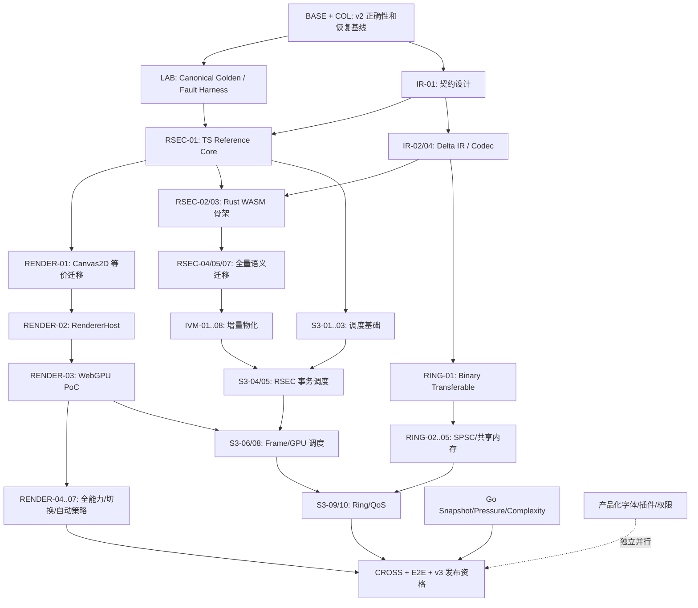

# Aevia 项目现状审计与 v2 → v3 全量实施清单

> **文档类型**：Architecture Audit / Product & Engineering Backlog / Migration Plan  
> **版本**：Draft 1.0 · 2026-11-12  
> **源码依据**：[`aquaori/aevia`](https://github.com/aquaori/aevia) `main` @ [`3fe17c016b6b76e121c896bddb5f917b6fbba89a`](https://github.com/aquaori/aevia/commit/3fe17c016b6b76e121c896bddb5f917b6fbba89a)（2026-11-09 最新提交）  
> **规划依据**：`aevia-v2.md`、`scene-engine-plan.md`、`scene-engine-plan2.md`、`lab-runner.md`、`backend-v2-refract.md`、前一版 `Aevia_v3_RSEC_heterogeneous_rendering_architecture_RFC_v0.2.md`。  
> **用途**：当前完成度核查、剩余工作统一收口、GitHub Issue/Project 拆分、架构演进排序、PR 验收参考。  
> **清单规模**：100 个带稳定编号的主题任务、371 个细分可勾选步骤（含实验矩阵），覆盖 v2 遗留、v3 五大系统与横向发布治理。  
> **工作边界**：此文档是实施规划和代码审计，**未更改 GitHub 仓库、未创建 PR/Issue**。性能数值和运行态最终门禁以新一轮 Lab 报告为准。

## 目录

1. [阅读指南与状态口径](#1-阅读指南与状态口径)
2. [执行摘要：v2 到底做完了什么](#2-执行摘要v2-到底做完了什么)
3. [六份规划间的差异、变更与取舍](#3-六份规划间的差异变更与取舍)
4. [现状能力对照矩阵](#4-现状能力对照矩阵)
5. [P0：v3 开始前应关闭的正确性与可靠性风险](#5-p0v3-开始前应关闭的正确性与可靠性风险)
6. [P1：v2 产品能力未完成事项](#6-p1v2-产品能力未完成事项)
7. [P1：Go 后端、协议与部署技术债](#7-p1go-后端协议与部署技术债)
8. [P1：Lab Runner、测试覆盖与性能资格](#8-p1lab-runner测试覆盖与性能资格)
9. [v3-A：RSEC 纯场景核心与 Rust/WASM](#9-v3-arsec-纯场景核心与-rustwasm)
10. [v3-B：Render IR 与增量物化视图](#10-v3-brender-ir-与增量物化视图)
11. [v3-C：Canvas2D/WebGPU 动态异构渲染](#11-v3-ccanvas2dwebgpu-动态异构渲染)
12. [v3-D：共享 Ring、内存模型与传输](#12-v3-d共享-ring内存模型与传输)
13. [v3-E：S3 分层调度器与 QoS](#13-v3-es3-分层调度器与-qos)
14. [横向契约：生命周期、版本与跨端一致性](#14-横向契约生命周期版本与跨端一致性)
15. [实施依赖 DAG 与分期 PR 清单](#15-实施依赖-dag-与分期-pr-清单)
16. [专项测试矩阵与发布门禁](#16-专项测试矩阵与发布门禁)
17. [可直接迁移到 GitHub Project 的总索引](#17-可直接迁移到-github-project-的总索引)
18. [本轮明确不纳入的需求](#18-本轮明确不纳入的需求)
19. [来源与源码导航](#19-来源与源码导航)

---

# 1. 阅读指南与状态口径

## 1.1 这不是一个“从零开发 v3”的清单

Aevia 的 v2 已经有严肃的协同操作模型、真实可用的图元渲染引擎、Go Room Actor、SQLite 写协调器、分块初始化、重连恢复和 Lab Runner。将这些现成能力重新列成未实现，会让计划失真，也会制造没有价值的重复工作。

本文将每个需求归入以下五种状态：

| 标记 | 解释 | 处理原则 |
|---|---|---|
| **✅ 已实现** | 当前源码存在相应功能和明确的执行路径；不等于所有异常场景均已验证 | 留在回归清单，不重复开发 |
| **🟡 部分完成** | 基本能力存在，但距离旧规划的验收契约有实质缺口 | 拆成可独立关闭的任务 |
| **⬜ 未实现** | 当前代码未包含所需系统/入口/协议，或明确返回 `501` | 列为实施任务 |
| **🧪 待验证** | 代码路径已经存在或已修复，但还缺少对应规模、故障注入或跨端验收 | 优先补 oracle/基准，不直接重写 |
| **↪ 已调整/延期** | 后来的文档修改了要求，或者原本明确不属于当期目标 | 不作为“漏做”追责，只放长期候选库 |

**优先级**：`P0` 阻断性正确性/可靠性、`P1` v3 重要前置或既定 v2 遗留、`P2` v3 主体架构和性能能力、`P3` 优化性/可选实验。这里的 `P2` 不表示技术价值低，只表示必须按前置依赖施工。

**任务格式**：每项以稳定编号（`BASE-`、`COL-`、`PROD-`、`BACK-`、`LAB-`、`RSEC-`、`IR-`、`IVM-`、`RENDER-`、`RING-`、`S3-`、`CROSS-`）标识，附依赖、涉及文件、完成定义（DoD）。编号为未来 Issue 标题前缀，**不是已经存在的 GitHub Issue ID**。

## 1.2 事实来源的先后顺序

相同问题出现冲突时，按如下顺序认定：**当前 `main` 源码 → 当前测试与校验契约 → 近期 v2 全景知识库 → 较早的产品/后端/Lab 计划 → v3 RFC（目标设计）**。

特别是 `aevia-v2.md` 的基线 `5278a18`、最初 v3 RFC 的基线 `2dd3e87`，都早于本次实际查询到的 `3fe17c0`。中间已经有部分 bugfix。因此本文不会把旧报告中的历史问题无条件判定为今天尚存的缺陷。

## 1.3 验收证据应分级

* **源码静态证据**：链接到函数和类型，可以判定“有没有实现”。
* **单元/属性测试证据**：可以判定特定模型或输入下“输出是否正确”。
* **浏览器/跨客户端真实行为**：判定 Worker、绘制与实际产品是否联动。
* **测量证据**：采用同一 source SHA、浏览器和机器、独立数据库、环境指纹以及有效样本才形成性能结论。

本文不会把“规划目标写了 5000 连接、百万点、99% 覆盖”视作当前已达到的数字。

---

# 2. 执行摘要：v2 到底做完了什么

## 2.1 已建成的 v2 骨架

1. **不可变协同操作**：[`packages/shared/src/types/scene.ts`](https://github.com/aquaori/aevia/blob/3fe17c016b6b76e121c896bddb5f917b6fbba89a/packages/shared/src/types/scene.ts) 声明九种场景操作：`element.create / append / transform / style / erase / delete`、`text.patch`、`history.toggle`、`page.clear`；`schemaVersion = 2`。Go 网关验证对应类型和载荷，新写入不再依赖可变批量变换。
2. **SceneEngine 的确定性渲染原子**：[`sceneEngine.ts`](https://github.com/aquaori/aevia/blob/3fe17c016b6b76e121c896bddb5f917b6fbba89a/apps/frontend/src/scene/sceneEngine.ts) 已维护 `operations`、`elements`、`atoms`、操作索引、历史组、空间索引与脏区；[`strokeCompiler.ts`](https://github.com/aquaori/aevia/blob/3fe17c016b6b76e121c896bddb5f917b6fbba89a/apps/frontend/src/scene/strokeCompiler.ts) 已将采样编译为 `dot`、`quadratic`。全量与脏区路径使用统一 `drawPrimitive`。
3. **图元索引**：[`renderOrderIndex.ts`](https://github.com/aquaori/aevia/blob/3fe17c016b6b76e121c896bddb5f917b6fbba89a/apps/frontend/src/scene/renderOrderIndex.ts) 是分块有序索引；[`spatialGridIndex.ts`](https://github.com/aquaori/aevia/blob/3fe17c016b6b76e121c896bddb5f917b6fbba89a/apps/frontend/src/scene/spatialGridIndex.ts) 是 `32×32` 网格、最大 `64` 原子的 chunk；[`dirtyRegionSet.ts`](https://github.com/aquaori/aevia/blob/3fe17c016b6b76e121c896bddb5f917b6fbba89a/apps/frontend/src/scene/dirtyRegionSet.ts) 有多脏区、full fallback 和进入/退出迟滞。
4. **已接入产品工具**：[`toolRegistry.ts`](https://github.com/aquaori/aevia/blob/3fe17c016b6b76e121c896bddb5f917b6fbba89a/apps/frontend/src/scene/toolRegistry.ts) 有注册型内置工具，涵盖钢笔、铅笔、荧光笔、两种橡皮、五种基础形状、文字、便签、贴纸和选择。`RoomToolbar.vue`、`RoomTextEditor.vue`、`roomPointerController.ts` 存在对应产品交互。
5. **Go 服务端**：[`room/actor.go`](https://github.com/aquaori/aevia/blob/3fe17c016b6b76e121c896bddb5f917b6fbba89a/apps/backend/internal/room/actor.go) 按房间串行管理状态，区分可靠和实时队列；有 SQLite writer、roomSeq、DeltaBuffer、分页窗口、流式渲染 chunk。
6. **Worker 渲染**：[`renderWorkerBridge.ts`](https://github.com/aquaori/aevia/blob/3fe17c016b6b76e121c896bddb5f917b6fbba89a/apps/frontend/src/service/renderWorkerBridge.ts) 发送并批处理任务，[`canvasWorker.ts`](https://github.com/aquaori/aevia/blob/3fe17c016b6b76e121c896bddb5f917b6fbba89a/apps/frontend/src/workers/canvasWorker.ts) 管理 OffscreenCanvas 和 SceneEngine；主线程回退仍存在。
7. **Lab 系统**：`single/smoke/ci/nightly`、Lab 埋点、manifest、门禁、报告、外部 E2E、GitHub Actions Nightly 及模块/能力债务清单均已入仓。

这些是**不允许 v3 重造或丢失**的已完成资产。

## 2.2 当前最重要的结论

> **v2 的主要欠账不是“缺少基础白板功能”，而是“协同边界的完全性、产品化授权、故障下可靠交付、巨量场景的可验证能力，以及架构边界尚未解耦”。**
>
> **v3 的主要工程任务不是把所有 TypeScript 翻译成 Rust，而是按顺序建立纯 Scene Core、稳定 Render IR、IVM、RendererHost、RSEC、S3 和 Ring，使每一条迁移路径都有可测量的回退点。**

## 2.3 近期源码已修正、但旧资料仍可能标为问题的事项

| 事项 | 旧文档/旧讨论的判断 | 当前 `main` 事实 | 本次归类 |
|---|---|---|---|
| 初始化 chunk 队列满后仍发成功结束 | 历史 500k run 出现 meta/binary 缺块 | [`stream_send.go`](https://github.com/aquaori/aevia/blob/3fe17c016b6b76e121c896bddb5f917b6fbba89a/apps/backend/internal/room/stream_send.go) 新增 `streamSender.failed`、`abort`，并在不同阶段检查失败；WS writer 已在 Join 前启动 | **代码修复存在；大规模回归待验证** |
| 重连 `lastRoomSeq == head` 仍返回全量 | 旧 `len(deltas)==0` 逻辑存在 | [`actor.go`](https://github.com/aquaori/aevia/blob/3fe17c016b6b76e121c896bddb5f917b6fbba89a/apps/backend/internal/room/actor.go) `decideResume` 区分 `current/delta/snapshot`，[`stream_send_test.go`](https://github.com/aquaori/aevia/blob/3fe17c016b6b76e121c896bddb5f917b6fbba89a/apps/backend/internal/room/stream_send_test.go) 有测试 | **已修复主要路径** |
| `element.append` 在缺少前置点时盲目追加 | 旧版 `sourceStart > length` 未拦截 | [`sceneEngine.ts`](https://github.com/aquaori/aevia/blob/3fe17c016b6b76e121c896bddb5f917b6fbba89a/apps/frontend/src/scene/sceneEngine.ts) 已有 `pendingAppends`、重放和容量上限、`needsResync` | **已实现防护；依赖边界补测** |
| `text.patch` 迟到时丢失删除/插入 | 旧版缺少等待队列 | 当前有 `pendingTextOperations`、`pendingTextDeletes` 和缺父节点上限 | **部分修复；需要完整因果模型及反例测试** |
| 新 V2 笔迹更新仍纯 JSON | v2 知识库当时的判断 | 新增 [`protocol/scene_append.go`](https://github.com/aquaori/aevia/blob/3fe17c016b6b76e121c896bddb5f917b6fbba89a/apps/backend/internal/protocol/scene_append.go) 和前端 `encodeSceneAppendBinary()`，握手可协商能力 | **已实现 append 二进制快路径；通用语义 codec/量化仍未做** |
| 操作 ACK 丢失造成重复提交 | 旧文档要求幂等 | [`room/events.go`](https://github.com/aquaori/aevia/blob/3fe17c016b6b76e121c896bddb5f917b6fbba89a/apps/backend/internal/room/events.go) 对相同操作者、同 opId、相同载荷返回已有 `roomSeq` 的 `ack.accepted`；客户端有重试集 | **基础幂等已实现；未知状态恢复需要故障测试** |

## 2.4 全局任务分层

| 工作流 | 当前判断 | 核心剩余工作 | 是否 v3 上线阻断 |
|---|---|---|---|
| A. 协同语义与可靠性 | 已形成体系，仍有边界要验证 | 操作依赖、ACK 水位、流故障、500k/1M 复测 | **是，P0** |
| B. v2 产品完善 | 功能主体已实现 | 编辑器字体/贴纸资源、插件接入、授权能力、若干交互边界 | 按发布范围分级 |
| C. Go 后端 | 单节点成熟度较高 | 快照执行隔离、页级广播、冷启动/多实例策略、RBAC | 部分是 |
| D. Lab | 体系已建成，覆盖尚不足 | uncovered obligations、故障注入、跨端差分、可靠性资格 | **是，P0/P1** |
| E. RSEC | 未开始 | 纯 TS Core → Rust/WASM → 核心语义迁移 | **v3 核心** |
| F. Render IR / IVM | v2 有内部 Atom/局部重建，缺通用 IR 和增量事务 | Versioned IR、稳定句柄、依赖闭包、Delta、Checkpoint | **v3 核心** |
| G. 双 Renderer | 当前是 Canvas2D | Canvas adapter、WebGPU PoC、混合合成、热切换、Auto | **v3 核心** |
| H. Shared Ring | 当前以 `postMessage`/transferable 为主 | 二进制批、SPSC、保序、shared WASM 实验 | **v3 核心/实验** |
| I. S3 调度器 | 已有分散 RAF/背压 | 分层任务队列、Core 事务分片、帧预算、资源调度、QoS | **v3 核心** |

---

# 3. 六份规划间的差异、变更与取舍

这一章专门解决“旧文档最初写了，后来方案变了，究竟算不算没做”的问题。

| 原计划 | 后来变化/现有实现 | 本文决定 |
|---|---|---|
| `scene-engine-plan.md` 把任意图形/文字局部遮罩作为擦除的扩展方式 | `scene-engine-plan2.md` 明确第一版非路径元素采用**整元素擦除**，不引入任意布尔裁剪 | 不把任意形状像素级切割列为 v2 缺陷；放长期候选 |
| 旧后端 v2 方案拟一次性建设完整账号、成员 RBAC 与 WS ticket | 现有代码优先上线房间 session + Go Actor，`/v2` 角色接口返回 501 | **真实未完成产品需求**，可独立实施，不与 RSEC 强耦合 |
| 早期产品计划描绘了统一、可动态扩展 Tool Registry | `ToolRegistry.register/list` 存在，但 `RoomToolbar.vue` 仍有硬编码工具组，第三方 `EditorHost` 受控入口不完整 | **部分完成**，不是从零设计 registry |
| 高亮笔合成方式旧稿曾写 `source-over` | 当前 [`primitiveRenderer.ts`](https://github.com/aquaori/aevia/blob/3fe17c016b6b76e121c896bddb5f917b6fbba89a/apps/frontend/src/scene/primitiveRenderer.ts) 对 `highlighter` 实现 `multiply` | 视当前体验为 v2 已存在语义；先冻结 golden，再由产品评审决定变更，**不擅自判定 bug** |
| `BitmapAtom` 原计划以本地 SVG/位图资源键实现贴纸 | 当前 `sticker` 仍以 Emoji 字符串通过 Canvas `fillText` 绘制 | **功能已存在、资产一致性未完成** |
| 原后端草案提出 WS 子协议 `aevia.v2` + 单次 ticket | 当前使用 WebSocket Subprotocol 承载 session token | **后端授权方案未完成**；不是普通渲染 v3 的强制先决条件，但上线安全评审应明确 |
| v2 Lab 计划要求单点/冒烟/CI/Nightly 及 run 追溯 | 当前源码存在相应系统与流程 | **已经实现主体**，剩余主要是覆盖、可观测性和持续有效报告 |
| 旧知识库指出 500k 初始化漏块 | 当前已补流失败中止和 writer 启动次序 | 标为**修复后复测**，不重复开发“给每次发送加返回值” |
| `scene-engine-plan2.md` 首期固定 32×32 网格、最多 8 个 dirty rect | 当前已实现 | v3 可通过基准决定是否自适应空间结构，不默认将“没有四叉树”算债务 |
| v3 的 Rust/WASM / WebGPU / Ring / S3 | 当前树中不存在对应模块 | **真正的 v3 新增工程**，应逐步落地并以收益门禁决定是否默认启用 |

---

# 4. 现状能力对照矩阵

此矩阵是项目“到底还有什么没做”的总览，后续章节提供可操作的剩余清单。

| 领域/需求 | 状态 | 已完成的代码链路 | 尚未闭环的部分 | 后续任务 |
|---|---|---|---|---|
| 九类 V2 场景操作与写入校验 | ✅ | shared scene type、gateway validator、Actor | 补跨语言随机操作和恶意载荷回归 | `COL-01/03` |
| 确定性 RenderOrder 与图元交错 | ✅/🧪 | `sceneProtocol` + `RenderOrderIndex` | Go/TS/Rust 跨语言 Golden、全部允许 ID 约束 | `COL-04`, `RSEC-06` |
| 点流编译 Dot/Quadratic | ✅ | `strokeCompiler` | v3 内核移植与高负载差分 | `RSEC-07` |
| 空间网格/局部查询/脏区 | ✅ | `SpatialGridIndex`, `DirtyRegionSet` | 热点退化、跨后端 IR 对照 | `LAB-09`, `IVM-07` |
| 迟到 append 和文本先后依赖 | 🟡 | `pendingAppends`, `pendingTextDeletes` | 依赖闭包、稳定状态、上限/超时/拒绝行为 | `COL-02/03`, `IVM-05` |
| 变换/历史/清屏不可变操作 | ✅/🧪 | SceneEngine 重建/历史组 | 大历史下延迟、组合撤回以及权限边界 | `COL-05`, `IVM-06` |
| 路径擦除 + 对象擦除 | ✅/🧪 | `eraseGeometry`, `computeEraseTargets` | 恶意参数、几何边界和两端视觉差分 | `COL-06` |
| 内置笔/形状/文字/便签/贴纸 | ✅ | `toolRegistry`, Pointer/Text/Toolbar | 字体/贴纸一致性、部分精细交互、插件可扩展性 | `PROD-01`～`PROD-08` |
| 离线本地持久 WAL 编辑 | ⬜ | 当前具备重连重试集 | 页面关闭/设备离线时本地可恢复操作日志未建 | `BACK-13`（可选独立里程碑） |
| Go Room Actor + SQLite WAL | ✅ | Room Actor/Writer | 快照编码与发送仍进入 Actor 执行期；大房间抢占 | `BACK-01/02` |
| 快照 / 页面窗口 / Delta replay | ✅/🧪 | `snapshot_builder`, `stream_send`, `decideResume` | 500k、慢客户端、快照并发追平资格 | `BASE-01/02` |
| V2 append 二进制传输 | ✅/🟡 | scene-append codec、握手协商 | 其余操作 JSON，仍要测 codec 成本/误差 | `BACK-04`, `RING-01` |
| 服务端压力广播与前端降频 | ✅ | `room/pressure.go`, `collabPressurePolicy.ts` | 房间级与慢客户端局部压力区分、S3 QoS | `BACK-05`, `S3-10` |
| 房间账号、RBAC、踢人封禁 | ⬜ | DB 部分 schema、HTTP placeholder | 实现授权状态机、端点及 Actor 检查 | `PROD-09`～`PROD-12` |
| 单机服务、健康探针、优雅停机 | ✅/🧪 | gateway/Actor/storage | 多实例唯一房间 Owner 未实现、灾难恢复压测 | `BACK-07/08` |
| Lab `single/smoke/ci/nightly` | ✅ | `tests/run-system`, `tests/lab`, workflows | 欠覆盖专项与高规格可靠性实验 | `LAB-01`～`LAB-11` |
| 测试覆盖债务 | 🟡 | feature/module obligations | `feature` 未覆盖 34、partial 7；`module` 未覆盖 35（静态清单当前快照） | `LAB-01/02/03` |
| 100k/250k/500k/1M 性能证明 | 🧪 | Nightly 场景、边界 ladder | 新修复后的有效独立基准与一致性通过报告 | `BASE-03`, `LAB-07` |
| 纯场景核心与 Render IR | ⬜ | 现有内部 `RenderAtom` | 与 Canvas 解耦、Core Port、二进制 Delta IR | `RSEC-*`, `IR-*` |
| 增量物化视图与 checkpoint | 🟡→⬜ | 现有尾部增量与受影响元素重建 | 真正依赖闭包、事务 Delta、历史片段与 checkpoint | `IVM-*` |
| 可插拔 Canvas/WebGPU | ⬜ | `Canvas2D` 直接绘制 | RendererHost、WebGPU 路径、热切换和 Auto | `RENDER-*` |
| SPSC/shared WASM Ring | ⬜ | `postMessage`/transferable | SAB、内存布局、lane、序号、buffer ownership | `RING-*` |
| S3 任务调度与 QoS | 🟡→⬜ | RAF 合帧、pressure、dirty full fallback | 分层 admission、分片 Core、帧预算、公平性 | `S3-*` |

**如何理解“🟡→⬜”**：v2 有某些基础策略或增量算法，但 v3 要构建的是一个具有全新契约的完整子系统，不能把“已经会 merge dirty rect”当成“S3 已完成”，也不能把“仅在尾部插入增量”当成“增量物化视图已完成”。

---
# 5. P0：v3 开始前应关闭的正确性与可靠性风险

这部分的任务优先级高于“是否要换 Rust”或“WebGPU 帧率能否更高”。因为新核心和新 Renderer 会显著扩大可观察状态空间；如果 v2 基线没有明确正确性 oracle，后续无法判断差异来自新引擎还是原有缺陷。

## 5.1 流式初始化、重连与时间线

### BASE-01｜补完流失败终态与慢客户端回归（P0，🧪）

**现状**：[`stream_send.go`](https://github.com/aquaori/aevia/blob/3fe17c016b6b76e121c896bddb5f917b6fbba89a/apps/backend/internal/room/stream_send.go) 已实现 `streamSender`；失败后标记 `failed`、调用 `abort()` 并阻止后续 `init-complete`。[`ws_handler.go`](https://github.com/aquaori/aevia/blob/3fe17c016b6b76e121c896bddb5f917b6fbba89a/apps/backend/internal/gateway/ws_handler.go) 在 Join 前开启 writer；`stream_send_test.go` 已有极小发送队列测试。**旧版“漏块继续成功结束”的核心代码问题已处理**。

- [ ] **BASE-01a**：对 init render、init commands、page-change render、page-change commands、delta-replay 五类流分别注入队列满、writer 中断、连接关闭、二进制编码失败。每类都检查 `meta / binary / done` 完整配对。
- [ ] **BASE-01b**：建立 N 块正常、在第 `0/1/N-1` 块故障的参数化测试，断言 `init-complete` 不能出现在失败的流后。
- [ ] **BASE-01c**：测试慢客户端造成 stream abort 后，其他客户端能继续编辑；记录 `actorLoopBlockedMs`、连接数、`streamAbortReason`。
- [ ] **BASE-01d**：验证浏览器在没有收到流结束时最终走连接错误/重同步，而不是无限显示加载状态。

**DoD**：流不是完整有序结束，就是明确取消且可重连恢复；不得存在静默缺块并显示“加载完成”。**依赖**：无；**修改**：`room/stream_send_test.go`、`gateway/ws_handler_test.go`、外部 browser/E2E；**来源**：旧知识库 §35.1、后端 v2 §2，最新 stream 代码。

### BASE-02｜快照期间的实时操作追平与 epoch 完整性（P0，🧪）

- [ ] **BASE-02a**：在 `init-meta` 到 `init-complete` 期间，让其他用户持续 `create/append/transform/delete/text.patch/history.toggle`；验证快照 `snapshotVersion` 与其后 live 操作合并后的最终场景一致。
- [ ] **BASE-02b**：在 `page-change` 连续请求 A→B→A 中插入 live 操作，验证旧 `requestId` 不能覆盖新页面窗口，避免跨页闪回。
- [ ] **BASE-02c**：同一测试覆盖初始可见点流 + V2 command hydration，断言 `create` adoption 不产生重复 RenderAtom。
- [ ] **BASE-02d**：增加“断线恰好发生在最后一块 binary 到达后、done 到达前”的恢复测试。

**DoD**：通过多客户端最终状态、图元稳定 ID/顺序和像素 ROI 三类 oracle；**依赖**：`BASE-01`；**涉及**：`room/snapshot_builder.go`、`room/stream_send.go`、`collabCommandHandlers.ts`、`canvasWorker.ts`、`roomPageService.ts`。

### BASE-03｜历史 500k 失败的修复后回归与 1M 资格（P0，🧪）

`aevia-v2.md` §33.6 记录了一个 **2026-11-05 左右的历史失败样本**：500k 梯级中 render chunk meta 数量多于实际 binary frame，不能将其直接解读为 SceneEngine 上限。现在需要基于新 stream sender 重新测量。

- [ ] **BASE-03a**：对 100k / 250k / 500k / 1M 分级分别启动独立服务、独立 SQLite DB、独立浏览器进程，固定运行次数与 warmup；不能把所有梯级积累到同一个数据库中测。
- [ ] **BASE-03b**：每次记录服务端期望点数、stream chunk 数、实际 writer 发送数、浏览器接收数、Worker ingest 数、Core Atom 数、首次可见绘制及完成状态。
- [ ] **BASE-03c**：区分 **产品失败 / 测量无效 / 机器容量不足**，必要时输出 `inconclusive`，而不是用“延长超时或删除测试”获得绿色结果。
- [ ] **BASE-03d**：保存 per-run source SHA、OS/browser/CPU/GPU、DB seed、资源峰值及失败时 trace；更新基线须通过 Lab 的 clean-tree/validity 规则。

**DoD**：清楚回答最大通过的规模、吞吐和失败位置，至少关闭旧的 500k 缺块可复现性疑问；1M 是否能通过以实测为准。**依赖**：`BASE-01/02`；**涉及**：`.github/workflows/nightly.yml`、`tests/lab`、外部性能套件。

### BASE-04｜RoomSeq 的“已收到 / 已物化 / 已绘制”水位（P0，🟡）

[`roomCollabTransport.ts`](https://github.com/aquaori/aevia/blob/3fe17c016b6b76e121c896bddb5f917b6fbba89a/apps/frontend/src/service/roomCollabTransport.ts) 已有连续 `roomSeq` 收集、pending op 重试和快照完成回调；不过网络消息进入 Dispatcher、Worker Core 真正完成变更、画面显示完成是不同阶段。

- [ ] **BASE-04a**：明确三个独立水位：`receivedRoomSeq`、`appliedRoomSeq`、`presentedRevision`，区分“WebSocket 收到了”和“当前页面 Core 已接受并物化”。
- [ ] **BASE-04b**：确保重连 cursor 仅前进到**有确切接收/应用保证**的连续位置；为跨页面不订阅的事件确定“可跳过但已被权威覆盖”的语义。
- [ ] **BASE-04c**：在 Worker 卡住或抛错时阻止错误推进恢复水位；必要时触发 `resync.required`。
- [ ] **BASE-04d**：实现 32 位/64 位序号与 JS `Number.MAX_SAFE_INTEGER` 的边界契约；在二进制和 Rust ABI 上统一 `u64` 表达。

**DoD**：ACK/断线/Worker 故障后不会因为“先收到序号、后丢掉内容”而错过重放；**依赖**：`BASE-02`，和后续 `CROSS-02` 合并实施；**涉及**：`roomCollabTransport.ts`、`renderWorkerBridge.ts`、`room/sequencing.go`。

## 5.2 场景依赖和协同操作

### COL-01｜冻结九种 V2 操作的规范顺序与折叠契约（P0，🟡）

- [ ] 从 `SceneOperationEnvelopeV2` 列举九种操作的**合法依赖**、独立/共享对象、历史分组归属、可重复提交规则和缺失前驱时的行为。
- [ ] 对多目标 `transform/erase/delete` 指明影响范围和原子应用要求，区分全序 `RenderOrder` 与因果依赖。
- [ ] 规定相同 `opId` 不同载荷、同载荷重复、不同作者重复的错误响应；编入跨端 fixture。
- [ ] 定义逻辑收敛不变量：相同规范有效操作集合在任意允许到达顺序下具有相同规范场景，不能以单次 `sceneHash()` 的 32 位值代替全部证明。

**DoD**：形成可机器解析的 Operation Semantics Contract + Golden Vectors；**依赖**：无；**涉及**：`packages/shared/src/types/scene.ts`、`sceneProtocol.ts`、Go validator、`sceneEngine.spec.ts`；**来源**：两个 scene-engine 规划的并发规则。

### COL-02｜补足增量 append 的依赖队列和缺口恢复验收（P0，🧪）

**现状**：当前 [`sceneEngine.ts`](https://github.com/aquaori/aevia/blob/3fe17c016b6b76e121c896bddb5f917b6fbba89a/apps/frontend/src/scene/sceneEngine.ts) 的 `appendOperationPoints` 会在 `sourceStart > points.length` 时暂存操作并在后续追平；重复区间会比较点值，队列超过阈值可触发 `needsResync`。基础防护已完成。

- [ ] 针对“create 最后到达”“append 3→1→2”“部分重叠 range”“源点内容冲突”“缺口永不补齐”“超过暂存上限”等生成交叉测试。
- [ ] 检查 `isComplete` 先到达、`sourceStart` 乱序与 `finishElement` 的曲线尾部是否只能生成一次。
- [ ] 验证“被认为与已有点相同”的 Float32 hydrate 规则不掩盖真实几何分歧。
- [ ] 给暂存超时/上限触发 resync 定义用户可见、Worker 可恢复的终态。

**DoD**：同一合法点集合的操作排列得出相同点数组、Atom ID、尾部图元；冲突输入显式拒绝/恢复；**依赖**：`COL-01`；**涉及**：`sceneEngine.ts`、`canvasWorker.ts`、`sceneEngine.spec.ts`。

### COL-03｜文字字素与 RGA 因果队列的边界收口（P0/P1，🟡）

**现状**：已有 `charId + afterId`，按字素构造 glyph；当前代码增加迟到文本操作与 delete-before-insert tombstone 暂存，但还不是一份独立、形式化定义的 CRDT 规范。

- [ ] 覆盖 `insert(afterId=missing)` 后父字素到达、删除先于插入、重复插入 ID 冲突、连续删除、同父并发兄弟有序、多用户撤回与重做。
- [ ] 确定缺失父节点的表现：不在某端偷偷展示为新的 root；应进入待就绪状态或可由一致规则折叠，超限要求 resync。
- [ ] 做完整 Unicode GraphemeBreakTest 或选定统一版本的字素分割规范；现有 `graphemes.ts` 为自定义规则，不应直接宣称完全覆盖 UAX #29。
- [ ] 明确字素 segmentation 版本、布局版本、字体资源版本对 scene revision / snapshot 的影响。

**DoD**：乱序/重复/缺依赖输入有可自动复现的最小反例，跨 Chromium/Firefox/WebKit 逻辑文字序列一致；**依赖**：`COL-01`；**涉及**：`graphemes.ts`、`sceneEngine.ts`、`RoomTextEditor.vue`、后端 `text.patch` 校验。

### COL-04｜规范 ID、排序、浮点与量化规则跨语言一致（P0，🟡）

- [ ] 比较 JS `<`（UTF-16）与 Go 字节序在所有**协议允许的 ID** 上是否一致；目前 Go `validID` 对新操作 ID 限定 ASCII 字符集，`validReferenceID` 对某些被引用 ID 约束较宽，需验证整个比较域。
- [ ] 对 Lamport、`sourceIndex/subIndex`、`historyGroupId` 的非法值、极值、非有限数和排序唯一性定义 codec 规则。
- [ ] `Float64 → Float32` hydrate、曲线采样、擦除区间量化的精度与舍入按例固定。
- [ ] 维护共享 fixture 同时供 TS、Go 和未来 Rust 测试，不使用 locale-sensitive compare。

**DoD**：三个实现逐条比较结果与规范完全一致；**依赖**：`COL-01`；**涉及**：`shared/protocol`, `gateway/scene_validation.go`, Rust `codec/order`。

### COL-05｜历史撤回、清屏与大组操作重建（P0/P1，🧪）

- [ ] 扩充 `history.toggle` 迟到、最后一次 toggle 胜出、撤回 create 后重做、撤回多目标 transform、撤回 page.clear 及多次 clear 的测试。
- [ ] 加入长历史（例如若干万操作）下的 `clear undo/redo` 处理时间、Atom 压缩前后内存与 GC 耗时基准。
- [ ] 遵循“历史操作保留、变更有效性而不篡改原操作”，且多用户历史组的访问权限单列 `PROD-10`。

**DoD**：功能与性能指标均有 baseline，`page.clear/history.toggle` 不引起无界内存或错误的历史恢复；**依赖**：`COL-01`；**涉及**：`sceneEngine.ts`、`history` 控制器、Go state。

### COL-06｜擦除、变换与视觉层级的规范回归（P0/P1，🧪）

- [ ] 对局部曲线区间擦除后执行移动、旋转、非等比缩放，再 Undo/Redo 擦除。
- [ ] 对虚线空隙、双线、透明荧光笔、转角、闭合曲线、近零面积 shape 和被重复擦除的 Atom 做几何比较。
- [ ] 记录 Worker 与 fallback、full 与 dirty 的相同视口 ROI，禁止仅通过“画面非空”判定一致。
- [ ] 将擦除目标格式绑定到稳定 Atom ID，不允许未来 RSEC 的 compact 操作改变其语义目标。

**DoD**：同输入具备稳定擦除量化区间、逻辑结果和合理视觉差异阈值；**依赖**：`COL-01/04`；**涉及**：`eraseGeometry.ts`、`primitiveRenderer.ts`、`sceneEngine.spec.ts`、browser scene-dirty 测试。

---

# 6. P1：v2 产品能力未完成事项

## 6.1 现有工具的完整性（不重复造已存在的工具）

### PROD-01｜铅笔与荧光笔效果规格最终化（P1，🟡）

- [ ] **铅笔**：评估并实现原计划的**确定性纹理/轻微透明度变化**（若仍保留该产品要求），种子从 `elementId / sourceIndex` 派生，禁止每次重绘使用随机数；当前 `primitiveRenderer.ts` 主要体现线帽、透明度和线宽差异，尚不是完整纹理模型。
- [ ] **荧光笔**：冻结现有 `multiply` 合成视觉契约，确认是否要遵循旧方案的 `source-over`。若决定改，则作为显式产品语义变更，并同时更新 Canvas/WebGPU 的 golden。
- [ ] **线型**：补全面向不同路径长度、缩放、部分擦除的虚线相位和双线外观测试。

**DoD**：明确特效是否进入 v3；不同客户端回放不产生随机差异；**依赖**：`COL-06`；**来源**：`scene-engine-plan.md` §5.1、当前 `primitiveRenderer.ts`。

### PROD-02｜文本输入与编辑体验完善（P1，🟡）

- [ ] 覆盖首次创建、多行编辑、双击重编辑、IME 组合、连续 Backspace、撤回边界、远端同元素并发插入。
- [ ] 文字编辑事务按真实输入阶段分组；原草案提出约 `750ms` 同源文字输入窗口，需对照当前 `roomPointerController.ts`/`RoomTextEditor.vue` 判断是否确实遵守该用户可见行为。
- [ ] 把编辑框、显示端和选区几何的坐标转换列为统一契约；跨页面尺寸变化检查光标/文字边界。
- [ ] 打通对 `fontSize/fontWeight/textAlign/color` 的本地及远端样式更新与撤回回归。

**DoD**：复杂中文/Emoji/换行编辑、多端混写和历史撤回可在 Playwright 上稳定复现；**依赖**：`COL-03`。

### PROD-03｜固定字体资源与确定性排版（P1，⬜/🟡）

- [ ] 将文档规定的字体资源作为受版本控制的应用资源加载，建立 `fontResourceVersion`，不要只依赖字符串 CSS 回退链；当前 `primitiveRenderer.ts` 的 `fontFamily` 依赖浏览器字体环境。
- [ ] 核定字体授权及 CJK/Emoji 覆盖，防止只打包一个 Latin 字体却导致中文回落系统字体。
- [ ] 固定“字号、字素 advance、换行、行高、字形边界和 hit-test”的关系；在 RSEC 里只生成**确定性布局几何**，真正光栅字形由各 Renderer 实现。
- [ ] 建 Windows/Linux/macOS × Chromium/Firefox/WebKit × DPR 的文本布局及截图证据，并记录允许的像素差异。

**DoD**：相同文字输入的逻辑排版和选区跨端一致，实测字形差异有可解释界限；**依赖**：`COL-03`、后续 `IR-05`；**来源**：`scene-engine-plan.md` §5.2、知识库 §35.9。

### PROD-04｜贴纸资产从 Emoji 字符升级为资源键（P1，🟡）

当前 `BitmapAtom` 的 `value` 来自贴纸字符串，[`primitiveRenderer.ts`](https://github.com/aquaori/aevia/blob/3fe17c016b6b76e121c896bddb5f917b6fbba89a/apps/frontend/src/scene/primitiveRenderer.ts) 实际使用 `fillText` 绘制；不同 OS 下 Emoji 外观可以明显不同。

- [ ] 定义可版本化的 `StickerAssetKey`、受控 manifest 和内置清洗过的 SVG/PNG 资源。
- [ ] 让 `SceneOperation` 仅引用可复制/可回放的资源键；不存在资源时给出明确 placeholder/capability 反馈。
- [ ] 统一 Canvas2D 和未来 WebGPU 资源加载、尺寸、透明度、缓存失效规则。
- [ ] 旧 `sticker: "✨"` 等字符串保留兼容适配，不破坏旧房间加载。

**DoD**：跨系统视觉一致性明显改善且具备资源版本迁移测试；**依赖**：`PROD-03` 可并行、`IR-05`。

### PROD-05｜ToolRegistry 完成真正的产品驱动（P1，🟡）

[`toolRegistry.ts`](https://github.com/aquaori/aevia/blob/3fe17c016b6b76e121c896bddb5f917b6fbba89a/apps/frontend/src/scene/toolRegistry.ts) 已有 `register/get/list/descriptor`。但 `RoomToolbar.vue` 仍硬编码部分工具分组和图标，`roomPointerController.ts` 仍根据工具 ID 分叉处理。现状不是“没有注册表”，而是“注册表还不是完整单一事实源”。

- [ ] 将工具栏的工具列表、分类、图标、默认 style、输入模式和能力描述从组件配置迁至注册表。
- [ ] 让 `roomToolController`、Pointer Controller 通过 `ToolInputMode` 分发，而不是为每个工具复写分支。
- [ ] 内置工具也以相同 API 注册，保证添加一个基于已有 primitive 的工具不需要改多处渲染代码。
- [ ] 固定 Tool Registry 的序列化边界：Worker 只接收工具声明/recipe，不接收任意函数对象。

**DoD**：新增一个仅使用现有 recipe 的内置测试工具时，无需修改 `SceneEngine` 或 `Canvas2DRenderer`，并具有工具栏与鼠标输入端到端示例；**依赖**：`IR-01` 可先行，无强依赖；**来源**：产品计划 §6。

### PROD-06｜受控插件 Host 与工具 API（P1/P2，🟡/⬜）

- [ ] 在现有 `EditorPlugin` 事件钩子之上提供 `registerTool/listTools/activateTool/dispose` 和受控 `submitSceneOperation`。
- [ ] 插件只能够声明被当前 Core 和 Renderer 认可的 recipe；未知 recipe 必须显式拒绝。
- [ ] 插件不能直接拿到 Canvas、WS 或 `commandStore` 可变引用；引入权限与生命周期控制。
- [ ] 先用一个内置 demo 插件证明契约，不把执行第三方任意脚本纳入 v3 首发。

**DoD**：动态启用/注销 demo 工具无泄漏、无跨端语义差异；**依赖**：`PROD-05`、`IR-01`。

### PROD-07｜选择、变换和 Presence 预览一致性（P1，🧪）

- [ ] 做多选移动、缩放、旋转、Shift 比例约束、旋转吸附、零尺寸约束和多用户同时变换同元素的 E2E。
- [ ] 核查当前 overlay 预览与 canonical `element.transform` 提交之间的同步：在最终 ACK 延迟/拒绝/取消时不得出现双影或把预览当作业务状态。
- [ ] 明确是否保留原计划“远端 transform-preview gesture ID + timeout”。如果继续列为产品要求，须实现完整 presence 事件及过期清理；目前旧规划的这套远端预览协议尚无独立、明确的端到端完成证据。
- [ ] 对 Canvas DOM 热切换后的 Pointer 事件、选择框、Overlay 跨层坐标进行同一套测试。

**DoD**：交互预览不会修改历史原始点/破坏多端最终一致性；**依赖**：`COL-05`、未来 `RENDER-05`。

### PROD-08｜编辑器 UX/可访问性与扩展能力契约（P2，🟡）

- [ ] 补充可聚焦的工具按钮、键盘切换、撤销恢复、工具提示和无障碍名称回归。
- [ ] 对移动设备 PointerEvent、触控/手写笔、DPR/resize 做针对性覆盖。
- [ ] 处理离线/重连、数据加载、WebGPU 启用失败等状态提示；不把系统出错当成“性能不好”的 Toast。
- [ ] 让技术设置面板承载 v3 的 `auto / Canvas 2D / WebGPU`，显式用户优先权不得被自动策略覆盖。

**DoD**：用户可以理解所选后端和错误反馈，不会在性能 Toast 中陷入反复弹窗；**依赖**：`RENDER-07`。

## 6.2 账号、权限与协作产品化（原 Go v2 计划的最大明确遗漏）

这部分**当前确实没有完成**：[`gateway/v2_placeholders.go`](https://github.com/aquaori/aevia/blob/3fe17c016b6b76e121c896bddb5f917b6fbba89a/apps/backend/internal/gateway/v2_placeholders.go) 列出的注册、登录、room admission、单次 WS ticket、成员列表/角色修改、踢人、封禁及权限策略接口统一返回 `501 NOT_IMPLEMENTED`。数据库已有 `auth_sessions`、`room_members`、`room_role_capabilities` 等表，不能混为“API 已完成”。

### PROD-09｜账户系统与持久会话（P1，⬜）

- [ ] 实现 `register/login/refresh/logout` 的 HTTP 路由、密码校验、token/session 轮换、失效与封禁策略。
- [ ] 引入有界 CPU/内存成本的密码哈希池，制定攻击限流与凭据存储策略。
- [ ] 前端增加账户登录/退出状态与现有匿名/房间会话迁移路径。
- [ ] 对双设备登录、刷新 token 失效、账户停用、会话撤销和突发暴力尝试建立测试。

**DoD**：不依赖仅存在于 room session 的临时身份，也能管理用户会话；**来源**：`backend-v2-refract.md` §3。

### PROD-10｜房间准入、Role/Capability 与 Actor 权限检查（P1，⬜）

- [ ] 增加 `owner/admin/participant` 角色及能力矩阵，并设计 `board.view/edit/erase/clear/page.add/members.moderate` 等权限。
- [ ] 在网关准入和 Actor 每条持久操作执行时二次验证权限，**不能只在前端隐藏按钮**。
- [ ] `history.toggle` 必须校验历史分组所有者或具备特权的操作权限；涉及跨页、撤回 create、撤回 clear 的规则单测。
- [ ] 在正在绘制时权限被撤销、owner 修改角色、管理员踢人等场景定义确定性响应。

**DoD**：越权请求即使绕过 Vue UI 直接发 WS 也被拒绝；**依赖**：`PROD-09`。

### PROD-11｜成员管理、踢人/封禁和审计（P1，⬜）

- [ ] 实现 `members` 列表、角色修改、`kick/ban/unban`、角色策略路由；统一错误码与审计日志。
- [ ] 踢出/封禁时关闭对应 WS 并撤销访问 grant，相关设备不能靠旧 session 继续写入。
- [ ] 用户端展示只读、权限被撤销、房间被禁入等状态，适配房间成员 UI。

**DoD**：当前连接、下次重连、另一个终端和历史会话均遵守权限新版本；**依赖**：`PROD-10`。

### PROD-12｜短期房间 Grant / 一次性 WS Ticket（P1/P2，⬜）

- [ ] 实现 `/v2/rooms/{roomId}/admission` 和 `/ws-ticket`，避免长期 session token 作为 WS subprotocol 原文传递。
- [ ] Ticket 单次使用、短时有效、消费后不可重放，包含房间/账户/权限版本。
- [ ] 兼容迁移时定义旧匿名房间的处理方式，避免升级导致已有房间无法进入。

**DoD**：重复票据、到期、重连和被踢出均有可验证的授权结果；**依赖**：`PROD-09/10`。

---
# 7. P1：Go 后端、协议与部署技术债

本节遵循一个边界：**不为 v3 重新写一套 Go 房间服务**。Go Actor、RoomSeq、DeltaBuffer、SQLite Writer、网关验证都应继续作为权威服务端基础；需要优化的主要是大任务隔离、网络订阅、幂等恢复、容量和权限。

### BACK-01｜Room Actor 与快照编码/传输解耦（P1，🟡）

**现状**：[`room/actor.go`](https://github.com/aquaori/aevia/blob/3fe17c016b6b76e121c896bddb5f917b6fbba89a/apps/backend/internal/room/actor.go) 的 `handleJoin` 在 Actor 的 `handle()` 分支内调用 `SendLiveInitStream`；`snapshotRequest`/翻页任务也会进入该 Actor 的执行流程。即使写入队列的 writer 已开始消费和 stream 发送有失败中止机制，**大快照的收集/编码/分块提交仍可能占用 Actor 的执行时间**。

- [ ] 在 Actor 内只捕获版本固定的快照描述符：`snapshotSeq`、页窗口、只读操作块引用、旧版本保活句柄。
- [ ] 让独立有界 Snapshot Executor 在 Actor 之外做点/命令 chunk 的编码、网络队列调度及失效中止。
- [ ] 将 `snapshotSeq` 之后的 live event 进入会话 catch-up buffer，服务端发送完 snapshot 后按 RoomSeq 追平再进入 ACTIVE。
- [ ] 避免引用会被 Actor 原位修改的 `map`/切片；引入只读版本快照或引用计数，不因为“加 goroutine”而制造数据竞态。
- [ ] 对同房间多个用户同时加入时，限制并行快照任务的内存和 CPU 占用；大客户端异常不能阻塞正在绘制的用户。

**DoD**：流式初始化期间 Actor 的可靠事件处理延迟有界；慢客户端不会阻塞其他客户端；**依赖**：`BASE-01/02`；**涉及**：`room/actor.go`、`snapshot_builder.go`、`stream_send.go`、`index.go`、`types.go`；**来源**：`backend-v2-refract.md` §2 “快照编码池”，v3 RFC §11。

### BACK-02｜大历史冷启动、页面惰性加载及语义快照（P1，🟡）

- [ ] 记录 Actor 从 SQLite 冷启动到可接受编辑的耗时、完整 `commands` Map + `PagePointIndex` 内存峰值。
- [ ] 设计按页加载的操作分段索引与定期可验证 checkpoint，不能简单丢弃已被 `history.toggle` 引用的旧操作。
- [ ] 对冷页按需激活，释放无订阅页面的派生数据；保留需要跨页计算的页面清屏与历史元数据。
- [ ] 在 `snapshotVersion`、DB durable seq、Core materialized checkpoint 三者之间明确完整性和升级方案。

**DoD**：冷启动大场景可以重复测量，恢复后操作集合和历史语义与全量回放一致；**依赖**：`COL-05`、`BACK-01`；**涉及**：`room/state.go`、`index.go`、`storage/rooms.go`、`storage/migrations.go`。

### BACK-03｜按页订阅/选择性广播（P1/P2，🟡）

当前 `broadcastAll/broadcastExcept` 主要针对房间全部连接发送，虽然接收方最终可能只显示其中一页，但下行队列已承担传输成本。

- [ ] 统计多页同时在线的实际冗余发送字节和客户端 `send` 队列压力。
- [ ] 建立 `PageSubscriptionIndex`（可基于 `client.PageID`、loaded window 和显式订阅）；按页投递绘制操作，房间元数据、权限/成员和全局事件仍广播。
- [ ] 保留全房间 RoomSeq 语义，未订阅页的事件必须能在切页/重连时从快照完整恢复；不能拿“未收到某页事件”当作序号缺口导致无限重连。
- [ ] 验证同房间 1 页、10 页、100 页分散用户的 CPU/字节下降与队列成本。

**DoD**：页面隔离正确，平均每操作发送字节下降有实测，RoomSeq 没有虚假缺口；**依赖**：`BASE-04`、`BACK-01`；**涉及**：`room/actor.go`、`window.go`、`snapshot_builder.go`、前端 page service。

### BACK-04｜二进制 V2 操作协议的下一阶段（P1/P2，🟡）

**已完成**：`element.append` 的二进制路径存在：Go `scene_append.go` 解出 12 字节头 + JSON metadata + 每点四个 `Float64` 的 32 字节记录，再走正常校验；前端根据服务端 `scene-append-v2-binary` capability 决定使用。**这不是完全未实现的优化**。

- [ ] 针对 10k/100k/大笔迹分析 JSON、现有 32 字节点、可选 Float32/定点量化的字节数/序列化 CPU/端到端误差。
- [ ] 明确二进制层的 `magic/version/type/length/checksum/feature negotiation`；必须保留 Gateway 与 JSON 等价校验。
- [ ] 为其他高频可编码操作提供独立 opcode/字典和 batch，先使用性能证据选择，不强行把所有低频操作转二进制。
- [ ] 在旧客户端、客户端比服务端新、字典失效及传输半截帧时提供明确 fallback/拒绝。

**DoD**：编码收益和坐标误差均可复现，协议 fuzz、长度溢出和重复序号测试通过；**依赖**：`COL-04`、`RING-01` 可共用 Codec；**涉及**：`protocol/scene_append.go`、`service/realtimeBinary.ts`、`gateway/ws_messages.go`。

### BACK-05｜房间背压与慢客户端公平性（P1，🟡）

[`room/pressure.go`](https://github.com/aquaori/aevia/blob/3fe17c016b6b76e121c896bddb5f917b6fbba89a/apps/backend/internal/room/pressure.go) 已经按 100ms 取样、四档 `normal/elevated/high/critical` 广播 `server-pressure`；其 send queue ratio 使用所有客户端中的最大值，单个慢连接会放大房间全局压力信号。

- [ ] 区分 Room Actor 自身处理压力、数据库写压力、服务端快照执行器压力、单连接慢消费者压力。
- [ ] 由 `maxClientSendQueueRatio` 扩展为 `p50/p95/max + slowClientCount` 等指标，并制定局部降速/淘汰优先于全房间降级的规则。
- [ ] 对 reliable 与 droppable presence 单独设置 QoS；不能以降低采样为由放弃已生成的正式 SceneOperation。
- [ ] 用拥塞稳定性、误触发率、队列年龄与公平性测试验证策略；与客户端 `S3-10` 的 QoS 输入保持解耦。

**DoD**：一个 2G/慢网络客户端不能长期拖慢同房间其他用户，级别切换具备迟滞且可观测；**依赖**：`BASE-01`；**涉及**：`room/pressure.go`、`collabPressurePolicy.ts`、gateway metrics。

### BACK-06｜容量指标、可观测性与运维故障注入（P1，🟡）

- [ ] 补齐 `actorQueueWait`, `snapshotBuild/Send`, `streamAbort`, `deltaHitRate`, `writerBarrierMs`, `SQLiteWALBytes`, `coldStartMs`, `perClientQueueBytes`。
- [ ] 将安全日志与诊断日志分离，不在指标事件中泄漏 JWT、房间密码、完整操作内容。
- [ ] 对 DB busy/full、write failure、磁盘低空间、系统信号停机和网络抖动做稳定复现，确认只读降级行为。
- [ ] 建立默认阈值和压测资源条件，而非在没有资源指纹的机器上声称达到 5000 连接/1000 人/10000 EPS。

**DoD**：故障具有指标、原因码、恢复步骤及对应 run artifact；**依赖**：`LAB-06`。

### BACK-07｜多实例部署和房间唯一所有权（P1/P3，⬜）

- [ ] 在部署说明中明确当前架构为**单进程 Actor 所有权模型**。若部署平台存在多个 backend 副本，必须保证同一 room 固定落到同一 owner。
- [ ] 如确需扩容：设计 room sharding、租约/epoch fencing、统一事件流或可靠 pub/sub、共享 durable seq 与故障切主恢复。
- [ ] 测试同一 room 分布于两个节点时能否维持唯一顺序、广播完整性、幂等和无双写。

**DoD**：单节点场景有明确生产约束；多节点模式只有通过双节点故障/切主测试后才能在文档中声明支持；**依赖**：`BACK-02/03`，可延期到有真实规模需求。

### BACK-08｜SQLite 单写协调器的吞吐资格（P1/P2，🧪）

- [ ] 以 1/10/100 个活跃房间测写事务批次分布、barrier p95/p99、写队列长度和 WAL checkpoint 影响。
- [ ] 确认当前 `Barrier` 和非 Barrier 路径的 ACK 级别明确反映持久状态；针对 crash-after-commit-before-ack 进行幂等恢复。
- [ ] 测 DB 失效后房间进入 read-only、写恢复后的重同步及旧 write queue 清理。

**DoD**：不会对尚未持久成功的操作作出错误的 durable 承诺；**依赖**：`BASE-04`、`LAB-06`；**涉及**：`room/persistence.go`、`storage/writer.go`。

### BACK-09｜Connection Epoch 与旧连接迟到事件（P1，🟡/🧪）

`ClientInfo` 有 `Epoch` 字段，但 WS 建连生成 `ClientID`、Token claim 和 Actor client 管理，仍需用真实测试证明旧连接的迟到包不会覆盖新连接状态。

- [ ] 定义同用户多端和同设备重连的 epoch 作用域；不应把“同一账号多个合法设备”错误地视为旧连接。
- [ ] 测旧 socket 的迟到 `push-cmd`、游标、清理事件与重连 session 并发。
- [ ] 明确旧 epoch 对应的对象/预览归属、ack、最晚写入时间以及断线回收规则。

**DoD**：会话和业务操作幂等边界一致，旧连接迟到不会清掉新连接 Presence；**依赖**：`BASE-04`，与 `PROD-12` 共同完成。

### BACK-10｜协议能力协商与新旧客户端拒绝语义（P1，🟡）

- [ ] 把 `sceneSchemaVersion`, `renderIRVersion`, `codecVersion`, `capabilities` 分层，不将“支持某个 append codec”误当成“支持新 Render IR”。
- [ ] 对旧客户端 V1 写入继续返回 `UPGRADE_REQUIRED`，对未知 recipe 返回明确能力错误，不悄悄退化为错画。
- [ ] 为客户端选择 TS/WASM、Canvas/WebGPU 提供本地能力状态，不应让服务端替所有客户端选择 GPU 后端。

**DoD**：版本错配可见、不会错误接受半兼容操作；**依赖**：`COL-01`、`IR-01`。

### BACK-11｜RoomSeq ACK/客户端恢复语义与持久回执（P1，🟡）

- [ ] 固定回执中 `ack.accepted`、`ack.committed`、`op-rejected` 的每种语义和重复 op 返回规则。
- [ ] 确认相同 opId、同用户、同载荷的重复发送返回原始 roomSeq，不因数据库 schema 字段顺序或 JSON 序列化细节误判。
- [ ] 对“一次发送成功，服务器已入库但 ACK 丢失，客户端刷新页面并重连”构造完整恢复测试。
- [ ] 如需跨设备/重启后查询 op 状态，提供可持久的 receipt 索引或明确从 Command Store/RoomSeq 查询的流程。

**DoD**：任何持久操作拥有可追踪的唯一身份与最终确认状态；**依赖**：`BASE-04`；**涉及**：`room/events.go`、`room/sequencing.go`、`roomCollabTransport.ts`。

### BACK-12｜部署配置和 Cross-Origin Isolation 预案（P1/P2，⬜）

- [ ] 单独准备 `COOP/COEP` 部署模式，对跨源字体、图片、脚本、CDN 和 iframe 列出依赖检查。
- [ ] 提供两种生产配置：不隔离（transferable fallback）与隔离（SAB/共享 WASM Memory），并加 E2E 探测。
- [ ] 固定健康探针/ready、TLS/Origin allowlist、错误响应和 graceful drain 的发布门禁。

**DoD**：不开启隔离也不影响 Aevia 基本编辑；开启后所有合法静态资源仍可加载；**依赖**：`RING-04`。

### BACK-13｜本地离线操作 WAL（P3，↪ 可选延期）

这一项来自此前 Aevia 的离线编辑愿景，不是本次五份 v2 规划和 v3 RFC 的必交付项。若将“真正离线优先”定义为后续产品目标，另起独立 RFC：`OPFS/IndexedDB` 持久操作日志、可恢复 opId、幂等补交、重连合并和冲突提示。**不要把现有内存 `pendingSceneOperations` 误称为具备断电持久性的离线 WAL**。

---

# 8. P1：Lab Runner、测试覆盖与性能资格

## 8.1 已实现和未达标的边界

旧 `lab-runner.md` 的主体目标已经落入仓库：`test:single/smoke/ci/nightly`、Lab Marks/Plugin、case 有效性、manifest、HTML、Lab Serve、GitHub Actions Nightly、模块和能力 obligations。**不应把“重建整套 Lab”列为待办**。

根据当前源码静态 `tests/catalog/*-obligations.json`：

- `feature-obligations.json` **76 项**：`obligation_verified = 21`、`rejection_contract_verified = 14`、`partial = 7`、`uncovered = 34`。
- `module-obligations.json` **128 项**：`covered = 92`、`uncovered = 35`、`excluded = 1`。

这些是**目录状态**，不是本次运行生成的覆盖率百分比。当前 Nightly 同时包含 Windows self-hosted 性能 lane（按配置启用）、Linux hosted performance observation 与 Linux correctness/race。它已经不是“完全没有 nightly 性能工作流”的旧状态。

### LAB-01｜消化 34 个 uncovered 的功能义务（P1，🟡）

- [ ] 将 `feature-obligations.json` 的每个 `uncovered` 与明确的外部 oracle 绑定，按真实风险优先：scene append/transform/erase/delete、init/replay、页面隔离、WS 异常、账号 placeholder 负向契约。
- [ ] 区分“旧 V1 消息刻意被拒绝”和“当下应成功的功能没有用例”，拒绝路径要保留测试但不要误分类为功能缺失。
- [ ] 为 `partial` 项定义升级到 `obligation_verified` 的具体判定条件，拒绝通过增加无意义断言刷状态。

**DoD**：每项非排除义务有 owner、oracle 和 case ID；完成数量变化可由 catalog diff 解释；**依赖**：`COL-01`。

### LAB-02｜消化 35 个 uncovered 的模块义务（P1，🟡）

- [ ] 优先为 `RoomView.vue` 及 UI 子组件、Pointer/Room 控制器、`canvasRuntime`、网络桥接等关键模块补行为驱动测试。
- [ ] 新 Core/RSEC/Renderer/Scheduler/Ring 模块一入仓就必须登记 owner 和测试类型；不允许形成新的“没有任何测试归属”的模块。
- [ ] 纯代码单测覆盖可独立验证的算法，交互/渲染必须由 browser/E2E 验证，不拿 DOM mock 替代可见画面。

**DoD**：`module-obligations` 新增未覆盖项不得进入主线；历史 uncovered 清理有阶段性报告，所有关键信息路径都有 owner 测试；**依赖**：可并行。

### LAB-03｜采用真实覆盖率口径，而不是设置纸面 99%（P1，🟡）

- [ ] 在 CI 报告中按源文件明确显示 statement/branch/function/line 及 Go `-coverpkg=./...` 口径。
- [ ] 先为核心模块定风险级门槛：Scene Core、协议 codec、Ring 并发模型和 RBAC 校验要有强分支覆盖；纯 UI 以行为 oracle 为主。
- [ ] 历史文档中“99% per-module 目标”继续作为愿景，不在未达成时改写定义或删除模块分母。

**DoD**：源目录全量盘点与运行覆盖率一致，覆盖退化有明确理由和门禁；**依赖**：`LAB-02`。

### LAB-04｜建立 SceneEngine 参考语义测试集（P0/P1，🟡）

- [ ] 从现有 `sceneEngine.spec.ts` 提取九类操作的 canonical fixture，包括排序、迟到、重复、历史、文字、擦除、clear、大小/精度边界。
- [ ] 对每个 fixture 保存独立于具体语言实现的规范输出（元素状态、Atom Order、Geometry、Dirty 影响集合）。
- [ ] 增加批量乱序、丢包/重传、部分分块、随机并发历史的 Property-based Testing；失败样本自动 shrink。
- [ ] 将 TS Reference Core 作为 v3 Rust 差分 oracle，但在引入新语义时先经过共同语义评审，不把现有 TS 偶发 bug 冻结成永久规范。

**DoD**：未来每次 Rust/WASM 更改都能在不启动浏览器的情况下得到可解释的差分报告；**依赖**：`COL-01`。

### LAB-05｜Worker / Browser 双路径与渲染矩阵（P1，🟡）

- [ ] 针对 OffscreenCanvas Worker 路径与主线程 fallback 的同一操作日志，比较逻辑场景、Atom IDs、ROI 和整页截图。
- [ ] 固定工具 × 操作 × history × full/dirty × resize × DPR × browser 的代表性组合，重点覆盖 multiply、destination-out、glyph、sticky、rotation。
- [ ] 往后添加 Canvas2D/WebGPU 双后端与切换前后画面对照；不只测试 WebGPU 初始化成功。

**DoD**：渲染差异记录为像素阈值/区域，允许抗锯齿浮动，但不允许丢层、错擦、重影、缺字；**依赖**：`COL-06`，后续 `RENDER-05`。

### LAB-06｜可靠性故障注入体系（P0/P1，⬜/🟡）

- [ ] 网络：延迟/乱序/重复/掉线、截断 binary、慢写泵、连接半开、重连快于 snapshot。
- [ ] 数据库：WAL busy、写入失败、barrier 后 ACK 丢失、后台 checkpoint、DB 突然只读。
- [ ] 内核/Worker：长任务、异常退出、OOM/内存不足、WASM trap、Renderer Device Lost、Ring 容量满。
- [ ] 以 `FailureScenario` ID、预期终态和 run artifact 维护，测试可在 single 模式独立重跑。

**DoD**：错误不只是“没有崩溃”，而有明确 `recover/resync/fail-closed` 终态且可自动验证；**依赖**：`BASE-01/04`。

### LAB-07｜性能资格与运行环境校准（P0/P1，🧪）

- [ ] 固定 Web/Worker/GPU/DB 的实验环境记录：OS、CPU、GPU、刷新率、DPR、browser、机器负载、DB seed、source identity。
- [ ] 将 10k/50k/100k 微基准扩展到 250k/500k/1M boundary（适合的专用 runner 上），分别测内核物化、渲染、网络、快照和 UI 延迟。
- [ ] 对 performance-external 的 invalid 样本按 Lab 规则保留证据、终止资格，不让无效采样进入可宣传 baseline。
- [ ] 对 Windows self-hosted 与 Linux hosted 结果分别记录，不跨硬件直接比较绝对耗时。

**DoD**：真实观察到的收益/退化能够归因于具体子系统；**依赖**：`BASE-03`。

### LAB-08｜调度和背压专项测试（P1/P2，⬜）

- [ ] 给每条任务 Lane 记录 Queue Age p95/p99、Backlog、最长不可中断计算段、Dropped/Coalesced/Rejected 分类。
- [ ] 注入持续输入 + 50k 历史回放 + 远端更新 + Canvas Resize + 夜间快照；量化 input-to-visible 与 materialized-to-presented 延迟。
- [ ] 调度策略变更以相同 trace 回放比较；防止“平均 FPS 提升、极端情况下可靠操作饥饿”。

**DoD**：S3 策略可用统计和故障 oracle 验收，而非凭主观“感觉更顺滑”；**依赖**：`S3-01`。

### LAB-09｜热点、空间索引与长笔迹压力矩阵（P1，🧪）

- [ ] 复用 `dirty-replay.bench.ts` 的 sparse 10k/100k、full-page long stroke、dense hotspot 数据，扩展多变换、大量 glyph、擦除和几何碎片。
- [ ] 明确 `K≈N` 退化应触发全量回退，不能承诺任何场景都是 `O(1)`；监控索引引用数和失效 Atom 比例。
- [ ] 基准比较“当前固定网格”和未来可选 BVH/自适应网格，在无改善时不额外引入复杂索引。

**DoD**：固定小 ROI 下候选规模和实际绘制数可解释，退化场景有可观察的 full fallback；**依赖**：`LAB-07`。

### LAB-10｜跨平台文本/协议兼容矩阵（P1，⬜/🟡）

- [ ] TS↔Go↔Rust Golden Vectors：Lamport、ID、scene operation、append 二进制、quantized interval。
- [ ] 字素分割/布局对 CJK、ZWJ Emoji、combining、Regional Indicator、variation selector 建立跨端输入集。
- [ ] Browser matrix 同时固定静态字体资源加载状态，区分“排版不同”和“抗锯齿颜色略有差异”。

**DoD**：协议语义差异一律是失败，允许的视觉差异单独配置阈值；**依赖**：`COL-03/04`。

### LAB-11｜测试报告与手册自动更新（P2，🟡）

- [ ] 每个 v3 PR 附 `runId / SHA / changed modules / regression owners / performance comparison`。
- [ ] `lab-runner.md` 的旧“实施计划”改为维护手册，状态与真实仓库同步；知识库更新 `v3` 架构和新协议的文件映射。
- [ ] 仅 clean-tree + valid 运行允许发布新的性能基线或对外性能宣传，避免将仪器降级的结果当成真实胜利。

**DoD**：开发者不用反复猜哪份文档是真实现状；**依赖**：各里程碑完成时同步。

---
# 9. v3-A：RSEC 纯场景核心与 Rust/WASM

> 对应 v3 RFC 第 3、6、12、14 章。**RSEC 是稳定的场景计算内核，不持有 CanvasRenderingContext、GPUDevice、Worker MessageEvent 或 WebSocket。**

## 9.1 第一原则：先抽离，再换语言

`sceneEngine.ts` 当前承担操作折叠/状态/命中/索引/脏区，也直接实现 `renderFull()`、`renderDirtyRegions()` 和 `drawPrimitive()` 调用。真正要迁移的是**数据域和算法域**，不是将整个类按行机械翻译成 Rust。

最终设计：

```text
Main: RoomView / Pointer / RoomTransport
  └─ SceneHost + S3 / WorkerTransport
        ├─ CorePort (TS Reference / Rust WASM)
        │    ├─ OperationStore / DependencyStore
        │    ├─ ElementStore / HistoryIndex
        │    ├─ MaterializedView / AtomStore / SpatialIndex
        │    └─ HitTest / Erase / Render IR Export
        └─ RendererHost
             ├─ Canvas2DRenderer
             └─ WebGPURenderer
```

### RSEC-01｜从 `sceneEngine.ts` 拆出纯 TS Reference Core（P1，⬜）

- [ ] 抽离 Operation Store、Element State、History Map、编译器、索引、命中/框选/擦除计算和逻辑 dirty region；保持原代码算法及行为。
- [ ] 抽走所有 `ctx` 形参和 `CanvasRenderingContext2D` 类型依赖，`drawPrimitive` 等调用移入 Renderer Adapter。
- [ ] 新建 `SceneCorePort`，提供 `applyBatch`、`finishStroke`、`query`、`hitTest`、`computeEraseTargets`、`exportFullIR`、`drainIRDelta`、`reset/loadSnapshot`、`getStats`。
- [ ] 主线程 fallback 与 Worker 使用同一 Core 接口，避免“同一个操作在两个执行模式下产生不同 scene”。

**DoD**：Node/Vitest 无 DOM 环境下可以应用九种 V2 操作并得到相同 canonical atoms；旧 Canvas 路径不变。**依赖**：`LAB-04`；**文件**：`sceneEngine.ts`、`sceneTypes.ts`、`strokeCompiler.ts`，新增 `engine/sceneCorePort.ts`, `engine/tsReferenceCore.ts`。

### RSEC-02｜Rust Workspace、Crate 边界与 CI（P2，⬜）

- [ ] 新增 `crates/rsec` Rust crate；按 `domain/operation`, `domain/element`, `order`, `geometry`, `compiler`, `history`, `materialize`, `query`, `ir`, `ffi` 划分模块。
- [ ] 通过 `wasm32-unknown-unknown` 生成单线程 WASM，保持对应 Native 编译/单元测试能力。
- [ ] 在 Vite 中接入可重复构建及 WASM artifact hash；CI 验证 `cargo fmt/clippy/test` 和 wasm build。
- [ ] 保持 Go backend 代码与 Rust Core 的边界：Go 继续负责权威 Room Actor/认证/持久化，Rust 可提供独立场景计算而不是取代 Go 服务。

**DoD**：空场景 RSEC WASM 正常加载，Native 与浏览器运行相同版本；**依赖**：`RSEC-01`, `IR-01`。

### RSEC-03｜稳定的 WASM ABI 与生命周期（P2，⬜）

- [ ] 实现 `create/destroy/reset/alloc/free/abi_version/apply_batch/get_changes/query` 等明确拥有权的接口；采用显式 handle，不在 JS 中持有 Rust 指针的永久引用。
- [ ] 规定输入/输出 Buffer 的租约和失效条件，内存增长后必须重新获取 TypedArray 视图。
- [ ] 将 `Result` 错误映射为可诊断的 `InvalidOperation / UnsupportedVersion / NeedsResync / ResourceExhausted / Internal`，不把 panic/trap 当普通恢复机制。
- [ ] 加入反复创建/销毁、大量申请/释放、Worker 异常重建的内存泄漏与 stale handle 测试。

**DoD**：ABI 无未定义对象所有权；同一 WebAssembly.Memory 不会因为并发 JS 写入而损坏 Rust allocator；**依赖**：`RSEC-02`。

### RSEC-04｜OperationStore / ElementStore / HistoryIndex 迁移（P2，⬜）

- [ ] 等价移植九类操作、按 `(lamport, opId, sourceIndex, subIndex)` 排序、历史有效性、page clear、文本和擦除语义。
- [ ] 对每种操作先通过静态 Golden，再做随机乱序/重复/重放差分。
- [ ] 将当前按 `operationsByElement` 和 `operationsByHistoryGroup` 的索引行为映射到 Rust 结构，允许内部数据结构不同，但结果必须等价。
- [ ] 严格区分“操作接收成功”和“物化成功”，支持 `needsResync` 和可观测的待依赖队列。

**DoD**：所有合法操作集合在 TS/Rust 中生成相同逻辑元素、样式、矩阵和历史状态；**依赖**：`COL-01/02/03/04`、`RSEC-03`。

### RSEC-05｜笔迹与计算几何模块（P2，⬜）

- [ ] 移植当前 `getInitialStrokeWidth/getNextStrokeWidth`、`compileStrokeSample/finishCompiledStroke`，保持 `dot/quadratic` 及双线/虚线所需的相位元数据。
- [ ] 迁入 `matrix`, `bounds`, `hitAtom`, `eraserTouchesAtom`, `cutIntervalsForStrokeAtom`，注意浮点误差对擦除区间的影响。
- [ ] 数值密集段采用紧凑 `Vec/SoA`，基准对比 JS AoS、TypedArray、Rust native、Rust/WASM。
- [ ] 保证坐标归一化、像素 tolerance 计算与 viewport/DPR 关系完全定义。

**DoD**：对 0/1/N 点、极小/极大 pressure、变换和擦除输出通过对照基准；**依赖**：`RSEC-04`。

### RSEC-06｜跨 TS/Go/Rust 排序与编码规范（P2，⬜）

- [ ] 实现 Rust 字节/ASCII ID Comparator 和 Lamport 排序；共享 fixture 直接源自 `packages/shared` 和 Go 测试向量。
- [ ] 处理操作 ID Interner 的生命周期，防止复用 handle 导致老操作引用到新对象。
- [ ] 为 `Float32`、`Float64`、整数定点、版本化字素分割编排跨语言 Golden。

**DoD**：三端排序/codec 对每个合同输入一致；**依赖**：`COL-04`, `RSEC-02`。

### RSEC-07｜Legacy FlatPoint / V2 create adoption（P2，⬜）

- [ ] 将旧快照 FlatPoint 流通过兼容适配接入 Rust Core；保留按源索引 hydrate、操作补齐不重复 Atom 的机制。
- [ ] 新旧渲染点流可能重叠时验证 ID、位置和 `Float32` 精度的 reconcile 规则。
- [ ] 保留 `pageId`、loaded window、跨页查询的逻辑状态边界。

**DoD**：老房间和当前 V2 新房间无需转换数据库格式即可进入 RSEC；**依赖**：`RSEC-04/05`、`BASE-02`。

### RSEC-08｜Runtime Core 切换/回退和版本路由（P2，⬜）

- [ ] `CoreHost` 以 `ts-reference / rust-wasm` 作为运行时实现选项，出现 WASM 加载失败时保留 TS Core。
- [ ] Core 实现切换时通过 Canonical Operation Log 或 Versioned Checkpoint 重建，不直接复制私有 Map/Vec。
- [ ] 每次 Core 初始化或重建携带 `sessionEpoch`、`snapshotEpoch`、`sceneRevision`，旧 Worker 回包不会污染新内核。
- [ ] 为实验灰度记录当前 Core 版本、ABI、WASM 文件 hash 和引擎切换原因。

**DoD**：切到 TS fallback 后画面和协同操作没有缺失或重复；**依赖**：`RSEC-03/07`、`CROSS-01/02`。

### RSEC-09｜WASM 实测收益门禁（P2，🧪）

- [ ] 每项基准同时计算 `encode + copy + wasm apply + decode + IR export`，不只测 Rust 函数体内耗时。
- [ ] 对 append、乱序 insert、global clear/undo、text patch、hit-test、erase、空间热点分别测 p50/p95、峰值内存和 JS heap。
- [ ] 若 Rust/WASM 未明显优于 TS，保持统一 Core 接口与 IR，Rust 可以继续作为实验或跨端共享实现，不以“Rust 必须更快”为发布条件。

**DoD**：可量化收益、额外内存和调试复杂度均写入 benchmark ADR；**依赖**：`RSEC-08`、`LAB-07`。

---

# 10. v3-B：Render IR 与增量物化视图

> 对应 v3 RFC 第 4、5、9、11 章。IR 是对外契约；IVM（Incremental View Maintenance）是 RSEC 内部维护 IR 的核心机制。

## 10.1 三层分离

1. **Canonical Log**：不可变 `SceneOperation`，是需要恢复/幂等/协同的事实。
2. **Materialized Scene**：`ElementStore`、有效历史、原子状态、空间和顺序索引，是由 Log 派生的可查询视图。
3. **Render IR**：对 Canvas2D/WebGPU 公开的稳定图元、排序、样式、dirty region 与 revision 更新集合；可被 Renderer 重建缓存，但不能反过来定义业务操作。

### IR-01｜冻结 Render IR v1 与 `SceneCorePort`（P1，⬜）

- [ ] 对应现有 `RenderAtom` 的五种基础 primitive 定义 `Dot/Quadratic/Shape/Glyph/Bitmap`，统一 `AtomKey`、`elementHandle`、`pageId`、`renderOrder`、style 和 transform。
- [ ] 明确坐标空间与单位：规范化 scene 坐标、viewport 逻辑像素、物理 DPR、Matrix 组合顺序。
- [ ] 将“擦除区间、composite mode、strokePattern、lineCap、字体、贴纸资源 key”纳入公共语义，而不是由不同 Renderer 自行猜测。
- [ ] 设计 `FullSnapshot` 与 `ChangeSet` 双输出、各自版本号和能力位。

**DoD**：`Canvas2DRenderer` 不需访问内部 `elements`, `operations`, `compilerStates` 便可完成旧版全部渲染；**依赖**：`LAB-04`；**涉及**：新增 `packages/rsec-contract/` 或 shared 下 v3 子协议。

### IR-02｜Scene Revision 与 Delta ChangeSet（P1/P2，⬜）

- [ ] 定义 `baseRevision/revision`, `epoch`, `full|delta`, `ADD/UPDATE/REMOVE/REORDER`, `dirtyRegionSet`。
- [ ] 规定 Delta 链必须连续；如果 Renderer 缺了一版，则请求完整 IR 而不是盲目套用下一版。
- [ ] 在操作事务提交时生成一个可发布的 ChangeSet，既包括旧空间索引影响也包括新图元影响。
- [ ] `presentedRevision` 与 `materializedRevision` 分离，为 S3 跳过中间视觉帧提供合法依据。

**DoD**：任意 `full@r` + 连续 delta `r+1…n` 得到与 `full@n` 等价的场景；**依赖**：`IR-01`, `CROSS-02`。

### IR-03｜稳定 AtomHandle / Generation 与压缩索引（P2，⬜）

**现状**：v2 使用数组下标 `atom.ref`；旧原子可通过 `elementRevision` 标记失效，并在碎片过多时 `compactIndexes()`。在 Renderer 缓存和 WebGPU buffer 存在后，裸数组下标跨 compaction 不再是安全的外部引用。

- [ ] 引入 `AtomHandle { index, generation }` 或稳定 logical ID → compact index 的重定位表。
- [ ] 让 `compactIndexes` 仅修改内部物理布局，外部 Cache/IR 持有的 handle 不能静默指向其他 Atom。
- [ ] 保留 `atomId` 语义身份供擦除和历史引用，和物理 AtomHandle 明确区分。
- [ ] 测旧 handle、重建、撤销/重做、文本重排和 WebGPU 缓存释放后的安全性。

**DoD**：旧句柄解析为已失效而非错误 Atom；**依赖**：`IR-01`。

### IR-04｜IR 二进制 Codec、Schema Migration 和校验（P2，⬜）

- [ ] 定义固定 Header/section table/length/version/endianness/alignment、可选 checksum，以及 `AtomMutation` payload。
- [ ] 保留仅用于调试的 JSON IR renderer，不让生产路径每帧 `JSON.stringify` 大量图元。
- [ ] Rust 输出可以被 JS TypedArray 消费，也可以被 WebGPU buffer staging 直接使用；避免每次导出整个 N 规模场景。
- [ ] Fuzz 处理未知 primitive、超长长度、越界 pointer、重复 mutation、版本错配和无效矩阵。

**DoD**：输入错误帧被显式拒绝且不损坏当前 Scene Revision；**依赖**：`IR-01/02`。

### IR-05｜Renderer Feature Matrix、资产引用与版式契约（P2，⬜）

- [ ] 给 IR 规定 `source-over/multiply/destination-out`、alpha premultiplication、色域、虚线、双线、shape、glyph、bitmap 和阴影的表达。
- [ ] 以统一 `AssetHandle` 表达字体、贴纸资源；定义资源未 ready 时的状态/placeholder，不允许 WebGPU 偷偷丢字。
- [ ] 选定当某 Renderer 不能支持特定 primitive 时的策略：初始化阻止选择、明确降级或者整画布回退；禁止悄悄异步切换造成层级错位。

**DoD**：Backend Capability 表可以精确描述已支持特征；**依赖**：`PROD-03/04`、`IR-01`。

## 10.2 RSEC 内部的增量物化视图

### IVM-01｜形式化依赖图与 Affected Set（P1/P2，⬜）

- [ ] 在 OperationStore 中维护 `opId → targets`、`elementId → ordered operations`、`historyGroupId → ops`、`pageId → clear/history` 和文本 `charId → children` 等索引。
- [ ] `element.append` 依赖合法 source range；`text.patch insert` 依赖 `afterId`；erase 依赖 stable atom identity；history toggle 影响整个目标组。
- [ ] 对每个输入操作计算受影响的 element/page/atom 集合，区分精确影响域与 page-wide barrier。
- [ ] 避免简单从单个 operation 的 `elementId` 推断全部影响：多目标 transform、erase、delete 和 clear 具有多对象范围。

**DoD**：每个 operation kind 都有正确的 Affected Set 单测，覆盖缺失依赖与跨对象引用；**依赖**：`COL-01`, `IR-01`。

### IVM-02｜尾插快路径与非尾部有序重放（P2，⬜）

- [ ] 保留 v2 在有序尾部追加时直接增量物化的优势，减少额外复制/排序。
- [ ] 对迟到操作用分块排序与对象局部重放，只恢复受影响 element 的必要操作后缀。
- [ ] 明确何时需要 page-wide rebuild（例如撤回 clear）与何时可以仅调整可见性索引。
- [ ] 单一操作不能同时发布“已变更元素”和“未更新的空间索引”供 Renderer/HitTest 消费。

**DoD**：同一操作集在不同顺序下的最终 Full IR 一致，局部重算量符合影响域；**依赖**：`IVM-01`。

### IVM-03｜旧/新几何脏区计算与 ChangeSet 生成（P2，⬜）

- [ ] 每个受影响元素记录变更前的可见 bounds 和变更后的 bounds（不只取新图元）。
- [ ] 输出 `ADD/UPDATE/REMOVE`，对删除、撤回、擦除和变换保证旧像素区域也会失效。
- [ ] 为移动预览保留 old/new 两个 dirty box，避免使用覆盖整个移动轨迹的巨大并集矩形。
- [ ] 大变更超过预算时允许产生 `fullInvalidation`，由 Frame Scheduler 决定全量画面重绘。

**DoD**：纯 dirty delta 渲染与同 revision 全量渲染的 ROI 结果在允许误差内一致；**依赖**：`IR-02`, `IVM-02`。

### IVM-04｜History Toggle、Page Clear 与可见性增量维护（P2，⬜）

- [ ] `history.toggle` 以目标组的最新有效 toggle 为准；改变组内操作有效性，但不改写原始历史。
- [ ] 重新计算对引用对象的依赖闭包；撤销 create 后隐藏，重做 create 后后继 transform/erase 重新生效。
- [ ] `page.clear` 的显隐范围与排序前沿符合 V2 语义，支持单页版本、历史撤销和恢复。
- [ ] 保证操作级全序的折叠与用户交互语义不同（例如矩阵变换不具有交换律），在测试用例中固定取舍。

**DoD**：多用户混合历史操作与 clear 的顺序回放没有逻辑差分；**依赖**：`COL-05`, `IVM-01/02`。

### IVM-05｜因果待就绪队列、冲突与强制 Resync（P2，⬜）

- [ ] 把 v2 `pendingAppends`、`pendingTextOperations`、`pendingTextDeletes` 合并为可观测的依赖等待模型 `pending/ready/conflict/needsResync`。
- [ ] 给等待队列设容量、timeout、operation bytes 和快照 epoch 界限；同一依赖完成后批量唤醒。
- [ ] `append` 重叠 range 若点值不一致，必须拒绝或强制重同步，不能让两个客户端独立选择“哪个覆盖哪个”。
- [ ] `text.patch` 缺父节点、删除先于插入、同 charId 冲突和反向依赖环要有确定处理。

**DoD**：缺口最终补齐可收敛；永远缺失/载荷冲突不会泄漏无界内存或错误发布 Revision；**依赖**：`COL-02/03`, `IVM-01`。

### IVM-06｜Checkpoint 和局部操作后缀重算（P2，⬜）

- [ ] 设计按 element/page 的 checkpoint：保存影响旧历史的必要 metadata、元素 state、已物化图元及最后已应用操作位置。
- [ ] 对 history undo/redo、late insert 使用最靠近的有效 checkpoint + 后缀 replay，不每次从 create 开始重算。
- [ ] 控制 checkpoint 创建、淘汰、恢复和版本/协议兼容，缓存被淘汰后能从 Canonical Log 恢复。
- [ ] 对热元素、长笔迹、大规模文字的 checkpoint 策略做命中率、内存/CPU trade-off 基准。

**DoD**：Checkpoint 命中与纯 full replay 的逻辑场景一致，且在大历史中有可重复的重算收益；**依赖**：`IVM-02/04`。

### IVM-07｜索引与存储的 Data-Oriented 优化（P2/P3，⬜）

- [ ] 将高频数值字段试验性迁为 SoA/TypedBuffer，保留 RenderOrderIndex 与 SpatialGridIndex 的语义和性能基线。
- [ ] 对 hotspot/full-page stroke 量化 chunk 数、查询候选、Cache locality、失效 Atom/碎片、compaction 成本。
- [ ] 用实际测量选择是否引入动态网格/BVH；**并非必须把固定网格替换掉**。

**DoD**：内存与 CPU 收益超过数据转换成本，能够独立在 Rust/WASM 和 Native 复现；**依赖**：`RSEC-05`, `LAB-09`。

### IVM-08｜事务安全点和 S3 协作（P2，⬜）

- [ ] 将大规模 `rebuildElements/page.clear/history.toggle` 表达为可分片 Work Unit，支持 `step(budget)`。
- [ ] 每次中断只能发生在可恢复安全点；阶段性状态放在 private staging view，外部仅能看到完整已提交 Revision。
- [ ] 保证一份 `ChangeSet` 的生成/提交不会被更高优先级输入打断到半成品；读请求总是读取一个完整 revision。

**DoD**：压力下可让出 Worker 执行时隙，但 Scene View、Hit Test 和 Render IR 不会读到不一致的半成品；**依赖**：`IVM-01/02/03`, `S3-04`。

---
# 11. v3-C：Canvas2D/WebGPU 动态异构渲染

> 对应 v3 RFC 第 7、8 章。Renderer 只消费 Render IR，**不得修改协同操作日志或内部 Scene Core 状态**。不同客户端可以对同一 Scene Revision 使用不同 Renderer。

## 11.1 Canvas2D 是 v3 的基准后端，而不是遗留包袱

当前 [`primitiveRenderer.ts`](https://github.com/aquaori/aevia/blob/3fe17c016b6b76e121c896bddb5f917b6fbba89a/apps/frontend/src/scene/primitiveRenderer.ts) 已具备 Dot/Quadratic、shape、glyph、bitmap、`destination-out`、`multiply`、虚线/双线、sticky 阴影等行为；[`RoomView.vue`](https://github.com/aquaori/aevia/blob/3fe17c016b6b76e121c896bddb5f917b6fbba89a/apps/frontend/src/views/RoomView.vue) 有**主画布 + UI Overlay 双 Canvas**；`PointerEvent` 绑定在主 Canvas，Worker 可接管主画布 OffscreenCanvas。因此迁移必须针对这些真实结构进行。

### RENDER-01｜Canvas2DRenderer Adapter 等价迁移（P1，⬜）

- [ ] 新建 `Canvas2DRenderer`，只接收 `RenderIR` 与 `FramePlan`，内部复用 `drawPrimitive` 的既有语义。
- [ ] 实现 `prepare/full/delta/resize/draw/dispose/capabilities`，从 SceneEngine 内移走 `ctx.save/clip/clearRect` 与绘制循环。
- [ ] 维护 full/dirty 和 fallback 两路径的绘制一致性，输入被 RSEC materialize 后不应再运行另一套 flatten 逻辑。
- [ ] 将 UI Overlay（预览、选择框、远端光标、变换提示）暂时保留独立 Canvas2D，不强迫 UI 一起 GPU 化。

**DoD**：仅 TS Reference Core + Canvas2DRenderer 即可恢复现有全部白板行为，图元/ROI golden 通过；**依赖**：`RSEC-01`, `IR-01/02`。

### RENDER-02｜RendererHost 与 Canvas 资源所有权（P2，⬜）

- [ ] 设计 `RendererHost`，管理主 Canvas slot、Overlay slot、DPR、viewport、Worker Offscreen transfer 和 renderer lifecycle。
- [ ] 取消通过同一个 HTMLCanvasElement 在 `2d/webgpu` Context 间直接切换的设想：Canvas 已传给 Offscreen 后，需要新元素、受控销毁/替换和事件重绑定。
- [ ] 将 `RoomView.vue` 中主 Canvas 的 Pointer 事件绑定移到稳定外部交互层或通过稳定的 host 在替换时绑定/解绑；不要让切换清空正在发生的手势状态。
- [ ] 在 `canvasRuntime.ts` 中统一 resize 和 DPR 更新顺序，避免触发无意义的两次全量重绘。

**DoD**：在不使用 WebGPU 的情况下，销毁并重建 Canvas 后端也能保持 SceneRevision 与交互状态；**依赖**：`RENDER-01`, `CROSS-01`。

### RENDER-03｜WebGPU 笔迹 PoC：Dot/Quadratic（P2，⬜）

- [ ] 基于 IR `Dot` 和 `Quadratic` 实现 GPU 可消费几何。先选可测量的 CPU triangulation + GPU draw，无需一开始就引入 Compute Shader。
- [ ] 为每个 Atom 的几何建立 GPU buffer cache/instance batch，维护全局点级绘制顺序与透明合成顺序，不得为了 batch 错误重排笔迹。
- [ ] 实现 viewport transform、DPR、scissor/dirty、fragment alpha 和抗锯齿策略。
- [ ] 与 Canvas2D 比较 1k/10k/100k 点静态绘制、长笔动态追加、ROI、显存、GPU submit CPU 时间、帧时间。

**DoD**：纯笔迹场景视觉通过，且可独立展示瓶颈/收益；若没有明显性能收益不默认启用；**依赖**：`RENDER-02`, `IR-05`, `LAB-07`。

### RENDER-04｜WebGPU 完整功能与混合合成契约（P2，⬜）

- [ ] 支持 `source-over`、`multiply`、`destination-out` 的当前视觉语义；必要时使用多 Pass/中间纹理，不能把全部模式当成一个 Blend State 轻率替换。
- [ ] 完成 dotted/dashed/dash-dot/double stroke、精确擦除区间、Shape、rounded rectangle、text/sticky glyph、bitmap/sticker。
- [ ] 字体使用统一排版 IR + glyph atlas 或可兼容的纹理通道；贴纸支持版本化纹理 atlas。
- [ ] 对暂不支持的 feature 有明确 `supports(featureSet)` 拒绝/整端回退，不允许“只在 WebGPU 模式下少画几种内容”。

**DoD**：声明为支持的 feature 必须经过 Canvas golden，跨端可接受视觉差异写入测试矩阵；**依赖**：`RENDER-03`, `PROD-03/04`。

### RENDER-05｜原子热切换：预热 / 追平 / 展示提交 / 回收（P2，⬜）

- [ ] 状态机 `IDLE → PREPARING → CATCHING_UP → READY → COMMITTING → ACTIVE`；失败转 `ROLLBACK`。
- [ ] 切换时旧 Renderer 持续显示；新 Renderer 在独立 Canvas slot 完整渲染当前 Scene Revision，等待追平实时操作。
- [ ] 仅在新后端的 `presentedRevision` 不落后于切换屏障后交换 DOM 可见层；旧后端延迟释放，避免黑屏和图元闪退。
- [ ] 切换跨越 Pointer down/up、Text Editor 正在编辑、resize、断线/重连时，保持手势和本地操作归属。
- [ ] WebGPU Device Lost、Worker terminate、WASM trap 均可触发回退，并记录明确故障码。

**DoD**：切换过程不丢操作、不复制笔迹、不丢 overlay、不中断协同；**依赖**：`RENDER-02/03`, `CROSS-01/02`。

### RENDER-06｜用户渲染设置与设备能力探测（P2，⬜）

- [ ] 增加 `auto / canvas2d / webgpu`，用户指定 Canvas2D 时禁止自动切换；指定 WebGPU 但不支持时回退且提示原因。
- [ ] 检测 `navigator.gpu`、adapter/device 可创建、所需 features/limits、Offscreen/Worker 条件、页面隔离及设备丢失。
- [ ] 运行时记录 backend、driver、featureSet、GPU reset 等匿名诊断信息；不得泄露不必要的可识别设备信息。

**DoD**：Chrome/Firefox/Safari 以及不支持 WebGPU 的浏览器都可使用现有 Canvas 模式；**依赖**：`RENDER-02/03`。

### RENDER-07｜自动 Renderer 决策与迟滞策略（P2，⬜）

- [ ] 不单用 FPS 判定：引入 `coreApplyMs / CanvasDrawCpuMs / GPUQueueMs / IRBytes / uploadBytes / pendingDirty / visibleAtoms` 的成本画像。
- [ ] 保留 `RendererStrategy` 的用户优先级、候选评估、最短观察窗口、cooldown、switch cost 和失败黑名单。
- [ ] 不在后台标签页或系统限帧场景依据 FPS 直接推荐；Toast 只建议尝试，不声称一定更快。
- [ ] 自动切换后再测收益，若显著退化则回退；防止反复在两个后端之间振荡。

**DoD**：决策 trace 可解释，每次切换都有原因和对照指标；**依赖**：`RENDER-05/06`, `S3-08`, `LAB-07`。

### RENDER-08｜服务端 Complexity Hint（P2，⬜）

- [ ] 在当前 `init-meta.chunkSummary` 的 `pointCount/commandCount` 基础上按需增加 `elementCount`, `estimatedGeometryWeight`, `pageVisibleComplexity`，避免重复冗长信息。
- [ ] `page-change-meta` 和 snapshot 流也可使用 hint，供 RendererHost 在首屏前预热所选后端。
- [ ] 服务端只描述场景复杂度，不直接要求某客户端使用 WebGPU；设备判断与用户偏好全部留在客户端。

**DoD**：同房间不同设备可根据相同 hint 选择不同 renderer，逻辑 scene 不变；**依赖**：`RENDER-07`, `BACK-10`。

### RENDER-09｜渲染性能优化是否继续下沉到 Compute Shader（P3，↪ 性能门禁）

- [ ] 只有测得曲线三角化/几何变换/实例生成的 CPU 计算构成显著瓶颈时，才比较 GPU Compute Shader 与 Rust SIMD/CPU 版本。
- [ ] 不以频繁 GPU→CPU readback 的方案作为生产必选路径；GPU 计算输出最好直接被 GPU draw 消费。
- [ ] 将性能收益与新增缓存同步、显存、Shader 调试成本一起记录到 ADR。

**DoD**：有独立正收益报告后才进入默认功能；**依赖**：`RENDER-03/04`。

---

# 12. v3-D：共享 Ring、内存模型与传输

> 对应 v3 RFC 第 10 章。需要区分 **Main↔Worker 线程消息通道** 和 **同一 Worker 中 JS↔Rust/WASM 的函数/线性内存边界**。不需要给两者各生硬堆一个 Ring。

## 12.1 已有可复用的 v2 机制

[`renderWorkerBridge.ts`](https://github.com/aquaori/aevia/blob/3fe17c016b6b76e121c896bddb5f917b6fbba89a/apps/frontend/src/service/renderWorkerBridge.ts) 已有 RAF 批量命令、`postMessage`、`ArrayBuffer transfer`、Worker 响应回调表。v3 应先测量“对象深拷贝与 `postMessage` 消息分配”占比，再决定共享数据面。

### RING-01｜先实现统一 Binary Batch + Transferable（P1/P2，⬜）

- [ ] 将 `cloneSceneOperation()` 的 `JSON.stringify/parse` 路径逐步替换为 `OperationBatchCodec`，保证 `opId/historyGroupId/sourceStart/point` 等字段不丢失。
- [ ] 以批次为单位发送可转移 `ArrayBuffer`，控制消息（init、resize、查询响应、故障）先保留对象消息。
- [ ] 对端到端吞吐、消息次数、主线程长任务、Worker GC、copy bytes 进行记录。
- [ ] 在高压下确保 `scene-op` 具有可靠队列语义；光标只保留最新值不影响正式绘图数据。

**DoD**：Transferable baseline 正确、可测、可回退；**依赖**：`IR-04`, `LAB-07`。

### RING-02｜SPSC Ring 控制头、消息头与原子协议（P2，⬜）

- [ ] 使用 Main→Worker **Single Producer Single Consumer**；单独定义 `control header`、读/写游标、epoch、容量、record header 和数据 payload。
- [ ] 推荐 RFC 提议的 64B 控制头、24B record header 作为 codec 起点，实际对齐和原子字段要经过规范审核。
- [ ] 用 `Atomics.load/store` 的 acquire/release 发布顺序保证消费者不会读到未写满消息；实现空、满、wrap、padding record。
- [ ] 保持 32 位原子字段和累加游标的溢出可控；不在普通主线程使用阻塞式 `Atomics.wait`。

**DoD**：随机 chunk 尺寸、生产/消费速率、头跨尾、总容量边界经过多线程 stress test；**依赖**：`RING-01`。

### RING-03｜可靠/可丢 Lane、Ring 满时回退与跨通道 FIFO（P2，⬜）

- [ ] 逻辑上区分 `reliable scene operations`、`replaceable presence` 和 `background bulk`；可以物理共用 Ring，也可以采用多个有界队列，但必须明确语义。
- [ ] **Ring 满时可靠操作不能直接 drop**：要么排队等待可发送额度，要么通过控制面/transferable fallback 转发。
- [ ] Mixed Ring + `postMessage` 提交时维护全局 `dispatchSeq` / barrier，防止后发送的 fallback 包在前面 Ring 数据之前被应用。
- [ ] 对 `Epoch` 更迭、Worker 重启、Ring 重置时序号清理定义协议；允许跳过旧的可丢光标，不允许跳过未应用的 scene-op。

**DoD**：可靠消息恰好处理一次或按 opId 幂等处理，乱序/重复/丢失均可检测；**依赖**：`RING-02`, `BASE-04`, `S3-03`。

### RING-04｜SharedArrayBuffer / crossOriginIsolated 与降级（P2，⬜）

- [ ] 在应用启动时检测 `crossOriginIsolated`、`SharedArrayBuffer`、Worker 与 Memory 支持；不支持时使用 Transferable。
- [ ] 配置 COOP/COEP 并核对字体、图片、第三方脚本响应头/CORS，避免打开隔离后破坏静态资源和分享页面。
- [ ] 在 Safari/Firefox/Chrome 不同条件下进行启用/禁用/浏览器回退测试；支持从共享路径切换到普通路径的语义恢复。

**DoD**：高能力模式可用，低能力环境没有白板功能退化；**依赖**：`RING-02`, `BACK-12`。

### RING-05｜JS↔Rust/WASM 直接线性内存桥接（P2，⬜）

- [ ] 单 Worker 内 JS 调用 RSEC 时，使用 `alloc/write/apply/read/release` 对接同一 WASM Memory；尽可能返回 TypedArray 视图而不是每个 Atom 重新构造 JS 对象。
- [ ] 固定 Buffer 生命周期：一批操作提交后，哪一方拥有输入 buffer，何时允许 Rust 复用/扩容，Renderer 何时完成读取。
- [ ] 使用 `IR-04` 的 compact codec，避免把“搬到 WASM”退化成每个点都调用一次跨语言 API。

**DoD**：批量 ABI 的平均复制次数和字节量可追踪，内存扩容/旧视图失效有测试；**依赖**：`RSEC-03`, `IR-04`。

### RING-06｜共享 WASM Memory Ring 高级实验（P3，⬜）

- [ ] 作为独立实验构建 WASM Threads/Shared Memory 目标，并用 `WebAssembly.Memory({shared:true, ...})` 及正确的原子语义连接 Main Writer 与 Worker Rust Consumer。
- [ ] Ring 区域必须由 Rust 内存布局/allocator 保留，JS 不得写入普通 Rust 堆的任意地址；定义 `memory epoch / ring offset`。
- [ ] 评估 Main 直接写 WASM Memory 与 SPSC SAB+copy、Transferable 三条通道的端到端收益及内存增长约束。
- [ ] 若共享 WASM 内存收益不显著或部署限制过大，可保持 `RING-05` 的单线程 WASM Memory 直读，项目 v3 仍可发布。

**DoD**：正确性与性能比 Transferable baseline 更好时才成为自动选择候选；**依赖**：`RING-03/04/05`。

### RING-07｜资源隔离和消息碎片控制（P2/P3，⬜）

- [ ] 根据场景复杂度/队列压力调整 batch，禁止单个巨型 Buffer 占用整个消息队列。
- [ ] 记录 `ringHighWatermark`, `fallbackCount`, `bytesCopied`, `dispatchGap`, `wakeups`, `staleEpochRejected`。
- [ ] 对连续运行数小时的内存、Ring wrap、Worker 重建和移动端后台恢复执行 soak tests。

**DoD**：所有队列有容量、观测和恢复行为；**依赖**：`RING-03`, `S3-09`。

---

# 13. v3-E：S3 分层调度器与 QoS

> 对应 v3 RFC 第 9 章。`S3` 不替代 Go Actor、JS Event Loop 或 GPU Queue；它负责把前端任务从“分散 RAF 与定时器”演进为**可解释、可测量、可满足延迟约束的分层协作式调度**。

## 13.1 应复用的 v2 调度资产

| v2 文件 | 已做的事 | v3 还需要的行为 |
|---|---|---|
| `roomPointerController.ts` | Pointer coalescing、RAF flush、动态采样/发送 | 输入任务的 deadline、可靠提交分离、预览延迟预算 |
| `dirtyRenderQueue.ts` | Dirty rect 合并、RAF 批次、数量阈值 | Revision 感知的 Frame Plan、成本估计、全局渲染预算 |
| `renderWorkerBridge.ts` | RAF 合并 Worker messages | Admission、优先级、epoch、可靠消息有序性 |
| `collabPressurePolicy.ts` | 服务端四档压力调整 | 区分本机 Core/GPU 压力与网络压力，不滥用采样降级 |
| `canvasWorker.ts` | 顺序执行 Worker 消息、维护 SceneEngine | RSEC 长任务切片、任务抢占安全点、查询优先 |
| `room/pressure.go` | 后端采样并广播 server-pressure | 与本地 QoS 独立反馈，不因为单个客户端过载全局误降频 |

### S3-01｜建立任务分类与传输语义（P1，⬜）

- [ ] 定义 `TaskClass`：`local-interaction`, `collab-apply`, `hit-test`, `render`, `init-stream`, `snapshot-replay`, `resource-upload`, `cache-maintenance`, `diagnostic`。
- [ ] 与 `Delivery` 分离：`reliable-ordered`（操作）、`latest-wins`（presence）、`replaceable`（中间帧）、`background`（缓存）。**优先级高低不等于消息可丢与否**。
- [ ] 任务契约包含 `taskId`, `epoch`, `sceneRevision`, `dispatchSeq`, `deadline`, `costEstimate`, `dependencies`, `cancelPolicy`。

**DoD**：任务类别可覆盖 v2 当前全部 Worker 消息和新 RSEC/Renderer 任务；**依赖**：`LAB-08` 可先并行；**新增**：`scheduler/taskTypes.ts`。

### S3-02｜统一性能画像与预算输入（P1，⬜）

- [ ] 将 `input-to-visible`, `queueAge`, `coreApply`, `coreRebuild`, `irEncode`, `canvasCpuDraw`, `gpuUpload`, `framePresent`, `wsBacklog` 纳入统一诊断。
- [ ] 将 60Hz、120Hz、后台状态、设备主线程抢占作为独立环境变量；不把固定 16ms 作为所有设备的真预算。
- [ ] 维护 EWMA/分位数趋势，允许按功耗模式、页面可见性、队列压力调整预算。

**DoD**：可以定位延迟主要来自输入/网络/Core/Renderer/GPU 哪一层；**依赖**：`LAB-08`；**新增**：`scheduler/performanceProfiler.ts`。

### S3-03｜主线程 Admission 与 Worker Transport 调度（P1/P2，⬜）

- [ ] 合并目前散落在 Pointer/DirtyQueue/Bridge 的任务提交入口，保留已有 RAF coalescing 行为作为初始策略。
- [ ] 对 reliable scene-op 保持依赖与全局提交序号，不能因前台忙而无限期困在 RAF 队列；可丢光标只保留最新。
- [ ] 当队列满时按照 `Delivery` 处理：可替换任务覆盖旧任务，可靠任务显式背压/排队/连接恢复。
- [ ] 加入 age-based fairness，低优先级初始化与资源维护不能永久饥饿。

**DoD**：可靠操作不因后台 rAF 暂停而停止推进；**依赖**：`S3-01`, `RING-01`。

### S3-04｜RSEC 的协作式 `step()`、预算与原子事务（P2，⬜）

- [ ] 将 `RebuildOperation`, `MaterializeElement`, `UpdateSpatialIndex`, `ReconcileHistory`, `GenerateIRDelta` 定义成可恢复 Work Unit。
- [ ] 在 `step(maxWorkUnits/budgetMs)` 中按预算执行，长任务在安全点让出 Worker 处理高优先级队列；避免在 Rust 内循环“看似带预算但 JS 无法调度”。
- [ ] staging scene 完整后一次发布 `Scene Revision`，不将部分元素、部分空间索引和未配对的 dirty region 暴露给读者。
- [ ] 对最高优先级输入的最坏服务时延设阈值，测 10k/100k 历史组重算期间连续笔绘响应。

**DoD**：长历史重算可 yield、恢复且不改变最终 canonical scene；**依赖**：`IVM-08`, `S3-01/02`。

### S3-05｜EDF + 配额公平 + 饥饿预防（P2，⬜）

- [ ] 在语义就绪的候选任务里按 deadline/成本预算排序；对不同 Lane 保留最低进度配额，而非只用一个高优先级堆无限抢占。
- [ ] 对等待时间过久的可靠操作及必要缓存维护做 aging，提高被服务概率。
- [ ] 每次可中断边界明确，跨一个不可分割 SceneOperation 时不得无代价抢占事务。
- [ ] 通过可重放 trace 验证优先级倒置、突发事件、长尾等待和公平性。

**DoD**：在持续交互负载下，可靠/初始化/维护均有可解释进度，最大不可中断段可测；**依赖**：`S3-04`。

### S3-06｜Frame Scheduler / FramePlan 与 Revision Gate（P2，⬜）

- [ ] FrameScheduler 输入 `full/delta IR`, `dirtyRegions`, `candidateAtoms`, `viewport`, `targetRevision`, `backend`；输出 `FramePlan`。
- [ ] 允许跳过中间呈现帧，例如只画 revision 15 而不逐帧显示 13/14，但必须先由 Core 完整应用所有实际操作。
- [ ] Canvas2D 依据成本模型选择 dirty/full；WebGPU 依据 buffer update、scissor、texture damage、GPU queue 决定路径。
- [ ] 帧显示成功后更新 `presentedRevision`，失败请求重绘或 fallback，不能谎称画面已经更新。

**DoD**：高频输入下不积压无意义旧视觉帧，场景最终一致；**依赖**：`IR-02`, `RENDER-01/03`, `S3-02`。

### S3-07｜初始化、页面切换、重连和后台任务调度（P2，⬜）

- [ ] 以“首屏可见”优先，将当前页首批可见图元先编译与绘制，再执行非关键预载/缓存优化；不改变真实操作顺序。
- [ ] 使后台快照导入、历史重算与正在书写的本地笔迹共存，控制每个任务片段持续时间。
- [ ] 页面切换时取消过期 `snapshotEpoch` 的可取消工作单元，原始可靠操作仍然保留或通过权威状态追平。
- [ ] 后台 Tab/低电量模式下缩减视觉更新，但不能放弃数据接收和可靠状态推进。

**DoD**：用户持续画画/翻页时不会因大快照完全冻结交互；**依赖**：`S3-04/06`, `BASE-02`。

### S3-08｜GPU 上传/预热与 Renderer 切换调度（P2，⬜）

- [ ] WebGPU Buffer/Texture 上传与 Pipeline 预热使用独立预算，不能挤占当前活跃 Renderer 的交互时隙。
- [ ] Renderer Switch 接入 S3：预热、追平 revision、显示切换作为依赖有序任务，故障则回滚。
- [ ] 自动模式的 Renderer 策略与 Frame Scheduler 分离：前者决定“用哪个”，后者决定“何时/画多少”。

**DoD**：新后端预热期间旧画布持续响应，切换不会制造明显输入延迟峰值；**依赖**：`RENDER-05/07`, `S3-06`。

### S3-09｜Ring 与跨队列背压的 S3 协调器（P2，⬜）

- [ ] 区分 Ring 填充度、Worker Core 背压、GPU 队列拥塞，不能把三者统称为“网络压力”。
- [ ] 为 Reliable、LatestWins、Background 三类数据设计各自的拒绝、合并与恢复策略。
- [ ] 联合 `dispatchSeq`, `Epoch` 与消息依赖，确保 Ring fallback 不改变协同操作顺序。

**DoD**：Ring 高压不会使可靠操作丢失或永久饥饿；**依赖**：`RING-03`, `S3-03/05`。

### S3-10｜闭环 QoS Controller 与迟滞（P2，⬜）

- [ ] 输入网络/服务端压力、本地 Core CPU、Canvas/GPU、队列年龄四组信号；分别配置拥塞阈值、滞后窗口和最低稳定时长。
- [ ] 使用 `interactive / balanced / catch-up` 等内部模式动态调整批量大小、缓存维护配额、帧率目标与预热强度。
- [ ] 服务端 `server-pressure` 只影响网络发送策略；本地 CPU 性能差不得错误反馈成全房间拥塞。
- [ ] 每次决策记录原始信号、旧/新策略、预期效果和实际效果，提供实验开关及一键回退。

**DoD**：QoS 在压力剧烈变化时不会振荡，交互/可靠数据各自满足 SLA；**依赖**：`S3-02/05/06/09`, `BACK-05`。

### S3-11｜调度模型的模拟与故障验证（P2，⬜）

- [ ] 编写纯函数 Scheduler Trace Simulator，生成高/低优先级、依赖关系、deadline miss、错误 Worker/Renderer 状态组合。
- [ ] 对 `no lost reliable ops`, `no partial Scene Revision`, `no stale epoch commit`, `bounded starvation` 做 property tests。
- [ ] 高阶可选 TLA+/PlusCal 模型检验：跨 Ring fallback、Core commit、ACK/Resume、水位顺序。

**DoD**：可自动重放违反不变量的最小事件 trace；**依赖**：`S3-01/04/09`。

---
# 14. 横向契约：生命周期、版本与跨端一致性

五个 v3 子系统能分别工作，不代表组合后正确。最常见的故障发生在多个层同时重建：快照重连、Worker 热重启、WASM trap、WebGPU Device Lost、页面切换。此处单列**横向工程契约**，避免遗失在某个模块里。

### CROSS-01｜统一 SceneHost / RendererHost / Worker 生命周期状态机（P1/P2，⬜）

- [ ] 固定 `CREATING → SYNCING → ACTIVE → SWITCHING → RECOVERING → DISPOSED` 主状态，定义每一步能接受哪些任务。
- [ ] 任何跨 epoch 的异步 response 必须被丢弃或重新定向，特别是 `scene-hit-result`, `erase-targets-result`, `init-render-points-decoded`, `scene-operation-rendered`。
- [ ] `dispose` 必须终止旧 Worker、取消挂起 Promise、释放 GPU 纹理/Buffer 和 WASM Handle，且不得把失败伪装成成功已绘制。
- [ ] Core 内存与 Renderer 缓存归属独立，切 Renderer 不修改 OperationLog；重启 Core 必须通过 Canonical Log/Checkpoint 恢复。

**DoD**：在 `resize + reconnect + worker restart + renderer switch` 交叉中无旧状态复活/未释放资源；**依赖**：`IR-02`, `RSEC-03`, `RENDER-02`。

### CROSS-02｜统一四个进度水位和版本号（P1，⬜）

- [ ] `RoomSeq`（服务端权威持久/恢复顺序）、`SceneRevision`（Core 已提交物化场景）、`PresentedRevision`（Renderer 可见帧）、`dispatchSeq`（本地跨通道消息顺序）各自定义作用域和类型。
- [ ] `snapshotEpoch/sessionEpoch/rendererEpoch/workerEpoch` 之间定义重置规则；跨页切换不意味着 RoomSeq 可以回退到任意值。
- [ ] `ack`, `CoreApplied`, `IRCommitted`, `FramePresented`, `RendererSwitched` 由明确事件推动，不互相推断。
- [ ] 预留 `schemaVersion/irVersion/wasmAbiVersion/ringVersion/capability`，不同版本失配时给出错误或明确降级路径。

**DoD**：任意 trace 都能解释“某操作收到了没有、已应用没有、被哪个后端显示了没有”；**依赖**：`BASE-04`, `IR-01/02`。

### CROSS-03｜Canonical OperationLog 的唯一事实源（P1，⬜）

- [ ] Main 侧 UI 状态、RoomStore、Worker 内 Core、Renderer 缓存及服务器命令状态的“所有权”写成表格；除了 Canonical Op 提交，没有任何 Renderer 方法能修改协同事实。
- [ ] 明确局部乐观操作、等待 ACK 的操作、服务端权威重排与页面快照如何合并。
- [ ] 同一操作若通过 JSON、二进制、Ring、Worker 回放进入 Core，只能以 opId 幂等生效一次。

**DoD**：不存在“Renderer 自己保存第二份业务状态并在切换时反向覆盖 Core”的链路；**依赖**：`COL-01`, `IR-01`。

### CROSS-04｜跨层故障矩阵与用户终态（P1/P2，⬜）

| 故障 | 必须保留 | 可降级策略 | 不能发生 |
|---|---|---|---|
| WASM 加载失败/Trap | 已确认的协同操作、未提交本地操作 ID | TS Reference Core 重建 | 丢笔迹、改 ID 后重复提交 |
| WebGPU Device Lost | Core SceneRevision、Overlay/手势状态 | Canvas2DRenderer | 切回后缺字、背景黑屏、错误画序 |
| SAB/Ring 不可用/满 | 可靠消息顺序与断点 | Transferable/普通 postMessage | 可靠操作 drop、fallback 越序 |
| Worker crash | 服务器 RoomSeq、水位、当前操作日志 | 创建新 Worker/重放 checkpoint | 旧 Worker 回包污染新状态 |
| 快照中断 | 可信的最近 ACK/恢复点 | full resync/reconnect | 伪造 init-complete，错误跳过操作 |
| SQLite read-only | 已持久化操作与明确业务错误 | 临时只读，展示错误提示 | 客户端误显示“已保存” |
| 用户显式 Canvas 模式 | 用户偏好 | 仍走 Canvas2D | Auto 策略越权切 WebGPU |

**DoD**：每行都有对应单测/E2E/Fault Injection，发生错误不出现静默数据损坏；**依赖**：`LAB-06`, `CROSS-01/02`。

### CROSS-05｜资源和版本兼容生命周期（P2，⬜）

- [ ] 字体/贴纸、Shader/Pipeline、WASM module、Render IR cache 使用清晰的 content hash/version；发布时避免旧浏览器缓存新协议和旧字体混合。
- [ ] 对 schema v2、IR v1、ABIv1、Ringv1 建兼容表；核心版本切换有完整的 rollback 流程。
- [ ] 灰度开启 Rust/WebGPU/Ring/S3 时支持独立 flag 和可观测回退，禁止五项一键同时切换导致问题不可归因。

**DoD**：升级失败可恢复到 TS+Canvas2D+Transferable，而不需要用户清空房间；**依赖**：`RSEC-08`, `RENDER-06`, `RING-04`。

---

# 15. 实施依赖 DAG 与分期 PR 清单

## 15.1 推荐的总体依赖图



**关键判断**：`WebGPU` 的 PoC **不必等 Rust 核心全部完成**，只需要 Render IR 和 RendererHost；`S3` 观测基础可以从第一个 PR 开始；`RING-06 shared WASM Memory` 是高级实验，不应强制阻塞第一个 v3 可发布版本；`PROD-09…12` 的账号/RBAC 是独立产品 Track，不应强行与前端 Rust 迁移绑成一次大版本变更。

## 15.2 推荐分期和可验收里程碑

| 里程碑 | 目标 | 进入条件 | 退出条件 | 可并行工作 |
|---|---|---|---|---|
| **M0：v2 稳定基线** | 解决正确性/故障边界 | 当前 `main` | 500k 旧问题复测；九类操作 Golden；重连/慢客户端通过 | Lab coverage、RBAC 设计 |
| **M1：纯 TS Core + Render IR** | 将协同/场景与 Canvas 解耦 | M0 | Canvas2D 等价迁移；新 Core 无 DOM 依赖 | Rust 骨架/协议方案 |
| **M2：Rust RSEC & IVM** | 等价场景计算、增量事务输出 | M1 | TS/Rust 全操作差分、Legacy adoption、Versioned Delta 通过 | WebGPU PoC、Binary batch |
| **M3：RendererHost & WebGPU** | Canvas/WebGPU 双后端 | M1，IR 稳定 | WebGPU 所支持功能的视觉门禁、用户设置及回退 | S3 Frame Scheduler |
| **M4：S3 & Shared Transport** | 低延迟调度、背压、可选 SAB | M1/M2 部分产物 | 无可靠消息丢失、无 partial revision、可测延迟收益 | Go Snapshot executor |
| **M5：v3 集成发布** | 统一退化、版本、性能资格 | M2/M3/M4 主路径完成 | `TS+Canvas+Transferable` 稳定回退；跨浏览器+大规模资格完成 | 产品 Track |
| **M6：产品强化（按需）** | 账号/RBAC、插件、字体/贴纸资产 | 可与 M1 起并行 | 对外版本的权限/资源契约通过 | 长期离线 WAL/集群 |

## 15.3 按 PR 实施的实际建议

下表的 PR 名称是**建议命名**，不是 GitHub 已存在的 PR。每个 PR 都应有明确关闭的任务 ID、附带 Lab run 证据和可回退开关。

| PR / 主题 | 内容 | 依赖 | 退出门槛 |
|---|---|---|---|
| `fix/v2-stream-reliability-qualification` | `BASE-01/02/03` 的故障测试、大规模修复后资格 | 无 | 500k 回归有明确结论；失败流不假成功 |
| `test/scene-canonical-golden` | `COL-01…06`, `LAB-04/05/10` | 无 | 九类操作及旧数据 golden 固化 |
| `refactor/scene-core-port` | `RSEC-01`, `IR-01`, `CROSS-03` | Golden | Node 无 DOM 执行场景计算 |
| `feat/render-ir-delta` | `IR-02/03/04`, `CROSS-02` | Core Port | Full+Delta 等价 / 句柄安全 |
| `refactor/canvas2d-renderer` | `RENDER-01/02` | IR | v2 外观/交互 E2E 通过 |
| `feat/rsec-wasm-bootstrap` | `RSEC-02/03/06` | IR Codec | ABI、Native、WASM Golden |
| `feat/rsec-domain-fold` | `RSEC-04/05/07` | WASM | 九类操作、文字、擦除、Legacy 差分 |
| `feat/rsec-incremental-materialization` | `IVM-01…07` | Rust Fold | Affected Set、Delta、Checkpoint 验收 |
| `feat/s3-foundation` | `S3-01/02/03`, `LAB-08` | Core Port | 任务类别/队列/指标可用 |
| `feat/s3-rsec-cooperative` | `IVM-08`, `S3-04/05/07` | IVM + S3 | 可分片而不发布半状态 |
| `feat/webgpu-stroke-poc` | `RENDER-03` | RendererHost | 笔迹正确与性能对照 |
| `feat/webgpu-feature-completion` | `RENDER-04/05/06` | PoC | 支持矩阵、热切换、Device Lost 回退 |
| `feat/renderer-adaptive-policy` | `RENDER-07/08`, `S3-08` | WebGPU + Profiler | Auto 稳定、用户优先、复杂度 Hint |
| `feat/operation-binary-transfer` | `RING-01`, `BACK-04` | IR Codec | 端到端字节/耗时更优且保序 |
| `feat/shared-spsc-ring` | `RING-02/03/04/07`, `S3-09` | Binary Batch | Ring 无丢可靠操作、fallback 保序 |
| `experiment/shared-wasm-memory` | `RING-05/06` | WASM + SPSC | 用对照实验决定是否默认启用 |
| `feat/s3-frame-qos` | `S3-06/10/11` | IVM/FrameHost | QoS 稳定，尾延迟不退化 |
| `refactor/go-snapshot-executor` | `BACK-01/02/05` | 流可靠性合格 | Actor 不被慢快照长期独占 |
| `feat/room-page-subscription` | `BACK-03` | Seq 语义 | 多页可量化节流，跨页恢复正确 |
| `feat/product-rbac` | `PROD-09…12` | Auth/Roles 设计 | HTTP/WS 权限行为安全，审计完整 |
| `feat/tool-host-assets` | `PROD-01…06` | IR/工具 UI | 工具扩展、资源跨端一致性 |
| `release/v3-hardening` | `CROSS-01…05`, `LAB-01…11` | 所有计划启用功能 | 完整 Lab 资格、版本表与回退流程 |

**切分纪律**：`Rust 全部语义`、`WebGPU 全能力`、`Go Snapshot Executor` 等行实际实施时可继续拆成多个更小的 PR。不要为满足表中一个名称而制造几万行一次性提交。

## 15.4 可并行与必须串行的真实关系

**可以并行**：

- Golden fixtures / Backend Snapshot tests / Lab coverage catalog；
- Tool Registry + 资产版本化 / 账号权限设计；
- Rust crate bootstrap / WebGPU 原型，但前提是共享的 IR v1 已冻结；
- S3 观测与 Binary Batch benchmarking。

**必须依次通过**：

- 规范语义 → TS Reference Core → IR 契约 → Rust 差分/IVM；
- IR → Canvas2D 等价 → RendererHost → WebGPU 视觉正确 → 热切换/Auto；
- Binary Batch → SPSC 正确性 → Mixed fallback 保序 → Shared WASM 实验；
- 可靠流恢复基线 → 后端快照 Executor → 多页订阅/复杂度提示；
- 任务分类与测量 → RSEC 协作式安全点 → FramePlan/QoS 闭环。

---

# 16. 专项测试矩阵与发布门禁

## 16.1 不能退化的功能矩阵

| 测试对象 | 最低保留能力 | v3 新增验收 |
|---|---|---|
| 操作模型 | 九类 V2 操作、重复 opId、History、Clear | TS↔Rust Golden + 因果乱序 + Delta 复原 |
| 笔迹 | Dot/Quadratic、压力、虚线/双线、分段流式加载 | 同笔迹 FramePlan/Canvas/WebGPU 图元顺序相同 |
| 文本 | Grapheme、RGA 风格、IME、同位置并发编辑 | 文本布局版本与字形资源行为稳定 |
| 擦除 | 曲线切割区间、对象擦除、变换后仍可见正确 | RSEC 目标稳定 ID + 双后端 mask/composition |
| 选择/变换 | 精确命中、框选、旋转/缩放、预览、远端更新 | 热切换/Worker restart 过程中不丢手势 |
| 初始化 | FlatPoint binary + commands，首帧与完整态 | Snapshot epoch、Core revision、GPU 几何预热分离 |
| 断线 | Delta replay、无 delta resume、full resync | Core/Transport/Renderer 独立恢复 |
| Worker fallback | OffscreenCanvas 优先，主线程 fallback | 不支持 WebGPU/SAB/WASM 时完整退化 |
| 后端 | Actor、SQLite Writer、ReadOnly 降级 | 大快照不独占 Actor、队列/资源有上限 |
| Lab | Manifest、validity gate、source identity | Core/IR/Ring/S3/Renderer 专项可追溯报告 |

## 16.2 实验场景集合

- [ ] **T-01**：V2 九类操作各 100～10000 个随机重排；重复/断开/重放；TS/Rust hash+结构等价。
- [ ] **T-02**：10k/50k/100k 稀疏笔迹、小 ROI、长笔、dense hotspot；Canvas2D dirty/full 核对。
- [ ] **T-03**：单条连续长笔迹中穿插远端字形/形状；中段重连、尾部继续绘制；画序唯一。
- [ ] **T-04**：多用户同时 transform、erase、clear 与撤回重做；历史不覆盖他人操作。
- [ ] **T-05**：缺失父字素、删除先于插入、`append sourceStart` 缺口、依赖队列满、故意冲突载荷。
- [ ] **T-06**：250k/500k/1M 断点阶梯，记录网络 chunk send/recv 和 Core Atom 完整数量。
- [ ] **T-07**：Snapshot 发送中 `Go Actor` 持续接收其他客户端操作，测 actor Queue Age、Writer p99。
- [ ] **T-08**：Canvas2D→WebGPU→Canvas2D 连续切换，穿插 Pointer down/up、Undo、文本输入、页面切换、Device Lost。
- [ ] **T-09**：Ring full、epoch 切换、wraparound、fallback 越序、Worker crash、Memory grow、Main 页面隐藏。
- [ ] **T-10**：Core rebuild 期间持续高速输入，在 `step()` 安全点让出；比较最终 Revision 与中间帧尾延迟。
- [ ] **T-11**：Windows/macOS/Linux 的文字与资产视觉/逻辑一致，浏览器环境可正确选择 fallback。
- [ ] **T-12**：账号/角色/踢人/封禁/权限撤销，直接发 WS 越权载荷被服务端拒绝。

## 16.3 性能度量项

| 级别 | 核心指标 | 判定用途 |
|---|---|---|
| 交互 | `inputToVisibleMs`, Pointer handler CPU, hit-test p95/p99 | 用户能否继续流畅绘图 |
| RSEC | `applyBatchMs`, `rebuildWorkUnits`, `pendingDependencyAge`, `stagingPeakBytes` | 语言迁移与 IVM 是否有收益 |
| IR | `bytesPerChange`, `deltaEncodeMs`, `baseRevisionMismatch`, full-resync rate | IR 是否减少数据搬运 |
| Worker/Ring | `queueAge`, `dispatchGap`, `copiedBytes`, `ringHighWatermark`, `fallbackCount` | 传输是否真的降成本 |
| Canvas | `drawCpuMs`, `dirtyCandidateAtoms`, `fullFallbackRate` | 判断浏览器绘制阶段瓶颈 |
| WebGPU | submit/upload/encode CPU、GPU 阶段估计、buffer/texture bytes、Device Lost 次数 | 判断 GPU 迁移是否有实际收益 |
| Go | `actorQueueWait`, `snapshotBuildSendMs`, `writerBarrierMs`, `streamAbort`, `deltaHitRate` | 判断服务端瓶颈和恢复能力 |
| Lab | invalid sample ratio、run source identity、环境指纹、有效次数 | 判断性能对比是否可相信 |

特别注意：**WebGPU 的 JavaScript submit 耗时不等于 GPU 真正完成绘制的耗时**；Worker 里的时间戳与 Main 接收时间也必须保留明确语义，不能把跨线程 mark 差直接当作 CPU 执行时间。

## 16.4 建议的发布资格（Gate）

**G0：基础可构建。** 原有 frontend/shared build、Go build/vet/test、单元与浏览器测试不能因 v3 迁移失败。

**G1：场景一致。** 规范操作集/历史/依赖/旧房间在 TS 与 Rust 下逻辑一致；Render IR full/delta 等价，脏区不能漏画。

**G2：可靠交付。** 可靠操作不丢、断线/重传/ACK 丢失不会重复生效；500k 历史问题有明确修复后证据。

**G3：可见兼容。** Canvas2D 继续可用；WebGPU 未支持/设备丢失则正确回退；SAB 不可用则退化到 Transferable。

**G4：性能真实。** 新后端/新 Core/新 Ring 的启用以端到端有效结果为依据；达不到收益可保持实验开关而不阻塞整个 v3 的架构价值。

**G5：恢复可追踪。** 用户遇到错误时能够由系统判断是网络、Core、Renderer、GPU 还是数据协议问题；不得无提示地丢失已确认操作。

**G6：安全版本发布。** 如果 v3 同时要宣传为“账号/角色协同正式产品”，则 `PROD-09…12` 成为阻断项；若 v3 仅是技术架构演进版，账号系统独立发布并在产品能力表中标明尚不支持。

## 16.5 现有命令入口

这些命令均属于仓库已有的测试/构建入口；实际以当前根 `package.json` 为准：

```bash
npm run test:doctor
npm run test:single -- --only=file:apps/frontend/src/scene/sceneEngine.spec.ts
npm run test:smoke
npm run test:ci
npm run test:nightly
npm run test:bench
```

精确测试子项目可直接通过 `vitest` 与 `go test` 运行；大规模 performance-external 在受控环境运行，不应把本机无浏览器/无可用 GPU 的失败解释成产品必然缺陷。

---

# 17. 可直接迁移到 GitHub Project 的总索引

## 17.1 Issue 元数据模板

建议每个任务标题写成 `[P#][模块][ID] 动词 + 完成目标`，例如：`[P0][COL-02] 完整验证乱序 append 的 Pending/Resync 语义`。Issue body 固定包含：

```markdown
## 现状与代码入口
- Current SHA:
- Files / functions:
- Related planning document sections:

## 目标 / 非目标

## 实施清单
- [ ] ...

## 不变量与验收
- Correctness oracle:
- Fault cases:
- Benchmark baseline:
- Expected DoD:

## 依赖
- Blocked by:
- Blocks:

## 证据
- Lab runId / source identity:
- E2E / screenshot / traces:
```

## 17.2 全部任务的建议看板状态

**Ready（可以现在就做）**：`BASE-01/02/03`、`COL-01/02/03/04/05/06`、`LAB-01/02/03/04/05/06/07/09/10`、`PROD-01/02/05`、`BACK-06/08/10/11`、`S3-01/02` 的指标/契约部分。

**Ready after Core Contract**：`RSEC-01`、`IR-01/02/03/04/05`、`RENDER-01`、`CROSS-02/03`、`PROD-03/04/06`。

**Blocked by Rust Core**：`RSEC-02…09`、`IVM-01…08`、`S3-04/05`；其中 Rust 骨架与 IVM 规划可以先设计，实施依赖正式 Core Port/IR。

**Blocked by RendererHost**：`RENDER-02…09`、`S3-06/08`。

**Blocked by Binary/Ring Foundation**：`RING-01…07`、`S3-09/10` 的部分策略。

**Independent Product Track**：`PROD-09…12`（账号、角色、管理、Ticket）、`BACK-07`（多实例，按需）、`BACK-13`（真正离线 WAL，可选）。

## 17.3 推荐第一批 10 个任务

这十项能最大程度降低 v3 的开发风险，同时尽量不引入多条新技术栈：

1. **`COL-01`**：写成可机器测试的九类操作规范及合法依赖矩阵。
2. **`LAB-04`**：从现有 SceneEngine 提取 TS Golden 和随机乱序参考模型。
3. **`BASE-01`**：完成五类流的失败终态故障注入。
4. **`BASE-03`**：重跑 500k/1M 初始化资格，关闭旧缺块疑问。
5. **`BASE-04`**：设计应用/显示水位与恢复 cursor，作为 v3 revision 的基础。
6. **`S3-02`**：先加 Core/Renderer/Worker Queue Age 和输入延迟的观测，不改变调度行为。
7. **`IR-01`**：冻结 Render IR v1、Scene Revision、图元语义和坐标契约。
8. **`RSEC-01`**：把现有 TS SceneEngine 拆成纯计算 Core + Canvas Adapter。
9. **`RENDER-01`**：证明 TS Core → IR → Canvas2D 的画面等价，不需要 Rust/WebGPU。
10. **`IR-02`**：实现 full/delta、旧/新脏区与连续 revision，为 Rust 与 GPU 双向开发奠基。

**为什么这十项先做**：完成后，即使 Rust、WebGPU、Shared Memory 的性能实验最终没有获得预期收益，项目仍然会得到更清晰的架构、可验证的协同语义、可靠的恢复链路和独立的 Renderer 契约。

## 17.4 最值得保留的现有代码资产（避免无效重构）

- `packages/shared/src/types/scene.ts` 与 V2 操作类型定义；
- `sceneEngine.spec.ts` 的乱序、历史、RGA、擦除和空间查询行为；
- `strokeCompiler.ts`、`eraseGeometry.ts`、`renderOrderIndex.ts`、`spatialGridIndex.ts`、`dirtyRegionSet.ts`；
- `primitiveRenderer.ts` 的当前 Canvas 绘制语义与产品工具；
- `renderWorkerBridge.ts` 的批处理和已经可用的 Transferable；
- Go Room Actor、Writer、DeltaBuffer、Snapshot/Index 和 Gateway Validator；
- Lab Runner 的 manifest/validity gate/HTML/nightly/feature+module obligations。

## 17.5 任务完成的统一 Definition of Done

每个 Issue 关闭前至少具备：**代码实现 + 精确针对性测试 + 无语义回退 + 源码级说明 + 失败/恢复分支 + 必要性能证据 + 文档更新**。对于纯架构 PoC，还应写明“实验保留/默认启用/弃用”的决策结果，不能将“代码合并了”当成“性能优化成立”。

---

# 18. 本轮明确不纳入的需求

以下事项不是忘记，而是先前产品规划明确延期或 v3 未将其设为必选：

- 任意图片上传、复杂媒体库、第三方图片远程代理；
- 对象分组/锁定、连接线自动吸附、多对象智能排版和全功能矢量设计器；
- 任意填充形状的像素级布尔擦除（v2 首期已选择非路径整元素擦除）；
- 第三方任意执行的插件沙箱与远程 plugin marketplace；
- 一次性将 Go 后端全部改写为 Rust；
- 无证据强制替换固定网格为 BVH、R-tree 或 Tile Cache；
- GPU Compute Shader 成为所有笔迹必需流程；
- 必须使用共享 WASM Memory 才允许运行浏览器客户端；
- 在未定义唯一房间 Owner 的情况下宣称支持多实例无状态横向扩展；
- 真正 OPFS 离线协同 WAL 与多设备离线合并（可另起产品 RFC）。

这些候选保留在 Icebox，不进入本次 v3 关键路径。只要之后有明确产品需求/真实性能瓶颈，可以通过新 RFC 晋升。

---

# 19. 来源与源码导航

## 19.1 输入文档映射

| 文档 | 此次主要使用的章节 | 用途 |
|---|---|---|
| `aevia-v2.md`（2026-11-08 知识库） | §10～18，§19～27，§30～35，§43 | v2 已实现事实、历史缺块与测试债务，作为旧基线而非最新源码 |
| `scene-engine-plan.md` | §2～9 | 完整产品/协同语义愿景、工具、插件与旧数据兼容要求 |
| `scene-engine-plan2.md` | §2～5 | 已调整的索引/脏区/擦除策略、性能验收约束和延期范围 |
| `lab-runner.md` | §1～13 | Lab 目标清单与旧项目时期的实施意图，用当前 Lab 代码核验完成情况 |
| `backend-v2-refract.md` | §2～5 | Go Actor、权限 API、快照编码池、运维、容量和 WS 安全的目标边界 |
| `Aevia_v3_RSEC_heterogeneous_rendering_architecture_RFC_v0.2.md` | §3～14 | 五大 v3 核心系统、IR/WASM、IVM、双 Renderer、Ring、S3、生命周期和 PR 路线 |

## 19.2 关键源码入口

**场景语义**

- [`packages/shared/src/types/scene.ts`](https://github.com/aquaori/aevia/blob/3fe17c016b6b76e121c896bddb5f917b6fbba89a/packages/shared/src/types/scene.ts)
- [`packages/shared/src/protocol/sceneProtocol.ts`](https://github.com/aquaori/aevia/blob/3fe17c016b6b76e121c896bddb5f917b6fbba89a/packages/shared/src/protocol/sceneProtocol.ts)
- [`apps/frontend/src/scene/sceneEngine.ts`](https://github.com/aquaori/aevia/blob/3fe17c016b6b76e121c896bddb5f917b6fbba89a/apps/frontend/src/scene/sceneEngine.ts)
- [`apps/frontend/src/scene/strokeCompiler.ts`](https://github.com/aquaori/aevia/blob/3fe17c016b6b76e121c896bddb5f917b6fbba89a/apps/frontend/src/scene/strokeCompiler.ts)
- [`apps/frontend/src/scene/eraseGeometry.ts`](https://github.com/aquaori/aevia/blob/3fe17c016b6b76e121c896bddb5f917b6fbba89a/apps/frontend/src/scene/eraseGeometry.ts)
- [`apps/frontend/src/scene/sceneTypes.ts`](https://github.com/aquaori/aevia/blob/3fe17c016b6b76e121c896bddb5f917b6fbba89a/apps/frontend/src/scene/sceneTypes.ts)

**输入与渲染**

- [`apps/frontend/src/scene/primitiveRenderer.ts`](https://github.com/aquaori/aevia/blob/3fe17c016b6b76e121c896bddb5f917b6fbba89a/apps/frontend/src/scene/primitiveRenderer.ts)
- [`apps/frontend/src/scene/toolRegistry.ts`](https://github.com/aquaori/aevia/blob/3fe17c016b6b76e121c896bddb5f917b6fbba89a/apps/frontend/src/scene/toolRegistry.ts)
- [`apps/frontend/src/service/renderWorkerBridge.ts`](https://github.com/aquaori/aevia/blob/3fe17c016b6b76e121c896bddb5f917b6fbba89a/apps/frontend/src/service/renderWorkerBridge.ts)
- [`apps/frontend/src/service/dirtyRenderQueue.ts`](https://github.com/aquaori/aevia/blob/3fe17c016b6b76e121c896bddb5f917b6fbba89a/apps/frontend/src/service/dirtyRenderQueue.ts)
- [`apps/frontend/src/workers/canvasWorker.ts`](https://github.com/aquaori/aevia/blob/3fe17c016b6b76e121c896bddb5f917b6fbba89a/apps/frontend/src/workers/canvasWorker.ts)
- [`apps/frontend/src/controllers/roomPointerController.ts`](https://github.com/aquaori/aevia/blob/3fe17c016b6b76e121c896bddb5f917b6fbba89a/apps/frontend/src/controllers/roomPointerController.ts)
- [`apps/frontend/src/views/RoomView.vue`](https://github.com/aquaori/aevia/blob/3fe17c016b6b76e121c896bddb5f917b6fbba89a/apps/frontend/src/views/RoomView.vue)

**后端与协议**

- [`apps/backend/internal/room/actor.go`](https://github.com/aquaori/aevia/blob/3fe17c016b6b76e121c896bddb5f917b6fbba89a/apps/backend/internal/room/actor.go)
- [`apps/backend/internal/room/stream_send.go`](https://github.com/aquaori/aevia/blob/3fe17c016b6b76e121c896bddb5f917b6fbba89a/apps/backend/internal/room/stream_send.go)
- [`apps/backend/internal/room/snapshot_builder.go`](https://github.com/aquaori/aevia/blob/3fe17c016b6b76e121c896bddb5f917b6fbba89a/apps/backend/internal/room/snapshot_builder.go)
- [`apps/backend/internal/room/pressure.go`](https://github.com/aquaori/aevia/blob/3fe17c016b6b76e121c896bddb5f917b6fbba89a/apps/backend/internal/room/pressure.go)
- [`apps/backend/internal/room/events.go`](https://github.com/aquaori/aevia/blob/3fe17c016b6b76e121c896bddb5f917b6fbba89a/apps/backend/internal/room/events.go)
- [`apps/backend/internal/protocol/scene_append.go`](https://github.com/aquaori/aevia/blob/3fe17c016b6b76e121c896bddb5f917b6fbba89a/apps/backend/internal/protocol/scene_append.go)
- [`apps/backend/internal/gateway/v2_placeholders.go`](https://github.com/aquaori/aevia/blob/3fe17c016b6b76e121c896bddb5f917b6fbba89a/apps/backend/internal/gateway/v2_placeholders.go)
- [`apps/backend/internal/gateway/scene_validation.go`](https://github.com/aquaori/aevia/blob/3fe17c016b6b76e121c896bddb5f917b6fbba89a/apps/backend/internal/gateway/scene_validation.go)
- [`apps/frontend/src/service/roomCollabTransport.ts`](https://github.com/aquaori/aevia/blob/3fe17c016b6b76e121c896bddb5f917b6fbba89a/apps/frontend/src/service/roomCollabTransport.ts)

**测试及 CI**

- [`apps/frontend/src/scene/sceneEngine.spec.ts`](https://github.com/aquaori/aevia/blob/3fe17c016b6b76e121c896bddb5f917b6fbba89a/apps/frontend/src/scene/sceneEngine.spec.ts)
- [`tests/catalog/feature-obligations.json`](https://github.com/aquaori/aevia/blob/3fe17c016b6b76e121c896bddb5f917b6fbba89a/tests/catalog/feature-obligations.json)
- [`tests/catalog/module-obligations.json`](https://github.com/aquaori/aevia/blob/3fe17c016b6b76e121c896bddb5f917b6fbba89a/tests/catalog/module-obligations.json)
- [`tests/run-system.ts`](https://github.com/aquaori/aevia/blob/3fe17c016b6b76e121c896bddb5f917b6fbba89a/tests/run-system.ts)
- [`apps/frontend/tests/bench/dirty-replay.bench.ts`](https://github.com/aquaori/aevia/blob/3fe17c016b6b76e121c896bddb5f917b6fbba89a/apps/frontend/tests/bench/dirty-replay.bench.ts)
- [`.github/workflows/nightly.yml`](https://github.com/aquaori/aevia/blob/3fe17c016b6b76e121c896bddb5f917b6fbba89a/.github/workflows/nightly.yml)

## 19.3 更新规则

每次关闭一批任务，至少同步更新：

1. 源码 commit 基线与“当前能力矩阵”的状态；
2. 任务编号的实际 Issue/PR 链接、完成情况与新的阻塞项；
3. Lab runId 和可复现的正确性/性能验收证据；
4. 关键架构变更对应的 ADR（为何采纳、为何放弃）；
5. v3 RFC、项目知识库以及 `tests/catalog/*-obligations.json` 的受影响范围。

**最终交付标准**：这份 Backlog 应当成为“从现有代码到下一版可发布能力”的追踪账本；不以文档篇幅代表完成度，而以每个任务都有可验证的关闭条件作为完成依据。
