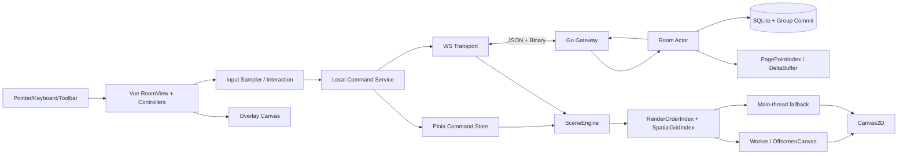
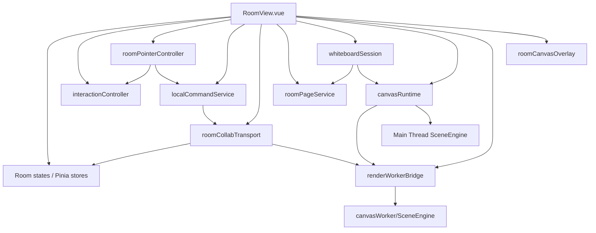
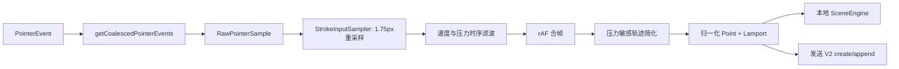
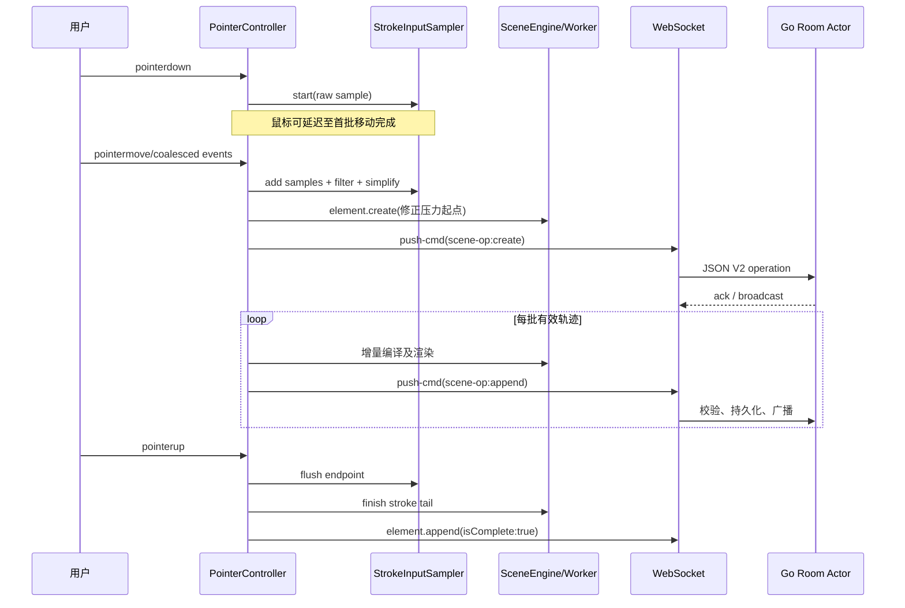
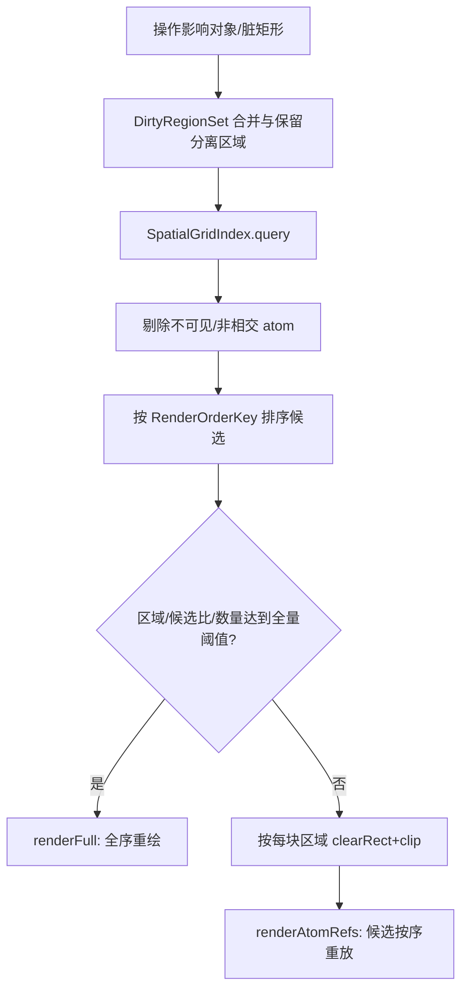
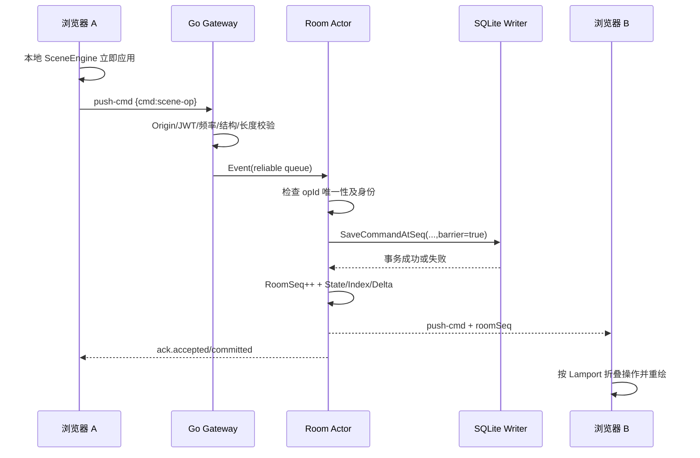
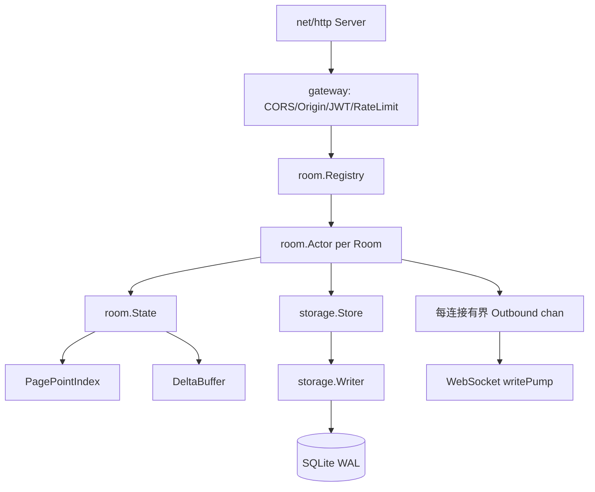
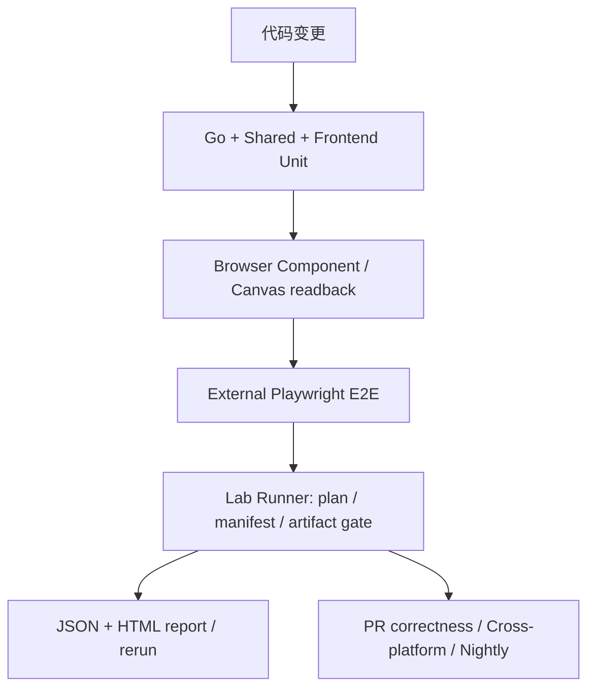

# Aevia 实时协同白板：项目全景知识库与技术实现手册

> **版本**：2026-11-08 · **基线仓库**：[aquaori/aevia](https://github.com/aquaori/aevia) · **分支**：`main` · **基线提交**：[`5278a18e5f5b95c292d6e2cb749ee7882e08fe9e`](https://github.com/aquaori/aevia/commit/5278a18e5f5b95c292d6e2cb749ee7882e08fe9e)  
> **适用对象**：新开发者、架构评审者、AI 编程助手、面试官、项目交接人员。  
> **目的**：让没有读过源码的人，了解项目“具有什么能力、为什么这样设计、数据怎样流动、关键算法如何工作、模块在哪里、哪些约束已经落实、哪些仍存在风险”。  
> **核查范围**：GitHub 连接器读取的当前仓库代码、仓库内项目指南/测试文档、提交记录，以及作为对照的 2026-06 旧版 `aevia-skill.md`。**本次为静态源码审阅；未在本地执行 Go/Vitest/Playwright 或重新测量性能**。文中引用的既有验证结果属于仓库记录，不代表本次复测通过。

---

## 快速导航

> 这是一份完整的源码交接手册；按主题阅读即可，无须从头到尾逐行读完。

**认识项目与核心模型**

- [0. 如何阅读与信任这份文档](#0-如何阅读与信任这份文档)
- [1. 项目是什么：用户能力、边界与产品对象](#1-项目是什么用户能力边界与产品对象)
- [2. 仓库快照与技术栈](#2-仓库快照与技术栈)
- [3. 全局架构与数据所有权](#3-全局架构与数据所有权)
- [4. 领域模型：Point、Command、SceneOperation 与 RenderAtom](#4-领域模型pointcommandsceneoperation-与-renderatom)
- [5. 确定性顺序与一致性：Lamport、RoomSeq、HistoryGroup](#5-确定性顺序与一致性lamportroomseqhistorygroup)

**前端、场景与交互**

- [6. 前端架构：从 Vue 装配根到服务层](#6-前端架构从-vue-装配根到服务层)
- [7. 工具体系：14 种工具如何映射到统一图元](#7-工具体系14-种工具如何映射到统一图元)
- [8. 画笔输入链路：事件合并、重采样、滤波、简化](#8-画笔输入链路事件合并重采样滤波简化)
- [9. 笔迹曲线与自然笔锋：从输入压力到 RenderAtom](#9-笔迹曲线与自然笔锋从输入压力到-renderatom)
- [10. SceneEngine：不可变操作如何折叠为最终画面](#10-sceneengine不可变操作如何折叠为最终画面)
- [11. 图元存储：RenderOrderIndex 与 SpatialGridIndex](#11-图元存储renderorderindex-与-spatialgridindex)
- [12. 脏矩形重绘：如何决定局部还是全量](#12-脏矩形重绘如何决定局部还是全量)
- [13. 命中检测、选择、拖动、缩放与旋转](#13-命中检测选择拖动缩放与旋转)
- [14. 擦除系统：量化曲线区间与对象擦除](#14-擦除系统量化曲线区间与对象擦除)
- [15. 文字与便签：以字素为单位的操作式编辑](#15-文字与便签以字素为单位的操作式编辑)
- [16. Worker / OffscreenCanvas：线程、状态和回退策略](#16-worker--offscreencanvas线程状态和回退策略)
- [17. 本地操作、远端广播与失败补偿](#17-本地操作远端广播与失败补偿)
- [18. Undo / Redo：历史组而非简单重写点数组](#18-undo--redo历史组而非简单重写点数组)

**Go 后端、协议与部署**

- [19. Go 后端：模块分层和启动](#19-go-后端模块分层和启动)
- [20. `PagePointIndex`：服务端大规模路径点的增量索引](#20-pagepointindex服务端大规模路径点的增量索引)
- [21. SQLite 持久化：group commit、读写与 WAL](#21-sqlite-持久化group-commit读写与-wal)
- [22. 初始化与翻页：两阶段数据水合](#22-初始化与翻页两阶段数据水合)
- [23. WebSocket 与 HTTP：协议总览](#23-websocket-与-http协议总览)
- [24. 自定义二进制协议：逐字节格式](#24-自定义二进制协议逐字节格式)
- [25. 会话、密码和安全边界](#25-会话密码和安全边界)
- [26. 断线、增量重放与全量恢复](#26-断线增量重放与全量恢复)
- [27. 背压控制与自适应降级：从 Go 到浏览器](#27-背压控制与自适应降级从-go-到浏览器)
- [28. 环境变量：运行时默认与生产配置](#28-环境变量运行时默认与生产配置)
- [29. 本地开发、构建和部署](#29-本地开发构建和部署)

**测试、性能与技术债**

- [30. 测试系统总览：从普通单测到独立 Lab 证据](#30-测试系统总览从普通单测到独立-lab-证据)
- [31. Lab Runner：测试计划、有效性和证据可追溯](#31-lab-runner测试计划有效性和证据可追溯)
- [32. CI 分层、跨浏览器正确性与 Nightly 性能](#32-ci-分层跨浏览器正确性与-nightly-性能)
- [33. 性能测试场景与边界：哪些数字能信](#33-性能测试场景与边界哪些数字能信)
- [34. 根目录/工作区脚本与推荐测试选择](#34-根目录工作区脚本与推荐测试选择)
- [35. 技术债、失效模式与优先级清单](#35-技术债失效模式与优先级清单)
- [36. 关键文件地图：按问题直接定位源码](#36-关键文件地图按问题直接定位源码)
- [37. 修改代码时的跨模块耦合规则](#37-修改代码时的跨模块耦合规则)
- [38. 推荐源码阅读顺序与“半天建立全局认识”的路线](#38-推荐源码阅读顺序与半天建立全局认识的路线)

**面试、维护与总览**

- [39. 面试与架构评审：如何准确介绍 Aevia](#39-面试与架构评审如何准确介绍-aevia)
- [40. 高频技术追问与回答思路](#40-高频技术追问与回答思路)
- [41. 三个 STAR 故事素材（请根据真实开发过程和测量补齐）](#41-三个-star-故事素材请根据真实开发过程和测量补齐)
- [42. 给 AI/代码维护者的任务提示模板](#42-给-ai代码维护者的任务提示模板)
- [43. 验证清单：维护者如何自行证明本文关键描述](#43-验证清单维护者如何自行证明本文关键描述)
- [44. 文档版本维护规则与推荐的增量更新流程](#44-文档版本维护规则与推荐的增量更新流程)
- [45. 最终心智模型：用五个问题看懂整个 Aevia](#45-最终心智模型用五个问题看懂整个-aevia)

---

## 0. 如何阅读与信任这份文档

### 0.1 文档的信息等级

- **【源码已核对】**：直接对应本次读取的源文件、类型声明、运行配置或 GitHub Actions 定义。
- **【实现机制】**：将多份源码组合起来解释端到端工作原理；属于可追踪的架构归纳。
- **【仓库记录】**：来自项目内部测试指南、报告说明和 commit 描述；已记录但不等于本次运行验证。
- **【风险/待验证】**：从已读代码或仓库记录推导出的边界、竞态及技术债；需要针对性测试验证，不应宣称必然发生。

**优先级：同一提交的可执行源码 > 类型和测试契约 > 项目维护文档 > README 叙述 > 旧版知识库。** 例如仓库内个别文字仍保留早期 V1 绘图流程，而当前入口已经强制采用 V2 不可变操作，应以实际代码为准。

### 0.2 项目一句话

Aevia 是一个 Vue 3/TypeScript + Go 的实时多人协同白板：**用户操作被记录为可排序、可重放的不可变场景操作；Go 房间 Actor 负责权威接入、持久化、顺序号和广播；前端 SceneEngine 将操作折叠成可渲染图元，通过 Web Worker / OffscreenCanvas、空间索引和脏区域重绘实现交互。** 除实时编辑外，系统还具备按页流式初始化、断线增量恢复、背压自适应和独立的测试/性能证据体系。

### 0.3 给第三方 AI 的最短准确上下文

```text
项目：Aevia；仓库 aquaori/aevia；基线 main@5278a18（2026-11-08 查询）。
前端：apps/frontend，Vue 3 + TS + Vite + Pinia；RoomView.vue 是装配根。
后端：apps/backend，Go 1.24，gateway → room Actor → storage(SQLite)；不是 Express。
共享契约：packages/shared，ESM-only；后端不在 npm workspaces 中，也没有旧的 cjs 镜像。
核心写入：Command(type='scene-op', schemaVersion=2) 包装不可变 SceneOperationEnvelopeV2。
新操作：element.create / append / transform / style / erase / delete，text.patch，history.toggle，page.clear。
旧 path/clear 和 cmd-start/update/stop 只作为兼容读取/历史处理；新 V1 修改被网关拒绝。
排序：Lamport + opId 的确定性比较，图元再按 sourceIndex/subIndex；Go 服务端还有权威 roomSeq。
渲染：SceneEngine 折叠操作 → RenderAtom → RenderOrderIndex(分块排序) / SpatialGridIndex(32×32) → Canvas2D。
局部重绘：DirtyRegionSet + 空间查询 + clip；超面积/候选比例阈值回退全量。
Worker 优先 OffscreenCanvas，不支持时有主线程 fallback；两条路径共享 SceneEngine。
绘图输入：coalesced pointer + 固定距离重采样 + 速度/压力滤波 + 动态简化；画笔支持铅笔/荧光笔。
后端：一个房间一个 Actor goroutine，可靠队列/可丢实时队列；roomSeq 持久化，写队列组提交。
恢复：初次和翻页用 JSON 元数据 + 二进制 FlatPoint + JSON 场景操作分块；重连可按 lastRoomSeq 做短期增量重放。
安全：JWT session/invite 分离、密码哈希、限流、WS Origin 校验；/v2 账号与 RBAC 路由仍是 501 占位。
测试：Lab Runner single/smoke/ci/nightly、run manifest、证据门禁、跨端 E2E、性能基线和报告服务。
重要未解决：仓库记录存在 500k 点边界测试流丢块，不能断言百万点稳定渲染已认证。
```

### 0.4 版本差异，一眼看懂

| 主题 | 旧知识库（2026-06） | 当前版本（本次源码核对） |
|---|---|---|
| 后端 | Node.js、Express 5、`ws`、`node:sqlite` | **Go**、`coder/websocket`、`modernc.org/sqlite`，房间 Actor |
| 工作区 | `frontend`、`backend`、`shared` 三个 npm workspace | 只有 `frontend`、`shared` 两个；Go 单独模块 |
| 正式编辑模型 | 可变 `Command(path)`，追加点、覆盖变换 | **Scene Schema V2** 不可变操作；按历史折叠形成当前场景 |
| 操作类型 | 路径、清屏、传统撤销/批量变换 | 9 类场景操作，覆盖图形、文字、擦除、变换、历史 |
| 渲染对象 | 以 `FlatPoint` 重放为中心 | **RenderAtom**（dot/quadratic/shape/glyph/bitmap）为核心 |
| 命中与脏区 | 命令 AABB + 局部扫描 | **32×32 空间网格 + 细粒度图元命中 + 自适应 dirty/full** |
| 橡皮 | Canvas `destination-out` 路径 | **按图元记录擦除区间**，对象橡皮支持整体删除 |
| 撤销/清屏 | 软删除、旧清屏物理截断 | **`history.toggle` 和 `page.clear` 水位线，可重新折叠历史** |
| 后端一致性 | Lamport 排序、全量点队列 | Lamport 渲染顺序 + **持久化 `roomSeq`** + DeltaBuffer |
| 弱网 | 断线重连再初始化 | **短期增量重放 + 背压分级 + 过载拒绝/降级** |
| 测试 | Vitest、Playwright 与基准 | **Lab Runner、manifest v2、证据合法性、CI 分层与 nightly** |

> 注意：V2 并不意味着所有旧协议文件都已删除。项目保留了 V1 的部分类型、解码器和场景水合适配器；“兼容读取”和“允许写入”是两个不同概念。

---

## 1. 项目是什么：用户能力、边界与产品对象

### 1.1 当前具备的用户能力

1. **房间**：生成六位房间号；创建房间、设置可选密码、加入房间、邀请 token 跳转；自动续签房间会话。
2. **自由绘制**：钢笔、铅笔、荧光笔，笔宽/颜色/透明度和多种线型，鼠标速度拟压感及真实笔输入。
3. **基础图形**：直线、箭头、矩形、圆角矩形、椭圆。
4. **内容图元**：文字、便签、贴纸（当前 bitmap recipe 更接近渲染字符/表情的画布图元，**不能据此声称已支持通用图片上传**）。
5. **编辑动作**：选择、框选、拖动、缩放、旋转、样式修改、删除、局部擦除和对象擦除。
6. **历史**：按历史操作组执行撤销/重做；清屏以可追踪场景操作表达。
7. **协同**：实时同步内容、光标、选框、在线成员与页状态；乐观显示并处理服务端确认/拒绝。
8. **多页**：添加页面、切换页面、邻页窗口缓存、页面概览/协作者分布。
9. **恢复**：掉线自动重连，优先短时间增量重放，必要时完整页重同步。
10. **工程可观测性**：代码内带按需开启的渲染测量标记，外部 E2E 和 Lab 证据报告。

### 1.2 不是什么

- **不是图片同步白板**：正式数据是对象与操作，Canvas 像素是可重建的派生结果。
- **不是纯 P2P**：客户端经权威 Go 后端认证、持久化和分发；房间存在中心状态。
- **不是完整通用 CRDT**：使用确定性顺序和局部类似 CRDT 的做法，但未证明任意离线分叉、所有并发操作均可交换合并。
- **不是成熟账号/企业 RBAC 平台**：数据库预置用户/成员/权限表，公开 `/v2` API 目前返回 501。
- **不是已证实的无限规模画布**：代码支持大数据量分块与索引，真实边界测试仍有流可靠性问题。

### 1.3 最重要的分工原则

**前端负责几何与视觉语义**：采样、曲线、空间查询、命中、文本排版、图元编译和 Canvas 绘制。  
**后端负责通信与权威状态**：身份、合法性校验、房间串行化、持久化、顺序分配、消息扇出、快照、缓存和降级。  
**共享包负责跨端可验证契约**：协议类型、排序、页标识和 V2 操作形状。  
**测试工具负责独立证据**：不应通过产品内部私有状态制造“测试通过”的假象。

---

## 2. 仓库快照与技术栈

### 2.1 仓库规模（本次 GitHub 树统计）

- 提交：`5278a18e5f5b95c292d6e2cb749ee7882e08fe9e`。
- GitHub Git tree 返回 **311 个已跟踪 blob 文件**，这些文件总 `size` 约 **2.38 MB**（仅仓库字节量，不是构建产物、安装依赖或程序内存）。
- `apps/frontend/src/` **104** 个文件；`apps/backend/internal/` **78** 个文件；`packages/` **11** 个文件；根 `tests/` **35** 个文件。
- 旧版代码行数和旧单元测试覆盖率均**不能直接挪用**，因为模块和统计口径已经改变。

### 2.2 技术选型

| 层次 | 当前实现 | 作用及技术要点 |
|---|---|---|
| 前端运行时 | Vue 3 + TypeScript | UI、组件响应、工具状态和交互 |
| 前端构建 | Vite 7、`vue-tsc` | ESM 模块、构建与类型检查 |
| 状态与路由 | Pinia 3、persistedstate、Vue Router 4 | 会话、命令窗口、Lamport、路由 |
| UI | Tailwind CSS 4、Lucide Vue Next | 控件和样式 |
| 网络 | Axios、浏览器 WebSocket | HTTP 鉴权/房间 API、实时消息 |
| 绘制 | Canvas2D、OffscreenCanvas、Web Worker | 渲染和线程隔离 |
| 图形核心 | 自研 SceneEngine / RenderAtom | 不可变操作折叠、查询、局部绘制 |
| 后端 | Go 1.24；标准库 `net/http` | 入口、HTTP/WS 网关、并发 |
| Go WS 库 | `github.com/coder/websocket` | WS 握手与读写、Ping/Pong |
| 数据库存储 | SQLite + `modernc.org/sqlite` | WAL、本地持久化、纯 Go 驱动 |
| 加密/身份 | JWT、`golang.org/x/crypto` | session/invite、口令哈希 |
| 自动化 | Go test/vet/race/fuzz、Vitest 4、Playwright | 单测、协议、浏览器 E2E、性能 |
| 报告 | Lab Runner + HTML/JSON report | 证据闭环、测试重跑和门禁 |
| CI | GitHub Actions | 快速门禁、跨系统正确性、nightly |

### 2.3 Monorepo 的准确含义

根 `package.json` 的 `workspaces` 现在只有：

```json
{
  "workspaces": ["apps/frontend", "packages/shared"]
}
```

Go 后端虽然仍在同一 Git 仓库，**但不是 npm workspace**。其依赖在 `apps/backend/go.mod` 管理；根部 `scripts/go.mjs` 负责从 npm 命令转发 Go build、test、vet、start。不要使用旧版 `npm run build --workspace @collaborative-whiteboard/backend`，也不要寻找已经移除的 Express 目录和 CommonJS 共享镜像。

### 2.4 目录树（按职责概括）

```text
aevia/
├── apps/
│   ├── frontend/
│   │   ├── src/
│   │   │   ├── views/              # Home / Invite / Room 装配视图
│   │   │   ├── components/         # 工具栏、文字编辑器、分页、面板
│   │   │   ├── controllers/        # Pointer/选择/工具/键盘/生命周期
│   │   │   ├── scene/              # V2 SceneEngine、图元、索引、几何
│   │   │   ├── service/            # 协作、页面、输入、渲染调度与桥接
│   │   │   ├── instrumentation/    # Lab 标记与 session 插件
│   │   │   ├── workers/            # Canvas Worker
│   │   │   ├── states/             # Room 内瞬时状态
│   │   │   ├── store/              # Pinia 用户/命令/Lamport
│   │   │   ├── router/             # 客户端路由
│   │   │   └── utils/              # 共享前端工具
│   │   └── tests/                  # bench/browser/e2e external
│   └── backend/
│       ├── go.mod
│       ├── cmd/aevia-backend/main.go
│       └── internal/
│           ├── auth/               # JWT 与密码
│           ├── config/             # 环境和限制
│           ├── gateway/            # HTTP / WebSocket / 校验 / 限流
│           ├── room/               # Actor / State / Index / Stream / Delta
│           ├── protocol/           # WS 二进制编解码
│           ├── storage/            # SQLite / group commit / WAL
│           ├── domain/             # Go 领域对象
│           └── console/            # 启动日志
├── packages/shared/src/
│   ├── types/collab.ts
│   ├── types/scene.ts
│   ├── protocol/collabProtocol.ts
│   └── protocol/sceneProtocol.ts
├── tests/
│   ├── run-system.ts               # Lab 和系统测试入口
│   ├── lab/                      # 计划、门禁、证据、直播控制台
│   ├── catalog/                  # 功能和模块义务清单
│   └── report/                   # 聚合、覆盖、HTML 报告
├── scripts/                      # 启动、构建、性能预算、CI 工具
├── .github/workflows/
│   ├── quick.yml
│   ├── ci.yml
│   └── nightly.yml
├── .codex/skills/
│   ├── aevia-project-guide/
│   └── aevia-testing/
├── package.json
└── README.md
```

---

## 3. 全局架构与数据所有权

### 3.1 总体链路



### 3.2 三种不同的“顺序”

系统有三个不能混为一谈的概念：

1. **用户行为的实际发生顺序**：浏览器物理事件先后与网络到达顺序；可能受卡顿/合并影响，不可靠。
2. **可复现的渲染顺序**：Lamport + operation ID + 图元内部索引；用于各端对同一历史产生一致的叠放结果。
3. **权威服务端持久化顺序**：每房间的 `roomSeq`；用于 ACK、断线增量恢复、持久化游标与快照相关性，不是替代 Lamport 的画笔 z-index。

用 Lamport 顺序决定如何画；用 `roomSeq` 说明服务器接受并存到了第几个事件。这一分层是当前架构理解的关键。

### 3.3 数据的唯一与派生来源

| 数据 | 所有者 | 是否权威 | 可否丢弃/重建 |
|---|---|---|---|
| SQLite `commands` 操作记录 | Go storage | 持久化事实 | 不能随意丢失 |
| 房间 `durable_seq` | Go storage / room | 顺序事实 | 不应无故回退 |
| Actor `State.Commands` | 每房间 Actor | 当前内存权威副本 | 可重新从 DB 加载 |
| PagePointIndex | Go room | 服务端渲染流派生索引 | 从命令重新建立 |
| DeltaBuffer | Go room | 短期恢复缓存 | 可失效并回退全量 |
| 客户端 `commandStore` | Pinia | 本地当前已加载窗口 | 可权威重同步 |
| SceneEngine 的 Element/Atom | 前端 SceneEngine | 本地当前渲染解释 | 可从操作日志重建 |
| Canvas 像素 | 浏览器/Worker | 不是业务真相 | 可重新绘制 |
| overlay、hover、光标 | Vue/Overlay | 瞬时状态 | 可消失或重算 |

### 3.4 为什么不把所有逻辑交给 Go

几何计算、曲线编译、字体绘制、像素合成与设备坐标强依赖浏览器 Canvas2D。如果 Go 同时实现一份图形解释，就会有**两套几何/渲染真相**，会增加跨语言一致性与协议维护成本。所以当前 Go 对 V2 主要检查操作结构、身份和数值边界，并维护路径点供快速首帧渲染；高级图元、变换和擦除效果由客户端统一折叠。这是架构取舍而不是后端“无业务逻辑”。

---

## 4. 领域模型：Point、Command、SceneOperation 与 RenderAtom

### 4.1 `Point`：几何输入的最小记录

```ts
interface Point {
  x: number;          // 归一化坐标
  y: number;
  p: number;          // 压力/模拟压力
  lamport: number;    // 样本逻辑时间
}
```

坐标按画布逻辑尺寸归一化（通常期望落在 0..1 区域），可以在不同尺寸视口再投影为像素。压感 `p` 由采样层确定，后续渲染不要再独立根据点距“算第二次速度”，以免不同渲染端得到不同宽度。点上的 Lamport 与包裹它的操作 Lamport 各有用途，不能互换。

### 4.2 `Command`：网络和存储的外层信封

当前 `packages/shared/src/types/collab.ts` 定义：

```ts
interface Command {
  id: string;
  type: 'path' | 'clear' | 'scene-op';
  tool?: 'pen' | 'pencil' | 'highlighter' | 'eraser';
  color?: string;
  size?: number;
  points?: Point[];
  strokePattern?: StrokePattern;
  schemaVersion?: 1 | 2;
  sceneOperation?: SceneOperationEnvelopeV2;
  timestamp: number;
  userId: string;
  roomId: string;
  pageId: number;
  isDeleted: boolean;
  lamport: number;
  box: AabbBox;
}
```

旧 `path` 记录携带完整点集，新的 `scene-op` 包装不可变操作。二者共用一个存储容器，便于迁移期重放历史；但是对新写入，`localCommandService.pushCommand()` 明确要求 `type === 'scene-op' && sceneOperation`，Go `gateway/scene_validation.go` 也要求 V2。**不能看到 `Command.type` 联合类型中有 `path`，就判断新客户端仍在写 V1 path。**

### 4.3 `SceneOperationEnvelopeV2`：当前最重要的领域契约

```ts
type SceneOperationEnvelopeV2 = {
  schemaVersion: 2;
  opId: string;
  elementId: string;
  actorId: string;
  roomId: string;
  pageId: number;
  lamport: number;
  historyGroupId: string;
  kind: SceneOperationKind;
  payload: /* 具体操作负载 */;
};
```

- `opId`：**一次操作**的唯一标识；不可变、不可被同 ID 的新数据覆盖。
- `elementId`：被操作的**画布对象**标识；一个对象可以经历 create、append、transform、erase 等多个 op。
- `historyGroupId`：一次用户意图的历史事务组；一次笔迹可能包含 create+多次 append，但 Undo 应作用于整个组。
- `actorId`：操作者；网关核对可信会话用户身份，不相信客户端任意指定。
- `pageId`：该操作所属页面；不能跨页混淆。
- `lamport`：逻辑时间；与 `opId` 共同形成稳定顺序。
- `kind/payload`：操作的语义与必要数据。

一条完整路径不是一条会反复被 UPDATE 的“大对象”，而是**同一 `elementId` 的 create 与 append 操作序列，在 SceneEngine 中折叠成当前对象**。这一点直接改变性能、同步、撤销与一致性讨论。

### 4.4 九种正式操作及其效果

| Kind | 重要 payload | SceneEngine 的语义 |
|---|---|---|
| `element.create` | `{descriptor, points?, isComplete?}` | 创建路径、图形、文字/便签或贴纸对象 |
| `element.append` | `{points, sourceStart, isComplete?}` | 给已有路径追加顺序编号明确的样本 |
| `element.transform` | `{targets:[{elementId,deltaMatrix,pivot?}]}` | 复合仿射矩阵变换，不重写原始点 |
| `element.style` | `{style:Partial<SceneElementStyle>}` | 对对象应用样式覆盖 |
| `element.erase` | `{targets:[{elementId,atomId?,intervals?,eraseWhole?}]}` | 按图元区间或整个对象标记擦除 |
| `element.delete` | `{elementIds:string[]}` | 标记对象不可见，历史操作仍保留 |
| `text.patch` | `{patches:[insert/delete]}` | 修改字符级文本状态 |
| `history.toggle` | `{targetHistoryGroupId,enabled}` | 更改历史组有效性并重算影响对象 |
| `page.clear` | `{before:RenderOrderKey}` | 用页面清除水位线隐藏此前对象，可被历史操作逆转 |

`SceneElementDescriptor` 还包含 `elementKind`、`toolId`、`recipeId`、`shapeKind`、`style`、盒子、文本、贴纸内容等。**工具是输入方式；图元 recipe 是渲染形式**。多个工具可以编译成同一种 recipe，而不需要为每个工具维护一套 Canvas 绘制器。

### 4.5 层级：工具 → 对象 → 图元

```text
用户选择工具（ToolDefinition）
    ↓ 输入模式 freehand / shape / text / sticker / eraser / cursor
生成 SceneElementDescriptor / SceneOperation
    ↓ SceneEngine 折叠
SceneElementState（对象）
    ↓ 编译
RenderAtom：dot / quadratic / shape / glyph / bitmap
    ↓ PrimitiveRenderer
Canvas 2D 像素
```

`SceneElementState` 维护描述符、创建顺序、版本 revision、矩阵、原始点、图元引用、被擦区间、文本字符状态和删除状态。`RenderAtom` 是可独立画出的更细颗粒单位，携带归属 `elementId`、`elementRevision`、`RenderOrderKey`、bounds、样式等。

### 4.6 `FlatPoint`：流传输投影，而非唯一场景结构

`FlatPoint` 在普通 `Point` 上追加 `cmdId`、`orderOpId?`、`pageId`、`userId`、`tool`、`color`、`size`、`isDeleted`、`pointIndex?`、`strokePattern?`。Go `PagePointIndex` 可将 V1 path 展平，也可从 **V2 的 `element.create` 与 `element.append` 路径片段**构建点索引，用于初始/翻页快速显示。它**不包含**文字、图形、变换、擦除、历史组的完整语义，因此无法替代 V2 Command stream。

### 4.7 仿射矩阵、包围盒和文本补丁

- `AffineMatrix` 是 `[a,b,c,d,e,f]` 的六元二维仿射矩阵，初始单位矩阵 `[1,0,0,1,0,0]`。平移、缩放、旋转按矩阵复合执行，避免频繁修改点坐标产生漂移。
- `AabbBox` 是轴对齐盒，含 `minX,minY,maxX,maxY,width,height`。作为粗筛边界，而非自动等于精确命中。
- `TextInsertPatch`：`{type:'insert',charId,afterId,grapheme}`；`TextDeletePatch`：`{type:'delete',charId}`。`charId` 和 `afterId` 提供可稳定重放的字符关系，`grapheme` 以用户感知字素为单位，不是简单 JS UTF-16 单字符切分。
- `QuantizedInterval` 的 `start/end` 是 **0..65535** 的曲线参数整数；擦除与编辑区间要统一量化，防止客户端重算浮点命中后出现差异。

### 4.8 示例：在同一个对象上连续操作

```json
{
  "schemaVersion": 2,
  "opId": "op-002",
  "elementId": "stroke-001",
  "actorId": "user-a",
  "roomId": "123123",
  "pageId": 0,
  "lamport": 42,
  "historyGroupId": "gesture-001",
  "kind": "element.append",
  "payload": {
    "sourceStart": 1,
    "points": [{"x": 0.23, "y": 0.42, "p": 0.8, "lamport": 41}],
    "isComplete": true
  }
}
```

上面仅是**帮助理解的字段示例**，不是仓库实际业务数据。它表达：“将某笔路径从第 1 个点位置起追加一个点，结束该笔画，属于 `gesture-001` 历史组”。注意外层 `Command` 还要具有匹配的 `id/opId`、身份、页号、逻辑时间和 envelope，才能通过服务端 V2 校验。

---

## 5. 确定性顺序与一致性：Lamport、RoomSeq、HistoryGroup

### 5.1 Lamport 能保证什么

Lamport 时钟通过事件先后关系提供可比较的逻辑序列：本地事件产生新的值，收到远端逻辑时间后将本地时钟向前推进。它不是墙上时间，不代表实际时间差；**两个并发事件仍可得到相同或不可体现因果的时间值**。因此项目必须额外使用字符串 ID 破除平局。

### 5.2 跨语言统一比较

共享包 `compareCommandOrder`：

```ts
const compareCommandOrder = (left, right) =>
  left.lamport !== right.lamport
    ? left.lamport - right.lamport
    : left.id < right.id ? -1 : left.id > right.id ? 1 : 0;
```

图元顺序 `compareRenderOrder` 精确排序键：

```text
(lamport, opId, sourceIndex, subIndex)
```

每一层按升序比较；`opId` 的比较需要**与 locale 无关**。JS 用 `<`/`>`，Go 使用普通字符串比较；项目生成的 ASCII/UUID 类 ID 在两端匹配。不要擅自改 `localeCompare` 或本地化大小写，否则不同用户可能为同一组图元形成不同层级。

### 5.3 为什么从“命令定序”细化到“图元定序”

多人同时画两条线时，各点在时间上可能交错。如果只按最后完成的整笔线条排序，一条线会整条盖住另一条，无法再现实际交错的叠放；图元级 `(lamport,opId,sourceIndex,subIndex)` 可以更细粒度表达遮挡顺序，也同时纳入形状和文字图元。它仍是**重放的确定性规定**，不是证明所有浏览器不同字体/抗锯齿结果逐像素完全相同。

### 5.4 `roomSeq` 补足服务端权威与恢复游标

Actor 在 `persist*` 写操作时分配 `RoomSeq+1`，将序号存入 Command/room 持久化状态；成功后更新内存 `RoomSeq`，并发送 ACK 或广播。客户端记录已确认的最大序号，断线重连时可请求 `lastRoomSeq` 之后的事件。它回答的是“**我错过哪些已提交修改**”，而不是“像素应该谁在上层”。

### 5.5 V2 为什么仍需重建而不能只做尾追加

如果某条操作按 Lamport 顺序应该插在现有历史中间，`SceneEngine.applyOperation()` 会找到插入位置，若不是末尾，则重建该操作影响的 element；若操作为 `page.clear`，可能重建更大范围。历史组切换也需要重算相关对象。这种 **尾部增量折叠、非尾回滚再折叠** 的策略保证不同到达顺序最终按同一有序操作集合解释。

### 5.6 正确的“CRDT-inspired”表述

可以说：**Aevia 借鉴 CRDT 对无序网络事件确定性解释的理念，使用逻辑时间、稳定全序、不可变操作及字符插入关系减少冲突；服务端负责唯一权威持久化与序列化。** 不应声称：

- 已实现完整任意离线操作日志的无冲突合并与统一权限冲突解决；
- V2 的所有变换、文本修改、清空和撤销天然可交换；
- 不需要中心服务即可保证房间最终状态；
- 不同系统字体、GPU/Canvas 栅格化的屏幕像素必然完全一致。

客户端最终收敛还依赖操作集合一致、比较器一致、版本语义一致、服务端没有丢操作及正确的恢复/重同步。**操作级确定性是必要条件，不等于端到端网络可靠性证明。**

---

## 6. 前端架构：从 Vue 装配根到服务层

### 6.1 路由和页面

`apps/frontend/src/main.ts` 创建 Vue 应用、Pinia 和路由；`router/index.ts` 定义三个主要路径：

| 路径 | 视图 | 用户行为 |
|---|---|---|
| `/` | `HomeView.vue` | 创建房间、输入房间号和用户名、加入房间 |
| `/invite/:token` | `InviteView.vue` | 解析邀请信息，按需输入密码，兑换房间会话 |
| `/room` | `RoomView.vue` | 主白板编辑器，Canvas 与实时协同 |

`/room` 路由自身不直接携带 roomId 或 JWT；当前会话身份通过 `userStore` 持久化，避免将敏感 session token 放在 URL 中。**邀请 token 不是 session token**，不能直接作为编辑 WebSocket 的身份凭据。

### 6.2 为什么 `RoomView.vue` 是“装配根”

`RoomView.vue`（当前 847 行）不是只负责 `<template>` 的纯展示组件，而是整个编辑器的 **composition root**，类似手工依赖注入容器。它创建/连接下面的依赖图：



例如 pointer controller 要调用命中检测，却不应该亲自解析 Go 协议；协同 handler 要触发局部渲染，却不应直接操作 Vue 工具栏。装配根通过传入回调、Ref 和服务实例将这些职责连接起来。某些回调闭包会引用稍后初始化的依赖，因此**修改构造顺序时必须看实际调用时机**，不能仅按变量声明顺序判断安全。

### 6.3 四组 Room 局部状态

| 文件 | 所持内容 | 为什么单独分离 |
|---|---|---|
| `states/roomSessionState.ts` | room/user/token、重连状态、到期时间、在线信息 | 不把网络会话与图形编辑耦合 |
| `states/roomUiState.ts` | 面板、工具菜单、快捷键、尺寸预览、全屏/折叠 | 展示状态不应污染正式场景模型 |
| `states/roomEditorState.ts` | 当前工具/颜色/笔宽、当前页/总页数、成员与远端光标 | 编辑器业务状态的响应式面 |
| `states/roomInteractionState.ts` | pointer 捕获、选中对象、控制柄、拖动/缩放/旋转、预览、热状态 | 高频 transient 状态避免全量 Vue 深响应代价 |

`pointerHotState` 采用普通可变对象承载高频轨迹、待发点等内容，符合“**热路径尽量少触发 Vue 依赖追踪**”的原则。其代价是必须显式通知画布或 overlay 刷新，不能期待所有普通对象属性变更都自动导致组件更新。

### 6.4 三类 Pinia Store

**`store/userStore.ts`**：用户标识、房间 session token、过期时间、用户名，采用会话存储；刷新房间能恢复入口数据，关闭会话后不应把 token 当作永久账号。

**`store/commandStore.ts`**：按页存放命令、按 ID 索引、记录待合并 update、已加载页面集与历史指针，负责命令去重/排序/窗口替换。这仍是前端“同步的命令集合” owner；但 V2 实际图形折叠、空间索引和图元命中交给 SceneEngine，不应再向 store 中塞一套新的图形渲染缓存。

**`store/lamportStore.ts`**：本地逻辑时钟和与远端最大逻辑时间的合并，保留旧的 dirty-point 事件/短时窗口辅助。短时窗口并不是完整的空间索引；新版局部候选检索的正式入口是 `scene/spatialGridIndex.ts`。

### 6.5 控制器职责地图

| 文件 | 聚焦事项 |
|---|---|
| `controllers/roomPointerController.ts` | pointerdown/move/up；工具行为；V2 create/append/erase/text/transform |
| `controllers/interactionController.ts` | 选择、命中结果处理、控制柄、矩阵预览与交互模式计算 |
| `controllers/roomCommandController.ts` | 撤销、重做、清屏等 UI 行为入口与通知 |
| `controllers/roomEditorController.ts` | 工具和变换相关编辑动作 |
| `controllers/roomToolController.ts` | 工具菜单、颜色、笔宽 |
| `controllers/roomKeyboardController.ts` | 快捷键路由 |
| `controllers/roomHeaderController.ts` | 用户名、邀请/分享、全屏 |
| `controllers/roomPanelController.ts` | 成员、页面概览、弹窗 |
| `controllers/roomLifecycleController.ts` | 挂载/卸载、resize、页面/指针生命周期 |

控制器的正确分工是“发起用户意图、协调状态和服务”，而不是把协议/绘图实现写成一个巨大的事件处理函数。

### 6.6 `whiteboardSession`：编辑器的统一宿主

`service/whiteboardSession.ts` 对外暴露编辑器生命周期与动作接口，例如 `mountCanvas`、`unmount`、`connect`、`disconnect`、`setTool`、`undo`、`redo`、`goToPage`、`resize`、`requestRender`、`requestDirtyRender`、`requestOverlayRender`。它还维护生命周期事件/钩子：工具变更、命令应用、页变更、协同连接、渲染前后等，允许以插件方式接入。

和旧知识库不同，当前 `src/instrumentation/labPlugin.ts` 已提供**测量插件适配层**。因此不能再说“项目完全没有插件实例”；但也不能声称已有成熟第三方业务插件生态。准确表述是：**核心 session 有插件扩展接口，已出现 Lab 测量接入，插件契约和可扩展范围仍以实际注册与 hook 为准**。

### 6.7 状态回路中的核心防线

**乐观操作**：本地先写入 Command / SceneEngine，使画笔即时可见，不等待 WebSocket 回显；后端拒绝时根据 `cmdId` 定位回滚并修复 Worker 状态。  
**避免“自己的广播再次执行”**：服务端对部分命令按 exclude ID 广播其他客户端，发送方靠本地操作和 ACK 确认。  
**初始化水合防覆盖**：初始化流还在到达时，新增的 live scene ops 必须与 snapshot 合并，不能命令块最后到达就覆盖掉中途协同产生的新笔迹。  
**失效请求取消**：翻页频繁时通过 requestId/snapshotVersion/generation 识别旧请求，避免晚到数据污染新页面。

---

## 7. 工具体系：14 种工具如何映射到统一图元

### 7.1 `ToolRegistry` 的价值

`scene/toolRegistry.ts` 以声明式 `ToolDefinition` 注册内置工具，而不是在每条渲染路径编写一个大 switch。一个定义说明：

```ts
type ToolInputMode =
  | 'freehand' | 'shape' | 'text' | 'sticker' | 'eraser' | 'cursor';

interface ToolDefinition {
  id: string;
  label: string;
  inputMode: ToolInputMode;
  elementKind?: ElementKind;
  recipeId?: PrimitiveRecipeId;
  shapeKind?: ShapeKind;
  defaultStyle?: Partial<SceneElementStyle>;
}
```

注册表的 `descriptor(id, style)` 将工具默认样式和当前选择样式合并，得到能够放入 `element.create` 的正式描述符。这是**在输入层扩展工具，在渲染层复用 recipe** 的关键解耦。

### 7.2 当前内置工具清单

| 工具 ID | 输入模式 | ElementKind / Recipe | 特性 |
|---|---|---|---|
| `cursor` | cursor | 无新图元 | 选择、框选、拖动、缩放/旋转 |
| `pen` | freehand | path / stroke | 标准圆润画笔 |
| `pencil` | freehand | path / stroke | 默认透明度约 0.78，铅笔质感 |
| `highlighter` | freehand | path / stroke | 默认约 0.32 透明度，multiply 合成 |
| `eraser` | eraser | 不创建普通笔迹对象 | 曲线区间精细擦除 |
| `object-eraser` | eraser | 不创建普通笔迹对象 | 擦除整对象 |
| `line` | shape | shape / shape | 直线 |
| `arrow` | shape | shape / shape | 带箭头端点的线 |
| `rectangle` | shape | shape / shape | 矩形 |
| `rounded-rectangle` | shape | shape / shape | 圆角矩形 |
| `ellipse` | shape | shape / shape | 椭圆 |
| `text` | text | text / glyph | 字符级补丁 |
| `sticky` | text | sticky / glyph | 便签底色和文字 |
| `sticker` | sticker | sticker / bitmap | 当前按文字/emoji 风格内容渲染 |

### 7.3 一种工具对应多种绘制阶段

用户选中 `rectangle` → pointerdown 记录起点 → pointermove 更新 overlay 形状预览 → pointerup 确定 end/box → 构造 shape descriptor → push `element.create` → SceneEngine 生成 `ShapeAtom` → PrimitiveRenderer 绘制。中途拖动预览是瞬时状态，不应把每个 pointermove 都存成一个正式矩形操作。

路径工具不同：从输入样本逐批形成 `element.append`，以支持远端“正在延长的线”。文字工具又不同：文本编辑器通过插入/删除字素构造 `text.patch`，在编辑确认时再提交一次样式变化。

### 7.4 可扩展性边界

注册一种新工具，只声明 ID 和 recipe 并不一定就能完成整条产品链路。需要同时具备：输入模式编排、SceneOperation schema、后端允许的 recipe/负载、SceneEngine 编译、PrimitiveRenderer 绘制、命中、历史影响范围、Worker/fallback 一致性、E2E/性能测试。若新工具能编译到现有 4 种 recipe，扩展成本较低；若是新 recipe，则必须先调整前后端可接受的协议集合。

---

## 8. 画笔输入链路：事件合并、重采样、滤波、简化

### 8.1 为什么不能把每个 `pointermove` 都存入数据库

浏览器在高刷新率设备上会产生大量 pointer 事件；不同机器浏览器的上报频率不一致。如果直接存每一个原始事件：点数和网络包高度依赖设备采样率，点间距不稳定、自然笔锋难以复现，Vue/Worker/WS/SQLite 都会承担冗余工作。因此项目将**原始输入**与**正式业务点集**分成两层：



### 8.2 `getCoalescedPointerEvents`：补回合并样本

浏览器可能把多个硬件采样点合并为一个派发的 PointerEvent。`roomPointerController.ts` 会读 `getCoalescedEvents()`，并处理当前事件点与合并列表的关系，尽量保留手势真实轨迹，再交给采样器。**不要在外部再做一套低频节流先扔掉事件**，否则重采样层无法还原被丢弃的转折。

### 8.3 固定空间间隔 `1.75px`

`createStrokeInputSampler({spacingPx=1.75})` 维护上个原始点、上个输出点以及距离累积。新线段长于剩余间隔时，通过线性插值在固定距离处插入一个或多个样本，剩余距离留给下一段。这样正式样本密度更接近**沿路径弧长**均匀，而不是每毫秒一个点。

假设输入依次为 `x=10→12→20`，间隔 1.75px：即使第二次事件跳过多个像素，采样器仍会插出多个位置，而不是把它当成一个跨度很大的线段。它改善曲率平滑、压力估计和传输量可控性。

### 8.4 鼠标无压感：速度映射到虚拟压力

`strokeInputSampler.ts` 的当前核心规则是：

```text
normalizedSpeed = clamp((speed - 0.08) / 1.72, 0, 1)
easedSpeed      = t*t*(3 - 2*t)
targetPressure  = 0.95 - easedSpeed*0.6
```

即低速更粗（压力约 0.95），高速更细（趋向约 0.35）。这里 `speed` 是采样位移/时间，不是只看相邻点的空间距离。注意 smoothstep 的非线性映射；不能误用旧版知识库“移动距离 / 120”的自然笔锋公式。

### 8.5 时间连续的非对称滤波

采样器按指数时间常数更新速度和压力：

```text
alpha(dt, τ) = 1 - exp(-max(dt,0)/τ)
filtered = previous + (target - previous) * alpha
```

- 鼠标速度加快时常数约 **22 ms**；减慢约 **80 ms**。
- 鼠标压力变小时响应较快（约 **24 ms**）；变大时较慢（约 **85 ms**）。
- 真实笔压力走独立输入路径，滤波时间常数约 **14 ms**。
- 超过 **48 ms** 的鼠标停顿视为 idle，恢复移动时用于速度计算的时间窗口最多约 **32 ms**，用于鼠标滤波的 dt 不超过 **24 ms**。

目的不是物理真实性的绝对模拟，而是在“突然加速容易迅速变细、减速重新变粗要缓一点”的视觉约束下避免笔锋波动和突然停顿之后的异常肥笔。

### 8.6 起笔时特殊处理，解决“无法收回已经涂上的墨”

鼠标按下时尚无运动速度，若立即用默认压力画第一点，后面根据速度估算出细笔锋后，第一点已经画在 Canvas 像素上，无法无损变细。因此当前鼠标采用**延迟启动**：先缓存初始点，待有两个归一化移动样本后回填起点压力，再正式 `element.create` 与本地绘制。无位移轻点在 pointerup 仍应提交一个圆点；压感笔可以使用物理初始压力直接起笔。

这项细节是交互体验与可重放渲染相一致的工程决策：**先决定要存的压力，再把同一个点交给渲染和传输**，而不是本地先画一条“估算版”再让远端画另一条。

### 8.7 按 rAF 批量处理与压力敏感简化

输入输出按动画帧合并，简化函数 `simplifyStrokeSamples(samples, anchor, tolerancePx)` 使用一类 Ramer–Douglas–Peucker 风格的区间递归（源码使用显式栈）：

```text
spatialError  = 采样点到首尾连线的最短距离
pressureError = |实际压力 - 端点压力线性插值| × 8
error         = max(spatialError, pressureError)
若区间最大 error > tolerance：保留该点并分裂区间
否则可移除中间点
```

这比只考虑 `(x,y)` 的几何简化更合适：在直线部分，如果压力发生明显变化，也应保留相应点，防止“笔锋被压缩没了”。输出的**同一批简化点**被用于本地 SceneEngine 与上行传输，保证输入解释一致。

### 8.8 背压不应直接改变基础重采样间隔

Server 发来的拥塞级别改变 `simplificationTolerancePx`、更新频率、每包最大点数等**后段分发/简化政策**，采样器的基础 `spacingPx=1.75` 不随四档策略跳变。这样可保持输入几何的初始质量与设备无关性，同时在需要时压缩实际发往服务端的数据。这里 `sampleMinDistancePx` 是策略字段，不等于采样器固定间隔。

### 8.9 从 pointerdown 到 pointerup 的实际时序



时序图是**解释性归纳**；某些手势可能只产生 create 的完成状态，或因空点、限流、失联而走提前退出分支，不应按图强制要求每笔都产生相同数量的消息。

---

## 9. 笔迹曲线与自然笔锋：从输入压力到 RenderAtom

### 9.1 两个独立阶段，不能重复算速度

**输入阶段**：根据原始鼠标速度或笔硬件压力生成稳定 `Point.p`。  
**编译/渲染阶段**：根据 `Point.p` 生成线宽，再编译贝塞尔原子图元。  
旧版用点距直接调 `velocityFactor` 的逻辑已不适合作为当前统一解释；新版强调**渲染器只消费已存的压力**。

### 9.2 当前宽度平滑算法

`service/strokeRasterizer.ts`：

```text
targetWidth   = baseSize × (pressure × 2)
smoothedWidth = previousWidth × 0.65 + targetWidth × 0.35
```

随后对 `smoothedWidth-previousWidth` 限幅，**增长和缩小分别设置不同上限**，并对最终线宽进行合理边界裁剪。旧知识库“0.7 + 0.3”不再准确；也不能只拷贝上面一行就宣称覆盖了全部笔锋算法，因为其中还有变化率限制。橡皮使用独立线宽语义，画笔/铅笔/荧光笔通过不同样式与合成模式表现。

### 9.3 为什么编译为“点 + 二次贝塞尔段”

`scene/strokeCompiler.ts` 按路径输入点逐步维护 `StrokeCompilerState`：上一个坐标、上一个中点、上次宽度、累计距离、点数量、最后顺序键、是否完成。

对于新点 `P_i` 与上一点 `P_(i-1)`，计算：

```text
M_i = (P_(i-1) + P_i) / 2
segment = quadratic(from=M_(i-1), control=P_(i-1), to=M_i)
```

第一点生成 `DotAtom`；后续每一点生成 `QuadraticAtom`。当 `isComplete` 时再补上从最后中点到最终采样点的**稳定尾段**。这种编译产生的每个 atom 能独立渲染，局部重绘不必为了画某条中间线段从整笔路径头开始复演宽度状态，解决旧架构“长笔迹局部重绘仍从点零推导状态”的一个核心痛点。

### 9.4 同一个 atom 为什么保留 `dashOffset`

虚线、点线、点划线需要保证每条线段的周期位置连续。`StrokeCompilerState.distance` 记录累计路径长度，每个 `QuadraticAtom` 存储对应 `dashOffset`。绘制不同的局部区域时，如果没有这个偏移，同一条虚线在每段截断处会重新开始周期，视觉上出现跳断。

### 9.5 样式与合成模式

`scene/primitiveRenderer.ts` 中：

| 工具/属性 | Canvas 行为 |
|---|---|
| `pen` | `source-over`、圆头、圆角连接 |
| `pencil` | `source-over`、默认 opacity 0.78、偏平端点 |
| `highlighter` | `multiply`、默认 opacity 0.32、偏平端点 |
| `eraser`（兼容旧像素绘制） | `destination-out` |
| `strokePattern=dashed` | 宽度相关 dash/gap |
| `dotted` | 点状 pattern |
| `dash-dot` | 长划+点组合 |
| `double` | 沿曲线法线方向平移两条较细曲线 |

实际渲染调用 `ctx.save()`、设置样式、画具体图元、再 `ctx.restore()`，避免一个图元的 globalAlpha、合成模式和虚线状态污染后面的图元。

### 9.6 “自然笔锋”可验证而不是主观宣称

能独立验证的不是“看起来很自然”，而是：给固定原始轨迹/时间戳/压力输入，采样器输出稳定；给固定操作序列，worker 与 fallback 的同一图元绘制表现一致；在不同时序到达后 SceneEngine 的 atom 顺序与 scene hash 一致。**主观视觉品质和真实硬件压感仍应通过实际用户设备测试，不应替换为单测通过的结论。**

---

## 10. SceneEngine：不可变操作如何折叠为最终画面

### 10.1 关键文件与责任

`apps/frontend/src/scene/sceneEngine.ts` 是前端最重要的图形核心，围绕它的模块如下：

| 文件 | 作用 |
|---|---|
| `sceneEngine.ts` | 累计操作、折叠对象、维护图元、命中、脏区、历史、clear |
| `sceneTypes.ts` | Element、RenderAtom、统计类型 |
| `strokeCompiler.ts` | Point → Dot/QuadraticAtom，一次性编译线宽/曲线 |
| `primitiveRenderer.ts` | 执行唯一的 Canvas2D 绘制配方 |
| `renderOrderIndex.ts` | 图元顺序索引，供全量回放 |
| `spatialGridIndex.ts` | 几何候选空间查询 |
| `dirtyRegionSet.ts` | 脏区归并与 full/dirty 切换 |
| `eraseGeometry.ts` | 曲线擦除区间计算/量化 |
| `matrix.ts` | 矩阵相乘、逆变换、点/盒变换 |
| `graphemes.ts` | 按字素切分文本 |
| `toolRegistry.ts` | 工具到图元配方的映射 |

### 10.2 SceneEngine 内部状态

```ts
class SceneEngine {
  private readonly atoms: RenderAtom[];
  private readonly elements: Map<string, SceneElementState>;
  private readonly compilerStates: Map<string, StrokeCompilerState>;
  private readonly operations: SceneOperationEnvelopeV2[];
  private readonly operationIds: Set<string>;
  private readonly operationsByElement: Map<string, SceneOperationEnvelopeV2[]>;
  private readonly operationsByHistoryGroup: Map<string, SceneOperationEnvelopeV2[]>;
  private readonly historyEnabled: Map<string, boolean>;
  private readonly pageClearBefore: Map<number, RenderOrderKey>;
  private readonly spatial: SpatialGridIndex;
  private readonly dirtyRegions: DirtyRegionSet;
  private readonly order: RenderOrderIndex;
  // 另有 legacy adapter、版本/压缩/可见计数等状态
}
```

它不是一个无状态 rasterizer，而是一个**维护可增量更新的场景解释器**。`operations` 保存有序操作，`elements` 是折叠后的对象状态，`atoms` 是执行绘制的细粒度原子，索引为局部查询和快速遍历服务。

### 10.3 `applyOperation()` 的逻辑

```text
1. 如果 opId 已经存在：直接忽略，防止重复应用。
2. 按 RenderOrderKey 找到操作在历史中的有序插入位置。
3. 记录 operation、按 element/group 构建索引。
4. 若刚好追加到末尾：调用 applyOperationIncremental。
5. 若迟到操作插在中间：重建该操作涉及的 element；page.clear 更广泛重建。
6. 若为 history.toggle：变更组 enabled 并重建该组影响的对象/必要场景。
7. 返回受影响 elementId，供上层调度 dirty/full render。
```

这个流程让尾部流式操作尽量只编译新增图元；但对于“历史中途插入或改写有效性”，通过重新折叠恢复确定性。**为了快而忽略乱序重建，会让场景正确性从根上失效。**

### 10.4 增量式编译与旧图元处理

`appendPoint()` 通过 `StrokeCompilerState` 编译新增 atom，`storeAtom()` 将 atom 加入对象 `atomRefs`、全序索引和空间网格。若对象因历史回放产生新 revision，旧 atom 不一定立刻从数组中删除，而由 `elementRevision` 过滤不可见；当失效图元累计过多，执行 `compactIndexes()` 重建密集数组与索引。当前压缩判据大体为：无效 atom 数超过 **4096** 且总 atom 数明显超过有效数（`atoms.length > currentAtoms * 1.25`），减少不断全量重建的成本。

### 10.5 `beginBulkLoad()/endBulkLoad()`

大规模初始化时，逐点写空间网格的索引维护成本可能较高。SceneEngine 可以开始 bulk load，先编译/建立场景，在结束时批量清空并重新填充网格索引，从而降低多次散乱更新开销。不要把此处误说成“服务端提前计算完整 Canvas 结果”；它仍是客户端的图元和索引构建优化。

### 10.6 完整画面重放

`rebuildFromCommands(commands,pageId)`：先 reset；提取旧 V1 path 的 FlatPoint 和新的 V2 scene operations；将点按顺序输入 SceneEngine；结束打开的曲线尾部；再按操作排序和折叠 V2 历史。正式 `renderFull()` 使用 `RenderOrderIndex.forEach(ref)` 顺序迭代可见 atom，调用统一的 `drawPrimitive()`。

注意：这不等于“先把 V2 全部投影成 FlatPoint 再画”。**只有路径样本适合 FlatPoint**；形状、文字、擦除、矩阵等保持场景操作层的表示。

### 10.7 为什么 worker 和 fallback 都必须用 SceneEngine

旧项目可能存在独立的 worker 点排序、主线程 Canvas 线条绘制、命中逻辑等多个实现。当前项目将正式对象/图元语义收敛到 SceneEngine，worker 和主线程应当调用同一折叠、绘制和空间查询规则。否则 OffscreenCanvas 支持情况不同的设备可能出现“可以看见但不能正确选中/撤销/擦除”的差异。

### 10.8 场景一致性校验：`sceneHash()`

`sceneHash()` 遍历可见图元，组合结构化几何、对象矩阵和擦除区间，使用 FNV 类 32 位散列形成十六进制标识。可用于同一测试输入跨到达顺序收敛判断，但**不是密码学哈希、不是跨浏览器像素哈希，也不是冲突概率零的证明**。测试中最好结合实际 Canvas 截图/像素 oracle。

---

## 11. 图元存储：RenderOrderIndex 与 SpatialGridIndex

### 11.1 为什么普通数组不是最佳方案

每笔新点都进入可排序历史；如果场景有数十万细图元，任意事件都做 `atoms.sort()` 或全表命中检查，会把局部输入拖成大范围处理。项目选择两套服务不同查询目标的索引：**时间维有序块；空间维网格桶**。两者是同一个 atom 的不同视图，不应混淆。

### 11.2 `RenderOrderIndex`：有序块表

`renderOrderIndex.ts` 默认块大小 **2000**。每块内部以 `RenderOrderKey` 排序。常见的“新 atom 排在全局末尾”路径只需追加到末块，满了就新建块。非尾插入时先通过块最后元素的 key 二分找块，再在块中二分定位，用 `splice` 插入；当块长度超过 `2 × blockSize`，把块一分为二。

**作用**：在保持全序的同时避免每次追加都排序整个场景或对巨大单数组做频繁移动。复杂度不能粗暴声称所有插入都是 O(log N)：查找接近对数，但数组块内 `splice` 和块分裂仍有线性搬移；优势来自块有界和尾追加快路径。

### 11.3 `SpatialGridIndex`：32×32 粗空间网格

`spatialGridIndex.ts` 把归一化画布划分为 **32×32=1024** 个格。每个格记录覆盖它的 geometry chunk ID，而不是直接重复存放所有点对象。查询一个矩形时：

1. 将 AABB 映射为覆盖的格号；
2. 收集相交格的 chunk ID；
3. 通过 `Uint32Array seen` + generation 去重，避免每次新建巨大 Set；
4. 对大块的独立列表补充扫描；
5. 将 chunk 提供的候选 atom 再进行**精确 bounds 检查**；
6. 对命中、绘制等目的再执行工具对应的细粒度几何判定。

### 11.4 GeometryChunk 的分组约束

索引把同一 element 的一组 atom 合并为 chunk，以减少“单 atom × 多格”的大量重复引用。源码常量：

| 常量 | 当前值 | 含义 |
|---|---:|---|
| `GRID_SIZE` | 32 | 每一维格数量 |
| `MAX_CHUNK_ATOMS` | 64 | 通常每几何块最多 atom 数 |
| `MAX_CHUNK_CELLS` | 8 | 给已有块继续追加时允许的覆盖格限制 |
| `LARGE_CHUNK_CELLS` | 64 | 超过该格数的块单独列入 large chunk 索引 |

某个 atom 或块覆盖过多格时，将其每格注册会放大索引内存，故 large chunk 另存；查询时额外追加这些大块。**注意 8 格与 64 格不是同一种阈值**：前者决定是否续用现有块；后者决定大块存储路径。

### 11.5 避免过度承诺复杂度

若场景高度集中在很小的热点区域，多个 atom 仍落在相同格；若存在大幅旋转或超大图元，大块扫描也不可避免；变换后还需 `reindexElement`。所以正确描述是“**降低稀疏/局部场景的候选规模**”，不是“命中恒定 O(1)”或“与图元总数完全无关”。性能要看 `gridCells`、`candidateChunks`、`candidateAtoms`、`renderedAtoms` 与场景分布。

---

## 12. 脏矩形重绘：如何决定局部还是全量

### 12.1 为什么 `clip()` 本身不足以优化

如果先遍历十万对象，再对每个对象绘制到一个很小的 clip 区域，GPU 最终改写的像素可能少了，但 JS 仍在做十万次命令分派、状态切换和 Canvas API 调用。真正有效的优化是：**候选筛选 + 受限清除 + 受限绘制 + 有序恢复**。

### 12.2 `DirtyRegionSet`：保留多块不相交脏区

收到需要修复的像素盒时，和现有矩形发生相交的区域合并；否则保留为独立矩形。最多保留 **8 个**区域，超过则标记 overflow 并考虑全量。保留分散区域的目的，是避免“画布左上角一个点 + 右下角一个点”被一个横跨整页的巨大并集覆盖。

### 12.3 自适应切换阈值

`dirtyRegionSet.ts` 的当前阈值：

```text
MAX_DIRTY_RECTS        = 8
FULL_AREA_RATIO        = 0.35
FULL_CANDIDATE_RATIO   = 0.40
EXIT_FULL_AREA_RATIO   = 0.25
EXIT_FULL_CANDIDATE_RATIO = 0.30
```

满足脏区总面积达到画布面积 **35%**，或候选 atom 占当前可见 atom **40%**，或脏区数量溢出时，改用全量渲染。若上一轮已经处于 full 模式，采用更低的 **25%/30%** 退出边界，形成**滞回（hysteresis）**。其目的是避免某个热点的脏区占比在临界值附近来回跳，导致 dirty/full 模式抖动。

### 12.4 实际执行顺序



`SceneEngine.renderDirtyRegions()` 在每个需要修复的像素矩形上额外扩出约 **20px padding**，避免粗线宽、曲线和边缘抗锯齿被裁断。它先清除脏区，再在裁剪范围内按全序重画所有需要可见的相交图元，不是只画最后修改的对象；否则会破坏被遮挡对象的层级。

### 12.5 绘图动作可能触发哪些重绘

- 正常尾部 `element.append`：可直接编译并增量绘制新 atom，通常无须清屏。
- 非尾乱序插入：重新折叠影响 element；修改覆盖的旧像素区，需要 dirty 修复。
- `element.transform`：旧位置与新位置的盒并集是重点脏区。
- `element.erase`/`element.delete`：擦除处可能露出下方其它对象，须重放相交图元。
- `history.toggle`：恢复或禁用历史组影响对象，按 `getHistoryImpact` 判断对象级还是整页。
- `page.clear` 或显著场景重建：可能整页重绘。
- 远端光标移动：原则上只刷新 overlay，不应该触发主画布的全部重绘。

### 12.6 Worker 与主线程的组合

`service/dirtyRenderQueue.ts`、`service/dirtyPointBus.ts` 等负责调度、合帧、合并请求；`SceneEngine` 负责真正的候选索引和绘制策略，`canvasWorker.ts` 或主线程 fallback 执行。旧版 DSU 两两合并 dirty rect 的描述只反映历史实现，不能继续当作当前唯一的脏区内核。**未来修改 dirty 算法需要同时核对 sceneEngine、grid、region、worker 和 fallback，避免只修一边。**

---

## 13. 命中检测、选择、拖动、缩放与旋转

### 13.1 不再是“只看 AABB”

`SceneEngine.hitTestTopmost(x,y,width,height)` 先在鼠标周围构造约 **8px 半径**的查询区域，从 SpatialGridIndex 获得候选 atom，并按渲染顺序**逆序**扫描（优先最上层）。对于候选对象，调用 atom 的具体几何命中函数；矩形框选同样先粗筛空间候选，再执行图元与选择区域的几何相交判断。

因此正确表述为：**AABB 用于快速粗筛，atom/路径几何用于进一步命中**，而不是旧版“框选只有命令包围盒”。精度边界仍取决于曲线采样/宽度、虚线实际可见段、变换逆映射和浏览器字体度量。

### 13.2 五种交互模式

`roomPointerController.ts` 声明：

```ts
type InteractionMode =
  'none' | 'box-selecting' | 'dragging' | 'resizing' | 'rotating';
```

控制柄类型包括四角、四边中点、`rotate` 和 `body`。命中已有选区时，会优先选择相应控制柄/内部拖动区域；否则命中最上层对象或进入空白框选。矩阵预览是**局部临时状态**，不是每帧都提交永久操作。

### 13.3 实时预览 vs 最终提交

用户拖动选中图形时，overlay 先用 `previewTransform` 绘出实时反馈，可将正在变换的对象从主画布正式重放中过滤，减少拖动过程重绘。pointerup 时计算目标对象及其 `deltaMatrix`，提交**一条多目标 `element.transform`**。它替换了早期连续发送相对位移并最终覆盖完整点集的实现思路。

### 13.4 矩阵复合的数学语义

标准二维仿射写成：

\[
\begin{bmatrix}x'\\y'\\1\end{bmatrix}=
\begin{bmatrix}a&c&e\\b&d&f\\0&0&1\end{bmatrix}
\begin{bmatrix}x\\y\\1\end{bmatrix}
\]

旋转、缩放、平移可以组合为一个矩阵；原始路径点仍保留，SceneEngine 根据矩阵映射图元和边界。这样 Undo transform 只需使对应 operation 失效并重新折叠，不必从被多次取整修改的点集中“反算回去”。

### 13.5 为什么最终不是简单修改 `points` 数组

多端协同下，直接覆盖完整点集存在并发更新覆盖、精度累计误差和历史逆操作难定义的问题。不可变 transform 让每一次用户意图保留自己的输入参数和顺序，便于撤销、重放和服务端校验。代价是重放/跨操作组合复杂度增加，场景引擎需要维护对象 revision、相关操作索引和回退重建。

---

## 14. 擦除系统：量化曲线区间与对象擦除

### 14.1 两种橡皮为什么要分开

**路径橡皮**：只擦除图元上和橡皮轨迹相交的部分，不破坏整条路径的其他可见片段。  
**对象橡皮**：触及某对象就将整个对象设为已删除/不可见。  
两者在 UI 上都像在画一条橡皮轨迹，但提交的 V2 结果不同。切勿把两者都简化为 `destination-out` 直接擦 Canvas 像素，否则刷新页面后无法从正式数据正确恢复。

### 14.2 `eraseGeometry.ts`：曲线参数化

二次贝塞尔曲线：

\[
B(t)=(1-t)^2 P_0 + 2(1-t)t P_1+t^2P_2,\quad t\in[0,1]
\]

当前 `cutIntervalsForStrokeAtom()` 沿曲线采样 **32 个步骤**（含起止采样点），计算样本到橡皮轨迹线段的距离，考虑橡皮半径与被擦笔迹宽度、当前对象变换。如果一段参数范围被判定为擦除，就把 `t` 的开始/结束位置转为 `0..65535` 的整数区间，并合并相邻或重叠区间。

这种做法把“用户当时的几何命中结果”冻结为明确的 `atomId + intervals`，其它协作者不必各自在不同 Canvas 环境下重新计算命中结果。它是一种**确定性结果传输**，而不是要求每个端再次运行可能略有浮点差异的擦除搜索。

### 14.3 Render 时如何只画未擦除部分

`primitiveRenderer.ts` 的 `visibleIntervals()` 计算擦除区间的补集，把一条 quadratic atom 拆为若干参数子段。`drawQuadratic()` 通过控制点/导数计算子曲线并分别绘制，擦除截断时调整线端样式。旧点和原始 path 不会被修改或删除，历史组失效后能够恢复可见子段。

### 14.4 量化并不意味着真实解析几何“绝对精确”

32 步离散检测是精度/性能折中；小于采样间隔的极窄碰撞可能需要额外回归场景验证。0..65535 量化解决的是传输表示一致，不会神奇消除曲线和粗笔迹碰撞检测的近似误差。对于特别细、快速擦过和复杂变换，应编写 Canvas 可视断言，不仅检查 target 数组非空。

---

## 15. 文字与便签：以字素为单位的操作式编辑

### 15.1 为什么文字不是简单的 Canvas `fillText` 状态

文字需要保留内容、排版样式、每次编辑的变更和撤销能力。如果只把最终字符串写回一个可变命令，协同文本编辑容易出现覆盖和丢字符。当前模型为 `text.patch` 定义了**字符 ID、前驱 ID、单字素**结构，更接近 RGA 风格的可追溯序列，而非“一把覆盖整篇文本”。

### 15.2 输入到提交的流程

1. 用户创建 `text` 或 `sticky` 对象；RoomTextEditor 进入编辑状态。
2. 编辑器把输入按 grapheme（字素簇）拆分；中文字符、组合字符和部分 emoji 不按 UTF-16 code unit 错误分割。
3. 比较编辑前后内容，生成 `insert` 或 `delete` patch；新字符分配 `charId`，插入关系指向 `afterId`。
4. `text.patch` 经统一 pushCommand 进入操作日志。
5. SceneEngine 更新字符状态，确定可见字素顺序，再编译为 `GlyphAtom`。
6. 修改字体、大小、颜色、对齐等 style 时，由编辑器本地暂存，**确认编辑时尽可能发一条 `element.style`**，避免每点击一次工具栏就上网发送一个操作。

### 15.3 文本渲染细节

`primitiveRenderer.ts` 的 `GlyphAtom` 使用 `ctx.font`、`textAlign`、`textBaseline='top'`、`fillText(grapheme,...)`。文本的字形宽度、字体回退和抗锯齿取决于执行环境，因此即使逻辑字素顺序一致，也不能断言跨操作系统**像素级完全相同**。便签通过 `sticky` 的对象样式提供浅色背景与文本，属于同一场景体系，不应视为游离 DOM 便签。

### 15.4 当前文本模型的边界

- 文本 patch 是可复现的字符关系，但不能据此推断完整在线富文本、段落级样式、OT 算法或多光标冲突 UI 全部存在。
- 字素切分减少 Unicode 编码切分错误，但字体 fallback、复杂脚本排版与行内布局仍需要浏览器级测试。
- 需要观察并发同一位置插入/删除、历史组撤销以及乱序输入时 SceneEngine 的重建结果；相关单测可在 `sceneEngine.spec.ts` 和 `graphemes.spec.ts` 查找。

---

## 16. Worker / OffscreenCanvas：线程、状态和回退策略

### 16.1 两个 Canvas 层的所有权

**主画布**：永久图形，含路径、形状、文字/贴纸、变换、擦除后的结果、全量和局部重放。  
**Overlay 画布**：远端光标、选框、控制柄、本地拖拽预览等短暂视觉信息。  

这么做的直接收益是：鼠标每移动一帧只需要刷新 overlay，而不应因为一个名字标签移动就让十万图元的主场景失效；更重要的是远端协作者的 UI presence 不参与正式场景哈希和持久化。

### 16.2 Offscreen 优先，fallback 必须真实可用

`service/renderWorkerBridge.ts` 初始化 module Worker；当环境支持 `HTMLCanvasElement.transferControlToOffscreen()` 时，把主画布控制权转交 worker，Worker 获得 `OffscreenCanvasRenderingContext2D` 并执行 SceneEngine 与渲染；否则 Worker 可承担部分运算或由主线程 `canvasRuntime`/`service/canvas.ts` 直接使用 SceneEngine 绘制。**不能在已经转移主 Canvas 后又在主线程调用同一个 canvas 的 2D context**，这是浏览器 API 所有权约束。

### 16.3 Worker 内的数据结构

`workers/canvasWorker.ts` 内含：

```text
sceneEngine: SceneEngine
sceneCommands: Map<commandId, Command>
activeStrokeIds: Set<string>
liveSceneCommandsDuringInit: Map<commandId, Command>
viewport: {width,height,...}
主画布 context 与渲染/流式初始化状态
```

Worker 不是纯粹的“接到指令画一条线”的 stateless service。它有一份正式 scene 的本地解释视图，持续处理操作、视口、初始流和 live updates。装配层必须在换页和卸载时明确重置对应的状态；否则旧页 atom/消息会混入新页。

### 16.4 常用 Worker 消息族

| 消息/请求类别 | 作用 |
|---|---|
| `init-canvas` | 绑定 OffscreenCanvas 上下文 |
| `resize` | 更新逻辑尺寸与 DPR 相关视口 |
| `begin-init-stream` | 开始流式水合，避免复用旧页数据 |
| `append-init-points` | 追加 JSON FlatPoint（兼容路径） |
| `append-init-binary-chunk` | 解码二进制块并流式编译、预画 |
| `render-full` / `rerender-scene` | 重建或重绘整个场景 |
| `render-increment-batch` | 批量增量笔迹 |
| `sync-scene` | 给 Worker 更新正式命令镜像 |
| `update-command-state` | 应用单个命令/场景状态变更 |
| `render-dirty` | 执行局部重绘 |
| `merge-dirty-rects` | 合并脏区请求，worker 中仍保有 DSU 实现 |
| Scene 命中/擦除查询 | Worker 计算对象命中或 `eraseTargets`，主线程获取结果 |
| `flat-points` | 在兼容接口下请求展平数据 |

建议以代码中的 message `type` switch 为准新增枚举，上表是**机制分类**，不等同于公开协议规范的完整枚举。

### 16.5 二进制块的 Worker 快路径

收到 `append-init-binary-chunk` 后，Worker 会校验 header magic/version/recordSize/snapshotVersion/chunkIndex 和总字节长度，再按 `DataView` 逐条解析 float32/float64 与 dictionary index。当前源码同时保留可构造 `FlatPoint[]` 的普通解码函数与**更紧凑的直接入场景/画布的快路径**。加载阶段按 chunk 增量绘制；在元数据和命令水合完成后用全量 V2 语义恢复正式 scene。

关键优化是减少无意义对象分配和重复结构解析，但任何快路径都应保留相同的数据合法性校验，否则一个坏帧可能让 Worker 绘制错颜色、错页面，甚至跳出数组边界。

### 16.6 为什么初始化时要合并两份输入

为快速出首帧，Render stream 比 Command stream 更早到达；与此同时，其他用户仍在绘图。Worker 使用 `liveSceneCommandsDuringInit`、pending init scene commands 和已水合 path range 检查，防止：

- 二进制路径已经展示，随后 JSON `element.create` 又把同一批点编译一遍；
- `element.append` 的点段和此前 render stream 的重叠区重复；
- 初始化快照到达期间实时收到的新操作，在正式命令列表替换时被覆盖；
- 非路径操作被错误地当作 FlatPoint 跳过。

这是流式系统最容易发生“初次进入画面看着对，几秒后笔迹重复/消失”的区域，新增流字段必须写对应合并测试。

### 16.7 Worker 的时间和测量

Worker 和 Window 的 `performance.now()` 不可直接当同一原点相减。Lab instrumentation 收集 Worker 本地 marks，再在主线程收到完成事件时结算跨线程可观察时长。这样避免把两个不同时间原点强行相减，得到不存在的“负延迟/超低首帧”。

---

## 17. 本地操作、远端广播与失败补偿

### 17.1 正式新写入只有 `push-cmd(scene-op)`

`localCommandService.pushCommand()` 先检查 V2 类型，生成/补全 Command envelope，调用 `roomCollabTransport.send('push-cmd', {id,cmd,username})`。`send()` 成功是“WebSocket 当前接受了发送调用”，并不等同于服务端数据库已持久化，因此本地会先乐观插入 store、通知 worker/本地场景，等待 ACK/广播或失败补偿。

### 17.2 服务端收到一条新 V2 操作



图中“RoomSeq++”是示意顺序；实现上在写事务前先计算 `RoomSeq+1`，数据库成功后才修改 Actor 的内存序号。V2 op ID 冲突返回 `DUPLICATE_OPERATION`，而不是静默覆写旧 op。

### 17.3 V1 的历史兼容与新写入拒绝

Go `room/events.go` 仍能看到处理 `cmd-start/update/stop`、旧 `undo-cmd`/`redo-cmd`、`cmd-batch-*` 的分支，`protocol/realtime.go` 仍能解析旧二进制 `cmd-update`。但网关 `gateway/scene_validation.go` 对进入的普通新编辑事件执行 schema gate，不允许以旧写入协议绕过 V2；会返回 `UPGRADE_REQUIRED`。**接口“有处理分支”不能等于“当前网关允许普通客户端使用”。**

### 17.4 为什么新操作不是一个超大的 JSON 命令

V2 路径使用 create + 分批 append；每一批包含新点，独立持久化，避免早期“每一个 update 都从 SQLite 读整笔 points → 拼接 → JSON.stringify 整个 points → UPDATE 原记录 → 重新排序全房间 FlatPoint”的线性放大。这里的收益来自**存储和计算模式改变**，不能只归结为把后端语言换成 Go。

### 17.5 ACK、拒绝与重同步

后端使用：

| 消息 | 含义 |
|---|---|
| `ack.accepted` | 服务端接受操作；含 roomSeq、cmdId、opId（不同操作可采用不同状态） |
| `ack.committed` | 已完成正式写入/提交的确认 |
| `op-rejected` | 结构、权限/身份、限流、重复、容量、DB 异常等拒绝 |
| `resync.required` | 连接/场景已不能可靠增量继续，应重新同步 |
| `server.draining` | 后端进入维护/退出阶段，停止正常写入 |
| `server-pressure` | 拥塞级别和建议节流/简化参数 |

前端收到 `op-rejected` 会定位失败的本地 Command，移除该乐观操作、通知重新绘图或重新请求页面；对于被拒绝的选中/擦除/历史操作，还要更新相关 UI 缓存，不能只做一个 toast。

### 17.6 被中途拒绝的“画到一半的笔”

一个有效负载或队列在某个时间点可能成功，在后续 append 因 `SERVER_BUSY`、限流或连接断开失败。此时客户端已画出的尾部可能缺少服务端持久化对应物，正确策略是**停止继续乐观追加、撤销本地未确认效果并重新对齐权威状态**。需要区分：某次 push `send` 返回 false（根本未发出）、服务端 `op-rejected`（服务端明确不接收）、连接中途断开但服务端结果未知（需要 ACK/roomSeq/重同步确定）。

---

## 18. Undo / Redo：历史组而非简单重写点数组

### 18.1 Undo 的新语义

用户点击撤销，`localCommandService.undo()` 从当前页、当前用户的 V2 操作历史中找到最近仍启用的有效历史组，新增一条：

```json
{
  "kind": "history.toggle",
  "payload": {"targetHistoryGroupId": "gesture-001", "enabled": false}
}
```

这不是删除旧记录，也不是把原始 points 覆写成上一步版本。它是**追加一个控制历史组有效性的事件**。SceneEngine 把历史组标记 disabled，并在其影响范围内重新折叠对象，从逻辑上撤销整次用户意图。

### 18.2 Redo 的新语义

Redo 同样追加一条 `history.toggle`，只是 `enabled:true`。完整历史没有被物理删除，因此可以再次恢复。`historyGroupId` 允许一个“绘制手势”包含多个 `element.append` 时一次撤销整笔，而不是只撤销最后 1.75px 的单个点段。

### 18.3 为什么不夸大为任意历史树

当前业务代码沿当前用户、当前页的可用历史组寻找 Undo/Redo 目标，其行为仍然是**面向线性用户体验的一组历史操作**。操作日志虽然可以表示分组的启停，但不能直接称为“已经提供可分叉浏览和任意时间旅行的完整 redo tree UI”。旧版文档中的“线性历史指针删除 redo 分支”已经不是 V2 核心写入的准确描述。

### 18.4 旧 V1 历史的桥接

若当前页存在历史 V1 `path`，`undo()` 会为其创建新的 `element.delete` 操作，使用特殊 `legacy-undo:*` 组标记；`redo()` 则通过切换这组 delete 操作有效性恢复对象。此机制让旧数据通过 V2 的历史解释器管理，不能理解为后端继续允许 V1 `undo-cmd` 新写入。

### 18.5 Clear：从“物理删除”变为可撤销水位线

当前 `clearCanvas()` 生成 **`scene-op` 的 `page.clear`**，其 payload 包含 `before` 顺序键。SceneEngine 记录该页清除水位线，比较对象 `createOrder` 与 `before`，隐藏此前内容；后续创建的对象不被误清掉。后端 `State.ClearBefore` 也维护水位线，用于流式快照过滤已有历史。

- 旧 `Command(type='clear')` 的服务端路径仍可物理 `DELETE FROM commands`，属于历史兼容语义；
- 现代 `page.clear` **不等于调用旧 `persistClear`**，通过新 Command 正常持久化；
- 若 `history.toggle` 关闭了 clear 所属历史组，重新折叠可恢复被隐藏对象；
- 随着多次 clear/toggle 交错，判断可见性必须以最终生效的历史和操作顺序为准。

这个差异非常重要：旧知识库的“清屏无法撤销、后端物理截断当前页”**不适用于正式 V2 清屏**。

### 18.6 HistoryGroup 一致性测试重点

同一组的 `element.create`/`append`、乱序 `history.toggle`、同组多次启停、跨对象 transform、先 clear 再 undo clear、老数据和新数据混存，都应分别测试。正确性 oracle 应包括 SceneEngine `sceneHash`、可见 atom 序列、文本字素、画布像素以及重新连接后的状态。

---

## 19. Go 后端：模块分层和启动

### 19.1 从旧 Node/Express 到当前 Go

`apps/backend/cmd/aevia-backend/main.go` 是实际程序入口：加载 env 配置、初始化日志、打开 SQLite、准备房间 registry 与 auth，装配 HTTP/WS 网关，启动 HTTP server，并在收到退出信号时进入 draining、通知客户端、终止房间、flush 数据库写队列并关闭连接。还可在指定 `PPROF_ADDR` 启用 Go 性能诊断服务。

没有 Express 的 `app.js`/`index.js`；HTTP 由 Go 标准库 `net/http.ServeMux` 路由，WebSocket 通过 `github.com/coder/websocket` 升级。开发脚本虽然由 Node 调度，但**业务后端是 Go**。

### 19.2 分层与数据路径



| Go 包 | 具体责任 |
|---|---|
| `config` | 环境变量默认值、生产校验、容量限制 |
| `auth` | JWT session/invite，密码哈希/验证 |
| `gateway` | HTTP/WS 接入、请求体限制、用户可信性、Origin、Rate Limit |
| `room` | Actor、命令逻辑、页窗口、索引、快照、在线状态、背压 |
| `protocol` | 实时二进制和 render chunk 结构化编解码 |
| `storage` | SQLite schema、查询、Batch writer、checkpoint 与异常处理 |
| `domain` | Go Command/Point/FlatPoint 和比较器 |
| `console` | 启动观测和日志呈现 |

### 19.3 为什么选择 Room Actor

如果多人同时写同一个房间，直接由每条 WebSocket goroutine 修改共享 `map`，会产生数据竞争、锁粒度选择和难以理解的操作先后。Actor 模型给每个房间一个拥有状态的 goroutine：其他 goroutine 不直接改 `State`，而是通过消息通道请求它完成操作。对于**单房间内部命令序列**，这是非常直接的串行化边界。

这不意味着整个服务只有一个 goroutine：HTTP/WS 连接读写、SQLite writer、维护任务、不同房间 Actor 都可以并行；串行边界仅在“**同一房间的持久状态修改**”。

### 19.4 Actor 的生命周期

1. Registry 通过房间 ID 查找/创建 Actor；创建时从 SQLite 读取房间信息与完整 Command，构造 State 和 `PagePointIndex`。
2. Actor 启动自己的 `loop()` goroutine，监听 reliable、realtime、wake、写失败和 idle timer。
3. 客户端 `Join`、`Leave`、`Event`、`PageChange` 均转为消息交给 Actor。
4. 空房间、没有待处理消息持续约 **10 分钟**时，Actor idle eviction 释放内存索引；下一次访问按 DB 重建。
5. `ErrActorStopped` 允许 Registry 重新分配 Actor；`done` 通道帮助在 Actor 停止时解除等待 reply 的调用者。
6. 服务停止时 `draining` 禁止新普通写入，向客户端发送维护信息并清理连接。

### 19.5 为什么有两种输入通道

`room.Actor` 结构核心：

```go
// 简化示意
inbox     chan actorMessage  // 可靠消息
realtime  chan actorMessage  // 低价值、可合并消息
pendingRealtime map[string]clientEventMessage
realtimeWake chan struct{}
state State
```

可靠消息代表会改变正式历史的 command、页面操作、join/leave 和 snapshot；队列满不能直接“悄悄丢掉”，而是 `ErrActorBusy`，经网关返回 `SERVER_BUSY` 等错误。  
实时消息只包括 `mouseMove`、`mouseLeave`、`box-selection` 之类 presence。队列满时可按 `(clientID,type)` 保存**最新**状态，覆盖同类型旧状态，再通知 Actor 统一 flush。远端看到的光标可跳过中间几个位置，但不应因此丢失一条正式绘制操作。

### 19.6 两级背压的区别

**上行 Actor 队列压力**：可靠通道和实时通道拥塞，影响“服务器有没有能力及时接受新事件”。  
**下行每客户端发送队列压力**：某个客户端网速或处理太慢，影响“服务器已提交的操作能否被这个客户端及时接收”。  
系统对前者采取可靠拒绝/实时合并，对后者采取有界队列与 resync 提示，不能把两者都称为“自动调低帧率即可解决”。

### 19.7 有界队列的当前默认值

| 通道/边界 | 默认值 | 失压策略 |
|---|---:|---|
| `ROOM_RELIABLE_QUEUE` | 4096 条 | 拒绝新可靠请求，调用者处理 `SERVER_BUSY` |
| `ROOM_REALTIME_QUEUE` | 2048 条 | 合并/覆盖低价值 presence 消息 |
| `CONNECTION_SEND_MESSAGES` | 256 条 | 慢连接触发 resync/关闭意图，可能丢消息（见风险章节） |
| `CONNECTION_SEND_BYTES` | 4 MiB | 连接发送预算配置；细节以 writer 限制实现为准 |
| `MAX_CONNECTIONS_PER_ROOM` | 1000 | 接入时限制房间总连接数 |

队列有界是为了**保护服务而非保证零丢失**。尤其对初始化流：若出队速度跟不上入队，发送函数出现 false 时，流发送者需要停止并明确告知失败，否则可能出现“收到了 init-complete 但中间少了渲染块”。这是当前仓库记录的一个真实边界问题。

### 19.8 房间状态与索引

`room.State` 主要持有：

```go
type State struct {
    Room        domain.Room
    Commands    map[string]domain.Command
    Index       *PagePointIndex
    Clients     map[ClientID]ClientInfo
    RoomSeq     uint64
    ReadOnly    bool
    Deltas      *DeltaBuffer
    ClearBefore map[int]sceneOrderKey
}
```

`Commands` 是 Actor 的内存权威视图；`Index` 为初始化/翻页准备已排序路径点；`Deltas` 为短期断线回放准备最近变化；`ClearBefore` 为 V2 清页水位线提供服务端可见性过滤。对场景操作的复杂图形结果，Go **并未实现与浏览器一模一样的 SceneEngine 几何内核**。

### 19.9 真正的广播范围：当前实现需谨慎描述

旧知识库说服务端 `broadcastExcept` 根据客户端当前页和缓存半径过滤；本次实际阅读的 `room/actor.go` 中 `broadcastExcept()` 是**遍历该房间所有客户端的发送通道**，没有在该函数内按 pageId 过滤。页面局部化主要体现于**初始化/翻页快照选择哪些页面数据**，而不是所有实时广播都由 `broadcastExcept` 强制按页窄播。

因此：

- **源码事实**：`broadcastExcept`/`broadcastAll` 发送目标是房间内连接列表。
- **性能推论**：若大量成员分散在不同页面，当前热路径可能承担不必要的房间级 fan-out；前端的页过滤只减少处理/展示，不自动节省发送字节。
- **注意**：具体某条消息进入广播前可能还有独立的事件级过滤/处理分支，不能从一个辅助函数推导所有消息都总是广播；新增消息仍须沿调用链核对。

这是从旧文档迁移时应明确修正的细节。

---

## 20. `PagePointIndex`：服务端大规模路径点的增量索引

### 20.1 数据结构

`room/index.go`：

```go
const pointBlockSize = 2000

type PagePointIndex struct {
    version         int
    pages           map[int]*pagePointBlocks
    locators        map[string]commandPointLocator
    scenePathStyles map[string]scenePathStyle
}

type pagePointBlocks struct {
    blocks [][]domain.FlatPoint
}
```

它将不同页面点序列分开存放。每页使用大小约 2000 的有序块，而不是每次新增一点都重新 sort 全房间。`locators` 记录某 Command/操作已贡献的点、所属页、删除状态等，便于判断是否可以增量 append 或需要移除重建。

### 20.2 V1 兼容路径：增量替换 vs 全量重排

若 `Command(path)` 的 page、tool、deleted 状态不变，并且新点数只比上次大，`canAppendIndexPoints` 允许从 `oldPointCount` 开始展平增量，避免重复展平前缀。若不是纯追加，则先移除该 command 旧点再重新插入。该流程仍服务**历史 V1 数据的维护能力**；新 V2 正式写入不是靠修改同一 path Command 的 `points` 数组推进。

### 20.3 V2 路径投影：为什么先找 create 再找 append

Go 的 `domain.ScenePathFragmentFromCommand()` 识别：

- V2 `element.create` 且 `descriptor.elementKind='path'`、`recipeId='stroke'`：提取路径的颜色、大小、工具、线型和起始点；
- V2 `element.append`：提取新增点和 `sourceStart`。

`NewPagePointIndex(commands)` 首先遍历一次命令收集 create 样式字典，随后第二遍构建点索引。原因是 `State.Commands` 在 `map` 中，没有稳定遍历顺序；如果恰好先看到 append，没有该 element 的 create 样式，可能不能正确投影 append 点。这是一个典型的**先建元数据依赖，再消费明细事件** 的构建策略。

### 20.4 为什么保持点序列有序块

`pagePointBlocks` 优先尝试已排序尾部 run 直接追加，且会对末尾块做容量约束；中间插入通过二分查找目标块，块内再二分定位、适时 split；移除命令后可合并过小的块。旧实现曾在“追加到最末尾”时也线性扫描全部块，源码注释提及 10 万点时会产生约 500 万次块比较；当前 `findBlock` 改为二分，消除这条热路径的重复扫描。

### 20.5 为什么不能只维护“全房间一个巨型数组”

RoomSeq 保证服务端 mutation 先后，但一个用户正在画的点和另一用户点在 Lamport 顺序上可能交错。必须能按当前页和 order key 提供准确的 FlatPoint 有序流。用页面级有序块，同时满足：尾部追加快、乱序点插入可控、翻页按页读取、分块发送、旧命令删除/清屏重建。

### 20.6 PagePointIndex 的能力边界

- 管的是**路径点**（V1/V2 路径投影），不是文字、形状和矩阵最终 Canvas 几何。
- `room.Index.Version()` 是内存索引自己的变化版本；**当前 SnapshotVersion 来源是 `roomSeq`**，两者概念不要混用。
- 索引与 `Commands` 同属 Actor 热内存，Actor idle eviction 后可从 SQLite 重建。
- 局部删除/修改点的代价与命令长度、块分裂/移除有关；不等于常数时间。

---

## 21. SQLite 持久化：group commit、读写与 WAL

### 21.1 当前持久化模型

`storage.Store` 使用 `database/sql` + `modernc.org/sqlite`，不依赖单独的 Node 数据库进程。`SQLite` WAL（Write-Ahead Logging）支持读取和写事务按 SQLite 规则并发，但它仍然存在**单写者约束**；Go goroutine 越多不代表 SQL 写盘吞吐线性增加。

### 21.2 当前数据库 schema

```sql
PRAGMA journal_mode = WAL;
PRAGMA foreign_keys = ON;
PRAGMA synchronous = NORMAL;

CREATE TABLE users (
  user_id TEXT PRIMARY KEY,
  username TEXT NOT NULL UNIQUE,
  password_hash TEXT NOT NULL,
  token_version INTEGER NOT NULL DEFAULT 0,
  disabled INTEGER NOT NULL DEFAULT 0,
  created_at INTEGER NOT NULL
);

CREATE TABLE auth_sessions (
  session_id TEXT PRIMARY KEY,
  user_id TEXT NOT NULL,
  refresh_token_hash TEXT NOT NULL,
  revoked_at INTEGER,
  expires_at INTEGER NOT NULL,
  created_at INTEGER NOT NULL,
  FOREIGN KEY(user_id) REFERENCES users(user_id) ON DELETE CASCADE
);

CREATE TABLE rooms (
  room_id TEXT PRIMARY KEY,
  name TEXT NOT NULL,
  password TEXT NOT NULL DEFAULT '',
  created_at INTEGER NOT NULL,
  total_page INTEGER NOT NULL DEFAULT 1,
  durable_seq INTEGER NOT NULL DEFAULT 0,
  policy_version INTEGER NOT NULL DEFAULT 1
);

CREATE TABLE room_members (
  room_id TEXT NOT NULL,
  user_id TEXT NOT NULL,
  role TEXT NOT NULL DEFAULT 'participant',
  banned_at INTEGER,
  created_at INTEGER NOT NULL,
  PRIMARY KEY(room_id,user_id),
  FOREIGN KEY(room_id) REFERENCES rooms(room_id) ON DELETE CASCADE
);

CREATE TABLE room_role_capabilities (
  room_id TEXT NOT NULL,
  role TEXT NOT NULL,
  capability TEXT NOT NULL,
  enabled INTEGER NOT NULL DEFAULT 1,
  PRIMARY KEY(room_id,role,capability)
);

CREATE TABLE commands (
  id INTEGER PRIMARY KEY AUTOINCREMENT,
  room_id TEXT NOT NULL,
  cmd_id TEXT NOT NULL,
  page_id INTEGER,
  type TEXT,
  payload TEXT NOT NULL,
  is_deleted INTEGER NOT NULL DEFAULT 0,
  revision INTEGER NOT NULL DEFAULT 1,
  room_seq INTEGER NOT NULL DEFAULT 0,
  created_at INTEGER NOT NULL,
  updated_at INTEGER NOT NULL,
  UNIQUE(room_id,cmd_id),
  FOREIGN KEY(room_id) REFERENCES rooms(room_id) ON DELETE CASCADE
);

CREATE TABLE server_state (
  key TEXT PRIMARY KEY,
  value TEXT NOT NULL,
  updated_at INTEGER NOT NULL
);
```

索引包括 `commands(room_id,id)`、`commands(room_id,cmd_id)` 和 `commands(room_id,page_id)`。以上是**当前源码的建表契约**；对已存在的历史 DB，是否包含迁移遗留字段需按实际 SQLite schema 检查。`users`/`auth_sessions`/`room_members`/`room_role_capabilities` **仅说明底层预留表存在**，公开 `/v2` API 目前不表示账号/角色功能已完成。

### 21.3 Command 为什么保持 `payload TEXT`

`commands.payload` 以 JSON 形式保存完整 Command。`page_id`、`type`、`is_deleted`、`room_seq` 等同时提取为列供筛选/索引。这种 schema 便于在迁移期同时保存旧 V1 和新 V2 操作，避免每增加一种场景操作就重构多张表；代价是 JSON 字段没有数据库强类型关系约束，必须靠网关校验和共享契约保证合法性。

### 21.4 `storage.Writer`：串行写队列 + 组提交

`writer.go` 通过有界 `writes chan writeRequest` 接收来自不同房间 Actor 的修改请求。默认每批最多 **128** 条，等待窗口约 **5ms**；批量在一个 SQL transaction 中执行，减少每条消息各自开启/提交事务的开销。写操作类型包含 `save`、`delete`、`clear`、`increment-page`。

`saveCommandAtSeq` 在同一个事务内：

1. 将 Command 以 JSON payload 插入/Upsert 到 `commands`；
2. 存入 `room_seq`、更新时间和 revision；
3. 更新 `rooms.durable_seq=max(durable_seq,roomSeq)`。

因此房间的恢复游标与操作落库顺序一同提交，不应在写失败时把内存 `roomSeq` 先推进成“已成功”。

### 21.5 Barrier 和非 Barrier 的本质区别

`mutationOptions.Barrier` 决定 Actor 是否等待 writer 事务结果：

- **Barrier=true**：必须等待持久化成功后才做内存状态替换、广播和正式 ACK；服务端接收时序更容易解释。
- **Barrier=false**：可先进入批量队列异步完成；失败需通过 callback 通知 Actor，不能把暂存视为已 durable。

目前 `room/persistence.go` 的正式命令/删除/清屏/加页路径传入 `Barrier:true`；不要只因为 Writer 支持异步，就宣称所有绘图写入都是 fire-and-forget。Group commit 仍然可能把不同来源的 barrier 请求合并在一个事务里。

### 21.6 持久化失败后的只读降级

SQLite 忙、磁盘满、写队列过载等可能使事务失败。`Writer` 设置有最大约 **5 秒**的排队等待，避免磁盘长时间卡顿把单房间 Actor 永久堵死。失败可触发 `a.enterReadOnly()`：标记房间不可写、增加 DBFail metrics、发送 `resync.required` 给客户，后续修改返回 `DEGRADED_READ_ONLY`。这是“**数据一致性优先于继续假装成功**”的故障策略。

需要区分两个状态：**服务端已确认进入 read-only** 和 **某个客户端本地看起来仍能划线**；后者是乐观 UI，必须被回滚或重同步修复。

### 21.7 SQLite `busy_timeout` 与多连接池

`storage/store.go` 将 `busy_timeout` 放入 SQLite DSN，使每个新建连接都获得等待锁的策略。默认 **15,000ms**，针对并发房间创建与批量写操作竞争造成的短暂 `SQLITE_BUSY`。但等待并不能解决无限写流量，也不能替代队列上限、正常事务长度和 WAL 维护。

### 21.8 WAL 维护机制

`storage/checkpoint.go` 默认每 **30s** 观察一次 WAL 大小：

- WAL 小于约 **64MiB**：不主动 checkpoint；
- 达到 **64MiB**：尝试 `PASSIVE` checkpoint；
- 达到 **256MiB**：选择 `TRUNCATE` checkpoint；
- 记录文件大小、checkpoint 耗时、帧数和失败次数。

WAL checkpoint 可以影响磁盘 I/O 和长查询读事务；如果优化性能，不应把数据库文件大小、内存或 WAN 延迟全部混在一起判断瓶颈。

### 21.9 数据路径和 Git 管理

当前默认数据库是 `data/whiteboard-go.sqlite`，`data/` 的本地运行数据已在 Git ignore 中；旧版 `data/whiteboard.sqlite` 被仓库跟踪的描述已过时。测试跑大规模协议 seed 时应使用**隔离的临时 DB**，并在每次基准测量前重置相同初始状态，避免第二轮额外累积数百万点造成不公平对比。

---

## 22. 初始化与翻页：两阶段数据水合

### 22.1 为什么不直接发送一个巨大的 JSON

首次进入一个笔迹密集的房间，需要同时拿到：一、可尽快画到 Canvas 的路径几何；二、允许编辑、撤销、选择和继续协作的完整对象操作。这两类数据有不同的体积、依赖和优先级。

- **Render phase**：传输当前页路径 FlatPoint；点字段紧凑，先画出用户能看到的大部分已有笔迹。
- **Commands phase**：传输当前页与周边缓存页的 Command，包括 V2 场景操作；在本地完成编辑状态水合，复原完整的形状/文字/变换/擦除/历史。

Render phase 对于非路径对象并不是完整预览；如果场景里主要是文字/形状，只有 Commands phase 完成才有完整语义。因而“先首帧、再可编辑水合”是设计目标，**不是承诺任何场景首个点包就已经显示全部内容**。

### 22.2 初始化流的准确消息顺序

```text
init-meta
init-render-meta
init-render-chunk-meta     ┐
Binary RenderChunk        ┘ 重复若干次
init-render-done
init-commands-meta
init-commands-chunk       ┐
                         ┘ 重复若干次
init-commands-done
init-complete
```

- `init-meta`：room/user、当前页/总页数、已加载页集、当前在线成员、`snapshotVersion`、`maxLamport` 和预估 chunk 数量。
- `init-render-meta`：声明渲染阶段和 chunk 总数。
- `init-render-chunk-meta`：本块 command dictionary、chunkIndex、首末 Lamport 等。
- `Binary RenderChunk`：真正的固定长度点记录。
- `init-render-done`：服务端认为渲染阶段已写出所有块。
- `init-commands-meta`：命令阶段元信息和 loaded pages。
- `init-commands-chunk`：JSON Command 列表，包含不能在 FlatPoint 中表达的 V2 对象操作。
- `init-commands-done`：命令阶段结束。
- `init-complete`：本次完整初始化流程结束通知。

客户端收到这些消息不应只看最后的 `init-complete` 字符串，还要核对**期望 chunk 数量、已接收 chunk 集合、snapshotVersion 和渲染/命令阶段完整性**。

### 22.3 当前 `snapshotVersion` 来源

`room/snapshot_builder.go`：

```go
return InitStream{
  SnapshotVersion: int(state.RoomSeq),
  Meta: meta,
  RenderChunks: renderChunks,
  CommandChunks: commandChunks,
}
```

因此它是本次房间状态的**快照相关性标识**，来自当前 `roomSeq`。二进制 header 里存的是 uint32，代表传输流版本标签，不应宣称它是一个永远不会溢出、可跨世纪的持久 64 位版本计数。它也**不是** `PagePointIndex.version`。

### 22.4 服务器为什么按当前页分别收集两种数据

`SnapshotBuilder.Init(state,pageId)`：

```text
renderPageIDs = [currentPage]
commandPageIDs = initPageIDs(currentPage,totalPages,INIT_PRELOAD_PAGE_COUNT)
```

默认 `INIT_PRELOAD_PAGE_COUNT=2`：初始化当前页开始向后最多两页命令；真正绘制的 FlatPoint 只取当前页。这使用户不必为了看到当前页，先下载整间房所有页面数据。下一页内容已可能在 `commandStore` 缓存，但**跨页切换时仍需请求该页 render stream**，因为当前主画布需要重新绘制与索引。

### 22.5 分块阈值

- `INIT_FLAT_POINT_CHUNK_SIZE=2000`：每个二进制渲染块通常 2000 点。
- `INIT_COMMAND_CHUNK_SIZE=100`：每个 JSON 命令块通常 100 条 Command。
- 渲染块最多 **65535** 点，以确保 `uint16 cmdIndex` 字典编码不会被潜在单块命令数溢出。
- Chunk 的顺序依据协议 index；即使 WebSocket 作为一条连接保证帧序，客户端仍检查 index 和 snapshotVersion，用于发现漏块或错误拼接。

### 22.6 页面窗口机制

`SnapshotBuilder.PageChange()`：

```text
previous = sanitize(clientLoadedPageIds)
next     = [current - radius ... current + radius] (限制合法页号)
load     = next - previous
unload   = previous - next
render   = [current]
commands = load
```

默认 `PAGE_CACHE_RADIUS=1`，目标窗口通常 `[上一页,当前页,下一页]`；已缓存页避免重复下发完整 Command，但仍会重新提供目标页的 FlatPoint。服务端 `meta.mode` 当前是 **`"window"`**，前端部分 handler 兼容旧 `flat-only/full` 表示，并把非 `flat-only` 解释为需要完整窗口处理；不要沿用旧知识库“服务端仍严格返回 flat-only/full 两模式”的表述。

### 22.7 翻页请求结构

```json
{
  "type":"page-change",
  "data":{
    "requestId":17,
    "pageId":2,
    "prevPageId":1,
    "nextPageId":2,
    "clientLoadedPageIds":[0,1,2]
  }
}
```

客户端发送后会乐观切换 UI 当前页，清理视口瞬时状态并等待流。`roomPageService.requestCurrentPageResync()` 使用 `clientLoadedPageIds=[]` 强制重新加载，避免利用受损的本地缓存作为“已具备”。

### 22.8 翻页服务端与客户端的竞态防御

服务端默认 `PAGE_CHANGE_DEBOUNCE_MS=80`，对连续快速页切换执行 generation/requestId 取消逻辑。客户端只接收当前 `activeRequestId` 且 snapshotVersion 一致的数据。若 A→B→C 快速切换，B 的旧块晚到，不能把 B 的路径贴到 C 的 Canvas 上。考虑到 Worker 主画布也要接收同一个 pageId，换页时各线程的 active stream id 应同步。

### 22.9 页面增加与范围

`cmd-page-add` 使后端 `rooms.total_page` 在事务中加一，向协作者广播新总页数；客户端可乐观显示并切到最后一页。当前产品未发现正式删除/重排页面接口；页面标识在协议里是从 **0** 开始的非负整数，UI 习惯显示 `pageId+1`。网页中的“无限页”应理解为**没有显式产品固定页数上限**，不是存储、内存、整数或客户端交互物理上无穷。

---

## 23. WebSocket 与 HTTP：协议总览

### 23.1 HTTP 与 WS 的责任边界

HTTP 用于低频、请求/响应式房间管理与鉴权；WebSocket 用于已加入房间的多端实时事件、操作、快照和 presence。在网络安全层面，HTTP session token 和 WS subprotocol token 都是**机密凭据**，应避免日志泄漏和 URL Query 明文暴露。

### 23.2 HTTP 公共 API

当前 `gateway/server.go` 注册的路线：

| 方法 | 路径 | 认证 | 作用 |
|---|---|---|---|
| GET | `/health/live` | 无 | 进程存活探针 |
| GET | `/health/ready` | 无 | DB/服务可用状态探针 |
| GET | `/debug/metrics` | loopback/令牌限制 | Go 服务与房间指标 |
| POST | `/create-room` | 无 | 创建房间，可带密码 |
| GET | `/check-room` | 无 | 检查指定 roomId 是否存在 |
| GET | `/generate-room-id` | 无 | 生成随机六位 roomId |
| POST | `/join-room` | 房间密码可选 | 创建用户房间 session |
| GET | `/generate-share-token` | Bearer session | 邀请 token，脱敏共享信息 |
| GET | `/get-token-info` | 邀请 token | 查询邀请对应房间名/是否需要密码 |
| GET | `/get-page-review` | Bearer session | 查看页面概览/人数等 |
| POST | `/renew-room-session` | Bearer session | 为当前房间会话续签 |
| GET | `/ws` | WS subprotocol token | 已认证的 WebSocket 建联 |

上表的 GET/POST、保护关系由实际 handler 定义。测试接口可用 `httptest`/Go gateway tests，不能用旧 Node Supertest 思路直接测后端。

### 23.3 `/v2` 预留接口，不是现成功能

`gateway/v2_placeholders.go` 注册了以下 API，但统一返回 HTTP **501 NOT_IMPLEMENTED**：

```text
POST  /v2/auth/register
POST  /v2/auth/login
POST  /v2/auth/refresh
POST  /v2/auth/logout
POST  /v2/rooms
POST  /v2/rooms/{roomId}/admission
POST  /v2/rooms/{roomId}/ws-ticket
GET   /v2/rooms/{roomId}/members
GET   /v2/rooms/{roomId}/pages
PATCH /v2/rooms/{roomId}/members/{userId}
POST  /v2/rooms/{roomId}/members/{userId}/kick
POST  /v2/rooms/{roomId}/members/{userId}/ban
POST  /v2/rooms/{roomId}/members/{userId}/unban
PATCH /v2/rooms/{roomId}/role-policies/{role}
```

其具体响应包含 `code: NOT_IMPLEMENTED`，说明未来的账号体系、成员角色、踢人/封禁、权限策略仍在迁移规划中。**千万不要仅因数据库建了 `room_members` 和 `role_capabilities` 表，就写“已实现多角色权限管理”。**

### 23.4 WebSocket URL 和身份

```text
ws://<host>:4646/ws?pageId=<0-based-page>&lastRoomSeq=<optional-u64>
```

客户端以 `new WebSocket(url,[sessionToken])` 方式把 session JWT 置于 `Sec-WebSocket-Protocol` 协商头；服务端读取后校验签名、房间存在性、房间创建时间、token 类型和 session epoch，然后初始化 wsClient 的可信 `UserID/UserName/RoomID`。URL 中的 `lastRoomSeq` 是**增量恢复游标**，不是认证。

### 23.5 正式客户端发往服务端的消息

| 消息 | 当前用途 | 编码 |
|---|---|---|
| `push-cmd` | 新 V2 场景操作的统一写入 | JSON |
| `mouseMove` | 指针位置 presence | 小二进制帧 |
| `mouseLeave` | 光标移出 | JSON |
| `box-selection` | 选择框 presence | JSON |
| `cmd-page-add` | 增加页面 | JSON |
| `page-change` | 请求当前页 render + 窗口 commands | JSON |
| `get-member-list` | 获取在线成员 | JSON |

历史兼容事件 `cmd-start`、`cmd-update`、`cmd-stop`、`undo-cmd`、`redo-cmd`、`delete-cmd`、`cmd-batch-move/update/stop` 仍在低层代码/类型中出现，但**普通新写入受 V2 网关限制，不应作为产品当前标准协议**。

### 23.6 服务端向客户端的重要消息

| 类别 | 消息 |
|---|---|
| 初始化 | `init-*` meta/render/commands/complete |
| 翻页 | `page-change-*` meta/render/commands/complete |
| 正式场景 | `push-cmd` / `cmd-page-add` |
| Presence | `mouseMove`、`mouseLeave`、`box-selection`、`online-count-change`、`get-member-list` |
| 确认与异常 | `ack.accepted`、`ack.committed`、`op-rejected`、`resync.required` |
| 恢复 | `delta-replay-meta`、`delta-replay-complete` |
| 服务状态 | `server-pressure`、`server.draining` |

新 `push-cmd(scene-op)` 的 Go `handleCommandCreate()` 是**barrier 成功后**广播并返回 `ack.accepted`；`ack.committed` 也出现在历史 `cmd-stop`、撤销/删除和 `cmd-page-add` 分支。**不能把 `accepted` 解释成“未持久化”，把 `committed` 解释成“持久化”这两个绝对对立状态**——具体以该消息发送前的写屏障为准。

### 23.7 事件被拒绝后返回什么

`op-rejected` 可能包含：

```json
{
  "type":"op-rejected",
  "data":{
    "opType":"push-cmd",
    "code":"INVALID_SCENE_OPERATION",
    "reason":"Scene operation payload is missing.",
    "cmdId":"op-002",
    "shouldRefresh":false,
    "shouldResync":false
  }
}
```

这只是**形状示例**，不同拒绝分支带的字段不完全相同：网关结构校验失败通常 `shouldRefresh=false`、`shouldResync=false`；Actor `reject()` 的服务端拒绝会设置 `shouldRefresh=true`。前端不能假设每次都收到同一组布尔字段。重要错误码包括：`UPGRADE_REQUIRED`、`INVALID_SCENE_OPERATION`、`UNSUPPORTED_RECIPE`、`INVALID_COMMAND_FORMAT`、`DUPLICATE_OPERATION`、`PAYLOAD_LIMIT_EXCEEDED`、`RATE_LIMITED`、`SERVER_BUSY`、`DB_WRITE_FAILED`、`DEGRADED_READ_ONLY`、`POINT_GAP` 等。

### 23.8 服务端对新 V2 schema 的检查

`gateway/scene_validation.go` 验证：

- `schemaVersion===2`；`Command.id` 与 `sceneOperation.opId` 等 envelope 一致；
- `actorId`、roomId 是可信会话预期值，页号/时间有限且合法；
- `kind` 属于允许集合，并检查其 payload 必备字段；
- `element.create` 的 elementKind/recipe/工具/文本长度/包围盒/样式尺寸合法；
- append 点数/坐标/压力/逻辑时间有效；
- transform 的矩阵 finite、长度和 targets 非空；
- erase 的 atom/intervals 区间合法且不含非法参数；
- delete、text.patch、history.toggle、page.clear 类型和索引有效；
- 同时受 WS 包大小、每操作点数、批量目标数限制。

前端 type check 不能代替这层校验：JS 客户端或外部 WebSocket 脚本能发送任意 JSON。

---

## 24. 自定义二进制协议：逐字节格式

### 24.1 两类二进制不要混为一谈

- **实时帧**：小消息，早期用于 mouseMove 和 legacy cmd-update；同一 WebSocket 可与普通 JSON 文本帧混用。
- **渲染流块**：大历史点集，使用字典+固定点记录，服务端按块发送、Worker 按块绘制。

它们的 magic 不同、头部字段不同、version 不同；不能用同一组 offset 解码。

### 24.2 实时帧 Header：6 字节

`protocol/realtime.go`：

| 偏移 | 大端类型 | 值/含义 |
|---:|---|---|
| 0 | uint32 | magic `0x43574252` |
| 4 | uint8 | version `1` |
| 5 | uint8 | frame type |

frame type：

| 值 | 类型 | 状态 |
|---:|---|---|
| 1 | mouse move client | 当前 presence |
| 2 | mouse move server | 当前 presence |
| 3 | command update | **旧路径二进制兼容格式** |

### 24.3 上行光标 18 字节

```text
[6B header]
[4B uint32 pageId]
[4B float32 x]
[4B float32 y]
= 18 bytes
```

坐标为归一化空间中的 float32。与 JSON 的十进制字符串相比，同类报文长度固定、无字段名称、可用 DataView 直接读。真实 WebSocket/TCP/TLS 上的总包长还包括协议头和网络栈成本；**18B 是应用数据帧长度，不是 wire 最终字节数**。

### 24.4 下行光标帧

```text
[6B header]
[1B userIdLength][userId UTF-8]
[1B userNameLength][userName UTF-8]
[4B pageId][4B x][4B y]
```

发送端注入可信的 session identity，而不是相信上行光标 payload 自称的 username。两个字符串长度字段为 uint8，存在 255 字节的固有限制；这里必须限制**UTF-8 字节长度**而不是 JS 字符数量。

### 24.5 Legacy `cmd-update` frame

```text
[6B header]
[1B cmdIdLength][cmdId bytes]
[2B pointCount]
N × [4B f32 x][4B f32 y][4B f32 p][8B f64 lamport]
```

每点 **20B**，单包点数由 `uint16` 限制最多 65535。它仍在 Go `DecodeRealtime` 中用于兼容，但当前新版本已经以 `push-cmd(scene-op)` JSON 为正式不变操作；**二进制 `cmd-update` 的保留存在不意味着当前所有笔迹增量都以该二进制帧发送**。对项目优化讨论，应该说“保留实时二进制能力，当前正式 V2 的写入链路主要走 JSON 操作包”，并考虑未来 V2 二进制 codec 作为独立演进方向。

### 24.6 渲染 chunk Header：20 字节

`protocol/render_chunk.go`：

| 偏移 | 大端类型 | 含义 |
|---:|---|---|
| 0 | uint32 | magic `0x49524348` |
| 4 | uint16 | version=1 |
| 6 | uint16 | recordSize=22 |
| 8 | uint32 | snapshotVersion |
| 12 | uint32 | chunkIndex |
| 16 | uint32 | pointCount |

每条点记录 **22B**：

```text
x          float32 (4B)
y          float32 (4B)
p          float32 (4B)
lamport    float64 (8B)
cmdIndex   uint16  (2B)
-----------------------
total               22B
```

这里的 `cmdIndex` 是字典索引，而不是最终字符串命令 ID；可支持一个块内至多 65536 个词条，从 0 开始编号。

### 24.7 为什么要用 Command Dictionary

如果点集里每个点重复携带相同 `userId`、`cmdId`、`tool`、`color`、`size`，会极大增加网络负载。当前每块在前面的 JSON `*-render-chunk-meta` 携带一张稀疏样式字典，例如：

```json
{
  "cmdIndex":0,
  "cmdId":"stroke-001",
  "orderOpId":"op-002",
  "sourceStart":1,
  "userId":"user-a",
  "tool":"pen",
  "color":"#000000",
  "size":3,
  "strokePattern":"solid",
  "isDeleted":false
}
```

解码的点记录只存 2B 索引，给多个点复用字符串和绘图样式。V2 同一个 `elementId` 的 create/append 可能来自不同 `opId`，因此字典 key 需要考虑 `orderOpId`；Go `renderPointDictionaryKey()` 用 cmdId 与 orderOpId 组合区分必要情形。

### 24.8 为什么 chunk meta 后必须接对应 binary

WebSocket transport 暂存一个 `pendingRenderBinaryChunk`：先接到当前块的 JSON 字典元数据，下一条符合 render magic 的 binary frame 就与它配对解析，随后清空 pending。WebSocket 在**单连接**内保序，可依赖“meta→binary”顺序；但如果服务端在它们之间插入其它类型消息或丢一个二进制块，客户端就要靠 header 的 `chunkIndex/snapshotVersion` 和计数检查发现，而不能拿下一块字典硬解当前块。

### 24.9 边界检查比节省几个字节更重要

Go encoder 检查 dictionary overflow 并返回 `ErrRenderDictionaryOverflow`，避免把超过 `uint16` 的索引无声截断成别的命令颜色/工具。Worker 必须检查 `expectedByteLength=20+pointCount×22`、magic/version/recordSize、chunk index 和期望快照版本。错误不应该以“从错误样式继续画”恢复，而应显式报错并请求重同步。

---

## 25. 会话、密码和安全边界

### 25.1 Session token 与 Invite token 完全不同

- **Invite JWT**：包含房间识别和是否需要密码等受控信息，不直接授予编辑权限；有独立有效期（默认 24h）。
- **Room Session JWT**：成功加入房间时生成，绑定用户 UUID、用户名、房间、房间创建时间与类型；默认有效期 30min，可用于 Bearer HTTP 和 WS 握手。

邀请页先 `GET /get-token-info` 获取脱敏信息，用户输入用户名/房间密码，再 `POST /join-room` 换取 session token。这保证分享链接不直接泄漏房间口令。

### 25.2 为什么 token 中必须包含房间创建时间

房间 ID 只有六位，可能经历删除后重建。如果旧 token 只绑定 roomId，重新创建同名房间时，原持有人可能仍用旧 token 进入新房间。当前后端核对 `RoomCreatedAt`，使“旧房间身份”不能误用为“新房间身份”。

### 25.3 Session Epoch 持久化

`server_state` 保存 session token 失效下界；Go 进程重启不会必然强制所有 session token 失效，多实例也不应仅因启动时刻不同而互相拒绝对方签发的 token。需要整体作废时更新 epoch；这和 `rooms.created_at` 防复用属于两道独立保护。

### 25.4 续签和掉线重连的配合

前端在 session 到期前约 **2min** 安排刷新；后台续签失败会按约 **30s** 退避/重试。准备新建 WebSocket 前还会检查 token 是否有效，必要时先续签。若已明确过期且无法续签，就停止无意义的 reconnect，并要求用户重新加入房间。不能把“WebSocket 断开”一概归因于服务器故障；JWT 过期、origin 不合法、房间重建等都可能表现为连接失败。

### 25.5 口令哈希和错误计数配额

房间密码由后端保存为哈希（`auth/password.go`）；历史明文密码在成功验证后可迁移。用户输入错误密码时，会计入按 IP 的**失败预算**，成功加入不消耗该预算，避免共享 NAT 出口的一个正常班级因为频繁合法加入被连带限制。`HASH_POOL_SIZE` 控制加密任务并发，并有超时限制。

### 25.6 WebSocket Origin 与代理 IP

- HTTP CORS 可以通过 `ALLOWED_ORIGINS` 配置；WebSocket 另做 Origin 校验，不能把 CORS 规则误当成天然 WS 安全检查。
- WS 接入受全局、每 IP、每房间连接上限控制。
- 默认 `TRUST_PROXY_HEADERS=false`，不相信请求中的 `X-Forwarded-For`；只有明确受可信反向代理保护时才可开启，并配置 `TRUSTED_PROXIES`。
- 如果部署在 Nginx/Traefik 后，却直接信任任何客户端伪造的 `X-Forwarded-For`，攻击者可能绕过 IP 限流。

### 25.7 生产启动约束

`APP_ENV=production`（或 `NODE_ENV=production`）**必须**显式设置 `JWT_SECRET`；缺失直接拒绝启动。默认开发密钥公开且只适用于本地测试。`ALLOWED_ORIGINS=*` 在生产环境下会警告但不一定自动拒绝启动，因此不能仅凭“程序启动成功”判定安全配置合格。可通过 `METRICS_TOKEN` 限制指标访问；未配置时 `/debug/metrics` 只应允许本地访问。

### 25.8 成员角色与鉴权的当前短板

当前用户通过房间密码/会话获得进入编辑房间的权限；更细颗粒的 owner/editor/viewer、ban/kick、capability 按角色动态校验，虽然有 schema 和 `/v2` 路由占位，尚不能写成现有成熟功能。针对“谁能撤销别人修改的内容”“谁能删除页面或清空全房间”，需要以后端权限校验作为第一责任方，不能只在前端隐藏按钮。

---

## 26. 断线、增量重放与全量恢复

### 26.1 为什么只靠“WebSocket 自动重连”不够

TCP 连接断开后，客户端可能错过多个正式操作；重新建连本身不会使这些操作自动出现。系统必须回答：**断线时上一次确认到哪个房间序号，服务端是否还保存缺失的事件链，能否安全补齐，若不能则如何全量替换？**

### 26.2 客户端重连算法

`roomCollabTransport.ts`：

| 参数 | 当前值/行为 |
|---|---|
| `MAX_RECONNECT` | 5 次尝试 |
| 初始退避 | 1000ms |
| 退避倍率 | 2 |
| 退避封顶 | 15000ms |
| 抖动比例 | 0.35 |
| 抖动最大 | 2500ms |
| 浏览器网络状态 | online/offline listener 辅助 |
| 增量重放开关 | `VITE_ENABLE_DELTA_REPLAY !== "0"` |

通过指数退避和随机 jitter，避免断网恢复时大量客户端同一秒瞬间冲击后端。浏览器明确 offline 时调整重连行为；session 过期时先处理 token，而不是无限重试握手。由于最多五次尝试，不能把它描述为“永久保持连接直到成功”。

### 26.3 `lastRoomSeq` 查询参数

客户端解析后端 ACK 或广播中的 `roomSeq`，维护最高已观察序号。重连时默认在 WebSocket URL 附加 `lastRoomSeq=N`（如果 N>0 且开关未禁用）。这只代表客户端声称已处理的服务端序列位置，**不保证那些未确认的本地乐观操作已写入**，后者仍须靠 ACK 或完整重同步判断。

### 26.4 `DeltaBuffer` 的保留策略

Go `room/delta_buffer.go` 保存近期写入和广播事件，默认由 State 以约 **30s TTL / 64MiB cap** 初始化。缓存按到达时间追加、估算事件大小，而不是永久保存无限历史。当前源码：

- 插入时先复制事件，防止持有可变引用后被后续代码改写；
- 超字节预算时从队列头逐项移除旧事件；
- TTL 使用二分找到过期前缀，摊销 prune，避免每次广播 O(N) 清理；
- 大量 `Point`、`FlatPoint` 采用结构化尺寸估计，不调用 `fmt.Sprint` 把大数组复制成临时字符串；
- 从旧事件前缀裁剪后会复制到新 backing array，避免大 slice 底层数组因为少量尾部事件还存活而被 GC 保留。

### 26.5 增量 vs 全量的选择

```mermaid
flowchart TD
  C[WebSocket 重连 lastRoomSeq] --> J[Actor Join]
  J --> Q[DeltaBuffer.Since(lastRoomSeq)]
  Q --> S{窗口完整且存在待补事件?}
  S -->|是| D[delta-replay-meta]
  D --> E[按序下发 delta events]
  E --> F[delta-replay-complete]
  S -->|否| I[新的 init-meta]
  I --> R[render chunk stream]
  R --> M[Command chunk stream]
  M --> Z[init-complete]
```

`DeltaBuffer.Since` 对明显缺失前缀返回 false；如果给定序号之后没有可发送的增量，当前 `handleJoin` 也可能走完整初始化分支。因此只说“有 lastRoomSeq 就一定增量恢复”不准确。**短期恢复是优化，完整快照是正确性后备手段**。

### 26.6 客户端处理 `resync.required`

遇到慢客户端、编码失败、DB 降级等不可继续增量的情况，Go 可能发送 `resync.required`。前端 `handleResyncRequired` 清空 `lastRoomSeq` 并重新建立完整同步；如果在错误状态仍保留旧序号，下一次重连可能重复尝试从缺失的错误位置续播，造成无限失败循环。

### 26.7 三个典型弱网场景

**场景 A：光标更新丢失。** 只影响 presence 观感，后面一个新光标包覆盖旧值即可，适合实时队列合并。  
**场景 B：`element.append` 丢失。** 它是正式场景操作，不能当 presence 一样无声跳过；客户端可能失去该笔路径中间一段，必须通过序号重放或全量补齐。  
**场景 C：页面切换与重连同时发生。** 请求页变了、delta 流仍按房间级序号补事件，客户端需要先确认自身 page/cache 窗口，再根据当前页选择是否渲染，避免误画其他页。

---

## 27. 背压控制与自适应降级：从 Go 到浏览器

### 27.1 监测拥塞的三个维度

`room/pressure.go` 每至多约 **100ms** 采样一次，主要考察：

```text
reliableRatio = len(reliableInbox) / cap(reliableInbox)
realtimeRatio = len(realtimeInbox) / cap(realtimeInbox)
sendRatio     = 所有客户端 Outbound queue 的最大占用率
```

同时参考最近一段时间的 `ReliableRejected`、`RealtimeDropped`、`RealtimeMerged`、`SlowClients`、`DBFailures` 计数。取**最大客户端发送队列占比**而非平均值的意义是：一个很慢的客户端可能导致丢块或连接关闭，平均值会掩盖这一局部极端瓶颈。

### 27.2 后端四档拥塞级别

| Level | 部分典型触发条件 | 行为 |
|---|---|---|
| `normal` | 队列稳定 | 恢复正常同步策略 |
| `elevated` | reliable≥50%，realtime≥60%，send≥50%，或已见少量合并/丢失 | 减少消息频率 |
| `high` | reliable≥75%，realtime≥85%，send≥75%，较多丢失/慢客户端 | 更明显批量与简化 |
| `critical` | reliable≥90%，send≥90%，可靠请求拒绝或多慢客户端 | 强退避与更小吞吐目标 |

`server-pressure` 发送带级别、原因、占比、近期计数、建议 policy、时间戳的消息。变化后的广播并非每条事件都发一次：变化/恢复有最短间隔，非 normal 状态还会定期刷新，避免拥塞报告自身成为新的消息风暴。

### 27.3 前端四档策略的精确默认值

`service/collabPressurePolicy.ts`：

| 参数 | normal | elevated | high | critical |
|---|---:|---:|---:|---:|
| cursor 最小间隔 (ms) | 16 | 50 | 100 | 200 |
| update 最小间隔 (ms) | 16 | 33 | 50 | 100 |
| update 最小点数 | 1 | 4 | 8 | 16 |
| 采样距离策略值 (px) | 2 | 3 | 4 | 6 |
| 几何/压感简化容差 (px) | 0.4 | 0.8 | 1.2 | 1.8 |
| 每包点数上限 | 128 | 128 | 96 | 64 |

`shouldFlushCommandUpdate()` 还会在达到 max points 时强制 flush，避免积压无限增长。服务端 `policyForPressure` 广播的是部分公共字段，前端以对应档位为基线，并对收到的数值范围再次 clamp；服务端不能借由异常值要求前端无限延长心跳或突破固定上限。

### 27.4 降级策略背后的优先级

1. **正式操作绝不无声丢弃**：新增路径、擦除、历史是必须可追踪的写入；过载就拒绝/补偿/重同步。
2. **presence 可降采样或最新值覆盖**：远端光标缺少中间 10 帧通常比丢失一条笔迹更可接受。
3. **采样简化应保住压力变化与端点**：不能只按空间距离盲删所有中间点。
4. **持续拥塞要回退到安全状态**：拒绝、read-only、resync、断开连接是可靠性策略，不是用户体验失败的遮掩。

### 27.5 副作用与可验证性

激进简化会改变笔迹细节，也可能降低远端同步频率；每种档位应在固定输入轨迹下测试：输出点数、端点偏差、笔压变化保持率、网络吞吐、首帧延迟，以及降级解除后是否正确恢复。避免只测 FPS，却牺牲了不可恢复的正式编辑精度。

---

## 28. 环境变量：运行时默认与生产配置

以下主要对应 `apps/backend/internal/config/config.go` 的 **2026-11-08 基线源码默认值**；具体部署应根据主机和网络环境评估，不能直接拿高压测阈值当互联网暴露的安全建议。

| 变量 | 默认值 | 作用 |
|---|---|---|
| `HOST` | `0.0.0.0` | 后端绑定地址 |
| `PORT` | `4646` | HTTP/WS 端口 |
| `APP_ENV` | `development` | 生产校验开关 |
| `DB_PATH` | `data/whiteboard-go.sqlite` | SQLite 文件 |
| `DB_BUSY_TIMEOUT_MS` | `15000` | SQLite 获取写锁的等候时间 |
| `JWT_SECRET` | 开发密钥 | 生产必须显式配置 |
| `DEFAULT_ROOM_ID` | `123123` | 初始化示例房间 |
| `SESSION_TOKEN_TTL` | `30m` | Session JWT 有效期 |
| `INVITE_TOKEN_TTL` | `24h` | Invite JWT 有效期 |
| `INIT_PRELOAD_PAGE_COUNT` | `2` | 初次预加载页命令窗口 |
| `PAGE_CACHE_RADIUS` | `1` | 翻页时左右邻页半径 |
| `INIT_COMMAND_CHUNK_SIZE` | `100` | 每个 JSON commands chunk 数 |
| `INIT_FLAT_POINT_CHUNK_SIZE` | `2000` | 每个 binary chunk 点数（最大 65535） |
| `PAGE_CHANGE_DEBOUNCE_MS` | `80` | 频繁翻页合并窗口 |
| `WS_MAX_PAYLOAD_BYTES` | `262144` | WS payload read limit |
| `WS_JSON_MAX_BYTES` | `262144` | JSON 消息长度阈值 |
| `WS_MAX_POINTS_PER_COMMAND` | `20000` | 创建路径操作点数上限 |
| `WS_MAX_POINTS_PER_UPDATE` | `2000` | 旧更新包点数上限 |
| `WS_MAX_BATCH_COMMANDS` | `200` | 批量对象/变更上限 |
| `ROOM_RELIABLE_QUEUE` | `4096` | 每房间可靠队列容量 |
| `ROOM_REALTIME_QUEUE` | `2048` | 每房间 presence 队列容量 |
| `CONNECTION_SEND_MESSAGES` | `256` | 每 WS 客户端下行消息队列容量 |
| `CONNECTION_SEND_BYTES` | `4194304` | 下行发送预算配置 |
| `DB_BATCH_SIZE` | `128` | Writer 组提交最大请求数 |
| `DB_BATCH_WINDOW_MS` | `5` | 合并时间窗 |
| `MAX_HTTP_BODY_BYTES` | `1048576` | HTTP Body 上限 |
| `MAX_CONNECTIONS` | `6000` | 进程全局连接上限 |
| `MAX_CONNECTIONS_PER_IP` | `512` | 每 IP 连接限制 |
| `MAX_CONNECTIONS_PER_ROOM` | `1000` | 每房间连接限制 |
| `HTTP_REQUESTS_PER_SECOND` | `120` | HTTP IP 令牌桶补给速率 |
| `HTTP_REQUESTS_BURST` | `240` | HTTP 突发配额 |
| `WS_REALTIME_PER_SECOND` | `90` | 单 WS 实时消息速率 |
| `WS_REALTIME_BURST` | `180` | 实时消息突发配额 |
| `WS_RELIABLE_PER_SECOND` | `120` | 单 WS 可靠消息速率 |
| `WS_RELIABLE_BURST` | `240` | 可靠消息突发配额 |
| `AUTH_FAILURES_PER_MINUTE` | `20` | 失败密码尝试补给率 |
| `AUTH_FAILURE_BURST` | `10` | 失败密码尝试突发额度 |
| `RATE_LIMIT_IDLE_TTL_MS` | `600000` | 空闲令牌桶保留期 |
| `RATE_LIMIT_MAX_KEYS` | `50000` | IP/用户配额 key 总数限制 |
| `ALLOWED_ORIGINS` | `*` | 跨域/Origin 源限制 |
| `TRUST_PROXY_HEADERS` | `false` | 是否信任代理 IP 头 |
| `TRUSTED_PROXIES` | 空 | 可受信代理集合 |
| `WS_HEARTBEAT_INTERVAL_MS` | `25000` | WS Ping 周期 |
| `WS_PONG_TIMEOUT_MS` | `10000` | Pong 超时 |
| `HASH_POOL_SIZE` | `2` | 密码哈希并发预算 |
| `HASH_QUEUE_TIMEOUT_MS` | `1500` | 密码哈希排队时间 |
| `WAL_CHECKPOINT_INTERVAL_MS` | `30000` | 定期 checkpoint 轮询 |
| `WAL_CHECKPOINT_BYTES` | `67108864` | PASSIVE checkpoint 门槛 |
| `WAL_TRUNCATE_BYTES` | `268435456` | TRUNCATE checkpoint 门槛 |
| `PPROF_ADDR` | 空 | 不启用独立 pprof 服务 |

**前端重要开关**：`VITE_ENABLE_DELTA_REPLAY=0` 可禁止在 WS URL 添加 `lastRoomSeq`，用于旧后端兼容和诊断。其余 Vite URL/端口以 `apps/frontend/.env.example` 和现有 Vite 配置为准；不要把后端 `JWT_SECRET` 之类服务端机密变量写进 `VITE_` 环境前缀，否则会被静态构建打入前端包。

---

## 29. 本地开发、构建和部署

### 29.1 先决环境

- Node.js：项目 GitHub CI 使用 **Node 24**。
- Go：`apps/backend/go.mod` 的 go 版本为 **1.24.0**。
- npm：配合根 lockfile 的 workspace 安装方式。
- Playwright 浏览器：只在运行 E2E/Browser tests 时需要下载对应 Chromium/Firefox/WebKit。
- Windows：GitHub Actions 提供 Windows runner；手工执行 npm 脚本时建议在 PowerShell 使用 `npm.cmd` 规避某些 shim 参数转发问题。

### 29.2 开发与生产命令

```bash
npm install

# 开发：通过脚本分别启动 Vite + Go 后端
npm run dev
# 或独立启动
npm run dev:frontend
npm run dev:backend

# 编译 Go 后端、前端检查/打包
npm run build

# 运行已构建后端
npm run start

# 前端 Vite preview（本地预览，不建议直接作为高流量生产服务器）
npm run preview
```

**注意**：不能把 `npm run start` 理解为自动启动并托管浏览器前端；生产时应使用 Nginx/对象存储/CDN 等独立托管前端静态文件，同时反代 `/ws` 和 API 给 Go 服务。

### 29.3 开发时数据卫生

根脚本和 Go 本地数据初始化路径可能清理或初始化数据库；在需要保留个人白板数据的情况下，先检查 `scripts/go.mjs`、后端 dev 命令以及运行目标 `DB_PATH`，不要直接复制旧文档中关于 `predev` 一定删除 SQLite 的陈述。性能基准尤其应使用独立 `data/whiteboard-bench.sqlite`，绝不能在业务正在使用的 SQLite 文件上随意 seed 数百万点或删除 WAL。

### 29.4 生产安全 Checklist

1. `APP_ENV=production`、强随机 `JWT_SECRET`，不可使用公开开发默认值。
2. 显式 `ALLOWED_ORIGINS`，正确配置 HTTPS/WSS 及 WS 反向代理 Upgrade。
3. 使用稳定持久磁盘和备份策略管理 SQLite WAL/SHM、权限与容量。
4. 只在可信代理后开启 `TRUST_PROXY_HEADERS` 并声明可信代理。
5. 为 `/debug/metrics` 设置认证或完全限制本机访问；不要公开 pprof。
6. 规划重启 draining、房间数据刷盘、慢客户端断开重同步和监控报警。
7. 在测试环境完整复现`/v2` 501、网络断线、token 过期、数据回放、极限渲染块等边界。

### 29.5 多实例部署的真实边界

持久化 `SessionEpoch` 可以让多实例之间不因启动时间不同而拒绝 JWT，但**不能推断 Aevia 已实现分布式房间 Actor 协作**。目前每个 Go 进程持有自己的 Actor、`State.Commands`、`DeltaBuffer` 和在线连接；多个实例如果同时服务同一个房间，仅共享 SQLite 并不能同步每个 Actor 内存状态、实时广播和房间序号协调。若部署多实例，应先解决 room-affinity/sticky routing、跨节点事件总线、唯一序号和故障恢复，或保证单房间固定分配到一个 writer/Actor 责任节点。

---

## 30. 测试系统总览：从普通单测到独立 Lab 证据

### 30.1 不只是“项目里有一些测试”

当前 Aevia 的质量体系包含四个层级：



1. **模块与单元测试**：纯逻辑、场景引擎、协议、转换器、Go 包与 HTTP/WS handler。测试主要证明某函数或模块符合确定性预期。
2. **浏览器组件测试**：在真实 Canvas/浏览器事件环境下验证绘制、页面和局部重绘的一致性。
3. **外部 E2E**：通过 Playwright UI 操作、HTTP/WS 协议驱动、多用户协同与截图/像素观察，检验用户真实可观察行为。
4. **Lab Runner**：统一启动隔离服务、挑选测试计划、绑定当前源码、记录每步输出、区分产品缺陷与测量失败，并将报告变为可复核证据。

### 30.2 为什么外部 E2E 不能直接读内部 `sceneEngine` 就认定测试通过

例如想验证“撤销后画布某处没有笔迹”：如果从应用内部调用 `sceneEngine.getElementState().deleted === true`，只证明 JS 状态位变了，不证明 Worker/OffscreenCanvas 最终正确擦掉了像素；反之截图空白也可能是图层不可见或页面没加载。当前测试指南要求尽量使用**公开 DOM、真实 Canvas 像素、浏览器 performance API、CDP、HTTP/WS 流量**作为独立观察，避免用特设的私有查询 hook 自证正确。

这种“被测系统与观察者解耦”是 CI 证据可信度的重要来源，而不只是测试工具的品味选择。

### 30.3 仓库里主要测试文件地图

| 路径 | 目标 |
|---|---|
| `apps/frontend/src/scene/sceneEngine.spec.ts` | 操作乱序/收敛、图元、变换、擦除、文本、历史 |
| `apps/frontend/src/scene/*.spec.ts` | 索引、笔画编译、擦除几何、字素等 |
| `apps/frontend/tests/bench/render-core.bench.ts` | 低层绘制 micro-benchmark |
| `apps/frontend/tests/bench/dirty-replay.bench.ts` | 10k/100k、固定脏区、长笔迹与热点数据 |
| `apps/frontend/tests/browser/scene-dirty-render.browser.spec.ts` | 真实 Canvas 中 dirty vs full 像素比较 |
| `apps/frontend/tests/browser/room-pagination.browser.spec.ts` | 页面与窗口交互 |
| `apps/frontend/tests/e2e/external/runner.ts` | Playwright 外部驱动主入口 |
| `apps/frontend/tests/e2e/external/suites.ts` | E2E 场景与性能 case |
| `apps/frontend/tests/e2e/external/protocol-driver.ts` | HTTP/WS 多用户脚本 |
| `apps/frontend/tests/e2e/external/ui-driver.ts` | UI Pointer 操作 |
| `apps/frontend/tests/e2e/external/canvas-observer.ts` | Canvas 像素、截图、ROI |
| `apps/frontend/tests/e2e/external/performance-observer.ts` | 性能测量 |
| `apps/backend/internal/**/_test.go` | Go 域、网关、房间并发与存储回归 |
| `tests/run-system.ts` | root CI/Lab 编排总入口 |
| `tests/report/*.ts` | Manifest、聚合、门禁与报告 |
| `tests/catalog/*.json,*.ts` | 功能、模块、用例覆盖义务 |

### 30.4 为什么“Go test 通过”不等于前后端集成通过

Go 包测试能证明 Actor 顺序、SQLite writer 和协议编解码，但浏览器端与 Go 端的 `RenderOrderKey`、V2 schema、二进制大小端、异步初始化流是**跨语言契约**。只有再加 browser/E2E 才能证明客户端能消费 Go 输出。反过来，UI 画面一致并不等于写盘正确；还需要服务端重启后恢复和持久化序号的集成用例。

---

## 31. Lab Runner：测试计划、有效性和证据可追溯

### 31.1 为什么单纯一个测试总耗时不足以做性能结论

一份外部基准报告如果缺少：代码版本、浏览器版本、CPU 限制、数据库初始状态、样本量、测试环境、用例来源、观测器是否采集完整，很容易把“跑得快”误当作优化成果。当前 `tests/run-system.ts` 的 Lab 模式从计划到报告统一记录这些元数据，重点解决**错误结论和不可复现**问题。

### 31.2 Lab Profile 和适用场景

| Profile | 命令 | 目的 | 是否做标准性能验收 |
|---|---|---|---|
| `single` | `npm run test:single -- --only=file:<path>` | 精确回归一个文件/用例、变更触发选择 | 否 |
| `smoke` | `npm run test:smoke` | 目录/契约校验、Vitest、小规模真实 E2E | 否 |
| `ci` | `npm run test:ci` | build、go vet/测试/coverage、shared/frontend/浏览器 E2E + 证据 gate | 默认否；可申请 perf |
| `nightly` | `npm run test:nightly` | 更大规模正确性、性能、race/fuzz、边界和覆盖债务盘点 | 分 Lane 执行 |

其它常用命令：

```bash
npm run test:doctor
npm run test:quick
npm run test:full
npm run test:replay -- --run-id=<uuid>
npm run test:report -- --manifest=<path>
npm run test:perf
npm run test:go
npm run test:go:vet
npm run lab:serve
```

**不要误读命令名**：`test:full` 当前仍与 `test:ci` 的范围相近，不是“所有 fuzz、mutation、设备和百万点场景通通通过”。旧的 `test:perf` 单独基准 runner 尚未完全校准到 Lab 新证据体系，不应当成 PR 阻断性能门禁。

### 31.3 `single` 的过滤器

支持以下选择：

```text
--only=case:<external-case-id>[,<id>]
--only=file:<path>
--only=test:<substring>
--only=go:<pkg>[#TestName]
--since=<git-ref>
--rerun-of=<runId> --scope=run|scenario|case --ids=<csv>
```

`--since` 会读取 Git diff 和未跟踪文件，再通过 `tests/lab/resolve-only.ts` 映射到 test owner。要注意“只执行受影响 owner”并不是数学上证明所有受影响功能都覆盖，前提是 source → test 的映射目录本身完整、准确。

### 31.4 Manifest v2 记录什么

`tests/report/contract.ts` 的核心对象包含：

```text
schemaVersion: 2
runId / profile / mode / source identity
validity: {status: valid|degraded|invalid, aborted, reasons[]}
steps: expected command, result, duration, exit code
artifacts: expected report files, schema/identity/hash validation
measurement: external + instrumentation + witness
recorded: 是否允许成为有效历史基线
rerun: 指向原 run 的 lineage
```

每一步从单独的 UUID 运行目录写输出；聚合器只接受**本次 manifest 列出、可解析、身份匹配**的证据，不能从 `latest` 目录偷偷读上一轮成功结果来填空。一个必需文件缺失、重复、版本不一致，应该失败关闭（fail-closed），而不是默默跳过。

### 31.5 测量失效 vs 产品失败

- **产品失败**：程序崩溃、笔迹不一致、响应超时、测试 oracle 明确不满足。应当保留为普通 failed case。
- **测量失效**：观察器在该场景未获得需要的 marks/像素样本、外部观测与内部标记不一致、浏览器错误导致数据不可解释。它是 measurement validity 问题，不能简单归因产品算法慢。
- **退化有效性**：部分数据无法用于强结论，但仍可保留诊断信息；报告需要写明降级原因。

Lab `VALIDITY_CODES` 包含 `MISSING_MARK`、`EXTERNAL_DISAGREEMENT`、`PAGE_CONSOLE_ERROR`、`LAB_RUNTIME_MISSING` 等。一个 invalid case 会记录为 invalid/failed，但不会立即停止整个运行，从而收集其它问题；如果整个 scenario 全部 invalid，终止进一步不具意义的采集，仍写终态报告。

### 31.6 运行结果退出码

| Exit code | 解释 |
|---:|---|
| 0 | 测试与证据门禁通过 |
| 1 | 用例或 gate 失败 |
| 2 | 运行器/参数使用错误 |
| 3 | 测量被迫中止或全部无效 |
| 130 | 用户/系统中断 |

对自动化脚本而言，`exit=3` 不能自动换算成“产品性能没问题”；正确结果是**本次未产生可用的性能结论**。

### 31.7 防止报告污染当前源身份

Runner 将 Git HEAD、dirty-file 哈希、runId 写入 manifest；在测试结束时再次检查源码是否变化。如果有人一边跑大基准一边改文件，测试前后的源码快照可能不同，报告会记录哪些文件变为 dirty/clean 或内容改变。测试自身生成的 baseline/history 变动被单独列入忽略清单，避免误报成用户修改源文件。

`recorded=false` 的 `single`、rerun、dirty-nightly 不更新 `latest` 指针；只有干净、可验证的运行结果才可进入可比较的基线/历史集合。

### 31.8 Instrumentation：只在 Lab 开启

`instrumentation/labMarks.ts` 定义：

```ts
window.__AEVIA_LAB__ = {
  contractVersion,
  enabled,
  marks,
  counters,
  dropped
}
```

生产运行默认 disabled；测试通过 `page.addInitScript()` 在应用脚本之前设为 enabled。禁用时业务热路径主要只增加一个布尔检查，避免为了测试让每一笔都创建大量 performance object。事件名集中在 `labMarkNames.ts`，常见：

```text
aevia.init.meta
aevia.init.first-chunk
aevia.init.render-complete
aevia.init.commands-complete
aevia.worker.first-paint
aevia.page.change
aevia.delta.meta
aevia.delta.complete
aevia.ws.open / message / send
aevia.pointer.down
aevia.local.paint-done
aevia.frame.commit
```

`instrumentation-guard.spec.ts` 阻止绕过统一表随便在业务代码中直接 `performance.mark()`；否则无法保持测量命名、有效性判定和跨版本对比的一致性。

### 31.9 External observer 与内部 mark 的 witness

单纯内部时间戳容易被“错误位置打 mark”污染：例如第一条消息被读到就记录 “render finished”，而用户实际要数秒后才看见。Lab 把**外部可见行为**与**内部 instrumented event** 对齐，并采用容忍界限：

```text
|instrumented - external| <= absoluteFloor + band*min(a,b)
```

不同指标有不同 floor（项目指南示例为 25/40/34ms），默认 band 为 2.0。原因是外部用 rAF 和 ROI 轮询看到的首帧时刻不可能和内部事件纳秒级一致；但若内部把一个 1000ms 的过程错误记为 0ms，witness 应当能够发现明显不合理。

**不可跨线程直接做 `workerNow - mainNow`**；Worker marks 必须在主线程接收消息时结算相同可观察事件。某些尚无可靠主线程终点的指标仅保留 sentinel，不强行制作 witness 以求“全都绿”。

### 31.10 综合报告和本地重跑

每次 managed run 生成：

```text
run-manifest.json
lab-report.json
lab-report.html
test-report.html
关联日志、截图、测量证据等文件
```

`lab-report.json` 统一暴露 source、validity、steps、artifacts、gate、suites、measurements、coverage、obligations、failures、gallery、logs、rerun 等。HTML 是自包含报告，可看 KPI、图像、日志和分组用例。运行 `npm run lab:serve` 后使用默认 `http://127.0.0.1:4790/` 本地索引与 `/api/rerun` API；重跑按钮只有通过本地 server 服务、携带进程级 token 时才启用，直接以 `file://` 打开报告不会让按钮任意调用本地 shell。

Lab server 同时限制本机回环地址和 token，一次只允许一个 rerun job，防止浏览器页面随意触发并发重跑；报告的 rerun lineage 指向原始 run，但**用的是当前源码执行**，并不是倒回旧 Git commit 进行时间旅行式复现。

### 31.11 Live Console 与终态报告不同

Runner 在非 `ci` 模式可启动一个临时回环 HTTP+WebSocket 控制台，显示当前 pipeline 步骤、正在运行的 case、测量门禁与日志，并支持安全取消。它是**运行中观察窗口**，不是 `lab-report.html` 的另一种打包形式；进程结束后以最终 manifest/report 为唯一持久结论。终态报告应在失败和中断时也尽可能写出，避免只有一个“进程退出码 1”而缺少诊断材料。

---

## 32. CI 分层、跨浏览器正确性与 Nightly 性能

### 32.1 三条主要 GitHub Actions 工作流

| Workflow | 触发 | 任务类型 |
|---|---|---|
| `.github/workflows/quick.yml` | push / PR | 变更文件归属分类、commitlint、受影响 frontend/backend 快速检查 |
| `.github/workflows/ci.yml` | main push / PR / schedule / 手动 | 核心 Ubuntu Chromium 及 3 OS × 3 浏览器正确性矩阵 |
| `.github/workflows/nightly.yml` | 定时 / 手动 | Windows 自托管性能 Lane + Linux 正确性/race/fuzz Lane |

**定义了定时 workflow 不等于证明每次都执行成功**：是否实际排队、self-hosted runner 是否在线、资产是否上传，必须查看 GitHub Actions 对应运行记录。本次仅审阅 YAML，不宣称最近一次云 CI 全绿。

### 32.2 Correctness：跨系统/跨浏览器

`ci.yml`：

- PR/main push 执行核心 `ubuntu-24.04 + chromium`，包括 `npm ci`、Go toolchain、Playwright、`test:doctor`、`test:ci`。
- 定时或手动执行 `ubuntu-24.04/windows-latest/macos-latest × chromium/firefox/webkit` 矩阵（共 9 种组合），上传每个组合的测试证据。
- 不运行 performance gate，防止不同云主机的随机硬件/负载造成难解释的性能假回归。

### 32.3 Nightly：性能与质量的主机隔离

`nightly.yml` 将运行拆开：

```text
Windows self-hosted + Chromium
  test:nightly -- --lane=performance
  → 性能标准场景/韧性场景/边界
  → 性能结论资格检查与 artifacts

Linux GitHub Runner
  test:nightly -- --lane=quality --live=off
  → 正确性 + Go race/fuzz + 覆盖债务 + artifacts
```

Windows 主机标签为 `[self-hosted,windows,aevia-nightly]`，旨在固定硬件/浏览器条件，减少云 runner 的噪声。Linux 质量 Lane 负责 bug/race 检测，不把其耗时和 Windows baseline 混做统一性能数值。

### 32.4 按能力建立测试目录，而非只按文件名数覆盖率

`tests/catalog/external-cases.ts` 为外部用例定义稳定 ID、capability labels、observable oracle、已知局限和 PR-required 子集。`tests/catalog/feature-obligations.json` 按类型列出：后端 HTTP 路由、WS event、V2 scene operation、前端路由和内置工具。Go AST + TypeScript AST 校验目录与真实 public surfaces 对齐，防止新增端点或新工具未登记便从 coverage 对话中“隐身”。

但是该 catalog 仍没有完整覆盖所有 UI、Worker、异常场景。状态 `partial`、`uncovered`、`rejection_contract_verified` 不能被宣传成“完整功能已经有断言”。**义务清单的完整性是逐步建设的契约，不是完成率 100% 的替代指标**。

### 32.5 模块债务清单

`tests/catalog/module-obligations.json` 将所有前端源码模块与 Go 源文件登记为 `covered / partial / uncovered / excluded`，并为 excluded 提供理由；`scripts/lab-inventory.mjs` 可重新生成快照，nightly 将其写为 `lab-inventory` artifact。这样新增代码文件不能简单靠没有测试文件、没有统计口径而从覆盖分母中消失。

但“covered”表示有登记且满足某些 owner/evidence 条件，**不是自动证明该模块所有分支和业务行为均已被测试**。

### 32.6 读覆盖率必须看口径

Go 使用类似 `go test -coverpkg=./...` 的跨包 profile，而不是只汇总每个包自行测试时的 coverage；frontend/shared 绑定精确的 executable source inventory，验证 statement/branch/function/line。历史文档中约 50.7% 等数字用的是不同的聚合范围，不能与当前 managed profile 的值直接画“上升趋势”。目标 99% per module 还没有通过真实数据达成，不能因为 catalog 检查通过就宣布“99% 覆盖”。

### 32.7 如何判断一个 CI 产物可用于架构评审

至少检查：

1. `run-manifest` 和 `test-report`/`lab-report` 的 runId、HEAD、dirty fingerprint 匹配。
2. 本次预期的 Go/frontend/browser/E2E artifacts 全部存在且解析成功，不能被上一轮 latest 补齐。
3. 没有测试期间源码漂移，或者明确记录本次降级性质。
4. performance 结果与相同硬件、浏览器、viewport、runs、warmup、seed、DB 生命周期的 baseline 可比。
5. 未被观察器采集失败替代成“产品快速/正确”的结论。
6. 关键 UI 断言有外部可观察证据；若是 blank assertion，尽可能直接读 Canvas pixel 而非包含 hover/cursor 的整页截图。

---

## 33. 性能测试场景与边界：哪些数字能信

### 33.1 关键性能指标

不能只有一个“FPS”。当前工程应该分别观察：

| 类别 | 指标 | 真实意义 |
|---|---|---|
| 首帧 | first non-blank / first paint | 用户多久第一次看到非空路径画面 |
| 稳定画面 | visually stable | 所有应出现的内容何时不再显著变化 |
| 首次可交互 | interaction ready | 正式命令/工具是否已经可用 |
| 局部编辑 | dirty render duration | 一次修改后恢复正确像素的耗时 |
| 查询 | candidate atoms / chunks / grid cells | 空间索引是否真的缩小扫描范围 |
| 网络 | chunk bytes/num、replay rate | 流水合、带宽和丢块风险 |
| 内存 | JS heap、Worker / 后端 RSS、GC | 几何对象/索引是否爆炸 |
| 后端 | actor inbox / outbound occupancy | 多人压力下实时延迟与损坏风险 |
| 数据库 | batch size、write latency、WAL size | 写入持久性和吞吐瓶颈 |
| 正确性 | sceneHash、canvas pixel diff | 快不能牺牲最终视觉/操作语义 |

### 33.2 External benchmark 的默认矩阵

`apps/frontend/tests/e2e/external/config.ts` 默认：

```text
suite: correctness-smoke（独立 runner 默认）
mode: headless
reporter: both
frontend: http://localhost:5173
api: http://localhost:4646
ws: ws://localhost:4646/ws
performance scales: 10000,50000,100000
runs: 3
warmup: 1
performance matrix: enabled
```

关键 caveat：独立 external runner 和 managed nightly Lane 的**测量及基线资格不同**。在未校准集合和门禁前，用前者产出的单次数值不宜直接作为可阻断回归的 CI 证据。

### 33.3 典型场景：大场景 vs 局部热点

- **10k/50k/100k**：观察总数据量增长时首帧、worker CPU、JS heap、Canvas 稳定时间变化。
- **固定脏区 10k/100k**：同一局部矩形内修改时，索引候选规模是否保持小于全场景 atom。
- **长单笔曲线**：过去旧 renderer 为了恢复线宽可能从点 0 重放，这一场景检验编译为 atom 后的局部收益。
- **稠密热点**：所有图元集中同一区域时，网格索引退化、候选比过大应触发 full fallback，而不是继续死撑 dirty。
- **断线与慢客户端**：检查在下行队列紧张时是否完整交付所有 render/commands chunks，不能只关注成功进入房间的 HTTP 状态。
- **不同浏览器**：验证 Canvas/Offscreen fallback、字体和像素差异是否仍在可接受范围。

### 33.4 基线校准的当前记录

仓库测试指南记载，2026-10-31 曾用 Windows 开发主机上的三轮 nightly 中接近跨轮中位数的 `928f2f5b` run（当时源码 `982f752`）重建性能基线，并由预算脚本提供 **100% headroom**。有验证样本全部落在预算范围内，但一个 noisy CPU-throttled 环境中约 **4/40** 组基线 delta 超过 `20%+8ms` 的对比容忍范围。

**这是什么证据**：说明基线、预算与测量矩阵已经落地，也说明某些性能结果对主机噪声敏感。  
**不是什么证据**：不能从“满足预算”推出代码比旧版快了 100%，也不能把一次 Windows 主机的数据当成 Linux/Mac 或其他显卡的性能承诺。如果 self-hosted nightly runner 与最初校准主机不是同一台，应当重新校准基线。

### 33.5 独立数据库重置的重要性

外部协议驱动通过不断注入真实历史点来 seed 测试。一次多尺度矩阵可能增加百万点，导致 SQLite 文件/WAL 膨胀、热点内存索引变大。如果“优化前”先测试，紧接着用**同一个数据库**测“优化后”，后者面对的历史数据更多，毫无公平性。当前脚本建议为基准测试使用独立 DB，并在每个测量 case/边界梯级重置服务和数据库。

### 33.6 当前已记录的最重要未解决边界：500k 初始化缺块

**【仓库记录，2026-11-05 附近】**

- Full-render boundary run ID：`24787c84-fb33-49fb-9324-3264f04aba8e`。
- 250k 点梯级已被执行，500k 点梯级在观测/收集阶段失败。
- 浏览器仍可响应，记录的 page errors 为零；instrumentation marks 约 **366** 条、dropped marks 为零。
- 观察到 render chunk metadata **176** 条，render binary frame **167** 条；服务端继续下发 `init-complete`，但缺少完整 `render-done`/对应数据。
- 项目维护文档已将根因方向指向 `room/actor.go:sendOutbound` 的有界队列满时丢消息、`room/stream_send.go` 未检查 send 的返回失败，而不是断言“SceneEngine 到 500k 点就崩溃”。

**准确解释**：这是一个重要的**流可靠性/背压契约问题**。测试失败不能用扩大超时或让观察器忽略缺块来“洗白”，也不能直接断言渲染器极限就是 500k；应先修复有序流的失败传播与终态控制，再重新做可控数据量验证。

### 33.7 对大数据优化应怎样做可信结论

每次优化都应固定：Git source identity、DB seed、浏览器版本、GPU/CPU profile、逻辑 viewport、测试轮数、warmup 次数、并发用户数与网络条件。报告同时给出 p50/p95 或适当稳健指标、有效样本数、观察来源及误差界限；并附上失败截图/日志和正确性 oracle。若只写“优化 80%”，面试官或评审很难判断：是算法进步、数据变少了、缓存命中、偷掉了部分图形，还是本次浏览器刚好空闲。

---

## 34. 根目录/工作区脚本与推荐测试选择

### 34.1 开发时低成本确认

| 场景 | 推荐 |
|---|---|
| 修改 shared 类型/比较器 | `npm run test:quick` + 受影响 shared spec |
| 修改 SceneEngine 数学 | 目标 spec/bench → browser dirty/full 对比 |
| 修改 Worker 消息 | 目标 Worker spec + 浏览器/外部 E2E 初始化 |
| 修改 Go `room` | `npm run test:go` + 相关 Go package tests |
| 修改 Go gateway/schema | `test:quick` 的表面契约 + Go HTTP/WS 集成 |
| 修改端到端网络协议 | `npm run test:ci`，必要时多浏览器 |
| 修改基线/性能 gate | 独立诊断 + 校准后 `test:nightly` 对应 Lane |
| 修改报告 schema/manifest | `tests/report` contract spec + report 聚合 |
| 修改用户界面小样式 | focused UI tests，按需 smoke |

### 34.2 为什么避免手滑运行 `npm test`

根 `npm test` 是复杂系统测试 CLI/编排入口，可能涉及浏览器、Go 后端、服务生命周期和长时间性能测试。若只是改一个 helper，先用 `--only` 或对应 Vitest/Go 包单测即可；只有跨服务合同或重要用户场景改变时才升到完整 managed CI。频繁全量执行不仅耗资源，还可能使临时数据库和基准报告失去可比较性。

### 34.3 测试能力检查

`npm run test:doctor` 应先检查 Node/Go/Git/工作区依赖、Playwright browser 可执行路径和环境。如果浏览器缺失，属于**运行环境错误**，不能记成产品浏览器兼容性 failure。同理在 Windows 没有可用 CGO/race 工具链时，Lab 根据环境记录支持情况；GitHub Linux quality Lane 的 race 验收要求则更严格。

### 34.4 结果来源与约束

**本文没有执行** `npm run test:ci`、`go test` 或 `benchmark:external`；第 30–34 节是根据最新测试源码/配置和仓库测试指南整理的机制和既有记录。如果要把某个指标写进简历或作为生产质量承诺，需要**在该提交、清洁源码、同一环境下拿到本次 run manifest + report**。

---

## 35. 技术债、失效模式与优先级清单

这一节不是“为了显得项目复杂而猜问题”。它把本次核对过的**确定事实、已记录的失败与需要复现的推断**分开；修改前需要定位源码和写回归测试。

### 35.1 P0：流式初始化可靠性与客户端发送队列

**现象证据**：第 33.6 节的 500k run 中，render meta 数量多于实际 binary chunk，服务端却继续发送结束信号。  
**相关代码**：`room/actor.go:sendOutbound()`、`room/stream_send.go:sendStreamOutbound()` 与其调用者、`gateway/ws_handler.go:writePump()`。  
**机制风险**：每客户端通道默认仅容纳 256 条消息；`sendOutbound` 失败后，某些上游循环继续发送后续块和 `init-complete`。客户端可能永远等不到全部点，且很难区分慢网络与后端漏发。  
**建议修复方向**：

1. 将流消息统一封装为有结果的 `Send`/`TrySend` API，区分正常写入、队列满、已关闭连接、终止流。
2. 每次发送关键 chunk/meta/done 都检查结果；任何一帧失败立即停止并进入明确 resync/close 终态，而不是继续写 complete。
3. 对 snapshot stream 提供更细粒度的发送调度与背压策略（例如有界等待、分批由 writer pump 拉取、按 byte budget 管理），避免 Actor 同步构建/提交大批发送项堵塞房间。
4. 协议测试人为设置很小 outbound queue + 慢消费者，断言**要么每块完整有序并正确 finish，要么明确失败且不能发布成功完成信号**。

**注意**：修复信号传播不等于已解决任何吞吐瓶颈；随后需要单独做满队列、半开连接、断线重连和后台恢复测试。

### 35.2 P0/P1：RoomSeq 与乐观操作未知状态

**事实**：V2 create 采用持久化 barrier 后 `ack.accepted`，客户端在服务器反馈之前已经乐观应用。  
**风险**：断网发生在“发送成功、ACK 丢失”窗口时，客户端无法仅根据本地 `send()` 的 true/false 确定后端是否已经存库；重发同 opId 会触发 `DUPLICATE_OPERATION`，而新 opId 可能造成重复对象。  
**验证重点**：重复 ID 的幂等返回策略、ACK 丢失时 `lastRoomSeq` 如何同步、客户端重连后是否能够从完整/增量日志识别同一 op 已存在。对正式场景操作建议明确“duplicate means already durable”或返回当前有效序号的读路径，而不是仅显示不明错误。

### 35.3 P1：房间级广播和跨页成员数量

**事实**：本次读取的 `Actor.broadcastExcept()`/`broadcastAll()` 遍历当前房间所有 client；它们本身不依据 pageId 限定发送对象。  
**风险推断**：若 1000 人分布在 100 页，只画一页时也可能向房间所有人复制 payload/排队。前端最终过滤不相关页面也节省不了服务端已经产生的字节和队列压力。  
**改进方向**：为可靠命令按接收方页面窗口定位订阅者；仍为 `cmd-page-add`、global metadata、onlineCount 等保留全房间广播；断线重连依旧以 roomSeq 为权威。需要对比“原始全房间广播 vs page-window narrowcast”在 1 页/多页场景下的吞吐、队列占用和恢复正确性，不能单凭理论字节量减少就宣称全面更优。

### 35.4 P1：V2 的网络编码仍偏 JSON

**事实**：V2 绝大多数新绘图操作走 `push-cmd` JSON；保留的二进制 `cmd-update` 属于旧兼容协议。  
**改进机会**：为 `element.append` 定义 V2 的二进制固定头 + 量化坐标/压力 + `opId`/`elementId` 字典；与 JSON V2 的端到端成本对比。需要考虑：

- JSON 字段重复名与数字文本序列化成本；
- float32/fixed-point 量化误差与笔迹几何精度；
- 裸二进制不是自动压缩（WebSocket compression、TLS、网络头仍需考虑）；
- 服务器 schema validation 不能因新 codec 放宽；
- 旧客户端兼容与协议版本握手必须明确。

这是**值得测量的演进方向，不是已经实现的项目现状**。

### 35.5 P1：SQLite 单写者和大房间历史加载

**事实**：跨房间共享 SQLite writer；单房间 Actor 初始化时从 DB 重建完整 Commands、PagePointIndex。  
**风险**：高活跃多个房间在相同写事务队列上争用；Actor idle 后重新加载巨量历史的冷启动时间、内存峰值和快照创建成本可能显著。  
**改进方向**：阶段性快照/按页 lazy load、冷热分层对象存储、引入按房间物化缓存或定期清理旧派生操作，需完整保留 V2 `history.toggle/page.clear` 的历史语义。**不能把一个普通路径的最新点集缓存就当成语义完整快照**。

### 35.6 P1：多实例部署尚未形成一致的分布式房间所有权

**事实**：每个 Go 进程维护自己的 Registry/Actor/DeltaBuffer、WS client list；没有在本次审阅范围内发现完成的多节点房间事件总线和唯一 owner 调度。  
**风险**：多实例共享 SQLite 时可能双 Actor 同时计算 `roomSeq`、房间内不同节点用户收不到彼此内存广播。  
**推荐**：在单节点/单房间 owner 假设下部署或明确引入稳定 room shard + leader/lease + pubsub + 事务级序列保护。不要误把“Go 天然高并发”理解成“已支持无状态多实例横向扩容”。

### 35.7 P1：几何索引在热点/大图形上的退化

**事实**：SpatialGridIndex 固定 32×32 网格，GeometryChunk 最多 64 atom，超大覆盖块单独扫描；DirtyRegionSet 可自适应 full fallback。  
**风险**：若百万图元几乎全重叠，空间索引候选规模接近全场景，dirty 频繁走 full；反复变换会引起对象重新索引/旧 atom 增长。  
**验证**：热点分布矩阵、超长单笔、全页变换、大量文字 glyph、原始/压缩后的有效 atom 比例、GC pause。若数据确实证明是瓶颈，再考虑自适应网格、R-tree/BVH、分层图元快照或 chunk 粒度调优。

### 35.8 P1：全局 `page.clear` 与历史组折叠的成本

**事实**：clear 和 history.toggle 可能迫使比单对象更大范围的重建。  
**风险**：在巨大历史上频繁 Undo/Redo Clear/大组 transform 的 CPU 与内存负担显著。  
**演进选项**：页级结构化快照、分层操作有效性位图、元素依赖索引、持久化 checkpoint 与回放段分离。但需要保留跨快照历史操作指向的对象和 historyGroupId，否则快照“提速”可能破坏撤销语义。

### 35.9 P1：文字排版跨平台差异

**事实**：文本使用 glyph atom 和 Canvas2D `fillText`，样式/字素是结构化数据；不同环境字体、回退链和光栅化可能不同。  
**风险**：同一个字符列表的逻辑 sceneHash 一致，但具体 text glyph 盒子/换行/点击命中在不同 OS 有像素差异。  
**验证**：Windows/Mac/Linux × Chromium/Firefox/WebKit、CJK/emoji/组合字素/大字体/高 DPR，以及远端文本重复 patch。**逻辑一致性不等于字体像素一致性**。

### 35.10 P1：权限和账号产品化缺失

**事实**：持久层已有成员/角色表，`/v2` auth/room/member/role 接口仍统一 501。  
**风险**：真实企业协作场景的 read-only viewer、操作所有权、踢人、封禁、角色变更、审计不可只通过前端 UI 判断。  
**建议**：先定义权限矩阵和 actor/gateway 校验时机、session 失效策略与审计模型，再开放 HTTP 端点，最后让前端配合权限状态，而不是倒序。

### 35.11 P2：测试覆盖与自动化验收仍有债务

**事实**：module/feature obligation catalog 已存在，但并非完整行为覆盖；99% per-module 未达成，性能校准有 host noise，500k 边界没通过有效收集。  
**风险**：重构破坏 Worker 交互或协议时，catalog 注册通过也不能替代缺失的真实用户 oracle。  
**建议**：先为每次已复现 bug 补一条独立可观察回归，再推进矩阵、race、fault injection、网络乱序测试和覆盖债务消化，避免“盲目追求绿表数量”。

### 35.12 P2：开发运行环境与基准隔离

**事实**：Windows workspace junction、Vitest root、Playwright executable 解析和 benchmark DB 重置都在仓库测试指南中留下真实问题记录。  
**风险**：路径拼写不一致、浏览器缺失和残留大 DB 会制造看起来像业务缺陷的假失败。  
**建议**：`test:doctor`、realpath root 规范化、每次测试独立数据库、固定版本浏览器与独立日志。报告把工具错误和业务错误分开归类。

---

## 36. 关键文件地图：按问题直接定位源码

### 36.1 前端入口与页面

| 文件 | 遇到什么问题先看这里 |
|---|---|
| `apps/frontend/src/main.ts` | 应用启动、Pinia、插件安装 |
| `apps/frontend/src/router/index.ts` | URL 与页面切换 |
| `apps/frontend/src/views/HomeView.vue` | 创建/加入房间表单和 session 保存 |
| `apps/frontend/src/views/InviteView.vue` | 邀请 token 转 session |
| `apps/frontend/src/views/RoomView.vue` | 依赖装配、Canvas、协同服务接线 |
| `apps/frontend/src/components/RoomToolbar.vue` | 工具列表与用户选择 |
| `apps/frontend/src/components/RoomTextEditor.vue` | 文本/便签交互编辑 |
| `apps/frontend/src/components/RoomPageOverview.vue` | 多页概览和在线活跃显示 |

### 36.2 用户交互与状态

| 文件 | 职责 |
|---|---|
| `controllers/roomPointerController.ts` | 真实 pointer 手势和 V2 操作构造 |
| `controllers/interactionController.ts` | 框选/命中、控制柄、几何预览 |
| `controllers/roomEditorController.ts` | 编辑器工具与动作 |
| `controllers/roomCommandController.ts` | undo/redo/clear UI 命令 |
| `controllers/roomKeyboardController.ts` | 快捷键 |
| `states/roomInteractionState.ts` | 指针热状态和变换过程 |
| `states/roomEditorState.ts` | 当前工具、当前页、成员状态 |
| `states/roomSessionState.ts` | 会话与重连 |
| `states/roomUiState.ts` | 纯 UI 面板/预览 |
| `store/commandStore.ts` | 当前已水合命令窗口 |
| `store/lamportStore.ts` | 逻辑时钟同步 |
| `store/userStore.ts` | token 和用户信息 |

### 36.3 场景与渲染

| 文件 | 职责 |
|---|---|
| `scene/sceneEngine.ts` | 正式场景解释器：可见性、历史、图元、dirty/full |
| `scene/sceneTypes.ts` | Elements/Atoms 定义 |
| `scene/toolRegistry.ts` | 内置工具描述 |
| `scene/strokeCompiler.ts` | 编译每个笔画样本为 atom |
| `scene/primitiveRenderer.ts` | Canvas 绘制细节 |
| `scene/renderOrderIndex.ts` | 有序图元块 |
| `scene/spatialGridIndex.ts` | 32×32 空间索引 |
| `scene/dirtyRegionSet.ts` | 脏矩形合并与降级 |
| `scene/eraseGeometry.ts` | 曲线擦除、量化 interval |
| `scene/matrix.ts` | 仿射变换 |
| `scene/graphemes.ts` | Unicode 字素 |
| `service/strokeInputSampler.ts` | 路径重采样、压力模拟、RDP 简化 |
| `service/strokeRasterizer.ts` | 线宽平滑与旧 Canvas stroke batch |
| `service/renderWorkerBridge.ts` | Worker RPC、消息、绘制结果与 marks |
| `service/canvasRuntime.ts` | 画布初始化与主线程 fallback |
| `workers/canvasWorker.ts` | Offscreen、SceneEngine、二进制流与查询 |
| `service/roomCanvasOverlay.ts` | 临时 UI 画布 |

### 36.4 网络与分页

| 文件 | 职责 |
|---|---|
| `service/roomCollabTransport.ts` | WS 连接、重连、分块配对、发送、session 续签 |
| `service/collabMessageDispatcher.ts` | 按 WS 消息类型分派 |
| `service/collabCommandHandlers.ts` | init/page 命令阶段、scene ops、op-rejected |
| `service/collabPresenceHandlers.ts` | 远端光标/选框/成员 |
| `service/roomPageService.ts` | 页操作、requestId、强制 reload |
| `service/collabPressurePolicy.ts` | 服务器背压建议 → 客户端节流策略 |
| `service/localCommandService.ts` | 唯一新写入要求、history 操作、clear |
| `service/whiteboardSession.ts` | 宿主生命周期/hook |
| `instrumentation/labMarks.ts` | 测量标记，默认禁用 |
| `instrumentation/labPlugin.ts` | Session → Lab hooks 适配 |

### 36.5 后端目录

| 文件 | 职责 |
|---|---|
| `cmd/aevia-backend/main.go` | Go 启动、graceful shutdown |
| `internal/config/config.go` | 生产校验与全部默认值 |
| `internal/gateway/server.go` | HTTP router |
| `internal/gateway/ws_handler.go` | WS 握手、读写 pump、心跳 |
| `internal/gateway/ws_messages.go` | JSON/Binary 分发与拒绝 |
| `internal/gateway/ws_limits.go` | 数量/长度检查 |
| `internal/gateway/scene_validation.go` | V2 schema 规范性和旧版写入拒绝 |
| `internal/gateway/v2_placeholders.go` | 501 预留 API |
| `internal/gateway/room_handlers.go` | 房间 HTTP 行为 |
| `internal/room/registry.go` | Actor 获取、生命周期和释放 |
| `internal/room/actor.go` | 消息队列、Join/Leave、广播、慢客户端 |
| `internal/room/events.go` | 业务消息分流、scene-op 持久化 |
| `internal/room/persistence.go` | Barrier、DB 失败和 read-only |
| `internal/room/sequencing.go` | RoomSeq 记录、增量缓冲、ACK |
| `internal/room/state.go` | 房间命令/客户端/clear watermark |
| `internal/room/index.go` | 按页有序 FlatPoint 块索引 |
| `internal/room/snapshot_builder.go` | 初始化和翻页窗口 |
| `internal/room/stream_send.go` | 流 meta、chunk、done 发送 |
| `internal/room/delta_buffer.go` | TTL/字节约束的短期增量缓存 |
| `internal/room/pressure.go` | 四档拥塞抽样与策略下发 |
| `internal/protocol/realtime.go` | 6B 头实时帧编码 |
| `internal/protocol/render_chunk.go` | 20B 头、22B 点渲染块 |
| `internal/storage/migrations.go` | 数据表、索引、PRAGMA |
| `internal/storage/store.go` | 连接池、初始化、健康与性能信息 |
| `internal/storage/writer.go` | 128×5ms group commit、失败处理 |
| `internal/storage/write_ops.go` | 具体 SQL DML |
| `internal/storage/checkpoint.go` | WAL 轮询/checkpoint |
| `internal/domain/types.go` | Go Command/Point/FlatPoint 与比较器 |

### 36.6 共享契约与测试

| 文件 | 用途 |
|---|---|
| `packages/shared/src/types/collab.ts` | 命令、点、房间数据类型 |
| `packages/shared/src/types/scene.ts` | V2 SceneOperation 和 tool/element/recipe 类型 |
| `packages/shared/src/protocol/collabProtocol.ts` | V1/V2 命令规范化、顺序、页面协议 |
| `packages/shared/src/protocol/sceneProtocol.ts` | 场景协议比较器和辅助函数 |
| `tests/run-system.ts` | Lab Runner/系统测试 CLI |
| `tests/report/contract.ts` | manifest/evidence schema |
| `tests/report/aggregate.ts` | fail-closed 聚合 |
| `tests/report/lab-report.ts` | JSON/HTML 统一报告 |
| `tests/catalog/external-cases.ts` | 稳定 E2E case 目录 |
| `tests/catalog/feature-obligations.json` | 表面功能义务 |
| `tests/catalog/module-obligations.json` | 源文件测试债务 |
| `.github/workflows/{quick,ci,nightly}.yml` | 自动化触发和主机矩阵 |
| `.codex/skills/aevia-project-guide/references/` | 仓库自带架构/协议/测试参考 |
| `.codex/skills/aevia-testing/SKILL.md` | 测试使用与证据规则 |

---

## 37. 修改代码时的跨模块耦合规则

### 37.1 修改新的操作类型

必须一起核对：

```text
shared/types/scene.ts              新 operation / payload 类型
shared/protocol/sceneProtocol.ts    排序和规范化
frontend/scene/toolRegistry.ts     输入工具映射（若可见）
frontend/controllers/*             构造操作/操作 UI
frontend/scene/sceneEngine.ts      折叠、脏区、历史影响、渲染
frontend/scene/primitiveRenderer.ts 新 recipe 画法（若需）
frontend/workers/canvasWorker.ts   worker 接线/消息（若需）
backend/gateway/scene_validation.go 服务端拒绝非法值
backend/domain/*                    Go 侧投影/排序（若影响）
tests/catalog/feature-obligations  表面功能目录
frontend & Go tests + E2E          可观察正确性
```

只改 TypeScript 联合类型，不改 Go 校验，会被服务端拒绝；只改 Worker，不改主线程 fallback，会产生不同设备结果；只改 Canvas 绘制，不更新 hitTest/erase，会出现“看起来可以画但无法准确编辑”。

### 37.2 修改 Lamport/RenderOrderKey 比较

**同时改 JS 和 Go 的相同全序语义、旧数据归一化和二进制字典键，最后做跨语言 Golden test。** 这是最容易造成“本机没问题，远端遮挡层级不一致”的高风险修改之一。

### 37.3 修改笔画重采样与压感

同时核对：

- coalesced event 的输入顺序与 dedupe；
- 初始鼠标压力回填；
- 固定间隔采样、简化容差与强制 endpoint；
- `strokeCompiler` 的 width state / tail completion；
- Worker 与 fallback 的 pixel diff；
- 低速/高速/停顿、不同 DPR、真实 pen 场景；
- 服务器 V2 点数限制与压力档位。

改变采样精度不是一个纯 UI 调整，会改变网络负载、历史存储量和后端 point index。

### 37.4 修改脏区/索引

`SpatialGridIndex` 必须保证插入、变换后 reindex、失效 atom compact、query rect 一致；`RenderOrderIndex` 必须保证 atom 全序；`DirtyRegionSet` 必须保证像素保真和 full fallback。性能指标和像素 oracle 要一起看，避免“候选少了，但把该画的笔迹漏了”。

### 37.5 修改断线重连/增量重放

要同时考虑：

- Actor `RoomSeq` 与 `DeltaBuffer.Since()` 的连续性；
- Gateway 读取 `lastRoomSeq` 和 token；
- Frontend WS 续签、backoff、重连次数；
- `collabCommandHandlers` 的 snapshot/live 合并；
- 模拟丢 ACK、离线、顺序缺口、缓冲超时；
- 慢连接出队/关闭后是否仍发送成功终态。

此类改动不能只通过“断开再连上”单一场景判定完成。

### 37.6 修改数据库 schema / Writer

应同时测试：旧数据迁移、纯 V2 op 存取、`roomSeq` 恢复、WAL checkpoint、重启数据一致性、并发房间写/建房、数据库锁竞争与写失败只读降级。性能测试必须重置 DB 基线，不能让迁移前后文件规模不同。

### 37.7 修改测试设施自身

调整 `labMarks`、report schema、case catalog、baseline/budget，不可因为业务失败就直接把阈值改宽、把断言删掉或把 case 标为 excluded。所有例外必须有独立证据和代码审查依据；**测试框架既是工具也是被测试的一部分**。

---

## 38. 推荐源码阅读顺序与“半天建立全局认识”的路线

### 38.1 只想了解项目做了什么（20 分钟）

1. 看本文第 0–5 节，理解操作/对象/图元/序号三层区别。
2. 读 `packages/shared/src/types/scene.ts`，确认九种操作和工具定义。
3. 读 `apps/frontend/src/views/RoomView.vue` 的构造区，认识装配根。
4. 读 `apps/backend/internal/gateway/server.go` 和 `room/actor.go` 的结构区，认识后端状态所有权。
5. 最后看项目截图/运行页面，建立 UI 行为与这几层的映射。

### 38.2 想理解一笔画从鼠标到远端（1–2 小时）

```text
roomPointerController.ts
  ↓ strokeInputSampler.ts
  ↓ localCommandService.ts
  ↓ roomCollabTransport.ts
  ↓ gateway/ws_messages.go + scene_validation.go
  ↓ room/events.go + persistence.go + storage/writer.go
  ↓ room/sequencing.go 广播
  ↓ collabMessageDispatcher.ts / collabCommandHandlers.ts
  ↓ canvasWorker.ts / sceneEngine.ts / primitiveRenderer.ts
```

建议在 debugger 中记录 `element.create` 的 `elementId,opId,historyGroupId,roomSeq`，再追踪同一 `elementId` 上一个 `element.append` 的端到端链路。

### 38.3 想理解“为什么十万点仍能局部编辑”（1–2 小时）

```text
scene/strokeCompiler.ts
  → scene/renderOrderIndex.ts
  → scene/spatialGridIndex.ts
  → scene/dirtyRegionSet.ts
  → scene/sceneEngine.ts:renderDirtyRegions
  → workers/canvasWorker.ts
  → tests/bench/dirty-replay.bench.ts
  → tests/browser/scene-dirty-render.browser.spec.ts
```

对比“局部稀疏”与“稠密热点”，注意候选/绘制 atom 数和 `DirtyRegionSet` full fallback；不要只看总点数。

### 38.4 想理解后端并发、可靠性与快照（2 小时）

```text
gateway/ws_handler.go
  → room/registry.go
  → room/actor.go
  → room/events.go + sequencing.go
  → room/persistence.go
  → storage/writer.go
  → room/index.go
  → room/snapshot_builder.go
  → room/stream_send.go
  → room/delta_buffer.go
  → room/pressure.go
```

边读边画一个房间的 goroutine/chan 所有权图，标记消息何时进入/退出 bounded queue，以及哪些环节会等待持久化。优先追踪一次队列满场景，这能把“为什么支持高并发”和“为什么仍可能失去可靠流”联系起来。

### 38.5 想理解测试为何复杂（1 小时）

```text
tests/run-system.ts
  → tests/report/contract.ts
  → tests/lab/*
  → apps/frontend/tests/e2e/external/runner.ts
  → suites.ts + ui-driver.ts + canvas-observer.ts
  → instrumentation/labMarks.ts
  → tests/report/aggregate.ts + lab-report.ts
  → .github/workflows/{quick,ci,nightly}.yml
```

重点是区分**成功完成测试、成功采集测量、取得可对比性能结论**三件事。

---

## 39. 面试与架构评审：如何准确介绍 Aevia

### 39.1 30 秒定位

> Aevia 是我开发的实时多人协同白板，前端基于 Vue/TypeScript、Canvas2D 和 Web Worker，后端采用 Go 的按房间 Actor 并发模型。它不直接同步像素，而是将编辑行为拆为可重放的 V2 不可变场景操作，Lamport 和稳定 ID 决定图元顺序，服务端 `roomSeq` 负责可靠恢复。渲染上将笔画编译为独立图元，结合有序块、空间网格和自适应脏矩形重绘降低大场景局部编辑开销，并通过分块流、增量恢复、背压策略和 Lab 测试体系控制复杂度。

### 39.2 2 分钟架构介绍

> 我最开始的方案偏向命令点集重放：每笔是一个可修改的 Command，所有人收到后按 Lamport 顺序重放。随着工具增加，选择、变换、橡皮、文字和撤销都要求不仅要能画，还要能解释“这次用户意图对哪些对象产生什么影响”。因此我把当前写入升级为 Scene Schema V2：每个对象有 elementId，每次行为有唯一 opId 和历史组，操作只追加不覆盖；SceneEngine 将它们折叠成正式对象，再编译为 dot、quadratic、shape、glyph 和 bitmap 等图元。
>
> 渲染没有用单个巨大数组强行全量扫描。RenderOrderIndex 负责图元全序，SpatialGridIndex 用 32×32 网格缩小几何候选，DirtyRegionSet 合并局部失效区域，在面积或候选比例达到阈值时自动回退全量绘制。正常情况下运行在 Worker/OffscreenCanvas，低兼容环境可以 fallback 到主线程。
>
> 网络和后端方面，正式修改通过 Go Gateway 校验后进入该房间独占的 Actor；Actor 串行化房间写入，SQLite writer 做有界排队和 group commit，成功后推进 roomSeq。初始化先二进制传路径点以尽快出画面，再用 JSON 分块水合完整场景操作；断线能用最近 roomSeq 的 DeltaBuffer 回放，超出窗口则全量重同步。Presence 可以合并丢中间帧，但正式操作不会无声当成 presence 丢弃。测试采用 Go/Vitest/Browser/Playwright + Lab Runner 的证据模型，避免把性能采集不完整当成性能通过。

### 39.3 避免把复杂问题说成“换语言就解决了”

Go 重构价值不应归因为“Go 天然比 Node 快”。更准确的是：

- 从一个可变 Command 的频繁全量读写，演进为 V2 append-only 操作；
- 每房间 Actor 形成清晰的状态所有权与串行化点；
- 可靠/实时双通道区分强一致数据和可丢 presence；
- PagePointIndex 使用增量有序块，改善大规模路径索引维护；
- SQLite writer 组提交减少碎片化事务，且提供慢存储 read-only 策略；
- `roomSeq` 与 DeltaBuffer 定义恢复时所需的权威缺口，避免只靠 Lamport 猜漏包。

这些是**架构/算法/存储模式**的调整；某些性能收益要通过可对比 benchmark 证明，不能只比较开发语言的理论吞吐。

---

## 40. 高频技术追问与回答思路

### Q1：你们为什么不直接用 Yjs/Automerge？

**建议回答**：白板的主要冲突场景是空间对象、路径图元、历史组及其渲染层级，不是单纯多人编辑一棵文本 JSON。Aevia 采用中心化权威服务端 + V2 不可变操作 + Lamport 排序，可以对目标场景做更细的绘制与网络优化。代价是需要自行处理文本补丁、历史组、删除/擦除与断线恢复的正确性。因此我不会说它“已经实现通用 CRDT”，更不会说自研一定比成熟 CRDT 全面更好。未来需要更强离线多端合并时，会重新评估库和协议。

### Q2：Lamport 解决的是哪个问题？`roomSeq` 又是什么？

**建议回答**：Lamport+opId+图元内部索引用于**确定性渲染顺序**，使不同到达顺序的同一操作集合能够按同一层级重放；`roomSeq` 是**服务器接受并持久化事件的单房间单调游标**，供 ACK、缺口增量补齐和快照版本关联。两者服务不同目的，不能用一个替代另一个。

### Q3：操作乱序时为什么重算对象，而不是直接绘制迟到的图元？

**建议回答**：因为历史操作可能改变后续操作的语义，比如一条路径先 append 后接 create、一个 transform 在某段 erase 之前、某个 history.toggle 关闭了早期编辑。如果直接在 Canvas 末尾叠加迟到图元，画面排序与逻辑对象都可能错误。SceneEngine 的尾追加快路径对常见情况效率高，非尾插入则通过按相关对象重新折叠纠正。

### Q4：你们怎样处理多端像素一致性？

**建议回答**：协议约束输入点、压力、操作顺序、图元配方和擦除区间，尽量让几何/顺序确定；Worker 与 fallback 复用同一个 SceneEngine/PrimitiveRenderer；对关键路径做浏览器 Canvas 像素级测试。但字体、浏览器抗锯齿和设备像素比会影响 rasterize 结果，因此只能根据跨浏览器可观察测试定义容忍范围，不能保证任意设备逐像素完全相同。

### Q5：为什么你们需要 RenderAtom？

**建议回答**：早期渲染一个线段要依赖这条笔迹从头累积的上一点/宽度状态，长笔迹中间一小块发生变更，仍可能复算很长前缀。现在提前把路径编译为带确定宽度/控制点/顺序的独立 dot/quadratic atoms，局部重绘可以直接查询相交 atoms，且 shape/glyph 也进入同一排序和空间索引。代价是持有更多派生数据，需要 revision 和压缩策略控制内存。

### Q6：SpatialGridIndex 为何是 32×32，而不是 R-tree？

**建议回答**：固定二维网格实现相对简单、查询位置直接、场景坐标归一化，适合许多局部白板区域；用 GeometryChunk 减少单原子多格的索引开销。但对于高度重叠或大范围对象会退化，项目有 large chunk 扫描和 dirty/full fallback；如果高负载样本显示网格成为瓶颈，再评估分层 BVH/R-tree，而不是未测试就预先引入维护成本更高的结构。选择 32 目前是工程阈值，不是严格最优值定理。

### Q7：Dirty Rect 为什么不能保证 O(1)？

**建议回答**：空间网格查找缩小候选，但查询时仍要访问相交格/chunk、判断相交 bounds、排序候选、按层级重画，并处理旧/新边界；最坏情况下所有对象都重叠，退化到全量工作。算法优化的是典型稀疏局部操作的成本，不是让所有大场景操作恒定时间。

### Q8：橡皮为什么不用 `destination-out`？

**建议回答**：把像素涂透明只改变当前位图，不是可重建的业务状态；还会让撤销/重做和变换后擦除难以准确表达。V2 `element.erase` 将擦除目标原子和其曲线参数区间以量化格式记入操作日志，渲染时求未擦除的区间补集，因此能重放、撤销和跨端同步。当前碰撞检测使用离散采样，仍需验证高曲率边界精度。

### Q9：为什么鼠标压感需要在 input 层模拟，而不是每次 render 根据距离计算？

**建议回答**：因为距离/时间的原始事件频率依赖设备，渲染器二次计算会让历史重放与远端不一致。项目在 StrokeInputSampler 中结合真实时间、速度、指数滤波生成稳定压力，把压力随点一并存储，再由统一 stroke compiler 映射线宽。起笔点还会延迟回填鼠标初始压力，避免先画后无法修正的肥笔。

### Q10：为什么后端用 Actor 而不是大 Mutex？

**建议回答**：可以用 Mutex，但每个房间状态涉及 Commands、pageIndex、roomSeq、DeltaBuffer、Clients、read-only 等多对象的一致更新。Actor 让它们由一个 goroutine 串行处理，减少锁组合与竞态讨论，并天然提供按房间的排序点。高并发跨房间靠不同 Actor 并行，瓶颈仍在每房间事件量、共享 writer、网络扇出和初始化大数据量，而不是宣称 Actor 消除所有竞争。

### Q11：那如果某个用户画笔移动太快把 Actor 堵住怎么办？

**建议回答**：区分可靠场景操作与实时光标等 presence；可靠事件进入有界 inbox，不能默默丢弃，过载要显式拒绝；presence 进入 realtime queue，必要时按 client/type 合并最新值。Actor 定期统计队列占比和慢客户端，广播 server-pressure，前端减少同步频率和点数。与此同时，仍需要修复快照流发送队列满时的信息丢失问题，不能因为有压力分档就宣称全链路零丢包。

### Q12：SQLite 会不会成为你们的吞吐瓶颈？

**建议回答**：会存在单写者与磁盘延迟约束。当前通过 Go writer 组提交（128 条/5ms）、barrier、busy_timeout、WAL checkpoint、独立 roomActor 串行状态降低事务/锁成本，但多个房间共享 DB 时写入吞吐仍有限。若定位出是实际瓶颈，再考虑更结构化的 append-only 存储/按房间分片、压缩快照或外部 DB，而不是仅凭预期流量盲目重构。

### Q13：断线期间生成了十条操作，如何避免丢失？

**建议回答**：目前系统有客户端 roomSeq 游标、Go DeltaBuffer 和完整重新初始化，可补齐服务端**已成功接收并提交**的事件；对离线期间客户端本地产生但没发送成功的操作，不能把它们自动视为已保护，更不能说完整离线编辑双向合并已经实现。若要求强离线编辑，需要额外建立本地持久操作 outbox、幂等重放、冲突语义与确认机制。当前讨论要明确这条能力边界。

### Q14：传二进制能省多少流量？

**建议回答**：当前 render block 的点记录是 22B/point，加 20B header 和一份 JSON dictionary；上行光标是 18B 应用帧。相比每点重复字符串 JSON，减少字段名/重复样式；但真实节省比例依赖命令数、压缩、点数、WebSocket/TLS/TCP 头，不应不经测量给出某个固定百分比。另外目前正式 V2 `element.append` 仍主要走 JSON，保留的 20B/point 旧 cmd-update 帧不能拿来计算当前完整写链路的节省率。

### Q15：你说百万点很流畅，有证据吗？

**建议回答**：目前不能这样无条件描述。我们有 10k/50k/100k benchmark 设计和更大边界测试，但仓库记录中 500k full-render 存在 streaming 缺块，使该轮没有获得有效完整结果。需要先修复慢发送队列与流完成契约，随后在固定硬件/浏览器、固定 DB seed 下跑出可追溯 Lab 证据，才能声明具体规模的性能边界。这个回答比无法核对的“大幅提升”更可信。

### Q16：为什么要做 CI Lab，而不是直接用 Playwright + Benchmark？

**建议回答**：Playwright 能采集，但未经校准的基准可能把观察器失败、历史残留数据库、浏览器/硬件变化和源码中途修改误判为产品回归。Lab 把每轮 runId、source identity、expected artifacts、measurement validity、外部/内部 witness 与性能 baseline 绑定，并形成报告和重跑链路。它的价值不是换一套测试库，而是**让每次性能结论可复核、可证伪**。

### Q17：你们未来最重要的改进是什么？

**建议回答**：近期优先解决流可靠性和重同步正确性（500k 缺块），再做固定条件下的真实瓶颈分析。若网络传输是瓶颈，可给 V2 append 引入新的二进制 codec；若服务端热路径是瓶颈，优化按页广播、写入/索引/快照；若渲染热点性能退化，则优化空间索引层级、密集热点处理和原子压缩。每个方向都用独立 correctness + performance evidence 验证，不要同时把十个子系统重写，最后无法归因收益。

---

## 41. 三个 STAR 故事素材（请根据真实开发过程和测量补齐）

本节用于**结构化组织实际工作**，不构成“项目已经达到某性能结果”的证明。面试前应填入真实的提交、回归测试和 benchmark 数据。

### 故事 A：从旧版可变 Command 升级到 V2 场景操作

- **Situation**：旧的 path/clear 命令对于简单笔迹足够，但选择、缩放、文字、橡皮、撤销逐渐要求更清晰的对象/历史语义；通过覆盖 points 表示变换容易遇到历史与冲突问题。
- **Task**：设计统一可扩展的操作协议，让多种工具复用 SceneEngine，并保持老数据兼容。
- **Action**：引入 `elementId/opId/historyGroupId`，定义九种 SceneOperation，网关强制 V2，客户端用历史折叠、对象 revision、图元编译、场景水位线和 RGA 风格字素补丁；保留 V1 读适配。
- **Result（已可描述）**：新操作模型支持更多对象和历史语义，Worker/主线程共享 SceneEngine，并有操作乱序/历史/擦除等可执行测试文件。**定量性能和 bug 降幅需以真实 run 证据补齐**。

### 故事 B：Go Room Actor 与可靠/实时流分层

- **Situation**：多人房间并发下，命令、Presence、持久化与索引互相影响；旧架构频繁整条 path 改写与索引重排会放大成本。
- **Task**：形成单房间可解释的状态所有权，提升系统过载时的正确性和资源可控性。
- **Action**：按房间 Actor、reliable/realtime 有界队列、presence 合并、roomSeq、DeltaBuffer、SQLite group commit、read-only 降级、pressure level 下发。
- **Result（已可描述）**：代码中形成了可追踪的高并发架构和保护策略；可测量 queue occupancy、DB write latency、delta replay 成功率。**需诚实披露大流式快照发送仍有队列缺块风险**，可以把修复它本身作为下一阶段工程任务。

### 故事 C：SceneEngine 索引与可信性能证据链

- **Situation**：多人历史轨迹多时，盲目全画或从单笔开头重播会让局部操作代价接近全局规模；而单次 benchmark 容易受环境噪声影响。
- **Task**：降低局部候选工作量，同时让性能改动能够可重复评估。
- **Action**：RenderAtom/stroke compiler、2000 大小顺序块、32×32 空间网格、脏区最多8块/35%面积/40%候选策略、回退 full；Lab manifest、外部 Canvas oracle、source identity 与跨源 witness。
- **Result（已可描述）**：具备可观测的局部重绘算法与独立测试基础设施，适合报告“候选数减少与帧时间变化”。**具体提升比例请从干净可比 run 提取，不要从算法复杂度推测固定百分比**。

---

## 42. 给 AI/代码维护者的任务提示模板

### 42.1 做架构优化前的提示

```text
你正在维护 Aevia，源码基线见本文 0 节。
必须先从指定 Git commit 读取涉及的文件，不能依赖旧版 Node.js/V1 文档。

任务：<待优化瓶颈>
目标：<用户可感知指标 + 容量指标 + 正确性目标>
限制：维持 Scene Schema V2 不可变操作，不能破坏 Lamport/opId 的稳定排序；
     确保 Worker 与主线程 fallback 一致；新写入必须通过 Go 网关校验；
     不得通过跳过渲染/降低用例断言伪造性能成果。

请输出：
1. 当前调用链、数据 owner 和读取过的源文件位置；
2. 至少两种方案及 CPU/内存/网络/一致性/复杂度权衡；
3. 已存在的测试、缺失的回归 case；
4. 小步改动计划和回滚点；
5. 同源可比的性能测量方案和失败解释规则。
```

### 42.2 修改具体 SceneOperation 的提示

```text
请基于 packages/shared/src/types/scene.ts 和
apps/backend/internal/gateway/scene_validation.go 核对 V2 协议。
需要支持 <新操作>；不能直接让前端在 Canvas 上做像素级永久修改。
按以下顺序分析：operation payload → immutable history folding → RenderAtom →
spatial index/revision/dirty → Worker/fallback → Go validation → persistence →
init/replay/undo → tests/catalog + E2E。
不要把规划 API 或旧版 V1 分支当作现成功能。
```

### 42.3 调查性能回归的提示

```text
先确认 run-manifest.json 的 runId、Git source、dirty fingerprint、browser、host、
DB_PATH/reset、runs/warmup/scales 与 baseline 匹配。
区分产品失败、测试设施失败、测量无效和硬件噪声。
如果出现 render meta/binary chunk 数量不一致，优先验证 WS 发送队列和流完成协议，
不得通过忽略 missing chunk、调大 collection tolerance 或覆盖 baseline 直接判为成功。
请给出可重复的最小 case 和独立的 Canvas oracle。
```

### 42.4 维护知识库的提示

```text
请对比旧知识库所标识的 commit 和当前 GitHub main HEAD。
从 Git diff 找出架构变更与新增/删除文件。
对每个章节核查实际源码，而不是只修改版本日期。
用【源码已核对】【仓库记录】【风险/待验证】区分可信度。
删除已经不成立的 Express、V1正式写入、物理清页不可撤销等陈述。
记录新 HEAD 和关键接口契约；不得未经运行测试声称当下性能指标。
```

---

## 43. 验证清单：维护者如何自行证明本文关键描述

本节可用于下一次文档更新的审核脚本/人工 checklist。检查“文件是否存在”不能代替行为验证，以下分为静态核对、目标单测和外部观察。

### 43.1 运行入口与架构

- [ ] `git rev-parse HEAD` 与文档 `source_commit` 一致。
- [ ] `apps/backend/go.mod` 是 Go 1.24，根 `workspaces` 只有 frontend/shared。
- [ ] `apps/backend/cmd/aevia-backend/main.go` 是实际后端主入口，旧 Express 目录不存在。
- [ ] `gateway/server.go` 的 HTTP 路由与本文匹配，`v2_placeholders.go` 仍返回 501。
- [ ] `config.go` 中的默认值与本文环境变量表一致。

### 43.2 协议与身份

- [ ] 前端新写入一律为 V2 `scene-op`，旧 V1 编辑新写入被 Go 校验拒绝。
- [ ] JS/Go 中 Lamport/opId 的比较结果一致，sourceIndex/subIndex 辅助排序正确。
- [ ] ACK/RoomSeq 与 SQLite durable_seq 的提交顺序正确。
- [ ] session 绑定房间创建时间，生产缺少 JWT_SECRET 直接启动失败。
- [ ] WebSocket 始终由 session 可信用户覆盖客户端 userId/roomId。
- [ ] 实时帧/渲染块 magic、header、endianness、recordSize 和字典索引与对端一致。

### 43.3 场景与图元

- [ ] 新工具登记后 Go Validator、SceneEngine、PrimitiveRenderer 和 Worker/fallback 都可用。
- [ ] 不同到达顺序的 V2 同一操作集合有相同可见场景结果。
- [ ] 重复 opId 不覆盖已有记录，不产生重复笔迹。
- [ ] create/append 能处理乱序；isComplete 正确补充曲线尾部。
- [ ] transform、style、erase、text.patch、history.toggle、page.clear 有 Undo/Redo 和多端重放测试。
- [ ] 局部重绘像素与 full replay 一致，稀疏/热点/旋转边缘都覆盖。
- [ ] 文本 Unicode 字素、同位置并发插入及不同字体环境被覆盖。

### 43.4 网络/数据库与弱网

- [ ] 停机 `server.draining`、Writer flush 与重连后的数据恢复一致。
- [ ] 模拟 DB lock/busy/full，服务端进入明确 read-only，而非确认未持久化写入。
- [ ] `roomSeq` 断点补齐在 DeltaBuffer 有效窗口内完整，在过期后回退 full init。
- [ ] 页缓存命令不会因快速翻页和旧 requestId 被覆写。
- [ ] Render/Commands chunk 发送中间失败后**不能产生虚假的成功完成信号**。
- [ ] 低速客户端不会拖垮其他客户端，队列上限及 resync 处理可观察。
- [ ] 按页广播优化若引入，需保留全局事件和 roomSeq 缺口语义。

### 43.5 CI 与性能资格

- [ ] `test:doctor` 验证当前机器/浏览器工具链。
- [ ] 当前 run manifest、source identity、artifacts 齐全并通过 fail-closed 聚合。
- [ ] 未用旧 run 的 latest 报告当新 run 证据。
- [ ] 正式 Lab 标记在生产默认不启用，worker 时间戳按主线程观测解释。
- [ ] 基线主机/浏览器/DB/seed/runs 一致，数字有观测来源与有效样本量。
- [ ] 性能边界跑失败时保留完整日志、截图和二进制块统计，不修改预算制造通过。
- [ ] `feature-obligations`、`module-obligations` 仍与源码 AST inventory 匹配。

---

## 44. 文档版本维护规则与推荐的增量更新流程

### 44.1 每次更新先回答四个问题

1. **仓库变成了什么**：源码、目录、工具、默认值、协议、行为具体改变哪些？
2. **哪些旧结论失效**：文件已经删除、路径换了、旧测试失效、旧行为已进入兼容层？
3. **新行为怎么解释**：用户动作到操作、服务器/数据库、客户端渲染的完整链路是什么？
4. **新的证据是什么**：来自源码、测试报告还是推断？有什么尚不能确认？

这四点比复制旧 Markdown 再在末尾写“更新日志”更重要。

### 44.2 建议的文档维护节奏

- **每次 breaking schema/protocol/架构变动**：立即更新第 0、4、5、10、17、19、23、36、37 节。
- **每次工具新增或编辑行为调整**：更新第 1、7–15 节、测试义务和用户示例。
- **每次后端资源/数据库改动**：更新第 19–21、26–29、35 节和容量边界。
- **每次稳定性能验证**：仅当有同源可比 manifest/报告时更新第 33 节中的量化结论，并附 runId/commit。
- **每次测试设施更新**：更新第 30–34 节与本节有效性规则。

### 44.3 术语的永久约束

| 应说 | 不应说 |
|---|---|
| Go 房间 Actor + SQLite | Express 5 后端 |
| V2 不可变场景操作 | 所有笔迹都在原 Command.points 上追加覆盖 |
| scene-op 正式写入，旧 V1 读兼容 | V1 cmd-start/update/stop 仍是正常新操作 API |
| scene ops 逻辑折叠 + RenderAtom | 整个系统只使用 FlatPoint 表示所有内容 |
| Lamport 视觉顺序 + roomSeq 提交游标 | Lamport 等价于持久化网络消息序号 |
| 历史组启停 / 清页水位线 | 清屏只能物理删除且不可撤销 |
| SpatialGridIndex 缩小候选 | 局部重绘永远 O(1) |
| 增量重放只覆盖服务端已有短期历史 | 已支持任意期限离线编辑双向自动合并 |
| 已具备 Lab 测试/报告/门禁基础 | 所有功能达到 99% 覆盖且百万点已认证 |
| V2 /v2 权限端点目前 501 | 完整企业 RBAC 已上线 |
| worker 和 fallback 复用核心场景解释 | 不同浏览器像素完全一致 |

### 44.4 本版可追溯源码参考

以下全部指向本次固定基线 `5278a18e5f5b95c292d6e2cb749ee7882e08fe9e`，以免用户未来打开 `main` 读到不同代码误判本文。

- [仓库首页固定提交](https://github.com/aquaori/aevia/tree/5278a18e5f5b95c292d6e2cb749ee7882e08fe9e)
- [共享 V2 类型：scene.ts](https://github.com/aquaori/aevia/blob/5278a18e5f5b95c292d6e2cb749ee7882e08fe9e/packages/shared/src/types/scene.ts)
- [共享旧/新命令类型：collab.ts](https://github.com/aquaori/aevia/blob/5278a18e5f5b95c292d6e2cb749ee7882e08fe9e/packages/shared/src/types/collab.ts)
- [前端场景核心：sceneEngine.ts](https://github.com/aquaori/aevia/blob/5278a18e5f5b95c292d6e2cb749ee7882e08fe9e/apps/frontend/src/scene/sceneEngine.ts)
- [前端工具注册：toolRegistry.ts](https://github.com/aquaori/aevia/blob/5278a18e5f5b95c292d6e2cb749ee7882e08fe9e/apps/frontend/src/scene/toolRegistry.ts)
- [图元编译：strokeCompiler.ts](https://github.com/aquaori/aevia/blob/5278a18e5f5b95c292d6e2cb749ee7882e08fe9e/apps/frontend/src/scene/strokeCompiler.ts)
- [空间网格：spatialGridIndex.ts](https://github.com/aquaori/aevia/blob/5278a18e5f5b95c292d6e2cb749ee7882e08fe9e/apps/frontend/src/scene/spatialGridIndex.ts)
- [DirtyRegionSet](https://github.com/aquaori/aevia/blob/5278a18e5f5b95c292d6e2cb749ee7882e08fe9e/apps/frontend/src/scene/dirtyRegionSet.ts)
- [输入采样：strokeInputSampler.ts](https://github.com/aquaori/aevia/blob/5278a18e5f5b95c292d6e2cb749ee7882e08fe9e/apps/frontend/src/service/strokeInputSampler.ts)
- [指针控制器：roomPointerController.ts](https://github.com/aquaori/aevia/blob/5278a18e5f5b95c292d6e2cb749ee7882e08fe9e/apps/frontend/src/controllers/roomPointerController.ts)
- [前端 Worker：canvasWorker.ts](https://github.com/aquaori/aevia/blob/5278a18e5f5b95c292d6e2cb749ee7882e08fe9e/apps/frontend/src/workers/canvasWorker.ts)
- [Go room Actor：actor.go](https://github.com/aquaori/aevia/blob/5278a18e5f5b95c292d6e2cb749ee7882e08fe9e/apps/backend/internal/room/actor.go)
- [Go room 顺序：sequencing.go](https://github.com/aquaori/aevia/blob/5278a18e5f5b95c292d6e2cb749ee7882e08fe9e/apps/backend/internal/room/sequencing.go)
- [Go Point Index：index.go](https://github.com/aquaori/aevia/blob/5278a18e5f5b95c292d6e2cb749ee7882e08fe9e/apps/backend/internal/room/index.go)
- [Go 初始化流：stream_send.go](https://github.com/aquaori/aevia/blob/5278a18e5f5b95c292d6e2cb749ee7882e08fe9e/apps/backend/internal/room/stream_send.go)
- [Go V2 结构校验：scene_validation.go](https://github.com/aquaori/aevia/blob/5278a18e5f5b95c292d6e2cb749ee7882e08fe9e/apps/backend/internal/gateway/scene_validation.go)
- [SQLite migrations](https://github.com/aquaori/aevia/blob/5278a18e5f5b95c292d6e2cb749ee7882e08fe9e/apps/backend/internal/storage/migrations.go)
- [SQLite writer](https://github.com/aquaori/aevia/blob/5278a18e5f5b95c292d6e2cb749ee7882e08fe9e/apps/backend/internal/storage/writer.go)
- [Go 配置默认值：config.go](https://github.com/aquaori/aevia/blob/5278a18e5f5b95c292d6e2cb749ee7882e08fe9e/apps/backend/internal/config/config.go)
- [Lab Runner：run-system.ts](https://github.com/aquaori/aevia/blob/5278a18e5f5b95c292d6e2cb749ee7882e08fe9e/tests/run-system.ts)
- [仓库内测试详解：testing-benchmarks.md](https://github.com/aquaori/aevia/blob/5278a18e5f5b95c292d6e2cb749ee7882e08fe9e/.codex/skills/aevia-project-guide/references/testing-benchmarks.md)
- [CI correctness workflow](https://github.com/aquaori/aevia/blob/5278a18e5f5b95c292d6e2cb749ee7882e08fe9e/.github/workflows/ci.yml)
- [Nightly Lab workflow](https://github.com/aquaori/aevia/blob/5278a18e5f5b95c292d6e2cb749ee7882e08fe9e/.github/workflows/nightly.yml)

---

## 45. 最终心智模型：用五个问题看懂整个 Aevia

**问题一：用户划下一笔后，哪些是真实数据？**  
`SceneOperation`（create/append）是真实数据；Point.p、Lamport、历史组、元素 ID 是真实输入语义；`RenderAtom` 是场景解释器从它们编译出的可重建结果；Canvas 是最后的视觉结果，失去像素不等于失去历史。

**问题二：为什么两个用户网络不同步还可能看到相同画面？**  
因为最终操作集合通过确定性 `(lamport,opId,sourceIndex,subIndex)` 排序，并按相同场景规则折叠；`roomSeq`/DeltaBuffer 负责让客户端知道自己错过哪些服务端正式事件，必要时完整重同步。只有操作收全并且同版本解释规则一致，才能谈最终视觉收敛。

**问题三：为什么页面有很多内容时不必每次都全量重绘？**  
因为路径先被编译为自含宽度和曲线的 RenderAtom，RenderOrderIndex 保证叠放顺序，SpatialGridIndex 缩小局部候选，DirtyRegionSet 根据面积/候选比例在 dirty/full 之间选择。它改善典型局部场景，但并不把密集热点变成免费操作。

**问题四：为什么 Go 后端不是简单消息转发器？**  
因为每房间 Actor 负责房间状态所有权、可信身份后的操作、持久化 barrier、`roomSeq`、点索引、DeltaBuffer、快照/页面窗口、背压、限流/只读降级和客户端广播。它仍是中心化权威服务，没有完整的多节点房间事务协调。

**问题五：如何判断“项目变快了/可靠了”是否可信？**  
需要在**同一可比测量条件**下得到完整、有效的独立测试证据：源码身份、run manifest、期望/实际 chunk、Canvas oracle、内外部测量和正确性门禁都能对上。不能只因为本地运行顺畅、测试目录很多或 CLI 退出码为零就自动推断百万点可靠性已经成立。

> **文档结语**：Aevia 的技术主线不再只是“Lamport + Canvas + 二进制 WebSocket”，而是：**不可变场景操作 → 可重放场景解释器 → 图元级空间/顺序索引 → Worker 渲染 → 权威房间 Actor / 增量恢复 → 可验证的可靠性与性能证据**。未来评估任何优化时，都应沿这条链路检查它改善了哪一级成本、是否引入新的语义偏差，以及测试证据能否支持结论。

*本版撰写基线：2026-11-08，`main@5278a18e5f5b95c292d6e2cb749ee7882e08fe9e`。文档是可审阅的代码解释，不是运行时不可变规范；仓库更新后应重新核对对应模块。*
