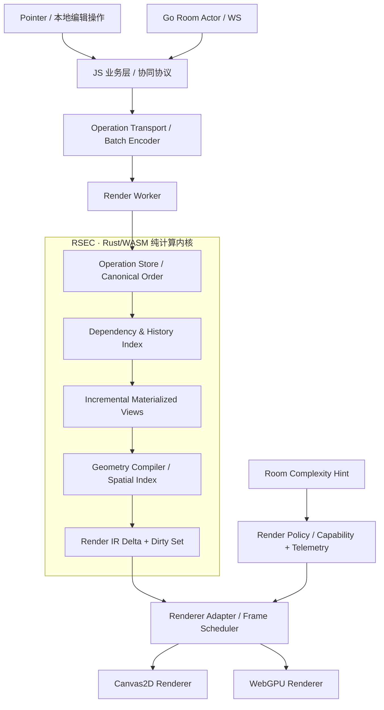
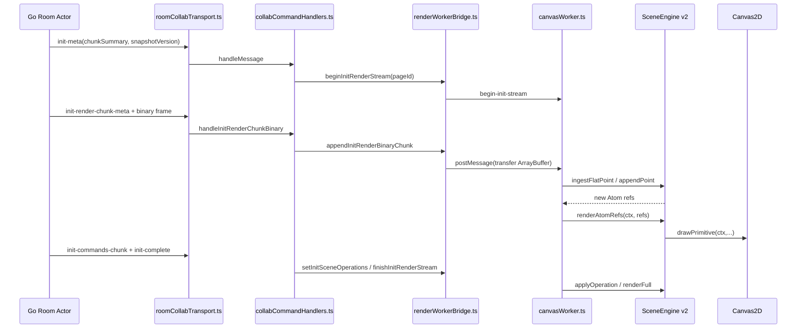
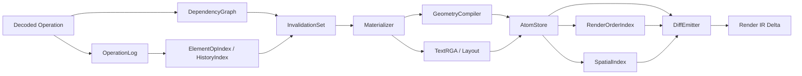
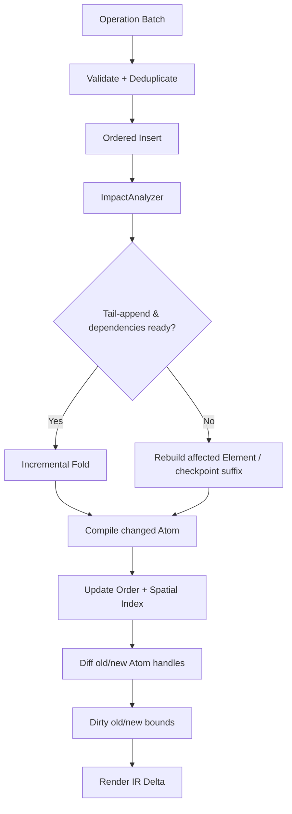
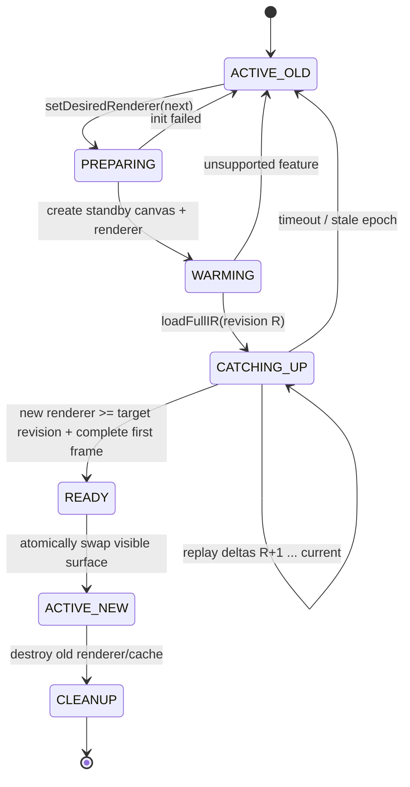
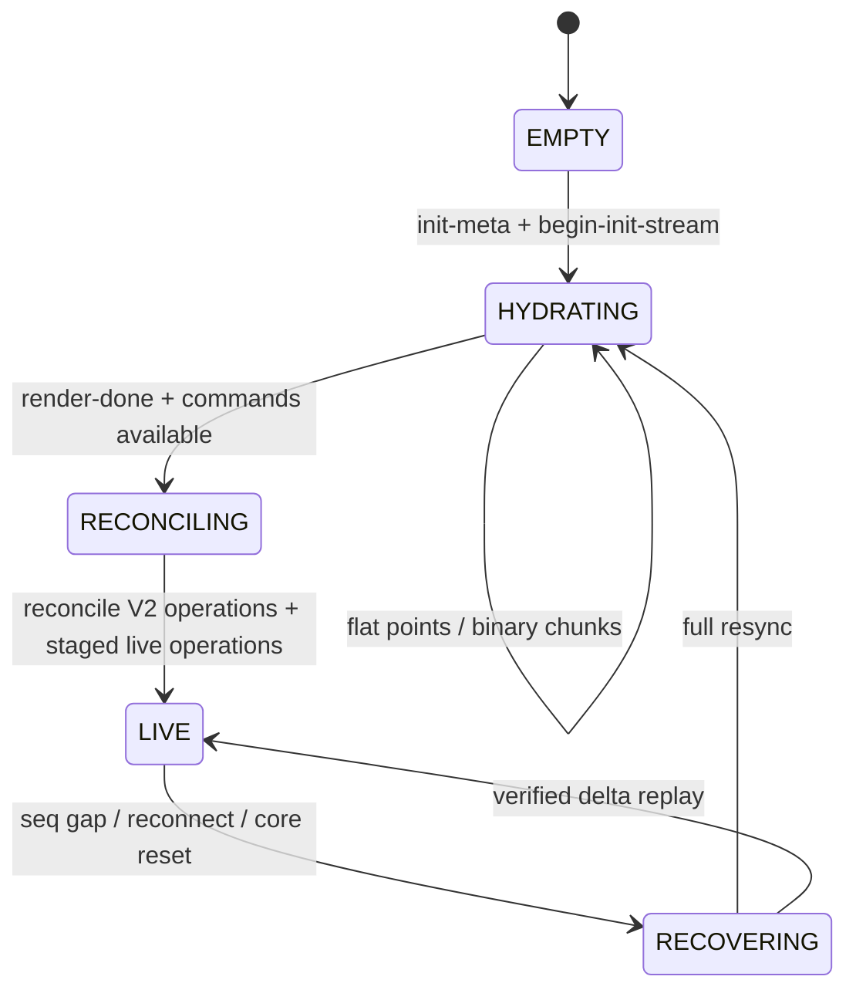
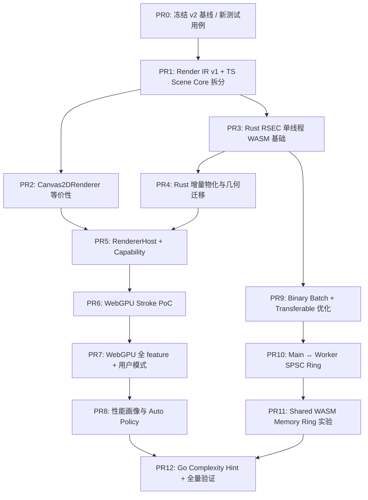
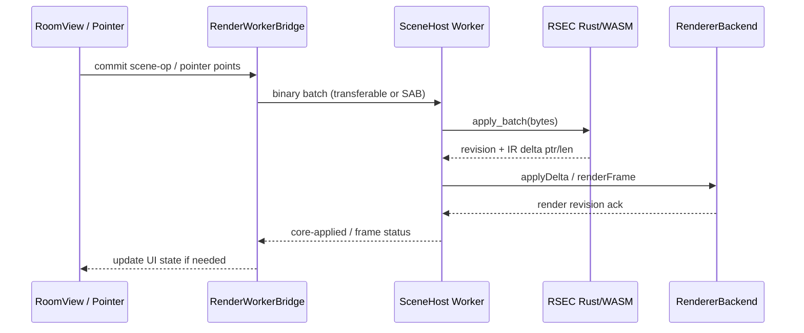

# Aevia v3：RSEC 场景计算内核与自适应异构渲染架构

> **架构设计 RFC / Draft 0.1**  
> 基准仓库：[aquaori/aevia](https://github.com/aquaori/aevia)  
> 源码锚点：[`2dd3e87428c95d00492532358364ec5f353393ac`](https://github.com/aquaori/aevia/tree/2dd3e87428c95d00492532358364ec5f353393ac)，2026-11-08  
> 方案范围：浏览器前端、SceneEngine、Render Worker、渲染后端、JS/WASM 边界、共享内存传输、初始化协议与质量门禁  
> 提案性质：**v3 新增架构**；本文所列新接口、Rust 模块、二进制格式和文件路径是拟实施的设计契约，不是宣称仓库里已经存在这些实现。文中对 v2 的描述则直接对应上述提交的现有源码。

---

## 目录

- [0. 执行摘要与技术决策](#0-执行摘要与技术决策)
- [1. v2 代码基线：实际数据怎样走到屏幕上](#1-v2-代码基线实际数据怎样走到屏幕上)
- [2. v3 总体架构、模块边界与不变量](#2-v3-总体架构模块边界与不变量)
- [3. RSEC：Rust Scene Engine Core](#3-rsecrust-scene-engine-core)
- [4. Render IR：稳定的中间表示与增量交换协议](#4-render-ir稳定的中间表示与增量交换协议)
- [5. 增量物化视图：把历史操作转化为局部场景更新](#5-增量物化视图把历史操作转化为局部场景更新)
- [6. Rust/WASM 的内存布局、ABI 与 JS 绑定](#6-rustwasm-的内存布局abi-与-js-绑定)
- [7. 动态异构渲染引擎：Canvas 2D + WebGPU](#7-动态异构渲染引擎canvas-2d--webgpu)
- [8. 渲染策略调度：用户选择、实时画像与服务端提示](#8-渲染策略调度用户选择实时画像与服务端提示)
- [9. 共享环形缓冲：主线程、Worker 与 WASM 的数据面](#9-共享环形缓冲主线程worker-与-wasm-的数据面)
- [10. 初始化、增量回放、视图切换与一致性水位](#10-初始化增量回放视图切换与一致性水位)
- [11. 仓库重构清单、依赖关系与精确实施步骤](#11-仓库重构清单依赖关系与精确实施步骤)
- [12. 测试、性能实验、CI 和验收标准](#12-测试性能实验ci-和验收标准)
- [13. 分期 PR 计划与退出条件](#13-分期-pr-计划与退出条件)
- [14. 主要设计取舍与可扩展方向](#14-主要设计取舍与可扩展方向)
- [附录 A. 现有源码定位](#附录-a-现有源码定位)
- [附录 B. 新增协议与接口清单](#附录-b-新增协议与接口清单)
- [附录 C. 术语索引与参考资料](#附录-c-术语索引与参考资料)

---

# 0. 执行摘要与技术决策

## 0.1 一句话目标

把 v2 中混合了**协同操作折叠、元素状态维护、几何编译、空间查询和 Canvas 绘制**的 `SceneEngine`，拆分为一个**Rust 实现、WASM 承载、只计算不绘制**的 `RSEC`，令它向多个渲染器发布增量 `Render IR`；在浏览器运行时通过性能画像与设备能力在 Canvas 2D / WebGPU 间选择后端，并在高频数据路径上以共享内存与有界队列降低对象克隆和传输成本。

目标链路：



## 0.2 此 RFC 确定的架构决策

| 编号 | 决策 | 原因 |
|---|---|---|
| ADR-01 | **RSEC 永不直接调用 Canvas / WebGPU API** | 场景语义必须独立于 GPU/浏览器实现。|
| ADR-02 | **v3 第一阶段保留 v2 `SceneOperationEnvelopeV2`，不立即改变网络写入协议** | 降低同时修改 Go 服务端、协议、客户端引擎的耦合风险。|
| ADR-03 | **RSEC 内部是有状态、增量更新的 Scene Materialized View** | 不把每次操作重新折叠整份历史，更不反复输出全量图元。|
| ADR-04 | **Render IR 描述逻辑场景和变更，不存具体后端的 GPU 资源句柄** | 便于两后端复用、可录制回放与比较一致性。|
| ADR-05 | **Canvas2D 是所有功能的基准实现与默认兜底** | v2 已覆盖复杂混合、擦除、文字、贴纸及脏区更新。|
| ADR-06 | **WebGPU 先做等价可选后端，不在 SceneCore 内执行图形 API** | GPU 仅负责绘制/局部几何加速；初期保留 Canvas 特殊效果。|
| ADR-07 | **主线程与 Worker 的高频链路可采用有界 SPSC Ring** | 减少每点的结构化克隆及消息分配，同时避免无限队列。|
| ADR-08 | **Worker 中的 JS 与同 Worker 的 WASM 优先采用共享线性内存视图，而非再套一层并发 Ring** | 二者同线程调用，无并发生产/消费时环形队列并不产生额外价值。|
| ADR-09 | **跨线程直接写入 WASM 共享内存 Ring 是高级档、必须有回退** | 依赖 Cross-Origin Isolation、共享 WASM Memory 和明确的线程所有权。|
| ADR-10 | **自动模式只能做有证据的后端推荐或切换，用户显式强制选择优先** | 复杂画布不等于 WebGPU 必然快。|
| ADR-11 | **绘制后端的变化不得修改协同 Operation 或 Scene Core 状态** | 不允许“不同 GPU 得到不同逻辑场景”。|
| ADR-12 | **先构造 TS 参考内核与 IR，再用 Rust 替换** | 能隔离 Rust 性能收益、协议风险和算法正确性，避免重写时无法定位回归。|

## 0.3 验收目标（不是凭空声称的提速数字）

**正确性门槛优先于性能门槛**：相同操作集合、相同规范顺序和依赖条件下，TS 参考实现与 Rust 实现的规范场景状态、可见 Atom 顺序、擦除区间、命中结果和图元 IR 一致；Canvas 新实现与现有 v2 的关键场景结果一致。

**性能目标按现有 Lab 基线增量验证**：测量 `apply`, `compile`, `query`, `hitTest`, `diff emit`, `worker transport`, `render`, `first paint`, `P95/P99 latency`, 峰值内存、CPU/GPU 负载和切换时间。新方案通过专项基准证明收益，而不是把语言更换当作收益证明。

**可运维门槛**：没有 WebGPU、没有 SharedArrayBuffer、WASM 初始化失败、GPU 设备丢失时仍能使用兼容渲染路径；尚未识别的 Rust IR 版本不能被旧渲染器误解释；旧房间数据仍可读取。

## 0.4 范围与明确暂不做的事

**v3 第一轮包含**：RSEC；TS/WASM 对照；统一 IR；增量物化更新；Canvas2D 等价渲染器；实验性 WebGPU；用户模式 + 性能调度；主线程-Worker Ring；WASM 数据批量 ABI；快照复杂度信号；故障恢复与测试体系。

**第一轮不包含**：重写 Go Room Actor、替换 SQLite、将协同协议整体升级为 CRDT、引入多线程 Rust 并行场景求值、让所有客户端 GPU 输出逐位相同。这些可以后续独立 RFC 讨论。

---

# 1. v2 代码基线：实际数据怎样走到屏幕上

这一章直接分析仓库，不使用想象中的“通用编辑器结构”。

## 1.1 前后端通信基线

服务端 `apps/backend/internal/room/stream_send.go` 的 `SendLiveInitStream()` 在发送 `init-meta` 之前计算当前页面 `renderPointCount`、可加载页面 `commandCount`，并在 `chunkSummary` 写入：

```json
{
  "renderChunks": 0,
  "commandChunks": 0,
  "totalRenderChunks": 0,
  "totalCommandChunks": 0,
  "pointCount": 0,
  "commandCount": 0
}
```

> 数字 `0` 只是展示字段结构，真实数值在服务端按房间状态计算。核心事实是这六个字段在现有源码中已存在。

随后服务器执行 `sendRenderStreamFromIndex` 与 `sendCommandStreamFromState`，前者把可见点数据编码成二进制 render chunk，后者把命令流发给客户端。这两条流是独立的：**Render Stream 追求尽快首帧，Command Stream 负责完整语义/业务状态补全**。因此不能简单地把渲染 chunk 当成完整的协同操作日志。

当前二进制 render chunk 见 `apps/backend/internal/protocol/render_chunk.go`，前端解码见 `apps/frontend/src/workers/canvasWorker.ts`：帧头为 20 字节，每条点记录为 22 字节，字段包含 `Float32 x/y/p`、`Float64 lamport` 和 `Uint16 cmdIndex`，**按网络帧既有大端规范读取**。v3 新的本地 RSEC/IR ABI 采用小端；两种协议是不同边界，不应混为一谈。

## 1.2 浏览器收到消息后的真实流转



**关键源码调用点**：

1. `roomCollabTransport.ts`：WebSocket 连接、流式消息解析、二进制帧路由、`lastRoomSeq`。
2. `collabMessageDispatcher.ts`：`init-meta`、`init-render-*`、`init-commands-*`、`push-cmd`、`delta-replay-*` 分发。
3. `collabCommandHandlers.ts`：`handleInitMeta()` 初始化快照状态；`handleInitRenderChunkBinary()` 与 `tryFinalizeInitRenderStream()` 管理分块完成；`setInitSceneOperations()` 将语义操作同步到 Worker。
4. `renderWorkerBridge.ts`：创建 `canvasWorker.ts`，通过 `transferControlToOffscreen()` 转移 canvas；`appendInitRenderBinaryChunk()` 以 transferable `ArrayBuffer` 转交消息；`syncCommandState()` 转交普通命令或 V2 Scene Operation。
5. `canvasWorker.ts`：持有一个 `const sceneEngine = new SceneEngine()`；处理 `init-canvas`、`append-init-binary-chunk`、`update-command-state`、`render-dirty`、`scene-hit-test` 等消息；在 worker 内创建 `OffscreenCanvasRenderingContext2D`。
6. `sceneEngine.ts`：维护场景/索引，并调用 `drawPrimitive()` 实际绘制。

这里明确说明一项已有优化：**v2 快照二进制已经通过 transferable `ArrayBuffer` 送入 Worker**，所以 v3 的 Ring 不是来替代一个“当前全是 JSON”的初始化通道。Ring 主要针对高频小消息和对象克隆；批量初始化仍适合 transfer。

## 1.3 当前 SceneEngine 维护的状态

位于 `apps/frontend/src/scene/sceneEngine.ts` 的私有成员实际包括：

| 当前字段 | 意义 | v3 对应模块 |
|---|---|---|
| `operations`、`operationIds` | 全局已知操作与去重 | `operation_log`、`op_dedup` |
| `operationsByElement` | 按元素索引的操作序列 | `element_op_index` |
| `operationsByHistoryGroup`、`historyEnabled` | 历史组和 undo/redo 有效状态 | `history_index` |
| `pageClearBefore` | 页面清空的逻辑水位 | `page_visibility` |
| `elements`、`revisionSeed` | Element 的物化状态及修订 | `materialized_elements` |
| `compilerStates` | 笔迹曲线编译器的上一个状态 | `geometry::stroke` |
| `atoms` | 已编译图元（包括过时修订） | `atom_store` |
| `order` | 按 RenderOrderKey 排序的图元索引 | `z_order_index` |
| `spatial` | 归一化网格与几何 chunk | `spatial_index` |
| `dirtyRegions`、`dirtyFullMode` | 局部/全量渲染抉择 | `invalidator`；策略最终交给 Renderer |
| `legacyElementIds`、`legacyDeleted` | 旧版点流兼容与升级 | `legacy_hydrator` |

SceneEngine 的公开能力也不只是“渲染”——它还提供 `applyOperation()`、`computeEraseTargets()`、`hitTestTopmost()`、`queryElements()`、`getElementBounds()`、`getHistoryImpact()`、`getVisibleAtomOrder()`、`sceneHash()` 等。抽离后这些功能都应当保留对外入口，而不只是导出 draw list。

## 1.4 已经实现的增量机制，不应误写成 v3 才有

`applyOperation()` 不是每次都重放所有操作：它将新操作按 `compareRenderOrder` 插入有序列表；如果插在尾部，执行 `applyOperationIncremental()`；如果乱序插入，则对受影响元素执行 `rebuildElements()`。`history.toggle` 通过 `operationsByHistoryGroup` 定位受影响目标；`page.clear` 可能触发 `rebuildV2Elements()`。

笔迹通过 `strokeCompiler.ts` 的 `compileStrokeSample()`，逐个输入点输出 `DotAtom` 或 `QuadraticAtom`，并在结束时通过 `finishCompiledStroke()` 补齐尾段。空间索引采用 `SpatialGridIndex`：32×32 归一化网格、chunk 最多 64 个 Atom，且限制 chunk 的格子覆盖。`RenderOrderIndex` 是分块排序索引（默认块长 2,000），不是一次次全局排序整个 Atom 数组。`DirtyRegionSet` 支持至多八个脏区，并且已有从局部渲染切回全量渲染的迟滞阈值。

因此 v3 的“增量物化视图”不是从零开始，而是把**当前分散在多个 Map、Atom 数组和 Renderer 方法中的增量规则**抽象成明确的依赖图、变更集、稳定句柄与可验证的局部维护语义。

## 1.5 v3 必须继承的视觉语义

`sceneTypes.ts` 的 `RenderAtom` 实际是五种实体：`dot`、`quadratic`、`shape`、`glyph`、`bitmap`。`primitiveRenderer.ts` 的真实规则还包括：

- `eraser` 用 `globalCompositeOperation = "destination-out"`；`highlighter` 用 `"multiply"`；其余采用 `"source-over"`。
- `pencil/highlighter` 采用 `butt` 线帽，其余通常是 `round`。
- `quadratic` 可配虚线、点线、点划线和双线笔触，受 `dashOffset`、笔宽和量化擦除区间影响。
- shape 包含直线、箭头、矩形、圆角矩形、椭圆、带阴影的便签背景。
- glyph 用 `ctx.fillText()` 根据字形、字体、字号、对齐与 `maxWidth` 绘制。
- 当前 sticker 的 `bitmap` Atom 实际存储 `value` 字符串，在 Canvas 执行器里通过 `fillText()` 绘制，**不是现成的图片纹理系统**。
- 源坐标主要是归一化画布坐标；一些笔宽、虚线和 UI 命中阈值则以逻辑像素计算；Canvas DPR 在 Worker 上下文初始化时处理。

这些细节决定了 RSEC IR 的字段，以及 WebGPU 的对齐顺序。不能把 `quadratic` 简化成普通线段而不保留曲线定义，也不能把文本草率替换成每字符固定图像而改变现有行宽与内容模型。

## 1.6 v2 中可直接成为 v3 设计动因的现象

**现象 A：操作数组按逆序线性扫描插入。** `applyOperation()` 里的 `while (insertAt > 0 ...)` 配合 `splice` 在大量迟到操作时可能产生较高维护成本；v3 可以保留尾部快路径，换成平衡索引或分块有序序列，同时通过基准决定是否有必要。

**现象 B：重建时旧 Atom 保存在全局数组，靠 `elementRevision` 过滤有效版本。** `compactIndexes()` 会在一定阈值下重建数组和索引；v3 应给 Renderer 提供稳定的 `AtomHandle + generation`，并显式发送 remove/update，避免下游 GPU Buffer 对裸 `atom.ref` 产生长期依赖。

**现象 C：SceneEngine 直接持有 Canvas Context。** `renderFull()`、`renderAtomRefs()`、`renderDirtyRegions()`、`drawRef()` 都以 `ctx` 为输入；`renderDirtyRegions()` 还直接 `clearRect`、`clip`。这是必须首先拆开的边界。

**现象 D：Worker Bridge 仍有不少深拷贝。** `cloneCommandForStateSync()` 和 `cloneSceneOperation()` 对复杂操作使用对象复制/`JSON.stringify`+`JSON.parse`，增量提交仍采用 `postMessage` 传 JS 对象；可作为 Ring + 结构化二进制输入的优化入口。

**现象 E：命中/擦除的几何计算属于场景内核，而非 Renderer。** `hitTestTopmost()`、`queryElements()`、`computeEraseTargets()` 使用空间索引、矩阵求逆、曲线采样和量化区间；不应因为 WebGPU 绘制而分叉出另一份语义实现。

---

# 2. v3 总体架构、模块边界与不变量

## 2.1 两层协议、三层状态、四个执行域

**两层协议**：网络上的 `SceneOperationEnvelopeV2` 是用户行为的规范事实；浏览器内部的 `RSEC Input Batch + Render IR Delta` 是高效计算/渲染协议。二者独立版本化。

**三层状态**：

1. **Operation Truth**：收到的不可变操作、唯一 ID、规范顺序、历史组开关、依赖关系。
2. **Scene Materialization**：当前有效 Element、文本字符、矩阵、路径点、擦除区间、Atom、索引。
3. **Render Cache**：Canvas 缓存、WebGPU Buffer/Texture、glyph atlas 等。它们可以被丢弃并从第二层重建。

**四个执行域**：

| 执行域 | 线程/位置 | 职责 |
|---|---|---|
| Vue / TS 主线程 | Main Thread | UI、输入、用户设置、WS 接收、后端提示、模式切换触发；不负责大规模场景折叠。|
| Scene/Render Worker | Dedicated Worker | 操作消费、RSEC 执行、渲染调度、离屏画布和设备生命周期。|
| Rust WASM | 先在上述 Worker 中同步执行 | 拥有逻辑 Scene 状态与增量编译；不直接接触 DOM 和 GPU。|
| Go 后端 | 服务进程 | Authoritative room operation、持久化、初始化/增量流、复杂度统计。|

为什么**不立即加一个独立 Rust Worker**？同一 Worker 中的 JS→WASM 调用成本可控，且渲染与 Scene Core 在同一线程可直接读取 IR 内存；独立多 Worker 会增加同步协议、调度延迟和一套额外消息队列。只有 RSEC 计算确实妨碍及时提交绘制时，再考虑双 Worker 或 Rust WASM Threads。

## 2.2 所有实现都必须满足的不变量

**I-01：同一有效操作集导出同一规范逻辑状态**，由固定的排序、操作折叠、历史和依赖规则定义；网络到达顺序不能改变最终 IR 的语义内容。

**I-02：Atom 的绘制全序保持不变**：v2 排序键是 `(lamport, opId, sourceIndex, subIndex)`。Rust 比较器必须与 JS/Go 相符。现有生成 ID 使用 ASCII 时，JS 的码元比较与 Go 的字节比较一致；v3 需通过协议明确 ID 的规范字符集或统一按 UTF-8 字节排序，不能在语言迁移时无意改变历史数据顺序。

**I-03：一个提交批次有且仅有一个 Scene Revision**：`Revision` 单调递增，变更包包含 `baseRevision` 和 `revision`。Renderer 必须按顺序应用，不能丢掉先前的 Remove 再画后续 Add。

**I-04：Render IR 只是一份逻辑投影**。后端使用 GPU 不得改变笔迹的 `atomId`、序号、擦除逻辑和用户协同结果。

**I-05：同一个逻辑场景只有一个权威 RSEC 实例**。切换 Canvas/WebGPU 不重新接收网络事件、重放未提交操作或改变 RoomSeq；新 Renderer 从当前 Scene Snapshot 和后续 IR Delta 初始化。

**I-06：所有局部更新必须覆盖旧包围盒与新包围盒**。改变位置、样式、可见性或图元集合时至少使两者并集失效，以免出现残影。

**I-07：高频队列可以合并纯临时事件，但不能丢失不可变协同操作。** Pointer hover/presence 可 coalesce；可靠 Operation / 文本补丁 / undo 必须按序送达或触发明确的 resync。

**I-08：协议版本互不隐式绑定**：网络 `schemaVersion=2`、新 `RSEC ABI VERSION=1`、`Render IR VERSION=1` 与 Renderer capability version 独立。

**I-09：安全与故障隔离**：WASM 非法输入不能越界访问或产生无限循环；Device Lost 不破坏 RSEC；共享环形队列不得无限阻塞主线程。

## 2.3 拟新增的仓库目录

```text
aevia/
├─ crates/
│  └─ rsec/
│     ├─ Cargo.toml
│     └─ src/
│        ├─ lib.rs                # Rust facade / wasm exports
│        ├─ abi.rs                # 版本、句柄、输入/输出 buffer
│        ├─ protocol/            # V2 操作解码、排序、ID 字典
│        ├─ model/               # Element、文本、History、页面
│        ├─ operation/           # OperationLog / index / dependencies
│        ├─ materialize/         # 增量视图、影响域、checkpoint
│        ├─ geometry/            # stroke / shape / erase / bounds
│        ├─ index/               # order / spatial
│        ├─ ir/                  # Atom packets / Scene delta / hash
│        ├─ memory/              # arena、缓冲区、可选 ring reader
│        └─ tests/               # rust 参考用例 / fuzz
├─ packages/
│  ├─ shared/                    # 保留现有 v2 语义操作
│  └─ rsec-contract/             # v3 内部 IR schema + codec + test vectors
├─ apps/frontend/src/
│  ├─ scene/                     # TS reference core，迁移后仍用于对照
│  ├─ engine/
│  │  ├─ coreAdapter.ts         # TSReferenceCore / WasmSceneCore 统一接口
│  │  ├─ wasmLoader.ts          # WASM 生命周期和输入输出内存
│  │  ├─ irDecoder.ts           # IR batch 读取
│  │  ├─ sceneHost.ts           # revision / apply / snapshot / query
│  │  └─ renderPolicy.ts        # Auto/Canvas/WebGPU 策略
│  ├─ render/
│  │  ├─ renderer.ts            # Renderer Backend 接口
│  │  ├─ canvas2dRenderer.ts    # 从 primitiveRenderer.ts 抽离
│  │  ├─ webgpuRenderer.ts      # GPU pipeline 和 cache
│  │  ├─ webgpu/                # stroke / mask / text / blend / atlas
│  │  └─ rendererSwitch.ts     # 双画布预热与原子切换
│  ├─ transport/
│  │  ├─ operationCodec.ts
│  │  ├─ spscRing.ts
│  │  └─ transportCoordinator.ts
│  ├─ workers/
│  │  └─ canvasWorker.ts        # 分阶段变薄为场景宿主入口
│  └─ service/
│     └─ renderWorkerBridge.ts  # 外部 API 保留，内部换适配器
└─ tests/
   └─ rsec/                    # TS/Rust 差分、IR、Ring、视觉金样、性能
```

该结构以仓库既有的 `apps/frontend`、`packages/shared`、`apps/backend` 工作区为根，不移动 Go 服务端，也不要求一次性改掉既有 Vue 组件。`crates/rsec` 最初作为一个独立 Rust crate，后续再决定要不要多 crate workspace。

# 3. RSEC：Rust Scene Engine Core

## 3.1 为什么 Rust 内核应该是「有状态的纯场景计算器」

一句 `compile(operations) -> IR` 看起来简单，但对于多人协同白板会隐藏极高的计算成本。一个历史包含十万点、数千个修改操作的房间，如果每添加一个点都重新计算所有操作，复杂度至少随历史长度增长；这会直接抵消 Rust 语言带来的优化。

因此真正的 RSEC 接口不是一次性的 `compile()`，而是：

```text
create(pageId) -> CoreHandle
apply(operations batch) -> Revision
read_changes(sinceRevision) -> RenderIrDelta
query_hit / query_rect / query_erase -> QueryResult
snapshot() -> FullRenderIR
reset / restore / destroy
```

引擎在自己的 Rust heap 中持续保存规范状态。**唯一真相是操作；Element 与 Render IR 是能从它重建的物化投影。** Rust 不处理权限、用户 UI、网络握手、`CanvasRenderingContext2D`、`GPUDevice` 或 DOM。前端传给 RSEC 的输入必须已经经过现有协议层的基本验证；RSEC 还要复核 ABI 长度和数值合法性，确保内存安全。

## 3.2 将 v2 类型映射到 Rust 内部模型

v2 的 `SceneOperationEnvelopeV2` 共有九类操作：

```text
element.create
 element.append
 element.transform
 element.style
 element.erase
 element.delete
 text.patch
 history.toggle
 page.clear
```

保留这九种动作的语义，不重新设计一个与 v2 不兼容的协同模型。

Rust 中用强类型枚举表达操作：

```rust
// crates/rsec/src/protocol/operation.rs
#[derive(Clone, Debug)]
pub struct OrderKey {
    pub lamport: f64,      // v2 中是 JavaScript Number；第一阶段保持数值语义
    pub op_id: String,
    pub source_index: u32,
    pub sub_index: i32,   // sticky-background 当前会使用 -1
}

#[derive(Clone, Debug)]
pub struct Envelope {
    pub op_id: String,
    pub element_id: String,
    pub actor_id: String,
    pub room_id: String,
    pub page_id: u32,
    pub lamport: f64,
    pub history_group_id: String,
    pub payload: Operation,
}

#[derive(Clone, Debug)]
pub enum Operation {
    Create(CreatePayload),
    Append { points: Vec<Point>, source_start: u32, complete: bool },
    Transform { targets: Vec<TransformTarget> },
    Style { patch: StylePatch },
    Erase { targets: Vec<EraseTarget> },
    Delete { element_ids: Vec<String> },
    TextPatch { patches: Vec<TextPatch> },
    HistoryToggle { target_history_group_id: String, enabled: bool },
    PageClear { before: OrderKey },
}
```

注意 `subIndex` 必须能表示负数：v2 的 `rebuildTextAtoms()` 为便签背景设置 `subIndex: -1`，因此这里不能为了方便改成无符号数。

`Point` 首轮保留 `x/y/p/lamport` 的 `f64` 规范值。网络的 render chunk 中 `x/y/p` 虽是 `Float32`，但这是**网络表示**，不是理由去无条件降低整个操作模型的内部精度。笔宽、矩阵、擦除边界等算术要先和 TS 参考结果逐项对照；只在 Render IR 证明误差范围可接受之后，再对大批量 GPU 几何改用 `f32`。

## 3.3 Rust 的模块职责与数据所有权



详细拆分：

| 模块 | 内部持有的长期数据 | 主要公开操作 |
|---|---|---|
| `operation_log` | 唯一 ID 集、有序操作记录 | `insert`, `by_id`, `ordered_range` |
| `element_op_index` | Element → 排序后操作句柄 | `operations_for(element)` |
| `history_index` | Group → 操作句柄、当前有效开关 | `affected_elements(group)`, `effective_toggle(group)` |
| `dependency_index` | `create` / `append` / `afterId` 依赖关系 | `ready`, `pending`, `dependents` |
| `materialized_elements` | Element descriptor、矩阵、路径点、文字 RGA、擦除区间 | `fold_element`, `apply_tail` |
| `geometry::stroke` | 上一个点、midpoint、压力宽度、累计距离、末端状态 | `append_sample`, `finish` |
| `geometry::erase` | 量化曲线擦除区间、几何相交 | `compute_targets`, `merge_intervals` |
| `atom_store` | 原语、样式、稳定句柄、修订版本 | `upsert`, `retire`, `iter_live` |
| `order_index` | RenderOrderKey → AtomHandle | `insert`, `remove`, `ordered_iter` |
| `spatial_index` | 归一化 AABB → chunk 与 AtomHandle | `insert`, `reindex`, `query` |
| `invalidator` | old/new bounds、显隐变化、跨区域修订 | `mark`, `finalize` |
| `ir` | 全量 IR 或 Delta IR 批次 | `emit_full`, `emit_delta` |

**数据所有权原则**：一个 Atom 的逻辑真相只保存在 `AtomStore` 中；RenderOrderIndex 和 SpatialIndex 都只保存稳定句柄，不另存一份完整 Atom，避免各个索引不同步。类似地，历史组的生效状态只由 `HistoryIndex` 决定，Materializer 只消费决定结果。

## 3.4 稳定句柄：替换现有 `atom.ref` 的关键步骤

v2 `storeAtom()` 使用 `const ref = this.atoms.length`，如果重建元素会保留过时 Atom 并依靠 `elementRevision` 判断活跃；之后 `compactIndexes()` 会重排 refs。

对 Canvas 2D 来说，`ref` 只在 JS 运行时内部使用，问题不大。但 WebGPU 后端要长期维护 Vertex Buffer、索引缓冲、纹理/缓存；如果 `ref` 在后台 compact 后改变，Renderer 容易错误地把旧 GPU 资源指向新图元。

v3 使用**代际句柄**（Generational Handle）：

```rust
#[derive(Clone, Copy, Debug, Hash, PartialEq, Eq)]
pub struct AtomHandle {
    pub slot: u32,
    pub generation: u32,
}

struct Slot<T> {
    generation: u32,
    value: Option<T>,
}
```

- 新 Atom 分配空 slot，得到 `(slot, generation)`。
- 元素重建时，旧 Atom 在逻辑层被 retire，发送 `REMOVE` Delta；可重用 slot，但 generation 必须递增。
- Renderer 更新 `(slot, generation)` 的精确对象；若收到旧 generation 的更新，直接判为过期数据。
- `elementId`、`atomId` 仍保留业务身份；Handle 是单一 RSEC 实例内部的短寿命快速引用，**不得当成跨进程协同 ID**。

这个设计能解决 v2 revision 过滤、GPU 资源索引和内部 compact 之间的耦合。注意 Renderer **仍应有自己的 GPU 资源 generation**，因为 GPU device lost 后缓冲区可整体失效，即使 AtomHandle 未变化。

## 3.5 Rust 内部的字符串与索引

操作 Envelope 的 `opId`、`actorId`、`elementId` 等是高频重复字符串。如果每个 Atom 都保存独立 `String`，大量点会产生大量内存分配。建议：

```rust
#[derive(Clone, Copy, Hash, Eq, PartialEq)]
struct ElementKey(u32);
#[derive(Clone, Copy, Hash, Eq, PartialEq)]
struct OpKey(u32);
#[derive(Clone, Copy, Hash, Eq, PartialEq)]
struct HistoryKey(u32);
```

在 `StringInterner` 中实现字符串 ↔ 32 位句柄映射，Atom 只携带短句柄。外部 IR 在必要时通过 Dictionary Section 输出原始字符串。

v2 的排序键比较规则必须专门定义为：

```text
1. lamport 数值升序
2. opId 的规范字节顺序
3. sourceIndex 升序
4. subIndex 升序
```

不能用“内部 OpKey 数字越小越先画”代替 `opId` 的字典序：Interner 的分配顺序随网络到达顺序变化，直接比较内部 ID 会破坏收敛性。Rust 可以用 `BTreeMap` / 排序向量或比较器保持规范次序，但**渲染全序以原始 ID 而不是内存地址/分配顺序决定**。

现有字符串 ID 正常来自 ASCII 生成路径。为兼容已有数据，推荐先把 v2 所用比较写成跨 TS/Go/Rust golden vectors；若准备接受任意 Unicode ID，需同时确认服务端验证与排序算法的协议含义，统一比较器之后才启用。

## 3.6 遗留点流兼容不能丢

`SceneEngine` 已处理旧 FlatPoint 流的 `ingestFlatPoint()`，并在 V2 `element.create` 到来时对已有 legacy hydrate 结果执行 adoption，避免重复绘制路径点。RSEC 必须保留这个入口：

```rust
pub enum SceneInputBatch {
    LegacyFlatPoints(Vec<FlatPoint>),
    SceneOperations(Vec<Envelope>),
    FinishLegacyStrokes(Vec<ElementKey>),
}
```

迁移期间的期望过程：

1. render chunk 的 FlatPoint 首先被 `legacy_hydrator` 收入临时场景并可生成首帧；
2. V2 `element.create` 与 `element.append` 从 commands stream 到达；
3. 若针对同一 `elementId` 的点序列已 hydrate 到对应 `sourceEndExclusive`，**采用现有几何而不是再复制一份 Atom**；
4. 历史、样式、擦除、transform 等语义操作随后进入标准增量管线；
5. 初始化完成后生成权威 revision，临时 hydrated 实体转为普通 Element 或被替换。

这是 v3 能继承 v2 “流式逐步首帧”特性的必要条件；若采用“先收完所有命令再调用 Rust”，会损失已有的渐进式显示体验。

---

# 4. Render IR：稳定的中间表示与增量交换协议

## 4.1 IR 分为「语义 IR」「Render IR」「后端缓存」三层

此处特别避免将三种中间状态混成一个概念。

**Semantic Scene State（内核持有）**：每个 Element 的点、文本字符、局部矩阵、样式、历史状态、擦除区间，具备协同语义。

**Render IR（跨 Rust/JS 的输出契约）**：Atom 类别、规范绘制顺序、归一化几何、样式引用、复合模式、擦除区间、可见性、修订与失效区域。它仍可被 Canvas2D 或 WebGPU 消费。

**Backend Cache（Renderer 独占）**：Canvas 的位图/Path2D；WebGPU 的三角化网格、`GPUBuffer`、pipeline、bind group、glyph atlas；这些不进入协同操作，也不由 Rust Core 持有。

```text
Operation Log --fold--> Semantic Element --compile--> Render Atom
                                            |
                                            +--IR Delta-->
                                               Canvas: drawPrimitive / Path2D
                                               WebGPU: tessellate / GPUBuffer / render pass
```

## 4.2 Render Atom 的提议结构：对应 v2 真实 Atom 类型

```ts
// packages/rsec-contract/src/types.ts（设计接口）
type AtomHandle = { slot: number; generation: number };
type RenderOrderKey = {
  lamport: number;
  opId: string;
  sourceIndex: number;
  subIndex: number;
};

type NormalizedPoint = { x: number; y: number };
type Mat2D = readonly [number, number, number, number, number, number];

type RenderPrimitiveIR =
  | { kind: "dot"; center: NormalizedPoint; widthPx: number; dashOffset: number }
  | { kind: "quadratic"; from: NormalizedPoint; via: NormalizedPoint;
      to: NormalizedPoint; widthPx: number; dashOffset: number;
      erased: readonly { start: number; end: number }[] }
  | { kind: "shape"; shapeKind: "line" | "arrow" | "rectangle" |
      "rounded-rectangle" | "ellipse"; box: AabbBox;
      shapeStart?: NormalizedPoint; shapeEnd?: NormalizedPoint }
  | { kind: "glyph"; grapheme: string; x: number; y: number; maxWidth: number }
  | { kind: "bitmap"; value: string; box: AabbBox };

type AtomIR = {
  handle: AtomHandle;
  atomId: string;
  elementId: string;
  pageId: number;
  order: RenderOrderKey;
  recipeId: "stroke" | "shape" | "glyph" | "bitmap";
  toolId: string;
  style: SceneElementStyle;
  matrix: Mat2D;
  bounds: AabbBox; // 归一化坐标；与变换后的 world bounds 区分
  primitive: RenderPrimitiveIR;
};
```

v2 `RenderAtom` 把 matrix 放在 `SceneElementState` 而不是 Atom 内。IR 可以选择 `elementMatrixRef`，避免重复序列化每个 Atom 的矩阵；上述 TS 版本为了表达清楚展开成 `matrix`，**二进制版本则推荐通过 Element Table 引用矩阵**。同理，`style` 应走 Style Table，字符串走 Dictionary Table。

### 重要的语义细节

- `widthPx` 不等于坐标单位。笔迹中心线在归一化画布中，当前 v2 `drawPrimitive` 通过 `logicalWidth`、`logicalHeight` 和 `matrixScale` 推导像素宽度。IR 明确存“逻辑笔宽”而不是烘焙后的某个 DPR 大小。
- `erased` 沿用 v2 `QuantizedInterval` 的 `0..65535` 参数区间；Canvas 执行器目前通过 `splitQuadratic()` 对可见曲线区间求新的控制点。
- `order` 必须可以跨笔迹、文字 glyph、图形混合排序，不能天然按 Element 类型分层，否则改变 v2 的交错绘制语义。
- `blend` 与 `opacity` 均是必需数据；`destination-out`、`multiply`、`source-over` 不可忽略。
- 文字 Atom 是 grapheme（字素簇）而不是 UTF-16 code unit。v2 通过 `splitGraphemes()` 生成字符数据；Rust 侧字素分割必须与现行策略做规范测试，而不是默认“每个 Unicode scalar 就是一个字符”。

## 4.3 增量协议比完整图元数组更重要

每个批次产生如下变化，而不是 `exportAllAtoms()`：

```ts
type AtomMutation =
  | { op: "add"; atom: AtomIR }
  | { op: "update"; atom: AtomIR }
  | { op: "remove"; handle: AtomHandle; lastKnownBounds: AabbBox };

interface RenderIRDelta {
  irVersion: 1;
  pageId: number;
  baseRevision: bigint;
  revision: bigint;
  mutations: AtomMutation[];
  dirtyRegions: AabbBox[];
  renderOrderChanged: boolean;
  fullRebuildRequired: boolean;
}
```

`Remove` 特别关键。比如撤销画笔操作，如果只把新可见 Atom 发给 GPU，不告诉 GPU 哪些旧 Atom 要删除，就会产生残影。v2 借助 `revision` 过滤、脏区 clear+重画隐含地完成了删除；v3 需要把这种失效变成显式变化。

同理，一个 Element 发生 Transform 时，两个位置都要失效：

```text
oldBounds = 转换前的 world AABB
newBounds = 转换后的 world AABB
dirty = union(oldBounds, newBounds)
```

如果一次操作同时触及多个 Element（`element.transform.targets`、`element.erase.targets`、`element.delete.elementIds`），每个目标都要生成独立变更，再合并 DirtyRegionSet。

## 4.4 IR 二进制交换格式：版本 1

**为何要定义二进制布局？** TS 对象 IR 很适合开发，但十万 Atom 场景下每次结构化克隆会触发对象分配、字符串复制和 GC；Rust/WASM 返回一份紧凑内存区域能够降低这个成本。此格式只用于浏览器内部，不替代服务器当前的 render chunk 帧。

建议使用**小端、八字节对齐、固定 Header + Section Directory + 变长 payload**：

| Header 字节偏移 | 类型 | 字段 | 含义 |
|---:|---|---|---|
| `0` | `u32` | `magic = 0x49524541` | 按 little-endian 字节序是 `AERI` |
| `4` | `u16` | `irVersion = 1` | 协议版本 |
| `6` | `u16` | `headerBytes = 64` | 固定头长 |
| `8` | `u32` | `flags` | FULL / DELTA / RESET 等 |
| `12` | `u32` | `sectionCount` | 后续 section directory 数量 |
| `16` | `u64` | `baseRevision` | 应用前修订 |
| `24` | `u64` | `revision` | 应用后修订 |
| `32` | `u32` | `pageId` | 当前页面 |
| `36` | `u32` | `atomMutationCount` | 原子变更数量 |
| `40` | `u32` | `dirtyRegionCount` | 脏区数量 |
| `44` | `u32` | `reserved` | 置零 |
| `48` | `u32` | `totalBytes` | 整个数据包长度 |
| `52` | `u32` | `directoryOffset` | Section Directory 起始 |
| `56` | `u32` | `checksumOffset` | 校验字段位置；0 表示无校验 |
| `60` | `u32` | `checksum32` | 开发诊断用校验，非协同状态 hash |

Section Directory 每条可以是 `kind: u16, flags: u16, offset: u32, length: u32, count: u32`（16 字节），支持：

| Section kind | 内容 | 所属职责 |
|---|---|---|
| `1 DICTIONARY` | UTF-8 string 表与长度 | opId/elementId/grapheme/style 字符串 |
| `2 ELEMENT_TABLE` | ElementKey → Matrix、StyleRef、页面 | 避免每 Atom 重复矩阵 |
| `3 STYLE_TABLE` | 颜色、字号、透明度、线型与排版属性 | Renderer 统一样式 |
| `4 ORDER_TABLE` | 规范 RenderOrderKey | 跨类别排序 |
| `5 ATOM_MUTATIONS` | Add/Update/Remove 记录 | GPU/Canvas 变更 |
| `6 PRIMITIVE_PAYLOAD` | dot/quadratic/shape/glyph/bitmap 参数 | 具体图元 |
| `7 ERASE_INTERVALS` | u16 区间对 | 精确擦除 |
| `8 DIRTY_RECTS` | 归一化 AABB 组 | 局部刷新 |
| `9 DEBUG_STATS` | 编译、索引、资源计数 | 可选调试 |

### 固定 64 字节的 Atom Mutation 记录

```text
0   u8  action           1=ADD 2=UPDATE 3=REMOVE
1   u8  primitiveKind    1=dot 2=quadratic 3=shape 4=glyph 5=bitmap
2   u8  compositeKind    1=source-over 2=multiply 3=destination-out
3   u8  flags
4   u32 atomSlot
8   u32 atomGeneration
12  u32 elementKey
16  u32 orderRef
20  u32 styleRef
24  f32 boundsMinX
28  f32 boundsMinY
32  f32 boundsMaxX
36  f32 boundsMaxY
40  u32 payloadOffset
44  u32 payloadBytes
48  u32 atomIdRef
52  u32 pageId
56  u64 reserved
```

所有偏移和长度均以**整个 IR Buffer 为基准**，不是相对 JS TypedArray 的 offset；所有 `offset + length` 必须在 `totalBytes` 内。`REMOVE` 可以不带 Primitive Payload，但必须带句柄与失效边界。`UPDATE` 用相同句柄的新状态替换旧状态；若修改类型导致内部 atomId 改变则发送 REMOVE+ADD，不隐藏身份变化。

**浮点规则**：64 字节 Atom Mutation 表的 AABB 采用 `f32` 是为渲染交换节省开销，但 Rust 内部仍可用 `f64` 保持协同/命中语义。输出时要为舍入误差适当向外扩张 bounds，避免因收窄包围盒而漏绘；几何 payload 首轮可使用 `f64`，性能实验后另行决定是否使用 `f32`。二者不可无测试地混用。

### TS 侧规范解码入口

```ts
function decodeIrHeader(bytes: Uint8Array) {
  if (bytes.byteLength < 64) throw new Error("IR header too short");
  const view = new DataView(bytes.buffer, bytes.byteOffset, bytes.byteLength);
  if (view.getUint32(0, true) !== 0x49524541) throw new Error("IR magic mismatch");
  const version = view.getUint16(4, true);
  if (version !== 1) throw new Error(`Unsupported IR version ${version}`);
  const totalBytes = view.getUint32(48, true);
  if (totalBytes > bytes.byteLength || totalBytes < 64) {
    throw new Error("IR length out of range");
  }
  return {
    version,
    baseRevision: view.getBigUint64(16, true),
    revision: view.getBigUint64(24, true),
    pageId: view.getUint32(32, true),
    mutationCount: view.getUint32(36, true),
    dirtyRegionCount: view.getUint32(40, true),
    totalBytes,
  };
}
```

这种布局可在 Rust 与 JS 分别编写 schema golden tests，并通过 `DataView` 以相同字节序解析，且不依赖 Rust `repr(C)` 的隐式 padding。**不能直接把 Rust `Vec<RenderAtom>` 的内存强转成 wire bytes**：Rust 结构体可能包含指针、枚举布局、对齐和分配器内部状态，无法作为稳定 ABI。

## 4.5 两种 IR 输出模式

**Full Snapshot IR**：初始化 Renderer、切换后端或 GPU device lost 重建时生成。含完整当前可见 Atom、顺序与所有引用表，`FULL` flag 开启。

**Delta IR**：日常操作维护时生成，含变更、引用表增量、旧/新 dirty、base/revision。Renderer 可以在逐帧调度中合并连续 Delta，但必须保留真实修订顺序，尤其不得把 `REMOVE+ADD` 擅自倒排。

如果 `baseRevision != renderer.revision`，不能猜测缺失变更：Renderer 请求对应 revision 的 Delta 重放（如果 RSEC 保存了）或 Full IR 重新同步。渲染缓存不是协同真相，可随时被销毁并重建。

---

# 5. 增量物化视图：把历史操作转化为局部场景更新

## 5.1 基础概念：把 SceneEngine 当成数据库的增量视图

数据库中的物化视图（Materialized View）不是在每次查询时重新执行复杂 SQL，而是将查询结果保存下来。当底层表修改时，增量视图维护（Incremental View Maintenance，IVM）只重新计算受影响的结果。

Aevia 可作如下对应：

| 数据库术语 | Aevia 对应物 |
|---|---|
| Base Table | Immutable Scene Operations |
| View Key | `elementId`，以及 page/history 维度 |
| Materialized View | `SceneElementState`、可见 Atom |
| Secondary Index | `operationsByElement`、`RenderOrderIndex`、`SpatialGridIndex` |
| Invalidation | 受影响 Element、旧/新 AABB |
| Change Data Capture | `RenderIRDelta` |
| Full Refresh | `rebuildV2Elements()` / Renderer Full IR |
| Incremental Refresh | `applyOperationIncremental()` / `rebuildElements()` |

这不是“引入 SQL”，而是借用数据库的成熟思想重新定义 SceneEngine 的更新机制。

## 5.2 数学化描述与增量维护目标

令 `O` 为满足规范排序的操作序列，`F(O)` 为按 v2 语义折叠得到的场景，`G(F(O))` 为编译后的渲染图元集合。

```math
Scene = F(O), \qquad IR = G(Scene)
```

新操作 `o` 到达后，最简单但最慢的是：

```math
IR' = G(F(sort(O \cup \{o\})))
```

增量方式希望求出变化 `Δ`：

```math
\Delta IR = \operatorname{Maintain}(IR,O,o)
```

其中 `Maintain` 的工作量与**受影响的操作/元素/图元集合**有关，而不是默认与整个房间历史成正比。这里的 `Δ` 不只有新增：必须同时支持删除、替换、复合样式改变、排序改变和脏区扩大。

### 影响域（Affected Set）

现有 `operationTargets(operation)` 已提供一个很好的起点：

```text
element.create / append / style / text.patch: [operation.elementId]
element.transform: targets[].elementId
element.erase: targets[].elementId
element.delete: elementIds[]
history.toggle: targetHistoryGroupId -> group 内所有操作目标
page.clear: 所属 page 的可见状态（page-wide）
```

RSEC 将这一规则抽象为 `ImpactAnalyzer`，不应把它写死在 Canvas Worker 的 `renderSceneOperation()` 中。

## 5.3 新操作的增量处理流水线



引擎可以使用如下可执行风格的 Rust 设计骨架：

```rust
pub struct SceneCore {
    revision: u64,
    log: OperationStore,
    history: HistoryIndex,
    dependencies: DependencyIndex,
    elements: ElementStore,
    atoms: AtomStore,
    order: RenderOrderIndex,
    spatial: SpatialIndex,
    changes: ChangeJournal,
}

impl SceneCore {
    pub fn apply_batch(&mut self, ops: &[Envelope]) -> ApplyOutcome {
        let mut impact = ImpactSet::default();
        for op in ops {
            if self.log.contains(&op.op_id) { continue; }
            let position = self.log.insert_ordered(op.clone());
            self.dependencies.track(op);
            impact.merge(self.history.register_and_resolve(op, position));
            impact.merge(ImpactAnalyzer::of(op));
        }

        let before = self.capture_projection(&impact);
        for element in impact.element_keys() {
            if self.log.can_apply_tail_for(element, &impact, &self.dependencies) {
                self.materialize_tail(element);
            } else {
                self.materialize_from_checkpoint(element);
            }
        }
        if impact.has_page_wide_change() {
            self.recompute_page_visibility(impact.page_ids());
        }
        let changes = self.diff_projection(before, &impact);
        self.refresh_indexes(&changes);
        self.revision += 1;
        self.changes.append(self.revision, changes);
        ApplyOutcome { revision: self.revision }
    }
}
```

该骨架里 `capture_projection` 不是拷贝整幅画布；它只记录影响集合对应的旧 Atom 句柄、旧 AABB、旧排序键、旧可见性等必要信息。提交前后分别观察目标的局部投影，即可构建准确 Diff。

### 尾部快路径

对于持续自由绘画，`element.append` 一般按 `sourceStart` 递增、Lamport 接近递增到达。v2 `compileStrokeSample()` 已经只依赖上一个 `StrokeCompilerState`，因此迁移后的 `materialize_tail(element)` 能继续 O(新增点数) 地生成新段。RSEC 不应为了统一算法而把这条快路径删掉。

### 非尾部回放

协同网络允许迟到操作。晚收到一个更早的 `style`、`transform`、`append` 或 `history.toggle`，可能会使后续结果发生变化。受影响 Element 的 Materializer 从合适 checkpoint 重新折叠其后缀；与其无关的其他 Element 不受影响。

## 5.4 依赖图与规范排序不是同一件事

**全序**告诉我们“若所有操作都齐全，按哪个顺序折叠”。**依赖关系**告诉我们“当前数据是否足够执行这条操作”。这两者不可混淆。

真实代码中的例子：

1. `element.append` 的 `sourceStart` 声明该批路径点从哪个索引开始；只有前面的连续路径点存在，才能安全进行状态式曲线编译。
2. `text.patch` 插入的 `afterId` 表示一个 RGA 风格的父字符；缺少父字符时，不能直接把新字符视为根字符，否则结果可能与原始结构不同。
3. `element.transform` 需要目标元素存在；当目标 `create` 尚未到达时，必须能够通过保留操作和未来重建得到正确结果。

v2 当前对 `appendOperationPoints()` 的行为是：如果 `sourceIndex < element.points.length` 就跳过，否则 `appendPoint()`；它并没有显式维护一个“等待缺失连续前缀”的依赖队列。对已知网络序列通常能正常工作；但 v3 在保持 v2 输出兼容的过程中，可以先增加诊断性依赖索引和乱序测试，再将严格 `Pending` 语义作为单独受测变更引入。

建议模型：

```rust
enum PendingReason {
    MissingCreate { element: ElementKey },
    MissingPathPrefix { element: ElementKey, want: u32 },
    MissingTextParent { element: ElementKey, after_id: String },
}

enum ApplyReadiness {
    Ready,
    Pending(PendingReason),
    Invalid,
}
```

**迁移兼容顺序**：第一轮 Rust 与 TS v2 逐行为对照；第二轮通过新增测试明确此前未定义/不严格的乱序行为；第三轮才将严格依赖处理纳入正式语义并升级对应客户端版本。这样既不否认 v2 已有收敛测试，也不把未充分定义的情况视为“天然已证明”。

## 5.5 History Toggle 的实现细节

目前 v2 `history.toggle` 的 `payload.targetHistoryGroupId` 决定被操作的历史组，当前是否 enabled 取该组按规范全序排列后的**最新 toggle**。特别是 v2 `applyOperation()` 已针对“较旧 toggle 迟到”做了保护，避免覆盖后来的 toggle。

RSEC 应直接保存：

```rust
struct HistoryGroupState {
    operations: Vec<OpKey>,
    latest_toggle: Option<(OrderKey, bool)>,
    affected_elements: Vec<ElementKey>,
    contains_page_clear: bool,
}
```

增量应用 `history.toggle`：

1. 获取目标组。
2. 比较新 toggle 的规范 OrderKey 与已有最新 toggle。
3. 如果较旧，不改变组生效状态，也不触发不必要的重建。
4. 如果较新且 enabled 值发生变化，把该组的所有受影响 Element 标为 dirty。
5. 如果组内包含 `page.clear`，扩大至页面级 visibility invalidation。
6. 对受影响 Element 重新折叠其规范操作序列，生成 Delta。

例如一条 transform 被撤销后再 redo，Element 的 matrix 需要按仍然有效的历史操作重算；**不能只把当前矩阵乘上反矩阵**，因为多个不交换的仿射变换顺序、目标和后续变化可能不满足简单逆操作条件。

## 5.6 文本物化：保留现有 RGA 风格与版式规则

v2 文本使用 `TextCharacterState {charId, afterId, grapheme, deleted, order}`；`orderedCharacters()` 先按父 ID 分组，再按 `compareRenderOrder` 排序同胞并 DFS 输出。`rebuildTextAtoms()` 进一步根据 box、fontSize、对齐方式和估算 advance 生成 glyph Atom。这是一个**轻量字符关系与文本布局模型**，不是浏览器完整文本排版引擎。

Rust `model::text` 必须复现：

- 插入的 `charId` 身份与 `afterId` 关系；
- 删除只改变 `deleted`，不把孩子一同删掉；
- 同胞按照 RenderOrderKey 比较；
- 子树遍历顺序与 v2 一致；
- 初始文本字符 ID 的 `${elementId}:initial:${sourceIndex}` 格式；
- 便签背景 Atom 与文字 glyph 的相对排序；
- 行宽计算、换行、左/中/右对齐、已有字体尺寸近似。

避免在 Rust v3 首轮自行引入 HarfBuzz、双向排版或新的 grapheme 规范并改变字形数量。真实字体 shaping 和换行可以是后续独立改进，但不能掺在“Rust 迁移等价性”这一个 PR 里。

## 5.7 变更合并与 dirtyRegion 的正确性

v2 `DirtyRegionSet` 已支持脏区合并与 full/dirty 迟滞。RSEC 内部负责的是**世界坐标中的失效事实**，Renderer 负责的是**这些失效区域在当前 viewport 如何重绘**。

建议拆出两层：

```text
RSEC Invalidator:
    Delta -> old/new normalized AABB union
    -> conservative dirty world rectangles

Renderer DirtyPlanner:
    world AABB -> pixel AABB
    -> stroke/AA/shadow padding
    -> merge + clip + candidate query
    -> dirty or full decision
```

因为脏区阈值可能随设备、DPR、GPU draw-call 成本变化，`35%` 面积阈值对 Canvas 有意义，却不一定适用于 WebGPU。如果让 Rust Core 直接决定“画全量还是局部”，就把不同后端的性能策略耦合进了核心。

`SpatialIndex` 可以由 RSEC 统一管理世界包围盒，Renderer 根据其对应 revision 请求 ordered visible candidates；但**复杂的 Canvas shadow / AA 扩张**应由对应后端保守处理，避免边缘漏绘。

## 5.8 局部增量算法的复杂度分析

设：`N` 为全部操作数，`E` 为 Element 数，`A` 为全部活跃 Atom，`K` 为受影响 Element 数，`a` 为这些 Element 的 Atom 数，`o` 为受影响操作后缀长度。

| 场景 | v2 现状 | v3 目标复杂度 |
|---|---|---|
| 同一笔迹末尾追加 m 点 | 已增量编译 | 继续 O(m)，更新索引额外成本按索引结构计算 |
| 在全局操作列表中插入迟到操作 | 逆序扫描 + 数组 splice；随后局部重建 | 用有序索引减少查找/移动，重建 O(o+a) 的受影响后缀 |
| 单 Element transform | matrix 更新 + 空间 reindex | O(受影响 chunk) + 对应 Delta，避免全场重新生成 |
| Undo 一个普通历史组 | 已按 group 目标重建 | 维持局部影响域，支持 checkpoint suffix |
| page.clear / undo clear | 可能重建所有 V2 Element | 显隐位图与页面级变更；必要时全量刷新 |
| 小脏区空间查询 | 32×32 grid 候选查询 | 保留/改造同类局部查询，必要时尝试自适应索引 |

**并不是所有操作都能严格做到 O(1) 增量**。一个全局 clear、变更巨量文本格式或撤销影响整个页面的历史组，本身就可能要求遍历很大范围。RFC 的目标是避免无关范围被扫描，而不是制造不可信的普遍常数复杂度承诺。

## 5.9 Checkpoint 设计

为减少每次非尾部操作的折叠成本，可按 Element 保存某些规范位置的 checkpoint：

```rust
struct ElementCheckpoint {
    last_op_key: OrderKey,
    semantic_state: CompactElementState,
    compiler_state: Option<StrokeCompilerState>,
    history_epoch: u64,
    schema_version: u16,
}
```

重建过程：

1. 找到不晚于迟到操作位置、且仍有效的最近 checkpoint。
2. 验证此 checkpoint 的 history epoch / dependencies 不因新操作而失效。
3. 恢复语义状态与曲线 compiler state。
4. 回放该 checkpoint 之后相关 Element 的有效操作。
5. 更新 Atom 与索引并计算 Diff。

**Checkpoint 不是 Renderer 的截图**，而是 Scene Fold 的可恢复内部状态。持久化格式另行版本化；第一阶段可以全部内存保存，借由间隔或每 Element 工作量阈值限制内存。何时建立 checkpoint 应通过非尾部注入基准测得，不急于写死“每 100 次操作一个”。

## 5.10 一个贯穿测试的示例

假设操作规范顺序：

```text
L=10  create(A)
L=12  append(A, sourceStart=0, points=[p0,p1,p2])
L=15  create(B)
L=17  transform(A)
L=20  style(B)
```

此时 A 生成若干曲线 Atom，B 生成自己的 Atom。随后网络迟到一条：

```text
L=14  style(A, color=red)
```

RSEC 处理步骤：

1. 插入规范日志 `L=14` 的位置；
2. ImpactAnalyzer 得出 `{A}`；
3. 记录 A 的旧 Atom/Bounds；
4. 从 A 的可用 checkpoint 回放其相关操作，正确插入 style，然后应用后续 `L=17 transform`；
5. 生成 A 的 Atom Update 或 Remove+Add；
6. 更新 A 的空间索引和顺序索引；
7. Dirty 为新旧 bounds 并集；
8. IR Delta 的 `baseRevision/revision` 连续；
9. B 的 Element/Atom/Index 不发生内容变化。

这一反例用来证明“增量物化”不是单纯缓存 `drawPrimitive` 的结果，而是具有**操作影响追踪、规范重放、失效传播和 Delta 输出**的完整计算子系统。

---
# 6. Rust/WASM 的内存布局、ABI 与 JS 绑定

## 6.1 两种性能优化要拆开验证

引入 Rust 有两个不同的潜在收益：

1. **算法/数据布局收益**：把大量 JS Object、Map 和分散数组改成紧凑 Handle、连续 Point Buffer、Chunk Array、Arena；减少指针追踪、内存分配、cache miss。
2. **编译器执行收益**：热点数值循环通过优化后的 WASM 指令执行，避免某些 JS 对象动态类型和 GC 成本。

如果一个 TS 版本把数组改成 SoA（Structure of Arrays）并有相同索引结构，性能可能已接近甚至超过朴素 Rust/WASM。因此基准必须同时包括：`v2 TS`、`v3 TS Core`、`v3 Rust Core` 三档，才能区分“架构提升”和“语言提升”。

## 6.2 内存中的点与 Atom：避免对象海

v2 的 `Point` 是 `{x,y,p,lamport}` JS 对象。Rust 内部可维护两种结构：

```rust
// 易于表达语义，供少量操作和测试使用。
struct Point {
    x: f64,
    y: f64,
    pressure: f64,
    lamport: f64,
}

// 大数据量路径点的 SoA 存储，适合线性扫描、批量几何处理。
struct PointColumns {
    x: Vec<f64>,
    y: Vec<f64>,
    pressure: Vec<f64>,
    lamport: Vec<f64>,
}
```

**AoS（Array of Structures）**：`[{x,y,p,t}, {x,y,p,t}, ...]`，适合逐点访问整个记录；**SoA（Structure of Arrays）**：`x[]、y[]、p[]、t[]`，适合只读取某些列、连续处理大量数值和做 SIMD。v3 不必强制所有数据都是 SoA：文本字符、操作 Envelope、更复杂的 Element metadata 仍可使用结构体与 Map；渲染点或空间边界可优先使用紧凑列式布局。

还有一个有用的折中：**Chunked SoA**，比如每个 stroke chunk 的点数据放在连续数组中，而不是把全房间所有 stroke 强行拼成一块。这可以降低局部更新时大数组移动和分配的成本。

### cache locality 的实际意义

CPU Cache 的最基本结论是：连续内存比大量随机对象指针通常更容易被预取。当前 `sceneEngine.ts` 遍历 Atom 时，经常根据 `atom.elementId` 再查询 `elements.get(...)`，根据 `atom.ref` 再获取图元；Rust 可以利用 `ElementKey` 和连续 store 降低字符串 Hash/对象定位成本。但注意该优化应对 `queryDirtyCandidates`、`hitTestTopmost`、`compileStrokeSample` 等热点分别测量。

## 6.3 第一版 WASM ABI：简单、稳定、可验证

**推荐 ABI 分为控制面和数据面**。

控制面只传少量整数：创建 core、申请输入缓冲区、提交批次、获取输出缓冲区位置与长度、释放缓冲、查询状态。数据面使用前述二进制格式。

```c
/* Rust/WASM 导出的概念接口，数值与指针由 wasm32 ABI 承载 */
u32 rsec_abi_version(void);
u32 rsec_create(u32 page_id);
u32 rsec_alloc(u32 size);
void rsec_free(u32 ptr, u32 size);
u32 rsec_apply_batch(u32 handle, u32 ptr, u32 length);
u32 rsec_ir_ptr(u32 handle);
u32 rsec_ir_len(u32 handle);
u32 rsec_snapshot(u32 handle);
u32 rsec_query_hit(u32 handle, f64 x, f64 y, f64 width, f64 height);
void rsec_destroy(u32 handle);
```

上面的 C 风格符号是**ABI 契约示意**。正式实现应为错误返回值设计明确编码，例如高位代表错误或增加 `rsec_last_error_code()`；不要让 `0` 既代表有效 slot 又代表失败。生产还应提供 `rsec_reset`, `rsec_set_page`, `rsec_query_elements`, `rsec_erase_targets` 等真实业务所需能力。

### Rust 外导符号的工程组织

```toml
# crates/rsec/Cargo.toml
[package]
name = "aevia-rsec"
version = "0.1.0"
edition = "2021"

[lib]
crate-type = ["cdylib", "rlib"]

[features]
default = []
shared-memory = []
```

推荐先用 `wasm32-unknown-unknown` 的单线程构建，最初不启用 Rust WASM Threads；以后若要共享 WASM Memory，再引入独立 feature/构建产物，避免将浏览器跨域隔离要求强加给普通模式。

C ABI 只负责二进制缓冲与 Handle，不用 `serde_wasm_bindgen` 一条条转换每个 Point 为 JS 对象；调试版可以保留 JSON Adapter 便于观察，但基准以二进制 Adapter 为准。

### JS 的调用方式：只在每批操作边界跨一次 ABI

```ts
// apps/frontend/src/engine/wasmLoader.ts —— 与上节 ABI 对齐的调用骨架
interface RsecExports {
  memory: WebAssembly.Memory;
  rsec_create(pageId: number): number;
  rsec_alloc(byteLength: number): number;
  rsec_free(ptr: number, byteLength: number): void;
  rsec_apply_batch(handle: number, ptr: number, byteLength: number): number;
  rsec_ir_ptr(handle: number): number;
  rsec_ir_len(handle: number): number;
  rsec_snapshot(handle: number): number;
  rsec_destroy(handle: number): void;
}

function submitBatch(wasm: RsecExports, core: number, input: Uint8Array): Uint8Array {
  const ptr = wasm.rsec_alloc(input.byteLength);
  try {
    // 先调用 alloc，再获取最新的 memory.buffer，防止 alloc 引发 memory.grow。
    new Uint8Array(wasm.memory.buffer, ptr, input.byteLength).set(input);
    const status = wasm.rsec_apply_batch(core, ptr, input.byteLength);
    if (status !== 0) throw new Error(`RSEC apply failed: ${status}`);

    const outPtr = wasm.rsec_ir_ptr(core);
    const outLength = wasm.rsec_ir_len(core);
    // 首版返回拥有独立生命周期的 JS 副本；以后再扩展只读 lease。
    return new Uint8Array(wasm.memory.buffer, outPtr, outLength).slice();
  } finally {
    wasm.rsec_free(ptr, input.byteLength);
  }
}
```

这里的 `.slice()` 是有意保留的一次输出拷贝：先得到**功能正确、生命周期简单**的 ABI，再优化为只读租约。不能宣称“WASM 调用天然零拷贝”：输入通常还需写入 WASM Linear Memory，输出如果跨异步帧保存也需要拥有自己的缓冲区或引用受控内存。

## 6.4 Rust 句柄、内存租约与所有权

为了消除输出 `.slice()`，可以让 WASM 将 `IR Buffer` 放入内部双缓冲 Arena：

```text
RSEC owned arena A: 当前 revision 的只读 IR
RSEC owned arena B: 下一 revision 的写入目标
```

JavaScript 通过：

```ts
interface IrLease {
  ptr: number;
  length: number;
  revision: bigint;
  leaseId: number;
}
```

读取这些字节，但只有在 `releaseIrLease(leaseId)` 后，Rust 才可以复用对应 Arena。初版 **同一 Worker 中 JS 同步读取后立即调用 Renderer**，通常不需要跨帧持有指针。WebGPU Buffer 写入数据时仍涉及 CPU→GPU 上传，并不是 WASM Heap 与 GPU 显存天然共享。

此处最重要的限制是 `WebAssembly.Memory.grow()`：普通 WASM Memory 扩容后，旧 `ArrayBuffer` 引用会失效，JS 必须重新创建 TypedArray view；共享 Memory 的旧 SAB 视图虽不 detached，也可能只覆盖增长前的长度。因此：

- 不在 TS 层长期缓存 `new Uint8Array(wasm.memory.buffer)` 后假定永远有效；
- 每次 `alloc/apply/snapshot` 后都从**当前** `memory.buffer` 重建视图；
- lease 的 `ptr`/`len` 在释放前必须保持有效；
- 共享 Ring 需要固定驻留区域与单独的内存增长纪律。

参考 WebAssembly Memory 文档：https://developer.mozilla.org/en-US/docs/WebAssembly/Reference/JavaScript_interface/Memory/grow

## 6.5 单线程 WASM 与 WASM Threads 两种构建

| 能力 | Single-thread WASM | Shared-memory / threads WASM |
|---|---|---|
| 在 Worker 内调用 RSEC | 支持 | 支持 |
| JS/WASM 通过同一 Linear Memory 视图交换数据 | 支持 | 支持 |
| Main Thread 直接访问 Worker RSEC 的非共享 WASM 内存 | 不支持 | 可通过共享 Memory 设计支持 |
| `SharedArrayBuffer` / Cross-Origin Isolation | 非必需 | 跨线程共享必需 |
| Rust 多线程并行计算 | 不支持 | 需额外线程工具链/运行时配置 |
| 内存模型和调试复杂度 | 较低 | 较高 |

Rust/WASM 不是操作系统进程，也不是浏览器里的“Rust 守护线程”。当 RSEC 与 Worker JS 在一个 Worker 中运行时，JS 调用同步 WASM 函数，**两者就是同一个线程的不同代码段**。这样就不需要用 SPSC Ring 在“同一线程里的 JS 函数和 Rust 函数”之间假造并发；直接读写同一 WASM Memory 足够。

真正有意义的 Rust↔JS 并发 Ring，只发生在：

- 主线程生产，Worker 中的 Rust Core 消费；或者
- JS Worker A 生产，共享 WASM Memory 的 Rust Worker B 消费；或者
- Rust Threads 与 JS 并行访问共享区域。

本 RFC 的进阶方案选第一种，详见第 9 章。

## 6.6 运行时配置与加载

建议：

```ts
type CoreEngineMode = "ts-reference" | "wasm" | "shadow";

interface CoreHostOptions {
  coreMode: CoreEngineMode;
  pageId: number;
  enableIrChecksum: boolean;
  enableSharedMemory: boolean;
}
```

- `ts-reference`：由现有 SceneEngine 的计算部分改造，保持无 Canvas 的 TS 版本。
- `wasm`：正式 Rust Core，作为当前页面唯一权威内核。
- `shadow`：主结果采用 TS；Rust 同时应用相同批次，用于测试环境差分。注意 shadow 将增加 CPU/内存负担，**不应默认在生产中同时执行两套全引擎**。

Vite 集成可在 `apps/frontend/vite.config.ts` 和 workspace 构建脚本中加入 Rust 构建前置步骤，产出版本化 `rsec_core.wasm`。WASM URL 通过 Vite 资源导入定位，不要在源码里硬编码开发机绝对路径。Rust 与 TS 的 IR Codec 都要声明并验证 ABI 版本。

---

# 7. 动态异构渲染引擎：Canvas 2D + WebGPU

## 7.1 保留 v2 的两层 Canvas 产品结构

`RoomView.vue` 的模板在主画布上绑定 `@pointerdown/@pointermove/@pointerup/@pointercancel`，并另有一个 `pointer-events-none` 的 `uiCanvasRef` 用于光标、选区和预览：

```text
RoomView
  ├─ main drawing canvas  ← v3 的 Canvas2D/WebGPU 后端切换对象
  └─ UI overlay canvas    ← 第一阶段继续沿用现有 Canvas2D
```

`roomCanvasOverlay.ts` 使用 Canvas2D 绘制选择框、光标、临时笔迹、文字等即时反馈。它**不必随主场景的 WebGPU 改造而重写**：它是另一个独立 UI 画布，且叠加在主画布之上。需要分辨的是：主场景的 `glyph` Atom 属于 RSEC Render IR，不能把它们混同于鼠标输入时的 UI Text Editor Overlay。

`canvasRuntime.ts` 目前统一处理主 Canvas 与 UI Canvas 的尺寸、DPR 和脏区重绘；v3 应让它调用 `RendererHost.resize()`，由两个 Renderer 后端各自处理像素缓冲尺寸，而不是继续持有一个假设永远是 `ctx.value` 的路径。

## 7.2 统一 Renderer 接口

```ts
// apps/frontend/src/render/renderer.ts
export type RendererKind = "canvas2d" | "webgpu";

export interface Viewport {
  width: number;   // CSS logical pixels
  height: number;
  dpr: number;
}

export interface RendererCapabilities {
  kind: RendererKind;
  supportedPrimitives: ReadonlySet<"dot" | "quadratic" | "shape" | "glyph" | "bitmap">;
  supportedCompositeModes: ReadonlySet<"source-over" | "multiply" | "destination-out">;
  supportsPartialRedraw: boolean;
  supportsSceneFeature(feature: string): boolean;
}

export interface RenderFrameStats {
  revision: bigint;
  submittedAtoms: number;
  candidateAtoms: number;
  dirtyAreaPx: number;
  jsCpuMs: number;
  gpuTimeMs?: number;
}

export interface RendererBackend {
  readonly kind: RendererKind;
  readonly capabilities: RendererCapabilities;
  initialize(canvas: OffscreenCanvas, viewport: Viewport): Promise<void>;
  applyDelta(delta: RenderIRDelta): void;
  loadFullSnapshot(snapshot: FullRenderIR): Promise<void>;
  renderFrame(frame: { viewport: Viewport; revision: bigint }): Promise<RenderFrameStats>;
  resize(viewport: Viewport): Promise<void>;
  getRevision(): bigint;
  dispose(): Promise<void>;
}
```

**RSEC 向 Renderer 输出什么**：规范的增量 Atom、顺序、Dirty、矩阵/样式。**Renderer 负责什么**：如何光栅化、缓存、合成、剪裁、选择重绘粒度，以及提交 GPU/Canvas 命令。

**查询仍走 RSEC**：`hitTest`、`eraseTargets`、`queryElements` 不应该调用 `WebGPU readPixels` 再解释命中结果，避免不同后端选中了不同对象。

## 7.3 Canvas2D Renderer：优先复用现有执行器

最短迁移路线不是重写 `primitiveRenderer.ts`，而是复用它：

1. 从 `SceneEngine.renderFull()`、`renderAtomRefs()` 和 `renderDirtyRegions()` 中剥离 Canvas 调用。
2. 在 `Canvas2DRenderer` 中保留现有 `drawPrimitive(ctx, atom, matrix, width, height, erased)` 逻辑。
3. 用 IR Adapter 将 `AtomIR` 映射成目前的 `RenderAtom`（或将 `drawPrimitive` 参数改成更通用的 Renderable Atom）。
4. 让 RSEC 返回有序候选 Atom 和保守脏区；Canvas2DRenderer 维持相同的 `save/clearRect/clip/restore` 行为。
5. `renderPageContentFromPoints` 等旧辅助路径保留为兼容 Adapter，直到全量 UI 流程迁移完毕。

推荐拆分后的 TS 目录关系：

```text
scene/primitiveRenderer.ts    -> render/canvas2d/primitiveExecutor.ts
scene/sceneEngine.ts          -> engine/tsReferenceCore.ts（无 ctx）
scene/dirtyRegionSet.ts       -> render/shared/dirtyRegionPolicy.ts 或 Core Invalidator
scene/sceneTypes.ts           -> rsec-contract/semantic + render-ir 类型
scene/spatialGridIndex.ts     -> TS Reference Core / Rust Core 双实现
```

其中 `primitiveRenderer.ts` 的 `drawPrimitive()` 对 `destination-out`、`multiply`、文字和特殊形状非常关键，应在复用过程前后增加截图对照，而不只是观察“画出来差不多”。

## 7.4 WebGPU Renderer 的工程分层

```text
WebGPURenderer
  ├─ DeviceManager         # navigator.gpu / adapter / device / lost
  ├─ SurfaceManager        # OffscreenCanvas WebGPU context / configure
  ├─ AtomGpuCache          # AtomHandle+generation -> GPU 资源/mesh slice
  ├─ StrokeTessellator     # dot / quadratic / cap / dash / erase
  ├─ ShapeTessellator      # line/rect/roundedRect/ellipse/arrow
  ├─ GlyphAtlas            # 文字栅格+图集；必要时 Canvas2D 字形生成
  ├─ CompositePipeline     # source-over/multiply/destination-out
  ├─ DirtyPlanner          # scissor / offscreen textures / full fallback
  ├─ DrawOrderPlanner      # 保证跨不同 Atom 类别的全序
  └─ GpuFrameProfiler      # submit / GPU timestamp when supported
```

### 7.4.1 从现有 QuadraticAtom 转换为 GPU 可绘制几何

v2 `QuadraticAtom` 已具备 `from (P0)`、`via (P1)`、`to (P2)` 三个控制点：

\[
Q(t)=(1-t)^2P_0+2(1-t)tP_1+t^2P_2,
\quad 0\le t\le 1
\]

切线为：

\[
Q'(t)=2(1-t)(P_1-P_0)+2t(P_2-P_1).
\]

把曲线按某种误差准则分成若干短线段，计算屏幕空间法向量 `n(t)`，由 `Q(t) ± n(t)·width/2` 形成两侧顶点，连接相邻顶点构成两个三角形的 strip。对于端点线帽，再构造圆形覆盖或扇形三角片。相比固定 16 段采样，**自适应细分**可以根据 zoom、屏幕曲率和允许像素误差决定段数，减少短/平直曲线的额外三角形。

实现细节：

- 几何中心线仍使用归一化坐标；先依据当前 viewport 将切线转换到屏幕空间再计算 stroke normal，才能兼顾宽高比。
- v2 笔迹是**每次新增点生成一个 QuadraticAtom**，对应片段宽度和 `dashOffset`；GPU Tessellator 不能将整条笔迹重采样后悄悄改变笔宽与虚线相位。
- 被擦除区间要先在 Bézier 参数域里裁剪出可见子曲线；v2 `splitQuadratic()` 正是在做这一件事。GPU 可在 CPU/Rust 先裁剪，再 tessellate；首版不要求 Compute Shader。
- `pencil/highlighter` 的 `butt` 线帽与普通笔触 `round` 线帽必须区分。
- WebGPU 的几何缓存 key 应至少包含 `(AtomHandle, geometryRevision, zoomBucket, rendererQuality)`；平移不一定要重新 tessellate，缩放跨精度级别才需要。

### 7.4.2 WebGPU 不必“一上来就是 Compute Shader”

最先可行的 GPU 执行器往往是：**Rust/TS 在 CPU 侧三角化小批变更 → TypedArray → `GPUBuffer` → 单次/少量 draw calls**。这已经利用了 GPU 的批量光栅化和缓存能力。

只有当曲线细分、擦除几何或大量粒子计算本身成为 CPU 热点时，再比较 Compute Shader：

```text
路径样本 / Geometry IR
  ├─ CPU tessellation -> vertex buffer -> GPU render
  └─ GPU compute tessellation -> storage/vertex buffer -> GPU render
```

GPU Compute 方案需要处理缓冲区容量预估、并行前缀和、写入同步、显存预算，低负载下未必有收益，因此应当是第二阶段性能实验。

### 7.4.3 透明度、擦除、荧光笔和顺序

WebGPU 与 Canvas2D 最复杂的等价工作不是普通笔迹，而是 `globalCompositeOperation`。以预乘 Alpha 的 `source-over` 为例：

\[
C_{out}=C_s+(1-\alpha_s)C_d,
\quad
\alpha_{out}=\alpha_s+(1-\alpha_s)\alpha_d.
\]

`destination-out` 用源 Alpha 作为清除系数：

\[
C_{out}=(1-\alpha_s)C_d,
\quad
\alpha_{out}=(1-\alpha_s)\alpha_d.
\]

这类模式可以设计相应的 GPU blend state，但要确保颜色与 Alpha 使用匹配的混合因子。`multiply` 在存在半透明源/目标及颜色空间处理时更复杂，不能将它直接等同于简单的 `srcColor * dstColor` 单步相乘；可能需要多 Pass 与中间纹理完成 Canvas 兼容合成。WebGPU/Canvas 的抗锯齿和颜色空间结果也可能不同，因此定义**逻辑语义一致 + 有容差的视觉契约**，而不是无条件要求所有浏览器逐位相同。

同样关键的是 Draw Order：v2 `getVisibleAtomOrder()` 允许文字与路径 Atom 根据 Lamport 全序交错，后端不能为了减少 draw calls 把所有 glyph 放在最上层、所有 stroke 放在最底层。优化时只能在**不改变有效合成顺序的相邻绘制范围**内批处理。

### 7.4.4 文字、贴纸与 GPU Atlas

v2 的 glyph 由 `rebuildTextAtoms()` 按现有简单版式布局，最终 `drawPrimitive()` 使用 Canvas 2D `fillText()`；sticker 则仍按文本 value 绘制。WebGPU 没有直接等价的 `fillText()`。建议：

1. RSEC 继续输出文字内容、字形位置与样式，**不在 Rust 里加载本地系统字体**。
2. Worker 中使用独立 OffscreenCanvas2D 按现有 `fillText` 规则将目标 grapheme 绘制到字形图集，作为 GlyphAtlas 的一种实现。
3. 把图集上传为 GPU Texture，WebGPU 绘制有序文字四边形。
4. 字体键至少包含字体族、权重、字号、DPR、绘制边界、文字内容；字体加载变化需要使相关 Atlas 与页面文字失效。
5. Sticker value 可以复用同样的文字/emoji 图集，避免把当前“文字贴纸”误设计成图片 URL 解码系统。

文字图集仍可能存在与直接 Canvas `fillText()` 不同的缩放、抗锯齿和字体回退细节，因此是**WebGPU 完整兼容的高成本模块**，应有单独测试门槛。

## 7.5 WebGPU 第一阶段的功能覆盖策略

由于文字与复杂合成成本较高，推荐 PoC 采用**整场景能力门禁**：

```ts
function mayUseWebGpu(scene: SceneFeatureSummary, cap: RendererCapabilities): boolean {
  return scene.primitiveKinds.every((kind) => cap.supportedPrimitives.has(kind)) &&
    scene.compositeKinds.every((kind) => cap.supportedCompositeModes.has(kind)) &&
    !scene.hasUnimplementedVisualFeature;
}
```

如果场景包含 WebGPU 尚未实现的效果，则直接使用 Canvas2D。**不建议首版简单把“WebGPU 画笔迹、Canvas overlay 画全部文字”**：因为两种类型的 Atom 在 Aevia 中可能按同一 RenderOrderKey 交错，任意固定分层会改变结果。只有设计严格遵循顺序的多 Pass 组合器之后，才允许混合后端按原子级切分。

这不是放弃 WebGPU，而是把实验范围控制为：

1. 同时支持的普通 `source-over` Dot/Quadratic；
2. 同时支持直线/矩形等 Shape；
3. 验证 `destination-out`；
4. 验证 `multiply`；
5. 扩展 glyph/sticker 及特殊阴影；
6. 场景全部特征覆盖后才进入自动选择候选集。

## 7.6 Renderer 热切换状态机

### 7.6.1 为什么不能简单 `getContext("webgpu")`

一个已取得 `2d` Context 的 Canvas 不能再就地切成 `webgpu`；`transferControlToOffscreen()` 也涉及 Canvas 所有权转移。当前 `renderWorkerBridge.bindMainCanvas()` 只针对一个 Canvas 执行一次转移，内部使用 `canvasTransferred` 标记。v3 要切换**Canvas 元素与渲染器资源**，而不只是替换某个函数指针。

### 7.6.2 两个 Canvas 主显示槽

```text
RoomView main canvas host
  ├─ activeCanvas  [当前可见，保留用户输入]
  ├─ standbyCanvas [不可见，用于初始化新后端]
  └─ uiCanvasRef   [沿用原有 UI overlay]
```

切换步骤：



**不要暂停协同操作输入**。旧 Renderer 正常服务，RSEC 持续接收所有操作；新 Renderer 在 standby 中读取 Full IR，随后消费期间积累的 Delta 追到当前 revision。待新后端完成相应首帧渲染，再切换可见元素；之后释放旧资源。

**不要在用户正在绘制中途抢占 PointerCapture**：当前 Pointer 监听直接绑定主 Canvas，热切换可能影响 `pointerup` 投递。推荐把未来 Pointer 事件入口移到稳定的透明交互层 `inputSurface`，或在切换前检查 `activePointerId/isDrawing` 并将切换延迟到该笔完成。第一阶段可用后者，最少改动。

## 7.7 资源故障处理

WebGPU 提供 `GPUDevice.lost`，建议 `DeviceManager` 把其转为 `renderer-lost` 控制事件：

1. `RenderPolicy` 记下该设备/会话的失败原因。
2. 停止向旧 GPUDevice 继续提交任务。
3. RSEC 继续接收协同操作，当前 Revision 保持递增。
4. 重新创建 Canvas2D standby，拉取当前 Full IR 并绘制。
5. 显示 Canvas2D；把 WebGPU 切换设为会话冷却或允许用户重新手动尝试。
6. 只清理 WebGPU Buffer/Texture，不销毁 RSEC。

如果 `webgpu` 初始化失败，不能让用户进入空白画布；新 surface 未达到 READY 时，旧 surface 一直可见。`GPUDevice.lost` 官方参考：https://developer.mozilla.org/en-US/docs/Web/API/GPUDevice/lost

## 7.8 双渲染架构与双内核不是一回事

正常生产环境推荐：

```text
              [One RSEC State]
                     |
                [Render IR]
                 /        \
         Canvas2D         WebGPU
           |                 |
       old/new surface, only one active
```

**不能**让 Canvas 后端自己维护一套协同折叠结果、WebGPU 再实现另一套协同折叠结果。那样任何历史 toggle、擦除或迟到操作的分歧都可能表现为“切换后画面不同”，而且调试极其困难。

---
# 8. 渲染策略调度：用户选择、实时画像与服务端提示

## 8.1 不是简单的“WebGPU 开关”，而是策略引擎

建议产品设置：

```ts
type UserRendererPreference =
  | "auto"      // 自适应（推荐）
  | "canvas2d"  // 优先兼容，禁止自动升为 WebGPU
  | "webgpu";   // 优先 WebGPU，不可用时回退

type EffectiveRenderer = "canvas2d" | "webgpu";

interface RendererDecision {
  requested: UserRendererPreference;
  effective: EffectiveRenderer;
  reason: "user" | "unsupported" | "scene-hint" | "measured" |
          "device-lost" | "feature-gap" | "cold-start";
  confidence: number;
}
```

持久化用户偏好可以先用项目中的前端状态管理 + `localStorage`，不要求后端保存个人图形设置。**用户模式属于本机显示策略，不属于房间协同 Operation**，不得通过 `push-cmd` 广播给其他人。

按产品交互可提供：

- **自动（推荐）**：从 Canvas2D 起步；可按场景复杂度提前准备 WebGPU，在具备性能证据时切换。
- **Canvas2D（兼容）**：始终使用 Canvas2D，不自动覆盖用户选择。
- **WebGPU（实验性）**：完成运行时 capability、实际 device 和 scene-feature 检测后启用；失败时自动回退并解释原因。

## 8.2 能力探测分成三层

```text
Level 1: Feature Presence
  worker 内是否存在 navigator.gpu / OffscreenCanvas webgpu 上下文

Level 2: Runtime Device
  requestAdapter() / requestDevice() 是否成功，必要 features/limits 是否满足

Level 3: Scene Feature Coverage
  这张画布使用的 primitive、混合、文字和特殊效果是否均被 Renderer 支持
```

`navigator.gpu` 存在不等于 `requestAdapter()` 一定成功；设备成功创建也不等于这张画布所需的 multiply、圆角阴影、glyph 语义已被当前 PoC 实现。只有三层均通过才是可选择候选。

探测最好在 Worker 里进行，与真正调用 WebGPU 的上下文一致。不要只在主线程使用 UA 字符串判断。

## 8.3 以实际耗时而非 FPS 作为主要决策信号

现有 `renderWorkerBridge.ts`、`canvasWorker.ts` 及 Lab Marks 已经记录首帧、Worker Render Complete、Ack 等关键指标；v3 可以在这一基础上增加细分阶段：

```text
T_receive         main 获得操作批次
T_enqueue         完成 Worker 提交
T_core_start/end  RSEC apply + compile + index
T_ir_end          Render IR Delta 生成完成
T_render_start    Renderer 开始处理
T_submit_end      Canvas 绘制函数返回 / WebGPU commands submit
T_present_obs     可观测的帧显示回执（近似，不宣称 GPU 绝对完成）
```

可以区分：

| 指标 | 衡量对象 | 是否能判断 WebGPU 受益 |
|---|---|---|
| `coreApplyMs` | 操作折叠、增量重建 | 否，优先优化 RSEC |
| `indexMs` | 空间索引和排序 | 否，优先优化索引 |
| `irEmitMs` | IR 构建和 JS/WASM 交换 | 不直接，需要减少数据量 |
| `workerQueueDelayMs` | 主线程到 Worker 的积压 | 不直接，考虑 Ring/排程 |
| `canvasDrawCpuMs` | 调用 Canvas API 消耗的 CPU 时间 | 是一个重要线索，但不等于 GPU 完成时间 |
| `webgpuSubmitCpuMs` | GPU 命令准备和提交 | 可以比较 CPU 成本 |
| `webgpuGpuMs` | GPU 时间戳查询（设备支持时） | 可以直接分析 GPU 负载 |
| `inputToPaintP95` | 用户可感知绘制延迟 | 最终用户体验指标 |
| `frameMissRatio` | 交互状态下未满足目标帧预算比例 | 用于判断持续退化 |

特别注意：浏览器切到后台时 rAF 可能被暂停/节流，设备可能进入省电状态；`document.visibilityState !== "visible"` 的样本不应按常规前台画图的卡顿来决定后端。Worker 中 `renderFrame()` 的 CPU 返回也不能直接当成 GPU 渲染耗时。

## 8.4 成本模型与推荐算法

把场景特征向量定义为：

```ts
interface SceneCostFeatures {
  visibleAtoms: number;
  strokeAtoms: number;
  shapeAtoms: number;
  glyphAtoms: number;
  erasedIntervalCount: number;
  dirtyAreaRatio: number;
  candidateAtoms: number;
  updateRateHz: number;
  activeDrawing: boolean;
  viewportPixels: number;
  dpr: number;
}
```

先用简单、可解释的线性近似而非机器学习黑盒：

\[
\widehat{T}_R(S,D)=
 b_R(D)
 +a_R(D)\cdot N_{candidate}
 +g_R(D)\cdot N_{geometryUpdates}
 +p_R(D)\cdot A_{dirty}
 +u_R(D)\cdot Bytes_{upload}.
\]

其中 `R` 是 Canvas2D / WebGPU，`D` 为设备能力档和之前该设备测得的系数。这个表达式的目的不是预言绝对时间，而是比较**同一设备同一场景**的预计成本。`Bytes_upload` 对 WebGPU 特别重要；假如所有图元每一帧都要重新生成并上传，GPU 绘制优势可能被上传成本抵消。

决定切换时还应计入一次性代价：

\[
Benefit(H)=H\cdot(\widehat T_{current}-\widehat T_{target})-T_{switch}-RiskPenalty,
\]

`H` 是预计保持当前场景负载的帧数，`T_switch` 包括 Device/Pipeline 初始化、Snapshot 转换、资源上传和双画布追平；`RiskPenalty` 代表设备刚发生 Device Lost、WebGPU 图元不完整等因素。只有预计收益足够大且持续时才推荐。

### 迟滞与冷却设计

建议初始策略参数作为**可调产品配置**，不是性能“实测常数”：

```ts
interface RenderPolicyConfig {
  measurementWindowMs: number;   // 起步可设 5000
  minSamples: number;            // 起步可设 60
  improvementThreshold: number;  // 示例 0.20：预计收益至少 20%
  minImprovementWindows: number; // 示例 3 个独立窗口
  cooldownMs: number;            // 示例 10 分钟
  maxAutoSwitchesPerSession: number; // 示例 2
}
```

核心决策逻辑：

```ts
function decide(input: DecisionInput): RendererDecision {
  if (input.userPreference === "canvas2d") return canvas("user");
  if (!input.webgpuAvailable) return canvas("unsupported");
  if (!input.sceneCoveredByWebgpu) return canvas("feature-gap");
  if (input.deviceLostRecently) return canvas("device-lost");
  if (input.userPreference === "webgpu") return webgpu("user");

  // Auto 模式：高置信度的、持续存在的收益才切换。
  if (input.isDrawing || input.isSwitching || input.isBackground) {
    return currentRenderer(input);
  }
  if (!input.enoughMeasurements || !input.cooldownElapsed) {
    return currentRenderer(input);
  }
  if (input.predictedImprovement >= input.policy.improvementThreshold &&
      input.consecutiveImprovementWindows >= input.policy.minImprovementWindows) {
    return webgpu("measured");
  }
  return currentRenderer(input);
}
```

第一版即使只提示 Toast 而不自动切换，也可以运行这个决策模块；等误报率、实际切换收益和回退机制成熟，再允许 Auto 无提示切换。

## 8.5 服务端 Scene Complexity Hint：直接复用现有 `chunkSummary`

v2 `SendLiveInitStream()` 和 `SnapshotBuilder.build()` 已经计算 `pointCount`、`commandCount`；因此**最小改造方案甚至不需要新增字段**：客户端直接从 `init-meta.chunkSummary` 读取已知复杂度并输入 `RenderPolicy`。如果要引入更精细的类型特征，再增加可选字段 `renderComplexity`：

```ts
interface RenderComplexityHintV1 {
  version: 1;
  pageId: number;
  snapshotVersion: number;
  visiblePointCount: number;      // 与现有 pointCount 的口径保持一致
  commandCount: number;           // 与已加载命令窗口的口径一致
  sceneOperationCount?: number;
  estimatedGlyphCount?: number;
  estimatedShapeCount?: number;
  featureFlags?: string[];       // multiply / erase / glyph / bitmap 等
}
```

推荐服务端修改位置：

1. `apps/backend/internal/room/snapshot_builder.go` 的 `build()` 与 `SendLiveInitStream()` 的 `meta` 构造阶段；
2. `apps/backend/internal/room/stream_send.go` 两个 `init-meta` 发送分支都要包含相同结构；
3. 页面切换时的 `page-change-meta` / render meta 可携带当前页面复杂度，而不是只在首次 join 发送；
4. `apps/frontend/src/service/collabCommandHandlers.ts` 的 `InitMetaPayload` 和 `handleInitMeta()` 将提示转交策略引擎。

**服务端只给事实，不给最终渲染命令**：它不知道客户端 GPU 型号、驱动、屏幕大小、DPR、实时 dirty 和用户偏好。两个用户进入同一房间，可以分别使用 Canvas2D 和 WebGPU；这正是架构希望支持的能力。

要区分 `pointCount` 与 `visibleAtoms`：一个点可能产生 dot/quadratic Atom，其他图元可能来自形状/文字；`pointCount` 可以用作入场复杂度提示，但不是 GPU draw-call 的直接计数，不能冒充为精确的渲染成本。

## 8.6 切换体验与失败反馈

用户从设置中开启 WebGPU 的第一阶段实现允许刷新页面，这比热切换简单。但既然要构建 `RendererHost`，建议接口设计之初就支持异步切换；实现上可以先采用“设置后 reload”，之后再启用第 7.6 节状态机。对于 Auto 模式推荐：

- 若 WebGPU 尚未验证收益，仅提示“尝试 GPU 加速”，不承诺一定提升；
- 用户拒绝后记录会话冷却；
- 切换后记录差异，如果交互延迟上升或 GPU Device Lost，则回退；
- 不因一次瞬时长帧触发切换；
- 可提供开发者诊断面板，显示当前后端、RSEC 耗时、render 耗时、IR 变更大小、Ring 占用率和最近一次切换原因。

---

# 9. 共享环形缓冲：主线程、Worker 与 WASM 的数据面

## 9.1 先明确三种拓扑

用户提出“Worker 与主线程 Ring + Rust 与 JS Ring”时，必须区分两种完全不同的通信：**跨线程队列**和**同线程内存调用**。

### 模式 A：普通 `postMessage` + transferable（v2 的已有能力）

```text
Main JS --postMessage({data}, [ArrayBuffer])--> Worker JS --> RSEC WASM
```

适用于初始化大型 Render Chunk、低频控制消息、浏览器不具备 Cross-Origin Isolation 的情况。当前 v2 的初始化二进制分块已经使用这种方式；应保留。

### 模式 B：Main↔Worker 共享 Ring + Worker↔WASM 线性内存桥接（首选实验）

```text
Main JS ──write──> SharedArrayBuffer SPSC Ring ──read──> Worker JS
                                                     |
                                             write bytes into WASM memory
                                                     |
                                               Rust RSEC apply_batch
```

优点：不需要一开始解决 Rust 共享内存构建；只要 Worker 中增加一个 Ring Reader 与批量 ABI，便可对比 `postMessage` 的传输成本。限制：**读取 Ring 后再写入普通 WASM Memory，仍然有一次内存复制**，不应把它宣传成完全零拷贝。

### 模式 C：Main↔Worker 直接共享 WASM Memory Ring（高级方案）

```text
Main JS ──write bytes directly──> shared WebAssembly.Memory.buffer (SAB)
                                           |
                                  Worker / Rust poll or drain
                                           |
                                    RSEC materialize
                                           |
                               IR output in same WASM Memory
                                           |
                                    JS Renderer consumes
```

优点：数据已经在 Rust 可寻址的 WASM 线性内存中，省去 Worker JS → WASM Memory 的复制。限制：**需要跨域隔离与共享 Memory 构建契约**，并确保 Ring 与 Rust allocator 的区域不重叠。并且“零拷贝”只覆盖输入的传输过程：Rust 要把操作保存在长期索引时仍可能复制/解析，WebGPU 数据上传也仍要发生。

结论：**先 A 保底、B 验证、C 作为可选加速档**；不存在“为了 Rust 与 JS 通信就必然要建第二条 Ring”的要求。

## 9.2 为什么选 SPSC，而不是 MPMC

SPSC = Single Producer / Single Consumer：一个生产者、一个消费者。当前主线程产生针对某个 Render Worker 的操作数据，Worker 单向消费，符合这种模式。SPSC 只需要两个单调读写游标和适当的发布顺序；MPMC（多生产者多消费者）需要复杂的槽位占用协议、CAS/序列号，且更难调试。

一个方向一条 Ring：

```text
InputRing:  Main -> RenderWorker        （高频笔迹/操作小批次）
OutputRing: RenderWorker -> Main        （可选：高频轻量统计）
Control:   postMessage                 （init、viewport、GPU Lost、swap、large payload）
```

初期不建议用 Ring 输出完整 IR：Renderer 也在 Worker 中，RSEC→Renderer 可以读取同一 WASM Memory；IR 不必先去主线程再绕回 Worker。

## 9.3 建议字节布局（SPSC Ring v1）

创建容量为 2 的幂的环形数据区，例如 1 MiB，并在前面附加 64 字节控制头：

```text
SharedArrayBuffer
  0x00..0x3f  64-byte Control Header
  0x40..     Data Ring, capacity = 2^k, e.g. 1,048,576 bytes
```

Header 的 u32 字段（**Atomics 访问**）：

| 字节偏移 | 字段 | 含义 |
|---:|---|---|
| `0` | `writeHead` | 累计写入字节数，模 2^32 |
| `4` | `readTail` | 累计消费字节数，模 2^32 |
| `8` | `producerEpoch` | 生产者代际标识 |
| `12` | `consumerEpoch` | 消费者代际标识 |
| `16` | `capacityBytes` | Ring 数据区字节数 |
| `20` | `protocolVersion` | 目前为 1 |
| `24` | `droppedEphemeral` | 被显式允许合并/丢弃的瞬时消息计数 |
| `28` | `wakeCounter` | 用于唤醒或统计信号 |
| `32..63` | 保留 | 置零、8 字节/缓存行对齐 |

**单条记录 24 字节头**：

```text
0   u32 totalAlignedBytes    含 24 字节头、payload、padding，8 字节对齐
4   u32 payloadBytes
8   u16 messageType          1=operation batch, 2=pointer batch, 3=viewport hint, 65535=PAD
10  u16 flags
12  u32 globalSequence       生产者全局消息序号
16  u32 engineEpoch          重置/切换 Worker 的代际
20  u32 checksum32           可选，用于调试数据损坏
24  byte[payloadBytes]
... 0..7 bytes padding
```

`messageType=65535` 的 PAD 表示“跳过环尾剩余空间，从环首读下一条”，其 `totalAlignedBytes` 等于尾部剩余字节。若尾部剩余空间不足 24 字节，则消费者按协议直接跳过不足头长的尾部 padding，再从 0 读。

### 无锁 Ring 的内存顺序

生产者在数据区写完整条记录后，再 `Atomics.store(writeHead, nextHead)`；消费者先 `Atomics.load(writeHead)`，再读新记录的普通 payload 字节。由于 JS Atomics 是顺序一致（sequentially consistent）的原子操作，这建立了需要的发布/观察关系。消费者处理完数据后才 `Atomics.store(readTail, nextTail)`，允许生产者复用旧区域。

### 为什么游标是累加数，而不是简单 `head % capacity`

若两个游标都只保存数组内索引，`head==tail` 无法区分“完全空”与“完全满”。单调计数允许：

```text
used = (writeHead - readTail) modulo 2^32
free = capacity - used
```

要求 `capacity` 远小于 `2^31`，且生产者严格不允许 `used > capacity`；环形下标只由 `offset = cursor & (capacity - 1)` 计算。这样模 2^32 回绕仍可使用无符号减法判断空闲区。

## 9.4 一个简化但遵守发布规则的 TS Writer

```ts
// apps/frontend/src/transport/spscRing.ts —— 核心算法骨架
const HEADER_BYTES = 64;
const RECORD_HEADER_BYTES = 24;
const PAD = 0xffff;
const align8 = (n: number) => (n + 7) & ~7;

class SpscWriter {
  private header: Uint32Array;
  private view: DataView;
  private bytes: Uint8Array;
  constructor(private sab: SharedArrayBuffer, private capacity: number) {
    if ((capacity & (capacity - 1)) !== 0) throw Error("capacity must be power of two");
    this.header = new Uint32Array(sab, 0, HEADER_BYTES / 4);
    this.view = new DataView(sab, HEADER_BYTES);
    this.bytes = new Uint8Array(sab, HEADER_BYTES);
  }
  tryWrite(kind: number, flags: number, sequence: number, epoch: number, payload: Uint8Array): boolean {
    const size = align8(RECORD_HEADER_BYTES + payload.byteLength);
    if (size > this.capacity - RECORD_HEADER_BYTES) return false;

    const head = Atomics.load(this.header, 0);
    const tail = Atomics.load(this.header, 1);
    const used = (head - tail) >>> 0;
    if (used > this.capacity) throw Error("ring cursor invariant broken");

    let at = head & (this.capacity - 1);
    const remaining = this.capacity - at;
    const wrapBytes = size <= remaining ? 0 : remaining;
    const required = size + wrapBytes;
    if (required > this.capacity - used) return false;

    // 记录不能跨尾：若空间不足，把尾段填为显式 PAD。
    if (wrapBytes > 0) {
      if (remaining >= RECORD_HEADER_BYTES) {
        this.view.setUint32(at, remaining, true);
        this.view.setUint32(at + 4, 0, true);
        this.view.setUint16(at + 8, PAD, true);
      }
      at = 0;
    }
    this.view.setUint32(at, size, true);
    this.view.setUint32(at + 4, payload.byteLength, true);
    this.view.setUint16(at + 8, kind, true);
    this.view.setUint16(at + 10, flags, true);
    this.view.setUint32(at + 12, sequence, true);
    this.view.setUint32(at + 16, epoch, true);
    this.view.setUint32(at + 20, 0, true); // checksum disabled in this sample
    this.bytes.set(payload, at + RECORD_HEADER_BYTES);

    // 所有普通内存写入完成后发布 head。消费者不得提前读取。
    const nextHead = (head + required) >>> 0;
    Atomics.store(this.header, 0, nextHead);
    Atomics.add(this.header, 7, 1);
    return true;
  }
}
```

上述 Writer 可直接作为测试起点，但完整项目必须同时实现 Reader、CRC/长度校验、Epoch 重建与更细的错误处理。`Uint8Array.set()` 只复制一次**主线程源 payload → SAB**，并不复制整个 JS 事件对象；Operation Batch 的编码同样应该先做批处理。

## 9.5 Reader 的核心规则

```text
while readTail != writeHead:
  offset = readTail & (capacity - 1)
  remaining = capacity - offset
  if remaining < RECORD_HEADER_BYTES:
      readTail += remaining; publish; continue
  read header
  if kind == PAD:
      validate totalAlignedBytes == remaining
      readTail += remaining; publish; continue
  validate 24 <= size <= capacity
  validate payloadBytes <= size - 24
  validate size is multiple of 8
  validate available = writeHead - readTail >= size
  validate epoch and message sequence
  read payload as borrowed byte slice
  submit to worker RSEC core
  only after data is consumed: readTail += size; Atomics.store(readTail)
```

注意**消费者对 payload 的借用不能越过 tail 发布**。一旦更新 `readTail`，生产者即可覆盖该区域。如果 Rust 解码后必须保留某些字符串或操作结构，需要在发布 tail 之前把它们复制/转化到长期 `OperationStore`；这并不破坏传输阶段省拷贝的价值。

## 9.6 唤醒机制：不能阻塞 UI

主线程绝不执行 `Atomics.wait()`。建议主线程成功写入 Ring 后仅在必要时发一个轻量 `postMessage({type:"ring-wake"})`；Worker 收到 wake 就尽可能 drain Ring。可加入 Worker 内异步唤醒机制，但要保证和 Canvas/ WebGPU 渲染事件循环协作，**不能让 Worker 永远阻塞在 `Atomics.wait()`，导致初始化或其他控制消息失去响应**。

因为 Ring 是有界的，Worker 长时间编译或 GPU 上传时，积压可能填满 Ring。输入层必须实现 backpressure，不能无限扩大 Ring 作为替代调度策略。

## 9.7 Ring 满时的行为及消息可靠性

必须区分消息等级：

| 等级 | 例子 | Ring 满时策略 |
|---|---|---|
| A：可靠不可丢 | `scene-op`、文本 patch、历史 toggle、持久化 append | 进入有界可靠 fallback 队列，或停止采样汇聚并强制 flush；不可静默丢弃 |
| B：可合并 | 相同 stroke 的本地未提交采样点批次 | 在语义允许且保持所有采样点的条件下合批，不能改变 `sourceStart` 与提交顺序 |
| C：可丢弃/覆盖 | 鼠标 hover、远端 presence 中间帧 | 保留最新状态，合并旧未消费帧并统计计数 |
| D：控制 | 初始化/页面切换/切换后端/设备丢失 | 保持 `postMessage` 控制面，显式 epoch/barrier |

已有 `renderWorkerBridge.ts` 采用 `pendingIncrements` 和 `requestAnimationFrame(flushIncrementalCommands)` 合并增量，这个机制要延续：**Ring 替换的是复制/投递方式，不是让每个 Pointer 点都单独发送一条记录**。批量化本身往往比 Ring 的微观优化更重要。

### Ring + fallback 的全局顺序

一个很容易踩坑的地方：假设操作 100、101 进入 Ring，102 因 Ring 已满走 `postMessage` fallback；Worker 可能先接到 102 的 fallback 事件。如果它直接执行，逻辑应用顺序就混乱。

因此每条**有序业务数据**都带 `globalSequence`，由单一 `TransportCoordinator` 分配；Worker 按序提交：

```ts
interface TransportEnvelope {
  sequence: number;     // 单源单调递增
  epoch: number;
  kind: "operation" | "pointer" | "control";
  payload: Uint8Array;
}
```

Worker 可使用小型待处理 Map 等待缺失 sequence；如果等待超时或 gap 超过容量，向主线程请求重放/重建。Presence 可以有独立 sequence domain 以免不重要的鼠标消息阻塞可靠协同事件。**不能仅因为两条 Ring 都叫 FIFO，就误认为 Ring 与 `postMessage` 混合路径之间也具有全局 FIFO。**

## 9.8 「Rust 与 JS 直接共享 Ring」的正确实现条件

这部分是用户提出方案中最前沿、也最值得单独验证的部分。

### 9.8.1 使用 WASM 自己的共享线性内存

```ts
const memory = new WebAssembly.Memory({
  initial: 512,       // 512 * 64 KiB，示例初始容量
  maximum: 2048,     // 示例最大容量，真实值需按设备能力调优
  shared: true,
});
```

`memory.buffer` 是 `SharedArrayBuffer`。Main 和 Worker 可以共享同一个 `WebAssembly.Memory` 对象（或经消息传递共享 backing memory），Rust 代码通过其 WASM 实例对同一段内存进行 load/store。Rust 模块必须按**导入共享 Memory**的方式构建并实例化；不能把一个普通单线程 Rust WASM 实例的非共享 Memory 事后“强行改成 SAB”。模块导入的 Memory 名称、初始页、最大页和共享特性必须与实际二进制契约匹配。建议构建时检查 `WebAssembly.Module.imports` 并用集成测试验证。

### 9.8.2 Ring 地址如何避免与 Rust allocator 冲突

RSEC 初始化后，通过专门的 `rsec_reserve_transport(capacity)` 在自身 WASM Heap 中**一次性申请并固定** Ring 区域，并返回 `(offset, size)`。后续 Rust 全局分配器不得释放或覆盖该区域；Main 只拿 offset 和当前 Memory Buffer 创建 TypedArray。若使用多线程编译的 Rust 内部原子字段，必须确保对该位置采用相同的原子宽度和内存序。

```text
WASM Linear Memory
  [Rust globals / stack / heap ...]
  [RSEC fixed Ring allocation]  <- Main JS 与 Worker/Rust 并发访问
  [RSEC persistent State]       <- Rust 独占修改
  [IR output Arena]             <- Rust 写，Worker JS 读
```

这个方案的本质是**一个 WASM Memory 的不同区域分别承担跨线程队列、持久场景与 IR 输出**。从 Main 看是一个 SAB，从 Rust 看是自己的线性内存。跨线程读写的控制字段必须使用原子语义；不要把普通 Rust `&mut [u8]` 在并发访问时随意借给多个线程造成数据竞争。

### 9.8.3 为什么不直接在 Main 调用 Rust

Main 需要处理 DOM、Pointer 输入和 UI。把完整 RSEC 的重度 apply/geometry 计算直接放到 Main，即使 Rust 运行得快，也可能卡住 Vue 事件循环。更合理的是 Main 只往共享 WASM Memory 投入数据，Worker 运行 Rust Core 消费并最终驱动 Renderer。

### 9.8.4 COOP/COEP 是部署级功能约束

共享内存模式要求安全上下文和 `crossOriginIsolated`。典型服务头：

```http
Cross-Origin-Opener-Policy: same-origin
Cross-Origin-Embedder-Policy: require-corp
```

部署时必须检查：

- 同源的 HTML/JS/WASM/Worker 资源能否正常加载；
- 第三方图片、字体、统计资源及其他跨域依赖是否提供合适 CORS/CORP；
- OAuth 弹窗、第三方登录及嵌入环境是否受 COOP/COEP 影响；
- 使用 `credentialless` 是否更适合当前资源布局；
- CDN、反向代理和开发服务器是否一致设置响应头；
- worker 内与主线程的 `crossOriginIsolated` 状态是否一致。

所以不能为了一个 Ring 性能实验就无条件改变整个正式站点的 HTTP 头。建议在隔离的测试部署/环境开关下验证，再决定是否把 Shared Mode 作为正式功能。检测失败时退回**模式 A：transferable**，而不是让整个白板不可用。

MDN 资料：https://developer.mozilla.org/en-US/docs/Web/JavaScript/Reference/Global_Objects/SharedArrayBuffer ；https://developer.mozilla.org/en-US/docs/Web/HTTP/Reference/Headers/Cross-Origin-Opener-Policy

## 9.9 内存模型、Buffer 扩容与 Epoch

共享 `WebAssembly.Memory` 增长后，旧 SAB View 可能只覆盖原来的前缀，JS 不能假定一个 View 永远覆盖新容量。Ring 的地址范围保持固定，在常规操作下不需要增长；但 Host 的其他 RSEC Buffer 扩容后，涉及新区域的 View 必须重新取得 `memory.buffer`。

`engineEpoch` 负责隔离“旧 Worker 已停止，新的 Worker/SceneCore 已重建”的消息。每次初始化新的 Core/Worker 会话或恢复重大错误时增加 Epoch；Worker 丢弃旧 Epoch 数据，Ring 头中的代际双方经过握手后才开始收发。由于 Head/Tail 是循环数，**不能仅清空两个游标就假定旧生产者已经停止写入**；先停止旧生产者、完成旧会话取消或替换整块 Buffer，然后发布新代际。

## 9.10 Ring 的性能收益怎样判断

不是比较“100 万次写入 SAB”与“100 万次发送巨大 JS 对象”就能证明 Aevia 实际变快。正确基准要以现有 v2 的批量策略作为对照：

```text
A. v2 requestAnimationFrame batch + postMessage(object)
B. binary encode + postMessage(transferable)
C. binary encode + SAB Ring + Worker copy to nonshared WASM
D. binary encode + WASM shared-memory Ring
```

记录端到端：编码时间、分配数/GC、Main CPU、Worker CPU、Ring 占用率、未消费 backlog、可靠 fallback 次数、RSEC apply 时间、Pointer→绘制延迟 P95/P99，以及在不同采样速度、网络回放密度和画布规模下的结果。如果 C/D 相比 B 没有收益，保留简单的 Transferable 管线是正确的工程选择；Ring 架构仍可以作为可选路径，而不是项目必须依赖的复杂性。

---
# 10. 初始化、增量回放、视图切换与一致性水位

## 10.1 为什么初始化协议也要纳入 RSEC 设计

如果只重构 SceneEngine，而忽略现有快照和重连流程，v3 很可能出现一种典型问题：**正常绘制没问题，刷新加入复杂房间后却丢失部分笔迹、重复操作或画面闪烁**。

当前真实流程是：

1. Go 发送 `init-meta`，包含 `snapshotVersion`、页面窗口、`chunkSummary`；
2. Render Chunk 先后到达，前端逐块 `ingestFlatPoint()` 并尝试渐进式绘制；
3. 命令流到达，v2 使用 `set-init-scene-operations()` 将 V2 场景操作融合到已有点流；
4. `init-render-done`、`init-commands-done`、`init-complete` 协调最终初始化；
5. 初始化期间收到的实时 scene-op 被 `liveSceneCommandsDuringInit` 暂存，最终合并；
6. 断线重连可以凭 `lastRoomSeq` 请求 delta replay 或完整恢复。

RSEC 必须支持**Streaming Hydration → Semantic Reconciliation → Live Tail** 三个阶段：



这里不能把 `render-done` 当成“全部 Scene Operation 已经完成”：现有 Render Stream 和 Commands Stream 分别有独立的完成标记。

## 10.2 Snapshot Epoch 与 Scene Revision 的区别

| 字段 | 来源 | 定义 | 生命周期 |
|---|---|---|---|
| `snapshotVersion` | Go 房间流 | 对应服务端快照所取的版本/RoomSeq 水位 | 每次房间/页面初始化 |
| `roomSeq` | 服务端提交序列 | 网络协同可靠事件的持久顺序基准 | 当前房间全局 |
| `coreRevision` | RSEC 本地 | 每次成功物化提交的版本，可能一次包含多个操作 | 当前 RSEC 实例 |
| `renderRevision` | Renderer 本地 | 已正确消费的 Render IR revision | 当前 Renderer 实例 |
| `surfaceEpoch` | RendererHost | 每次重新建立 Canvas/Worker/后端的代际 | 当前 UI 会话 |

不能直接认为 `coreRevision == roomSeq`：一个服务端序号可能对应不同接入批次，本地绘图尚未 ack 的操作也可能被 RSEC 乐观应用。IR Revision 是本地视图版本；RoomSeq 是远端同步协议的语义水位。

建议消息与内部状态显式携带：

```ts
interface SceneRevisionClock {
  snapshotVersion: number;
  receivedRoomSeq: number;
  coreAppliedRoomSeq: number;
  coreRevision: bigint;
  rendererRevision: bigint;
  surfaceEpoch: number;
}
```

## 10.3 分离「已收到」「已物化」「已绘制」三个阶段

当前 `roomCollabTransport.ts` 的 `updateLastRoomSeq()` 在消息进入 `dispatcher.handleMessage()` 前就提升 `lastRoomSeq`。该变量的注释说它用于重连“last applied”水位，但实现上更接近“已解析收到的最大 roomSeq”；不能据此直接证明它等于 Worker 已经物化的连续提交序号。

v3 推荐：

```text
receivedSeq：WebSocket 已解析并接收
appliedSeq：RSEC 已经确认连续物化
presentedRevision：Renderer 已处理并完成对应帧提交
```

只将**可靠、连续、已应用的服务端操作**推进 `appliedSeq`，并用它参与重连的 delta 游标。对偶发序号空洞，应等待缺失段或请求 resync；不能直接用“看到的最大序号”覆盖。对于 page change / snapshot flush，使用明确的 ack 或 barrier 才算新页面可用。

### Ack 控制消息

```ts
type WorkerAck =
  | { type: "core-applied"; epoch: number; roomSeq: number; coreRevision: string }
  | { type: "renderer-frame"; epoch: number; coreRevision: string;
      rendererKind: "canvas2d" | "webgpu" }
  | { type: "resync-requested"; epoch: number; reason: string };
```

`renderer-frame` 代表渲染任务的逻辑完成点，**不是可以无条件视作用户已经在显示器上看到对应像素的硬件 Present 时间戳**。如果将来要做端到端感知延迟量测，还需结合浏览器帧事件、CDP 或适当的可观测指标。

## 10.4 初始加载期间 Renderer 如何选择

在收到 `init-meta` 时，客户端已有 `pointCount` 和 `commandCount`，可以：

1. 建立或复用当前 RSEC Core；
2. 获取用户设置 `auto/canvas2d/webgpu`；
3. 在 Worker 内检查 WebGPU 能力；
4. 优先用 Canvas2D 渐进首帧，除非用户显式 WebGPU 或可靠预校准数据证明首帧走 GPU 更好；
5. 按原有 render chunk 顺序输入 RSEC，并发送可见 IR Delta；
6. command stream 到达后按照 v2 adoption 逻辑 reconcile；
7. 最终 Scene Revision 标记初始化完成；若要切到 WebGPU，再通过 standby Renderer 快照追平，不中断输入。

这兼顾原有的流式首帧能力和 WebGPU 异步初始化成本。如果用户选择了 WebGPU，也不必阻塞“房间已连接”或把用户留在空白加载页直到 Pipeline 完成；可以先显示 Canvas2D，再切换。

## 10.5 页面切换：不能把页面窗口与 Renderer 缓存混淆

当前 `roomPageService.ts`、`collabCommandHandlers.ts` 与 `page-change-*` 消息使用已加载页面窗口：除了当前页，还可能预加载相邻页面的 Command。v3 应明确：

- `RSEC activePageId`：决定当前物化页面的可见状态和 Hit Test 范围；
- `RSEC cachedPageStates`：可选，保存有限数量预加载页面的物化状态；
- `Renderer activeSurface`：只负责当前可见页面；
- `Renderer cache`：可选择持有邻页 GPU/Canvas 资源，但不能决定协同页面状态。

切页时，`snapshotVersion`/`pageRequestId` 必须参与校验，旧页面迟到 chunk 不能写入新页的 Renderer。若采用多页 RSEC 缓存，使用 `(pageId, snapshotVersion, requestId)` 作为初始化批次身份；旧请求消息应被取消或丢弃。

## 10.6 Live Operation 在快照期间如何合并

v2 的 `canvasWorker.ts` 在 `!initRenderFinished` 时把某些新 `scene-op` 放进 `liveSceneCommandsDuringInit`，随后在 `applyPendingInitSceneOperations()` 处理它们。v3 不应删除这个机制，而是统一成：

```text
incoming operation
   |
   +-- HYDRATING/RECONCILING -> PendingLiveOps（按 opId 去重、存入规范序列）
   |
   +-- LIVE -> RSEC.applyBatch(...)
```

切换到 LIVE 的条件：所有必要命令分块已收齐、render 分块已完成或明确被跳过、legacy hydrate 已 reconcile、PendingLiveOps 已合并、没有未解决的初始化级别 sequence gap。

如果命令流同时包含 V2 `element.create` 与此前 render stream 给出的同笔迹 FlatPoints，RSEC 的 adoption 逻辑必须避免双份 Atom；新增测试应覆盖“先 FlatPoint、后 Create、再 Append、再 Live Append”的具体序列。

## 10.7 Renderer 切换只切图形，不切协同

从 Canvas2D 切到 WebGPU：

```text
RoomSeq = 200  (只由协同数据改变)
RSEC revision = 317
Old Canvas presented revision = 317
New WebGPU receives full IR(revision 317)
RoomSeq advances to 201, RSEC revision = 318
New WebGPU applies Delta(317 -> 318)
Old Canvas also draws Delta(317 -> 318)
WebGPU complete revision 318
Surface visible swap -> WebGPU
```

两边均从同一 RSEC 获取 IR；切换本身不会新建 Scene Operation，也不应触发房间客户端重新 join。这个分离能防止“用户换个渲染后端竟然在协同日志中留下事件”。

## 10.8 当共享 Ring、WASM 和 WebGPU 同时发生异常

建议按组件边界局部恢复：

| 故障 | 影响范围 | 恢复动作 |
|---|---|---|
| Ring 校验失败 / cursor 不合法 | Worker 输入通道 | 停止该 Ring、切换 transferable / postMessage、利用 sequence 追平，必要时 RSEC 重建 |
| WASM ABI 版本错误 | RSEC 初始化 | 使用 TS Reference Core 或拒绝新 Core 上线，保留 Canvas2D；不要猜测 IR 格式 |
| Rust Core 内部错误 | Scene Materialization | 进入恢复态，按规范快照重建或切 TS Core，保留已确认的本地/远端操作 |
| GPU Adapter 不可用 | WebGPU Renderer | Canvas2D |
| GPU Device Lost | GPU 资源 | 销毁 GPU 资源、由当前 RSEC Full IR 重建 Canvas2D |
| 页面切换流被旧请求覆盖 | 初始化/页面会话 | 依 `requestId + snapshotVersion` 拒绝旧数据并重取当前页 |
| Worker 重启 | RSEC 与 Renderer | 替换 Epoch、重新初始化、请求当前快照；主线程控制可靠事件重放 |

恢复过程不能反复发送本地 Scene Operation 造成服务端重复写入；已有 `opId` 是幂等性基础。必须区分“重新向 RSEC 投影一个已经提交的操作”和“重新向服务端发一条新编辑”。

---

# 11. 仓库重构清单、依赖关系与精确实施步骤

## 11.1 文件级映射表：现有位置 → v3 位置

以下为对当前 `main` 源码的具体迁移计划，不依赖抽象项目模板。

| 现有文件与函数/职责 | v3 修改方式 | 目标模块 |
|---|---|---|
| `apps/frontend/src/scene/sceneEngine.ts`：`operations`/`elements`/`atoms` | 计算部分成为 TS 参考 Core；逐步迁入 Rust | `engine/tsReferenceCore.ts`、`crates/rsec/src/*` |
| 同文件：`applyOperation()` | 保留当前排序、幂等、局部回放语义，替换有序索引和物化器 | `operation/` + `materialize/` |
| 同文件：`renderFull`、`renderAtomRefs`、`renderDirtyRegions`、`drawRef` | 从 Core 删除对 `ctx` 的依赖 | `render/canvas2dRenderer.ts` |
| 同文件：`queryDirtyCandidates()` | 保留逻辑空间查询能力；输出 IR 候选句柄 | `crates/rsec/src/index/spatial.rs` |
| 同文件：`hitTestTopmost`、`queryElements`、`computeEraseTargets` | 按 TS Reference 定义 Rust 等价实现 | `crates/rsec/src/geometry/` |
| `scene/strokeCompiler.ts` | Rust 实现曲线 Atom 编译；保留 TS 差分测试 | `geometry/stroke.rs` |
| `scene/eraseGeometry.ts` | Rust 量化擦除、interval 合并 | `geometry/erase.rs` |
| `scene/matrix.ts` | Rust 仿射矩阵与 bounds；TS Renderer 仅负责显示映射 | `geometry/matrix.rs` |
| `scene/renderOrderIndex.ts` | Rust 全序索引，原 TS 作对照 | `index/order.rs` |
| `scene/spatialGridIndex.ts` | 首轮复现既有 32×32 语义，后续再评估自适应索引 | `index/spatial.rs` |
| `scene/dirtyRegionSet.ts` | 分成世界失效事实与各后端 dirty/full 策略 | `materialize/invalidator.rs` + `render/dirtyPlanner.ts` |
| `scene/sceneTypes.ts` | 提取稳定 IR 类型，原业务兼容类型保留 Adapter | `packages/rsec-contract` |
| `scene/primitiveRenderer.ts` | 移至 Canvas2D 执行器；保留混合/文字/阴影规则 | `render/canvas2dRenderer.ts` |
| `workers/canvasWorker.ts`：`const sceneEngine = new SceneEngine()` | 由 `SceneHost` 创建 TS 或 WASM 内核 | `engine/sceneHost.ts` |
| 同文件：`init-canvas` | 由 RendererHost 管理 OffscreenCanvas 上下文 | `render/rendererSwitch.ts` |
| 同文件：`append-init-binary-chunk` | 网络 BE 解码后生成统一批量 RSEC 输入 | `engine/sceneHost.ts` + `transport/operationCodec.ts` |
| 同文件：`update-command-state` | 转为 `SceneHost.applyOperation()`，获得 IR Delta 后让 Renderer 消费 | `engine/sceneHost.ts` |
| 同文件：`scene-hit-test`、`scene-query-elements` | 原消息 API 不变，内部调用 RSEC | `engine/coreAdapter.ts` |
| `service/renderWorkerBridge.ts` | 外部方法尽量稳定；新增 Ring、Core/Renderer 状态消息 | `transport/transportCoordinator.ts` |
| `service/canvasRuntime.ts` | 从硬编码 2D context 改成 `RendererHost` 的 resize/render 调度 | `render/rendererSwitch.ts` |
| `service/canvas.ts` | 保留兼容渲染与 `uiCanvasRef`，逐步移除主场景对 `ctx` 的强耦合 | 既有兼容模块 |
| `service/roomCanvasOverlay.ts` | 继续使用现有 Canvas2D UI Overlay | 不立即迁移 |
| `views/RoomView.vue` | 新增 RendererMode 设置入口、双画布/输入保持策略 | `components/` + `RoomView.vue` |
| `service/collabCommandHandlers.ts` | 接收复杂度提示、初始化与 Core Applied Ack 对接 | 既有 Dispatcher + Engine Adapter |
| `service/roomCollabTransport.ts` | 分离 `receivedRoomSeq` 与 `coreAppliedRoomSeq`，保留 reconnect 契约 | 既有 Transport |
| `backend/internal/room/stream_send.go` | 两个 init-meta 分支可选添加 renderComplexity | 既有 Go 服务端 |
| `backend/internal/room/snapshot_builder.go` | 用当前快照索引导出额外复杂度元数据 | 既有 Go 服务端 |
| `packages/shared/src/types/scene.ts` | **第一阶段保留 V2 public contract** | 不破坏协同协议 |
| `packages/shared/src/protocol/sceneProtocol.ts` | 提供跨 Rust/TS 排序向量及校验测试 | shared + rsec tests |

文件表的原则是**迁移职责，不机械地搬文件**：例如 `strokeCompiler.ts` 在 Rust 通过对照后才可以退出生产；`renderWorkerBridge.ts` 的公开方法因 `RoomView.vue`、业务控制器仍在使用，应有兼容适配期。

## 11.2 先拆 TS Scene Core，不立即动 Rust

第一步创建：

```ts
interface SceneCorePort {
  applyOperations(ops: readonly SceneOperationEnvelopeV2[]): Promise<CoreApplyResult>;
  ingestLegacyPoints(points: readonly FlatPoint[]): Promise<CoreApplyResult>;
  finishLegacyStrokes(): Promise<CoreApplyResult>;
  getFullIr(): Promise<FullRenderIR>;
  getDelta(baseRevision: bigint): Promise<RenderIRDelta>;
  queryHit(x: number, y: number, viewport: Viewport): Promise<HitResult>;
  queryElements(box: AabbBox, viewport: Viewport): Promise<ElementQueryResult>;
  computeEraseTargets(input: EraseQuery): Promise<EraseTarget[]>;
  getStats(): Promise<SceneStats>;
  reset(pageId: number): Promise<void>;
  dispose(): Promise<void>;
}
```

这不是要求每个调用都真正异步；TS Adapter 可以同步返回 `Promise.resolve`。选择 async 形式是为了对主线程/Worker Bridge 暴露统一消息边界；在 Worker 内部热点路径，Core 可使用更轻量的同步接口，避免每个点都构造 Promise。

实现步骤：

1. 将 `SceneEngine` 里所有 `ctx` 依赖移至 Canvas2DRenderer。
2. 用 `RenderIR` 表达现有 `RenderAtom`，而不是重新推导笔迹曲线。
3. 让 `canvasWorker.ts` 在逻辑上调用 `core.apply → renderer.applyDelta → renderer.renderFrame`。
4. 保留现有 `renderWorkerBridge` 给上层业务提供的 API。
5. 针对旧路径 `ingestFlatPoint`、`applyOperation`、`computeEraseTargets`、Hit Test 等加入差分基准。
6. 完成这个阶段后，**不开启 Rust、不引入 WebGPU，仍应能跑完整个白板**。

这样 IR 的正确性、后端抽象与后续 Rust 迁移能够分开验证。

## 11.3 SceneHost：将 RSEC 和 Renderer 对接的唯一调度点

```ts
// apps/frontend/src/engine/sceneHost.ts（新模块设计）
class SceneHost {
  constructor(
    private core: SceneCorePort,
    private renderer: RendererBackend,
    private transport: TransportPort,
  ) {}

  async applyOperationBatch(ops: readonly SceneOperationEnvelopeV2[], ack?: AckContext) {
    const beforeRevision = this.renderer.getRevision();
    const result = await this.core.applyOperations(ops);
    const delta = await this.core.getDelta(beforeRevision);
    if (delta.baseRevision !== beforeRevision) {
      await this.renderer.loadFullSnapshot(await this.core.getFullIr());
    } else {
      this.renderer.applyDelta(delta);
    }
    // 只有逻辑 Core 已可靠应用时，才向 transport 通知可前进的水位。
    if (ack) this.transport.ackCoreApplied(ack, result.revision);
    this.scheduleRender();
  }

  private scheduleRender() {
    // 对齐 Worker frame budget，批量渲染；不能每点立即提交整帧。
  }
}
```

建议 `SceneHost` 将网络操作和本地乐观操作先编码为统一批次并记录来源；Core 返回的 `revision` 是逻辑提交水位，Renderer 的 Frame 完成单独通知。这样用户点击“切换 WebGPU”时，`RendererSwitchController` 只需要从 `SceneHost` 获取当前 Full IR 和后续 Delta，不必访问网络层或重建独立场景。

## 11.4 Canvas Worker 改造次序

现有 `canvasWorker.ts` 约 886 行，内部消息分支较多。一次性重写会把业务边界、初始化、数据序列化和 GPU 接入混在一起。推荐逐批替换：

| 原 Worker 消息 | 第一步处理 | RSEC 接管后 |
|---|---|---|
| `init-canvas` / `resize` | RendererHost 调用 Canvas2D Renderer | 支持 Canvas/WebGPU |
| `begin-init-stream` | Core.reset + Renderer 清除 | 维护 Snapshot Epoch |
| `append-init-points` | 统一 Legacy Hydration API | Rust ingest legacy points |
| `append-init-binary-chunk` | 保留现有 BE 解码器 | 批量编码成 RSEC Input |
| `finish-init-stream` | `Core.finishStrokes` + replay commands | 完成语义 reconcile |
| `set-init-scene-operations` | 统一 operation batch | Rust apply operations |
| `update-command-state` | `SceneHost.applyOperationBatch` | Rust apply + IR Delta |
| `render-dirty` / `render-dirty-regions` | 统一 Renderer 调度 | 对应后端局部绘制 |
| `scene-hit-test` | `SceneCorePort.queryHit` | Rust geometric query |
| `scene-query-elements` | `SceneCorePort.queryElements` | Rust spatial query |
| `compute-erase-targets` | `SceneCorePort.computeEraseTargets` | Rust erase geometry |
| `rerender-scene` | Renderer Full IR | 新旧后端通用 |
| `dispose` | Core/Renderer/Transport 分别 dispose | Epoch 失效和资源释放 |

还有一个依赖：`sceneCommands` 目前在 Worker 内保存命令镜像以适配 legacy/UI 操作。不能因为 RSEC 内部也保存了 OperationLog 就立刻删除它；先列清楚哪些 UI 查询仍从 `sceneCommands` 获取数据，再决定将命令模型移到 RSEC 还是保留 TS 视图 Adapter。

## 11.5 Vite / Rust 构建集成

建议根工作区增加脚本：

```json
{
  "scripts": {
    "build:rsec": "cargo build --manifest-path crates/rsec/Cargo.toml --release --target wasm32-unknown-unknown",
    "test:rsec": "cargo test --manifest-path crates/rsec/Cargo.toml",
    "test:rsec:diff": "vitest run --project rsec-differential"
  }
}
```

`build:rsec` 的原始产物需要再通过构建适配脚本复制/处理至 Vite 可引用的位置，并写出 WASM 的 hash 与 ABI version；具体脚本应在 PR 中实现。正式 CI 不应默认访问开发机上安装好的 Rust 二进制绝对路径，而应显式安装 Rust toolchain、`wasm32-unknown-unknown` target，并缓存 Cargo。多线程共享内存构建另设 `build:rsec:shared`，避免混淆普通 `.wasm` 文件。

## 11.6 Go 服务端最小范围修改

后端不承担 Renderer 选择，所以 v3 第一阶段 Go 只需要：

- 保留 `schemaVersion: 2` 的场景操作写入与验证；
- 可选在 `init-meta` / `page-change` 添加版本化复杂度字段；
- 继续输出与既有兼容的 Render Chunk；
- 对升级的 `coreAppliedRoomSeq` 重连语义开展客户端回归测试；
- 后续若引入新操作依赖协议，再另行修改 server validator。

尤其不要让“Rust Core”变成“Go Server 改成 Rust Server”的借口；这两个组件负责的职责完全不同。

## 11.7 推荐在代码中写下的接口原则

```text
Protocol types: packages/shared is authoritative for V2 input schema.
Rust Core: authoritative for v3 local scene projection.
Render IR: authoritative for v3 renderer-independent geometry changes.
Renderer: authoritative only for presentation resources.
Worker Bridge: authoritative for transport sequencing and acknowledgements.
Go Room Actor: authoritative for room operations and persistence.
```

这些边界明确之后，Aevia 未来不管是升级 WebGPU、导出图片、嵌入桌面应用，还是引入端侧计算，都有可以独立替换的组件，不必再次拆掉整棵 SceneEngine。

---

# 12. 测试、性能实验、CI 和验收标准

## 12.1 继承现有测试体系，而不是重新设计一套简化测试

仓库已经有：

- `apps/frontend/src/scene/sceneEngine.spec.ts`：不同操作到达顺序的收敛、历史 toggle、文字 RGA 同胞、橡皮擦、空间索引、Hit Test；
- `apps/frontend/src/scene/renderOrderIndex.spec.ts`、`spatialGridIndex.spec.ts`、`eraseGeometry.spec.ts`、`graphemes.spec.ts`、`matrix.spec.ts`；
- `apps/frontend/tests/browser/scene-dirty-render.browser.spec.ts`：真实 Canvas 局部重绘 vs 全量对照；
- `apps/frontend/tests/browser/worker-init-stream.browser.spec.ts`：初始化/Worker/主线程兼容路径；
- `apps/frontend/tests/bench/dirty-replay.bench.ts`：稀疏 10k/100k、跨全屏长笔迹、密集热点 100k 查询；
- `apps/frontend/tests/e2e/external`：外部真实浏览器 E2E、图像采样、性能基线、报告；
- `tests/run-system.ts`：`single`、`smoke`、`ci`、`nightly`、报告、证据与源代码版本绑定。

v3 应把 **Rust Differential Test、Ring Concurrency Test、GPU Visual Parity Test 和 Renderer Switch E2E** 挂进这些项目与现有报告链路，避免另建一套不受 CI 门禁管理的孤立脚本。

## 12.2 参考模型与 Rust 差分测试

### 数据集分层

1. **既有单元用例直接复用**：将 `sceneEngine.spec.ts` 里的规范操作样例序列化为跨语言 fixtures。
2. **规范序列**：包含九类 V2 Operation、重复 opId、交错 glyph/stroke、多个历史组、clear/undo/redo。
3. **乱序序列**：随机打乱到达顺序，在相同完整操作集合下比较收敛结果。
4. **缺失依赖序列**：`append` 先于 `create`、`afterId` 父字符未到达、重复 Append、历史组先 toggle 后实体操作；用于定义 Pending 语义。
5. **临界浮点与字符序列**：极小/极大有效坐标、矩阵负缩放、Unicode 字素簇、ASCII tie-breaker、非 ASCII ID 的协议行为。
6. **旧数据序列**：FlatPoint 先 hydrate，再 V2 create/adopt，跨初始流补齐。

### 对比内容

```ts
interface CanonicalSceneDigest {
  pageId: number;
  visibleElementIds: string[];
  visibleAtomIds: string[];
  orderedAtoms: CanonicalAtom[];
  elementMatrices: Record<string, number[]>;
  textCharacters: CanonicalTextCharacter[];
  eraseIntervals: CanonicalEraseInterval[];
  hitTestCases: Array<{x: number; y: number; elementId: string | null}>;
}
```

必须对规范结构进行比较，而不是只比较 `sceneHash()`。v2 `sceneHash()` 是 32-bit FNV 风格的调试摘要；两个不同结果理论上可能碰撞，且不一定覆盖全部语义字段。建议把 `CanonicalSceneDigest` 用固定排序、固定数值/字符串编码序列化后，对照每个字段并输出首个分歧路径；可再附 SHA-256 作大型回放的快速摘要，但不以哈希替代精确测试。

### 属性测试与最小反例收缩

引入 property-based testing 可以自动构造操作序列并做顺序扰动：

```ts
for (const history of generatedValidHistories) {
  const canonical = referenceCore.fold(history);
  for (const arrival of shuffledArrivals(history)) {
    const rust = wasmCore.applyAll(arrival);
    assertCanonicalEqual(rust.export(), canonical.export());
  }
}
```

重要的是生成器须遵守操作的基本身份与依赖约束；测试“缺失依赖”的场景则使用独立生成器和明确预期，不要把不合法数据当作收敛性定理的前提。失败时通过 shrinking 缩短历史，找到最小的“某两个 transform + 一个 undo 导致不一致”案例，比肉眼调试十万操作的差异有效得多。

## 12.3 新增的 Ring 并发测试矩阵

| 测试 | 预期 |
|---|---|
| 空队列→写入→读出 | payload 与 sequence 精确一致 |
| 数据正好填满 Ring | 无覆盖、无 off-by-one |
| 记录末尾恰好结束 | 下一条从环首开始 |
| 尾部不足 24 字节 | 隐式 padding 正确跳过 |
| 尾部空间够 header 不够 payload | PAD 记录被正确识别 |
| head/tail 接近 `2^32` 回绕 | occupancy 判断仍正确 |
| Producer 写大量可靠消息，Consumer 慢 | fallback 不丢失、不乱序 |
| 有低优先级 presence 混入 | 可合并且不阻塞可靠操作 |
| SAB 不可用 | 自动走 transferable，不白屏 |
| WASM Memory grow | 视图更新，无陈旧 Buffer 访问 |
| Worker dispose/recreate | 旧 epoch 数据不污染新 Core |
| 多次连续切换页面或后端 | Ring/IR 的 revision 和 epoch 不串台 |
| CRC/长度/非法 type | 明确错误或 resync，不能越界读 |

建议用**真实 Main + Worker 线程**运行并发测试，而不只是同一 JS 线程轮流调用 Writer/Reader。再用不同 Consumer 延迟、不同消息尺寸和随机 Worker 重启压力测试 `Atomics` 发布顺序。

## 12.4 Render IR Codec 测试

为 `packages/rsec-contract` 建立跨 TS/Rust golden fixtures：

- 每个 section 的 offset/length、对齐及 little-endian 解析；
- Header 的 `baseRevision/revision` 用 `u64`，JS 以 `BigInt` 读取；
- `subIndex=-1`、可选 style、无效枚举、空字符串、UTF-8 emoji 和多字素簇；
- 二进制的 `REMOVE` 不允许隐式要求 payload，`ADD` 必须提供正确的类型 payload；
- 超出 buffer 边界、极端大小、重复 handle、未知版本均有确定处理；
- `full -> delta1 -> delta2` 的结果等价于直接 `full at revision2`；
- 经过 Renderer cache compact 后，AtomHandle generation 防止旧消息污染新对象。

## 12.5 Canvas2D 的视觉一致性基准

**第一层：v2 Canvas vs v3 TS Core + Canvas Renderer**。期望尽可能逐像素一致，因为重用同一个 `drawPrimitive()`、相同尺寸/DPR、相同字体环境。测试情形至少包括：

- 压力笔迹、单点结束、终点补段；
- Pencil、Highlighter、Eraser 与混合操作；
- solid/dashed/dotted/dash-dot/double；
- Transform、负缩放、旋转后的笔迹；
- 量化擦除、撤销和重做；
- 文本、便签背景、emoji sticker；
- 图形填充、透明叠加、阴影；
- 多用户操作乱序抵达、撤销历史组与 page clear；
- 稀疏脏区、跨全画布长笔迹、重叠元素和大面积局部重绘。

**第二层：v3 Canvas vs v3 WebGPU**。对照截图中的 ROI、边缘误差、Alpha、混合与图形拓扑。WebGPU 的抗锯齿/字体纹理可能存在可接受的细微差异，因此需制定明确容差；但不得容许明显残影、缺失字符、改变 z-order、擦除不彻底或对象被错误高亮。对共享同一规范 IR 的两种 Renderer，逻辑 Atom 顺序必须完全相同。

## 12.6 性能基准设计：拆开瓶颈

**数据规模场景**：沿用现有 `dirty-replay.bench.ts` 的 sparse-10k、sparse-100k、full-page-100k、dense-hotspot-100k，再增加：

| 新场景 | 目标瓶颈 | 测量重点 |
|---|---|---|
| 10k ops、连续尾部 append | RSEC 快路径 | ops/s、CPU、Atom 增量生成 |
| 100k ops、10% 随机迟到 | 有序索引、重建 | P50/P95 apply、重建范围、checkpoint hit |
| 100k Atom，仅修改 1 Element | Delta IR | diff bytes、dirty area、无关对象触达数 |
| 多历史组 undo/redo 风暴 | HistoryIndex | 影响域、重建成本、收敛 |
| 大量文本补丁 | 字符图、布局 | 文字重排与 glyph 更新数量 |
| 高频橡皮擦轨迹 | Geometry | erase target/s、命中误差 |
| 1k / 10k / 100k 可见笔迹 | Renderer | Frame CPU/GPU、GPU upload、资源占用 |
| 高密度新增期间切换 Renderer | 热切换 | 切换耗时、队列增长、帧丢失、最终一致性 |
| 缺少 SAB / WebGPU / WASM | 兼容路径 | 功能、首帧及回退耗时 |

**同一设备同一条件的对照矩阵**：

```text
Core:      v2 TS / v3 TS Core / Rust WASM
Renderer:  Canvas2D / WebGPU
Transport: postMessage object / transferable / SAB Ring / shared WASM Ring
Scenes:    sparse / dense / text / mixed / erase / late-history
```

不需要跑满 3×2×4×6 的全部组合：先单变量隔离，再选择有价值的端到端组合。这样可以回答：到底是 Rust 内核优化了 CPU，还是 Ring 减少了 clone，还是 GPU 优化了光栅化。

### 指标解释的两个底线

**A. 不要把 `GPUDevice.queue.submit()` 返回时间等同于 GPU 完成时间。** 它主要反映提交成本；GPU 时间应在设备支持 timestamp query 时单独测，并考虑 CPU/GPU 同步开销。

**B. 不要把开着两个 Renderer 做“性能对照”的双倍成本算作正常用户模式。** 长期生产只运行一个活跃后端；AB 测量应有专门采样窗口或隔离回放实验，避免后台 GPU 自行竞争导致结果失真。

## 12.7 推荐验收门槛

| 门槛 | 条件 |
|---|---|
| 语义正确性 | 既有 SceneEngine 单测、TS/Rust 差分、golden IR 全部通过 |
| 初始流与恢复 | 快照、Live Replay、delta reconnect、页面切换无重复/漏绘 |
| 主线程响应 | 不因 RSEC 新接口造成显著长任务，回归由现有 Lab 采集 |
| Canvas 视觉 | 与原执行器对照满足指定像素/ROI 门禁 |
| WebGPU 视觉 | 已声明支持的 feature 在视觉测试矩阵中通过 |
| WebGPU 性能 | 目标代表性场景端到端延迟/资源消耗有可重复收益，否则不进入 Auto |
| Ring 功能 | 严格序号、无可靠消息丢失、无跨代污染 |
| Ring 性能 | 相较既有合批/transferable 路径有可重复收益，否则保持可选 |
| Browser fallback | Chrome/Safari/Firefox 及缺失特性环境的降级用例通过 |
| 证据有效性 | 使用现有测试 Lab 的 run manifest、源码版本、硬件/浏览器条件与对应基线 |

这里没有随意编造“Rust 必须快 3 倍”或“WebGPU 必须提升 50%”的数字。可以在首次 PoC 测得设备基线之后，为不同模式制定明确的项目指标与可复现门禁。

---
# 13. 分期 PR 计划与退出条件

## 13.1 总体实施顺序

这份 RFC 的四大主题并非四个互不相关的功能开关，而是有依赖的架构栈：



某些 PR 可以并行开发，但每个 PR 都要保持白板可运行与现有测试可回退。尤其建议**先拿到“纯 TS Scene Core + Canvas2DRenderer”这一中间稳定版本**，再进入 Rust/ WebGPU 双向实验。否则当画面不一致时，很难判定是迁移协同语义还是迁移 GPU 像素管线导致的。

## 13.2 PR0：冻结语义与观测基线

**涉及代码**：`sceneEngine.spec.ts`、`sceneEngine.ts`、`primitiveRenderer.ts`、`tests/lab/*`、`apps/frontend/tests/bench/*`。

工作清单：

1. 从现有 9 种操作分别提取至少一个复杂测试 fixture。
2. 导出 v2 原始 `RenderAtom` 的规范化数据，用于后续 IR 差分。
3. 针对 `history.toggle` 迟到、page.clear、erase target、RGA sibling 建立可重复的回放用例。
4. 增加主场景/Overlay 的视觉样例截图，固定 viewport、DPR、字体加载与浏览器版本。
5. 跑 `test:quick` / `test:ci` / 现有 `performance-external`，保存对应 Git commit 与环境。

**退出条件**：能够准确解释 v2 对每一种操作的规范输出；记录出基准场景的 `coreApplyMs`、`canvasDrawMs`、`inputToPaint`、`initFirstPaint`，而不是只知道总体 FPS。

## 13.3 PR1：提取 Render IR 与 TS Reference Core

**涉及代码**：`sceneEngine.ts`、`sceneTypes.ts`、`sceneProtocol.ts`，新增 `packages/rsec-contract` 和 `apps/frontend/src/engine/tsReferenceCore.ts`。

工作清单：

1. 定义 AtomIR、Scene Revision、Delta ChangeSet 和画布无关的 AABB。
2. 用 TypeScript 实现标准 `SceneCorePort`。
3. 将现有 `SceneEngine` 逻辑按职责拆开，但**第一轮不重写算法**。
4. 以原有 `RenderAtom` 作为参考，建立 IR exporter。
5. 确定 binary IR header 和 section 规范，先实现 JSON/TS 开发型 Adapter。

**退出条件**：在完全不提供 Canvas Context 的环境里，TS Reference Core 仍能处理九类操作、Hit Test、Erase Targets、Index、History；所有相关单测通过。

## 13.4 PR2：Canvas2DRenderer 等价迁移

**涉及代码**：`primitiveRenderer.ts`、`sceneEngine.ts`、`canvasWorker.ts`、`canvasRuntime.ts`。

1. 把 `drawPrimitive()` 接入 `Canvas2DRenderer`。
2. 实现 full/delta 渲染、dirty candidate、clip 与 full fallback。
3. 将 Worker 的主要绘制路径改成 `SceneCore → IR → Canvas2DRenderer`。
4. 保留 `uiCanvasRef`、`roomCanvasOverlay.ts`、Canvas 主线程 fallback。
5. 补齐 Canvas2D 视觉对照。

**退出条件**：v3 TS Core + Canvas2DRenderer 能替换 v2 的主要场景路径，且用户看不到功能回退；此时 Rust 与 WebGPU 均可不启用。

## 13.5 PR3：Rust RSEC 骨架与 ABI

**涉及代码**：新建 `crates/rsec`、`wasmLoader.ts`、IR codec、构建脚本。

1. 建 Rust 2021 crate，导出单线程 WASM。
2. 实现 `rsec_create/reset/destroy/alloc/free/abi_version`。
3. 实现 V2 Envelope binary decoding、固定比较器与 ID Interner。
4. 建立 `OperationStore`、`ElementStore` 和初步 `Scene Revision`。
5. 用简单 create/dot/quadratic 通过 `apply_batch → Full IR` 端到端验证。
6. 加入 WASM ABI 与 Memory grow 测试。

**退出条件**：能够独立加载 WASM、创建 Core、应用操作批次、导出规范 IR，并通过跨 TS/Rust 的最基础 golden tests。

## 13.6 PR4：Rust 增量物化视图与完整场景语义

这是整个 v3 研发最重要的 PR 群，实际可按能力拆成 4～6 个小 PR：

**PR4a：Stroke + Geometry**。等价实现 `compileStrokeSample`、`finishCompiledStroke`、matrix、bounds 和基本空间索引。保留单点/double/dash 等具体语义。

**PR4b：Element Operations**。九类 V2 操作的全部处理，包括多目标 transform/erase/delete；采用 Stable AtomHandle。

**PR4c：History + PageClear**。索引有效历史组、最后一次 toggle、页面显隐水位，增量重建受影响 Element。

**PR4d：Text RGA + Legacy Hydration**。兼容 `splitGraphemes`、文本插入/删除与初始 stream 点/操作 adoption。

**PR4e：IVM + IR Delta**。生成 `ADD/UPDATE/REMOVE`，维护 old/new dirty，处理 ordered insert 与局部 checkpoint。

**PR4f：Query + Erase**。实现命中、框选与 `computeEraseTargets`，以 v2 输出差分作为门槛。

**退出条件**：全部九类操作、文字、历史、橡皮擦、旧数据兼容及乱序场景的 TS/Rust 规范结果通过；RSEC 不持有 Canvas/DOM/GPU 资源。

## 13.7 PR5～PR8：异构渲染与策略

| PR | 主要输出 | 不可缺少的验收 |
|---|---|---|
| PR5 RendererHost | Canvas 元素槽、Renderer interface、OffscreenCanvas 生命周期 | 可正常销毁/重建 Canvas 后端且场景未丢失 |
| PR6 WebGPU Stroke PoC | Dot/Quadratic、顶点缓存、source-over、Device Lost | 纯笔迹场景画面正确并通过对照性能测试 |
| PR7 WebGPU Feature Coverage + 用户设置 | 擦除、multiply、shape、glyph/sticker，`auto/canvas/webgpu` | 所有已声明支持的场景通过视觉门禁，不支持时回退 |
| PR8 Auto Policy | Worker 细分画像、设备能力、迟滞、冷却、Toast / 自适应切换 | 无误触发连环切换，稳定检测并记录实际收益 |

**重要里程碑**：PR6 的 PoC 即使最终没有跑赢 Canvas2D，也不影响 PR1～PR4 的 RSEC 价值；可以保留 WebGPU 实验模块而不开启 Auto。

## 13.8 PR9～PR11：输入数据面

**PR9：Binary Batch + Transferable**

- 从当前 `cloneSceneOperation()` 的对象克隆路径切入；
- 把一批 Scene Operation 转成二进制；
- 与 `postMessage(buffer, [buffer])` 比较；
- 依然保留原 Worker 消息作为控制面；
- 为 binary protocol 加 CRC/长度/版本测试。

**PR10：SPSC Ring**

- Main↔Worker、SAB、64B 控制头/24B record；
- 校验所有 wrap-around、full/empty、Epoch；
- 实现 fallback FIFO 调度和不可丢可靠操作；
- 接入 `renderWorkerBridge` 既有 RAF batch 合并；
- 增加并发与长时间 Worker 卡顿测试。

**PR11：共享 WASM Memory 试验分支**

- 新的共享 Memory Rust 构建目标；
- 通过 `WebAssembly.Memory({shared:true,...})` 导入；
- Rust 直接消费固定 Ring 区域；
- Cross-Origin Isolation 测试部署；
- 比较 transferable、SAB+copy、共享 WASM Ring 三条链路。

**退出条件**：没有可靠消息丢失或乱序，浏览器不支持共享内存时仍可正常工作；只在真实端到端收益存在时默认启用高级数据面。

## 13.9 PR12：服务端提示、端到端验收、文档收口

1. Go 初始化元数据中补充 `renderComplexity`；如果原有 `chunkSummary` 已满足需求则避免重复字段。
2. `page-change` 路径同样支持复杂度提示。
3. 将 Core/Renderer/Transport 的版本、Revision、Epoch、当前后端纳入诊断面板。
4. 对 TS/WASM/Canvas/WebGPU/Transferable/SAB 组合跑外部 E2E。
5. 使用现有 Lab Runner 的 manifest、baseline、validity gate 验收。
6. 更新 `.codex/skills/aevia-project-guide/references/` 的 frontend、protocol、testing-benchmarks 知识库。
7. 发布 v3 的正式架构说明、能力矩阵与已测得性能报告。

## 13.10 可在 README 中逐条打勾的整体 Checklist

- [ ] RSEC 不导入 DOM、Canvas2D 或 WebGPU API。
- [ ] `SceneOperationEnvelopeV2` 九类操作全部迁移。
- [ ] Operation ID 排序跨 TS/Go/Rust 一致。
- [ ] Legacy FlatPoint → V2 create adoption 不重复图元。
- [ ] History Toggle 迟到与 page.clear 的状态一致。
- [ ] 变更只触及影响域；带稳定 AtomHandle / generation。
- [ ] 每次 Scene Mutation 输出连续 `baseRevision/revision`。
- [ ] 全量 IR 与增量 IR 经过相同逻辑得到同一场景。
- [ ] Canvas2DRenderer 继承原有颜色、擦除、虚线、文字、阴影规则。
- [ ] WebGPU 对场景特征有准确支持声明和失败回退。
- [ ] Renderer 热切换不修改协同 OperationLog。
- [ ] 用户显式 Renderer 偏好始终优先于 Auto。
- [ ] 自动模式基于可观测收益，不仅基于 FPS/pointCount。
- [ ] Ring 满时不会丢失可靠 Scene Operation。
- [ ] Mixed Ring + postMessage 顺序有全局 sequence 机制。
- [ ] 无 crossOriginIsolated 时可走 transferable。
- [ ] WASM Memory 扩容和 Worker Epoch 重建有测试。
- [ ] 现有 v2 测试与 Lab 证据均可复用、结果有对应基线。

---

# 14. 主要设计取舍与可扩展方向

## 14.1 先 Rust 还是先 WebGPU？

**建议先做可渲染后端无关的 TS Core → Render IR，再并行 Rust 与 WebGPU PoC**。原因不是 Rust 天然比 WebGPU 重要，而是 IR 必须先成为双方的共同契约。没有 IR，WebGPU 只能再次理解 v2 SceneEngine 的内部 Map 和画笔对象，最终会形成第二套场景语义。

同时，**Rust 不是 IR 的前置条件**。PR1 完成后完全可以先在 TypeScript 上开发 WebGPU；Rust 后续仅替换 Scene Core 的实现，Renderer API 不变。这种解耦允许技术风险分离。

## 14.2 要不要直接把所有代码搬进 Rust？

不建议。`RoomView.vue`、交互 UI、用户权限/工具状态、WebSocket Session、渲染设备生命周期都应继续由 TS 管理。Rust 只持有纯计算/确定性投影状态，尤其适合：

- 操作归并与全序；
- 依赖管理和历史组有效性；
- Element 物化与索引；
- 压力笔迹/几何/擦除；
- 命中测试与空间查询；
- Render IR Delta 生成。

UI overlay 可以继续用既有 Canvas2D API；将它“为了 Rust 统一”强行迁移不符合架构职责。

## 14.3 是否把 Scene Core 直接变成 CRDT？

本 RFC 不以 CRDT 为前提。现有 v2 使用 Lamport+OpID 的规范全序、可变操作日志投影和某些类似 RGA 的文本关系；RSEC 的职责是**忠实执行既定操作语义、处理依赖并提高增量维护效率**。Rust 迁移不会自动建立 CRDT 的数学收敛证明。

后续可以独立起草《Aevia 协同语义形式化 RFC》：定义操作交换条件、缺失依赖、公理、强最终一致性边界、冲突语义，再判断哪些操作满足可证明的性质。RSEC 的确定性参考模型、差分测试、规范 OperationLog 会成为形式化工作的基础。

## 14.4 是否让 RSEC 直接输出 GPU 顶点？

不作为唯一 IR。**语义 Render IR** 保留 quadratic、shape、glyph 的原始含义；**可选 Backend Compilation** 再将它转成三角形/纹理。原因：

- Canvas2D 有内置 `quadraticCurveTo()`，没必要把三角化结果转换回 Canvas 路径；
- GPU Tessellation 可能受 zoom 和像素误差影响，具有设备/Renderer 特性；
- 将 GPU Vertex Buffer 写死到 RSEC 的公共 API 会把场景核心与 WebGPU 版本绑定；
- 未来导出 SVG、PDF 或矢量格式时，原始曲线 IR 比三角形更有用。

可以把 Rust 的 CPU Tessellator 做成一个独立 crate module，供 WebGPU Renderer 调用，但不要让它覆盖规范 Scene IR。

## 14.5 是否从 v3 第一版开始就使用 Shared WASM Memory？

不建议作为主路径的硬依赖。因为这不仅是一个 JS 数据结构优化，而是**整个站点跨域隔离策略、WASM 工具链、内存并发模型和部署资源**的共同决策。模式 B（SAB Ring + Worker→WASM 单次 copy）已经可以检验事件流是否值得做 Ring；只有当这一次复制在具体基准中足够昂贵时，模式 C 才能形成清晰价值。

也就是说，**SAB 不是越多越好**：对 Worker 内 JS→同 Worker Rust 的同步调用，通常应该用内存视图与批量 API，而不是环形缓存。

## 14.6 额外值得纳入 v3 的两个小模块

### A. Deterministic Replay Capsule（确定性回放包）

保存某次测试或线上用户授权诊断中的：协议版本、脱敏操作序列、关键快照版本、场景特征、环境信息和期望规范摘要。它可在 TS Reference/Rust Native/Rust WASM 中重复执行，以定位协同语义分歧、内存回归、GPU 渲染差异。这与目前 Aevia 的 Lab Runner 和操作日志体系非常匹配。

建议只是新增**调试数据格式**，不默认上传用户完整画布或文本内容到服务端；提供明确的脱敏与本地生成流程。

### B. Renderer Resource Budget（后端资源预算）

给 WebGPU 维护几何、纹理和 GlyphAtlas 设置单独的软预算，并让 `RendererPolicy` 感知：

```text
CPU Geometry Cache / GPU Vertex Buffer / Texture Atlas
  -> estimated bytes
  -> visible / recent / offscreen priority
  -> LRU / revision-aware eviction
```

这样后续可在超大画布里实现 Tile Cache、几何 LOD 与资源淘汰，而不影响 RSEC 对操作、命中和几何的规范定义。**画面缓存可以丢，协同状态不能丢**，是这套系统应长期保持的不变量。

## 14.7 最终推荐的 v3 产品形态

在用户层面，v3 不应被描述为“把 TypeScript 改成 Rust、把 Canvas 换成 WebGPU、再加个共享缓存”。更恰当的定义是：

> **Aevia v3：以 RSEC 为核心的确定性协同场景引擎，采用增量物化视图输出标准 Render IR，并基于浏览器能力与可观测性能在 Canvas2D / WebGPU 之间动态调度。高频操作通过批量二进制协议和可选共享内存通道传输。**

这条路线的关键价值依次是：

1. **架构独立性**：协同计算与图形 API 解耦；
2. **语义一致性**：同一内核对不同 Renderer 产生同样的逻辑场景；
3. **增量性能**：只维护受影响的 Element 和 Atom，降低无关全量回放；
4. **渲染扩展性**：保留成熟的 Canvas2D，逐步增加 WebGPU；
5. **传输可优化性**：从对象 clone 走向 batch/transferable/ring/shared WASM memory；
6. **可靠性与可验证性**：版本、Revision、Epoch、差分用例、视觉测试和 Lab Evidence 构成完整验收链。

---
# 附录 A. 现有源码定位

> 所有下列 GitHub 链接锁定到 **`2dd3e874`**，避免后续仓库继续迭代时行号漂移。文档写作时没有修改用户仓库。

## A.1 前端 Scene 与 Renderer

| 文件 | 关键行 / 作用 | v3 直接依赖的事实 |
|---|---|---|
| [`sceneEngine.ts` 1–186](https://github.com/aquaori/aevia/blob/2dd3e87428c95d00492532358364ec5f353393ac/apps/frontend/src/scene/sceneEngine.ts#L1-L186) | 引入 Canvas Context、索引、Operations、Elements | 当前纯计算与绘制职责混合；RSEC 抽离边界 |
| [`sceneEngine.ts` 188–304](https://github.com/aquaori/aevia/blob/2dd3e87428c95d00492532358364ec5f353393ac/apps/frontend/src/scene/sceneEngine.ts#L188-L304) | `reset`、`beginBulkLoad`、`ingestFlatPoint`、重建命令 | Legacy 点流与 Bulk Hydration 必须保留 |
| [`sceneEngine.ts` 305–358](https://github.com/aquaori/aevia/blob/2dd3e87428c95d00492532358364ec5f353393ac/apps/frontend/src/scene/sceneEngine.ts#L305-L358) | `applyOperation` 有序插入、历史 toggle、局部回放 | v3 OperationLog/IVM 的直接迁移依据 |
| [`sceneEngine.ts` 422–523](https://github.com/aquaori/aevia/blob/2dd3e87428c95d00492532358364ec5f353393ac/apps/frontend/src/scene/sceneEngine.ts#L422-L523) | `renderFull/AtomRefs/Elements/Dirty` | Canvas API 从 Core 移至 Renderer 的直接拆分点 |
| [`sceneEngine.ts` 523–666](https://github.com/aquaori/aevia/blob/2dd3e87428c95d00492532358364ec5f353393ac/apps/frontend/src/scene/sceneEngine.ts#L523-L666) | Dirty candidates、Hit Test、Erase Targets、Element Bounds | RSEC 仍要提供一致的几何查询接口 |
| [`sceneEngine.ts` 712–886](https://github.com/aquaori/aevia/blob/2dd3e87428c95d00492532358364ec5f353393ac/apps/frontend/src/scene/sceneEngine.ts#L712-L886) | Atom 存储、operation index、history 与重建 | Stable Handle/Materializer 设计来源 |
| [`sceneEngine.ts` 936–1132](https://github.com/aquaori/aevia/blob/2dd3e87428c95d00492532358364ec5f353393ac/apps/frontend/src/scene/sceneEngine.ts#L936-L1132) | Append、TextRGA、Glyph、Style、Erase | Nine-op parity + Delta IR 语义来源 |
| [`sceneEngine.ts` 1143–1230](https://github.com/aquaori/aevia/blob/2dd3e87428c95d00492532358364ec5f353393ac/apps/frontend/src/scene/sceneEngine.ts#L1143-L1230) | compact、visibility、drawRef | handle generation 与移除显式化来源 |
| [`sceneTypes.ts`](https://github.com/aquaori/aevia/blob/2dd3e87428c95d00492532358364ec5f353393ac/apps/frontend/src/scene/sceneTypes.ts) | Dot/Quadratic/Shape/Glyph/Bitmap 类型 | Render IR 种类映射 |
| [`strokeCompiler.ts`](https://github.com/aquaori/aevia/blob/2dd3e87428c95d00492532358364ec5f353393ac/apps/frontend/src/scene/strokeCompiler.ts) | 增量编译状态、曲线原语、结束补段 | Rust StrokeCompiler 的行为规范 |
| [`eraseGeometry.ts`](https://github.com/aquaori/aevia/blob/2dd3e87428c95d00492532358364ec5f353393ac/apps/frontend/src/scene/eraseGeometry.ts) | 量化擦除区间 | Rust/Canvas/GPU 擦除一致性 |
| [`primitiveRenderer.ts`](https://github.com/aquaori/aevia/blob/2dd3e87428c95d00492532358364ec5f353393ac/apps/frontend/src/scene/primitiveRenderer.ts) | Canvas 绘制及 blend、curve、text、shape | Canvas2D 等价 Renderer 的核心实现 |
| [`renderOrderIndex.ts`](https://github.com/aquaori/aevia/blob/2dd3e87428c95d00492532358364ec5f353393ac/apps/frontend/src/scene/renderOrderIndex.ts) | 分块排序（默认 2,000） | Rust order index 不需要从零设计排序语义 |
| [`spatialGridIndex.ts`](https://github.com/aquaori/aevia/blob/2dd3e87428c95d00492532358364ec5f353393ac/apps/frontend/src/scene/spatialGridIndex.ts) | 32×32 grid、最多 64 Atom chunk | Rust 空间索引的首版对照模型 |
| [`dirtyRegionSet.ts`](https://github.com/aquaori/aevia/blob/2dd3e87428c95d00492532358364ec5f353393ac/apps/frontend/src/scene/dirtyRegionSet.ts) | 八脏区 + full/dirty 迟滞 | 保留局部渲染策略并让后端可调 |

## A.2 Worker、UI 与网络

| 文件 | 关键行 / 作用 | v3 关联 |
|---|---|---|
| [`renderWorkerBridge.ts` 73–231](https://github.com/aquaori/aevia/blob/2dd3e87428c95d00492532358364ec5f353393ac/apps/frontend/src/service/renderWorkerBridge.ts#L73-L231) | `cloneSceneOperation`、RAF 增量 batch | Binary input / Ring 接入点 |
| [`renderWorkerBridge.ts` 232–369](https://github.com/aquaori/aevia/blob/2dd3e87428c95d00492532358364ec5f353393ac/apps/frontend/src/service/renderWorkerBridge.ts#L232-L369) | Worker 创建、Canvas transfer、Worker ACK | Renderer 生命周期和传输控制面 |
| [`renderWorkerBridge.ts` 390–595](https://github.com/aquaori/aevia/blob/2dd3e87428c95d00492532358364ec5f353393ac/apps/frontend/src/service/renderWorkerBridge.ts#L390-L595) | Render Chunk transfer、场景同步、增量消息、Dirty | Streaming input/OutputAdapter |
| [`canvasWorker.ts` 70–160](https://github.com/aquaori/aevia/blob/2dd3e87428c95d00492532358364ec5f353393ac/apps/frontend/src/workers/canvasWorker.ts#L70-L160) | Worker 单例 SceneEngine、2D Context、初始化点绘制 | RSEC SceneHost 替换位置 |
| [`canvasWorker.ts` 162–335](https://github.com/aquaori/aevia/blob/2dd3e87428c95d00492532358364ec5f353393ac/apps/frontend/src/workers/canvasWorker.ts#L162-L335) | 二进制 Render Chunk 解码与校验 | 保持现有网络 BE wire contract |
| [`canvasWorker.ts` 460–557](https://github.com/aquaori/aevia/blob/2dd3e87428c95d00492532358364ec5f353393ac/apps/frontend/src/workers/canvasWorker.ts#L460-L557) | init operation reconcile、renderSceneOperation | RSEC Delta IR 与 old/new bounds |
| [`canvasWorker.ts` 599–886](https://github.com/aquaori/aevia/blob/2dd3e87428c95d00492532358364ec5f353393ac/apps/frontend/src/workers/canvasWorker.ts#L599-L886) | 全部 Worker 消息分支 | 逐项迁移清单 |
| [`canvasRuntime.ts`](https://github.com/aquaori/aevia/blob/2dd3e87428c95d00492532358364ec5f353393ac/apps/frontend/src/service/canvasRuntime.ts) | 主场景 viewport、DPR、重绘 | RendererHost resize 接入 |
| [`roomCanvasOverlay.ts`](https://github.com/aquaori/aevia/blob/2dd3e87428c95d00492532358364ec5f353393ac/apps/frontend/src/service/roomCanvasOverlay.ts) | UI Overlay 预览、选择、光标 | 首轮继续独立 Canvas2D |
| [`RoomView.vue` 764–792](https://github.com/aquaori/aevia/blob/2dd3e87428c95d00492532358364ec5f353393ac/apps/frontend/src/views/RoomView.vue#L764-L792) | 主 Canvas Pointer 监听与 UI Canvas 双层 | 双画布热切换与 Pointer 保持 |
| [`collabCommandHandlers.ts` 572–645](https://github.com/aquaori/aevia/blob/2dd3e87428c95d00492532358364ec5f353393ac/apps/frontend/src/service/collabCommandHandlers.ts#L572-L645) | `handleInitMeta` 解析版本、chunkSummary | Complexity Hint / 初始化策略 |
| [`roomCollabTransport.ts` 488–495](https://github.com/aquaori/aevia/blob/2dd3e87428c95d00492532358364ec5f353393ac/apps/frontend/src/service/roomCollabTransport.ts#L488-L495) | `lastRoomSeq` 更新函数 | Applied watermark 设计 |
| [`collabMessageDispatcher.ts`](https://github.com/aquaori/aevia/blob/2dd3e87428c95d00492532358364ec5f353393ac/apps/frontend/src/service/collabMessageDispatcher.ts) | init/command/delta/presence 分流 | 控制面和数据面分离 |

## A.3 服务端、协议和测试

| 文件 | 对应事实 |
|---|---|
| [`packages/shared/src/types/scene.ts`](https://github.com/aquaori/aevia/blob/2dd3e87428c95d00492532358364ec5f353393ac/packages/shared/src/types/scene.ts) | V2 九类 Scene Operation、RenderOrderKey、Element/Style 类型 |
| [`packages/shared/src/protocol/sceneProtocol.ts`](https://github.com/aquaori/aevia/blob/2dd3e87428c95d00492532358364ec5f353393ac/packages/shared/src/protocol/sceneProtocol.ts) | `compareRenderOrder`、v2 验证 |
| [`packages/shared/src/protocol/collabProtocol.ts`](https://github.com/aquaori/aevia/blob/2dd3e87428c95d00492532358364ec5f353393ac/packages/shared/src/protocol/collabProtocol.ts) | ID 字符串比较、Lamport tie-break |
| [`apps/backend/internal/room/stream_send.go`](https://github.com/aquaori/aevia/blob/2dd3e87428c95d00492532358364ec5f353393ac/apps/backend/internal/room/stream_send.go) | `init-meta`、point/command 数量、流式快照与 delta replay |
| [`apps/backend/internal/room/snapshot_builder.go`](https://github.com/aquaori/aevia/blob/2dd3e87428c95d00492532358364ec5f353393ac/apps/backend/internal/room/snapshot_builder.go) | 页面窗口、快照数据构建和 chunkSummary |
| [`apps/backend/internal/room/state.go`](https://github.com/aquaori/aevia/blob/2dd3e87428c95d00492532358364ec5f353393ac/apps/backend/internal/room/state.go) | 服务端 RoomSeq 和规范 sceneOrderKey |
| [`apps/backend/internal/protocol/render_chunk.go`](https://github.com/aquaori/aevia/blob/2dd3e87428c95d00492532358364ec5f353393ac/apps/backend/internal/protocol/render_chunk.go) | 现有 Render Chunk 网络二进制格式 |
| [`apps/backend/internal/gateway/scene_validation.go`](https://github.com/aquaori/aevia/blob/2dd3e87428c95d00492532358364ec5f353393ac/apps/backend/internal/gateway/scene_validation.go) | Scene V2 Gateway 校验和 v1 写入升级约束 |
| [`apps/frontend/src/scene/sceneEngine.spec.ts`](https://github.com/aquaori/aevia/blob/2dd3e87428c95d00492532358364ec5f353393ac/apps/frontend/src/scene/sceneEngine.spec.ts) | 既有收敛/历史/空间/几何单测 |
| [`apps/frontend/tests/bench/dirty-replay.bench.ts`](https://github.com/aquaori/aevia/blob/2dd3e87428c95d00492532358364ec5f353393ac/apps/frontend/tests/bench/dirty-replay.bench.ts) | 10k/100k 性能分布场景 |
| [`apps/frontend/tests/browser/scene-dirty-render.browser.spec.ts`](https://github.com/aquaori/aevia/blob/2dd3e87428c95d00492532358364ec5f353393ac/apps/frontend/tests/browser/scene-dirty-render.browser.spec.ts) | Canvas 局部/全量绘制一致性 |
| [项目测试说明](https://github.com/aquaori/aevia/blob/2dd3e87428c95d00492532358364ec5f353393ac/.codex/skills/aevia-project-guide/references/testing-benchmarks.md) | `single/smoke/ci/nightly`、Lab、外部 E2E、基线有效性约束 |

---

# 附录 B. 新增协议与接口清单

| Contract | 所有者 | 版本 | 用途 |
|---|---|---|---|
| `SceneOperationEnvelopeV2` | `packages/shared` | 2（不改） | 外部规范协同操作 |
| `RSEC Input Batch` | `packages/rsec-contract` + Rust | 1 | 向 Core 输入批量操作/旧点流 |
| `Render IR Full` | `packages/rsec-contract` + Rust | 1 | 初始化或重建 Renderer |
| `Render IR Delta` | `packages/rsec-contract` + Rust | 1 | 局部 Add/Update/Remove 与 Dirty |
| `SceneRevisionClock` | EngineHost | 1 | snapshot、RoomSeq、Core/Renderer Revision |
| `RendererCapabilities` | RendererBackend | 1 | 声明支持 Primitive、Composite 和局部更新 |
| `RendererDecision` | RenderPolicy | 1 | 用户选择、能力与预测成本的最终决策 |
| `RenderComplexityHintV1` | Go backend | 1，可选 | 初始化/页面切换时的成本信号 |
| `SpscRing Control Header` | TransportCoordinator | 1 | Main↔Worker 共享队列管理 |
| `SpscRing Record Header` | TransportCoordinator | 1 | 可靠有序数据与 Epoch |
| `WorkerAck` | SceneHost / Bridge | 1 | 已物化、已提交绘制、重同步反馈 |
| `CoreEngineMode` | CoreHost | 1 | TS 参考 / WASM / shadow |

建议所有新增二进制协议都采用**固定 magic + 版本 + 长度 + 错误码**。不要借用当前 WebSocket `schemaVersion: 2` 来作为 IR 或 Ring 的版本，因为它们的升级步调和兼容对象完全不同。

## B.1 首轮内部接口互操作边界



同一帧可能包含多个 operation batch，也可能一批操作合并成一次 IR Delta。只要 Ack 和 Revision 语义明确，就不需要为每个 Point 建立单独请求-响应 Promise。

## B.2 四种常用故障恢复指令

```ts
type EngineControl =
  | { type: "engine:reinitialize"; epoch: number; pageId: number }
  | { type: "engine:request-full-ir"; epoch: number; reason: string }
  | { type: "renderer:switch"; epoch: number; target: "canvas2d" | "webgpu" }
  | { type: "transport:replay-from"; epoch: number; roomSeq: number };
```

它们都属于 Worker Bridge / EngineHost 的**本地控制消息**，不应使用房间协同 `push-cmd` 广播。

---

# 附录 C. 术语索引与参考资料

## C.1 快速术语词典

| 术语 | 本 RFC 中的实际含义 |
|---|---|
| **RSEC** | Rust Scene Engine Core；不依赖 UI/GPU 的确定性场景计算内核。|
| **WASM** | WebAssembly；浏览器可执行的低级二进制模块，Rust 可以编译为该目标。|
| **Render IR** | 渲染器无关的场景图元中间表示，不是 Canvas 指令，也不是 GPU Vertex Buffer。|
| **IVM** | Incremental View Maintenance；底层操作变化时只更新受影响的物化结果。|
| **Materialized View** | 从规范操作日志计算并保存的 Element/Atom 状态，供查询和渲染复用。|
| **Atom** | v2 已存在的可绘制基本图元：dot、quadratic、shape、glyph、bitmap。|
| **Stable Handle** | `(slot, generation)`；与数组重排无关、可检测陈旧引用的内部图元句柄。|
| **Delta IR** | 一次 Scene Revision 对图元的 Add/Update/Remove 及脏区变化。|
| **Full IR** | 对当前页面完整可见场景的渲染中间表示，用于初始化/恢复。|
| **Operation Fold** | 根据规范顺序与历史有效性，把不可变协同操作折叠为 Element 状态。|
| **Causal Dependency** | 某操作必须先有其他数据才能正确执行，如 Append 的连续前缀或 Text 的 afterId。|
| **RenderOrderKey** | `(lamport, opId, sourceIndex, subIndex)`，决定跨类型图元的全局绘制顺序。|
| **World Bounds** | 考虑 Element Transform 后，原语在归一化世界坐标中的包围盒。|
| **Dirty Region** | 因新增、删除、移动或样式更新而需要重绘的区域。|
| **Tessellation** | 把曲线/形状离散成可供 GPU 绘制的三角形网格。|
| **Glyph Atlas** | 把很多字形的栅格图存进少量纹理，减少文字绘制资源切换。|
| **Composite Mode** | 颜色和 Alpha 混合方式，如 source-over、multiply、destination-out。|
| **OffscreenCanvas** | 可转移到 Worker 中进行绘制的 Canvas 实例。|
| **WebGPU** | 浏览器底层 GPU API；用于自定义绘制管线和可选计算。|
| **SPSC Ring** | 单生产者、单消费者、固定容量循环字节缓冲。|
| **SAB** | SharedArrayBuffer；可被多个线程访问的同一块共享字节内存。|
| **Linear Memory** | WASM 可连续寻址的字节空间；JS 可通过 ArrayBuffer/SAB 视图访问。|
| **Atomics** | 共享内存中的原子读写、通知和内存发布机制。|
| **Transferable** | `postMessage` 中转移 ArrayBuffer 所有权，避免结构化克隆整个字节数组。|
| **Cross-Origin Isolation** | 满足共享内存所需的跨域隔离能力，典型由 COOP/COEP 控制。|
| **Backpressure** | 消费速度跟不上时限制生产、合批、回退和申请重同步的策略。|
| **Revision** | RSEC 场景物化的一次成功提交版本；不等于网络 RoomSeq。|
| **Epoch** | 一个 Worker/Renderer/Session 生命周期代际，用来拒绝旧异步消息。|
| **Shadow Mode** | 测试/灰度中让 TS 和 WASM 并行处理相同输入，并比较结果。|
| **Golden Fixture** | 固定输入与规范预期输出，用于不同语言实现的回归对照。|
| **Property-based Testing** | 随机生成合法操作序列，验证普遍性质并收缩失败反例。|
| **Device Lost** | GPU 设备在运行中失效，必须清理/重新创建 GPU 资源。|
| **Warm-up** | 新 Renderer 在不可见 surface 上创建 Pipeline、上传缓存并追平 Revision。|
| **Cost Model** | 使用图元/dirty/upload/设备等特征估计两种渲染后端的成本。|

## C.2 Web 平台与语言规范参考

以下资料用于确定新方案的**平台能力边界**，与附录 A 的 Aevia 实际源码相互补充：

1. [MDN：SharedArrayBuffer](https://developer.mozilla.org/en-US/docs/Web/JavaScript/Reference/Global_Objects/SharedArrayBuffer) —— 共享内存、跨域隔离、跨 Worker 通信。
2. [MDN：WebAssembly Memory](https://developer.mozilla.org/en-US/docs/WebAssembly/Reference/JavaScript_interface/Memory) —— Linear Memory、ArrayBuffer/SAB、内存共享。
3. [MDN：WebAssembly Memory.grow](https://developer.mozilla.org/en-US/docs/WebAssembly/Reference/JavaScript_interface/Memory/grow) —— 内存扩容与 JS View 生命周期。
4. [MDN：WebAssembly Threads / shared memory](https://developer.mozilla.org/en-US/docs/WebAssembly/Guides/Understanding_the_text_format#webassembly_threads) —— Shared Memory 与原子指令。
5. [MDN：Cross-Origin-Opener-Policy](https://developer.mozilla.org/en-US/docs/Web/HTTP/Reference/Headers/Cross-Origin-Opener-Policy) —— COOP、COEP 与跨域隔离的部署要求。
6. [MDN：GPUDevice.lost](https://developer.mozilla.org/en-US/docs/Web/API/GPUDevice/lost) —— GPU Device Lost 生命周期。
7. [WebGPU Specification](https://www.w3.org/TR/webgpu/) —— GPUCanvasContext、pipeline、资源、错误与设备模型。
8. [WebAssembly Core Specification](https://webassembly.github.io/spec/core/) —— 数值、内存、指令及执行语义。
9. [Rust and WebAssembly Book](https://rustwasm.github.io/docs/book/) —— Rust/WASM 工程组织与性能分析。
10. [wasm-bindgen Guide](https://rustwasm.github.io/docs/wasm-bindgen/) —— Rust/JS 互操作与工具链；本 RFC 的生产热路径优先二进制 ABI。

---

**RFC Draft 0.1 结束。**

下一轮设计评审的核心问题应该是：**先确认 `Render IR v1` 与 `SceneCorePort` 是否足够表达现有 v2 的九类操作及全部 Atom 视觉语义**。这项契约冻结后，Rust RSEC、增量物化和 Canvas/WebGPU 两条实现线就可以在没有相互干扰的前提下并行推进。
