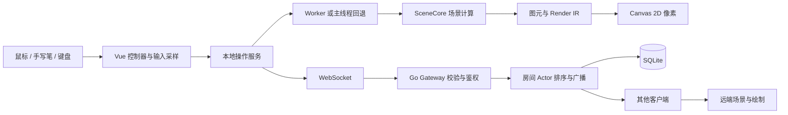

# Aevia V3：项目全景知识库与技术实现手册

> **基线**：2026-11-15，`feat/s08-incremental-scheduling`，提交 `c087017304c24e794811f04bc50bdf235068ca2b`。本文件为工作区新增文档，不包含在该提交中。该分支包含 S08 代码；它是否合入主分支应以 Git 和 PR 的最新状态为准。
>
> **读者**：第一次接触项目的开发者、架构评审者、交接人员及代码助手。本文采用 V2 知识库的分层和解释方式，但以当前代码为准，力求说明“是什么、为什么、怎么运作、在哪看、边界是什么”。
>
> **证据范围**：基于当前工作区源码、项目指南、阶段总结及历史 V3 方案的静态阅读；没有为撰写本文重新运行完整测试或测量性能。示例用于解释机制，具体请求格式以源码和测试为准。
>
> **版本用语**：这里的“V3”指正在向 V3 演进的当前实现，不代表原始 V3 RFC 的所有方案都已落地。场景操作协议仍叫 `SceneOperationEnvelopeV2`；协议版本与架构演进版本是两个维度。Rust/WASM、WebGPU、共享内存 Ring 均不是本文基线中的已实现能力。

## 快速导航

- [1. 项目与版本边界](#1-项目与版本边界)
- [2. 仓库与技术栈](#2-仓库与技术栈)
- [3. 整体架构与数据流](#3-整体架构与数据流)
- [4. 领域对象与三种顺序](#4-领域对象与三种顺序)
- [5. 账户、房间与权限](#5-账户房间与权限)
- [6. 从输入到一笔完成](#6-从输入到一笔完成)
- [7. 场景核心与增量物化](#7-场景核心与增量物化)
- [8. Render IR 与绘制边界](#8-render-ir-与绘制边界)
- [9. 索引、命中和局部重绘](#9-索引命中和局部重绘)
- [10. 操作、选区、擦除和文字](#10-操作选区擦除和文字)
- [11. Worker、分片与故障恢复](#11-worker分片与故障恢复)
- [12. 后端 Actor 与可靠性](#12-后端-actor-与可靠性)
- [13. 持久化与初始化](#13-持久化与初始化)
- [14. 协作传输与断线恢复](#14-协作传输与断线恢复)
- [15. 接口、配置与运行](#15-接口配置与运行)
- [16. 测试、CI 与性能证据](#16-测试ci-与性能证据)
- [17. 已知边界与未来方向](#17-已知边界与未来方向)
- [18. 修改指南、文件地图与常见问题](#18-修改指南文件地图与常见问题)
- [归档：v3 架构设计 RFC（2026-11-12）](./aevia-v3-rfc-2026-11-12.md)

## 1. 项目与版本边界

Aevia 是多人实时协作白板。浏览器负责输入、场景计算和展示；Go 服务负责账户、房间准入、协作顺序、广播和保存；SQLite 保存房间及其操作。用户可以创建或加入房间，在多页白板上绘制和编辑，与其他人同步，并在允许的范围内管理房间和成员。

### 1.1 如何判断一段话是否可信

本文的“当前”都指文首基线。源码决定运行行为；项目指南和测试帮助理解意图，但不能替代运行结果。提交记录可以证明某项改动进入某个分支，不自动证明已合并、用户已验收或性能达到目标。不同机器、浏览器和工作负载的结果也不能互相代替。

现有 `docs/aevia-v2.md` 是较早快照；未跟踪的 `docs/aevia-v3-refract.md` 是设计方案，其部分 Rust/WASM、WebGPU 等内容是目标或当时假设。阅读时应以当前源码为准。本文保留旧版本中仍适用的原理，并补上账户、恢复、场景核心与 S08 等实际变化。

### 1.2 从 V2 到当前阶段的变化

| 维度 | 原 V2 基线 | 本文基线 |
|---|---|---|
| 交互 | 已有场景操作与统一图元 | 完善选区、历史分支、文字便签和绘制工具 |
| 协作恢复 | 已有 roomSeq 与增量重放 | 补充初始化确认、恢复中实时/本地操作合并及故障处理 |
| 身份与房间 | 旧知识库描述账号/RBAC 尚未产品化 | 有账户、长期成员、房间角色、游客准入、邀请及转让流程 |
| 场景与绘制 | 场景计算和 Canvas 适配耦合较紧 | TypeScript `SceneCore` 与 Canvas 适配分开，具备 IR 全量/差量导出 |
| 增量与调度 | 已有空间索引和脏区 | 增加场景差量、受影响元素重建、长任务分片和分片完整绘制 |
| 渲染技术 | Canvas 2D | 仍以 Canvas 2D 为主；未实现 WebGPU 后端 |
| 原生/共享内存 | 无 | 未迁移 Rust/WASM，未接入跨线程共享内存 Ring |

### 1.3 一句话心智模型

**操作是可以同步和保存的事实；场景是操作折叠得到的当前状态；画布是场景在某个时刻显示出来的像素。** 三者不能互换。画布擦掉像素不等于操作从数据库消失；网络收到消息也不等于用户已经看见它。

## 2. 仓库与技术栈

```text
apps/frontend/        Vue 3、TypeScript、Vite、Pinia：入口、房间 UI、输入、场景与渲染
apps/backend/         Go：HTTP/WebSocket 网关、房间 Actor、SQLite 存储
packages/shared/      TypeScript 共享领域类型、消息与排序契约
tests/                测试目录、Lab 运行器、报告与证据目录
scripts/              开发启动、Go 包装、测试与报告脚本
.github/workflows/    分支、PR、main、nightly 等工作流
docs/                 架构、阶段说明和知识文档
```

前端两个重要路由之外还有邀请入口：`/` 是首页，`/invite/:token` 是邀请页，`/room` 是白板房间。`RoomView.vue` 是房间的装配位置，不应该把所有逻辑理解成写在一个组件里：控制器管理输入、工具与生命周期，service 对接本地操作、网络与画布，store 保存共享状态。

后端入口为 `apps/backend/cmd/aevia-backend/main.go`。`internal/gateway` 处理 HTTP、认证和 WS；`internal/room` 管理房间内状态、排序、快照；`internal/storage` 操作 SQLite；`internal/protocol` 负责二进制协议。Go 后端是唯一正式后端，不能把旧 Express 实现当成当前服务。

## 3. 整体架构与数据流



用户画笔迹时，本地先生成不可变操作，既用于本地响应，又发送服务端。服务端验证身份、操作格式和房间权限，按房间顺序处理并持久化，再向参与者分发。远端客户端收到操作后，用相同的场景规则计算其结果并绘制。

### 3.1 所有权与派生数据

| 数据 | 作用与归属 | 重要限制 |
|---|---|---|
| 账户、房间配置、成员关系 | 服务端保存与授权 | 前端按钮状态不能替代服务端校验 |
| 已持久化场景操作 | 白板的协作历史与恢复依据 | 按操作身份与顺序处理；不是直接保存某一张截图 |
| 场景元素、图元、索引、IR | 客户端由操作计算的投影 | 可重建；不应绕开操作语义当作协作权威 |
| Canvas 像素 | 当前显示结果 | 可重画；看见像素不等于服务端已保存 |
| 当前待确认操作 | 客户端内存中的临时状态 | 不等于跨刷新、崩溃仍可靠保存的离线日志 |

### 3.2 一个例子：画、移动、擦除、撤回

先创建线条，再追加点。选中它并拖动时，界面先展示变换预览，松开时提交变换操作；擦除部分线条时记录擦除目标与遮罩；撤回时切换对应历史组的有效性。场景引擎把这些事实按顺序折叠，得到当前可见形状，再交给渲染器。其他用户不需要接收“你的画面截图”，只要拿到被授权、顺序正确的操作即可重建逻辑状态。

## 4. 领域对象与三种顺序

### 4.1 点、命令、场景操作、图元

- `Point` 保存路径采样位置和压力等信息。多个点描述一次输入轨迹；坐标和画布像素之间需按视口转换。
- `Command` 是协作、存储所使用的外层记录，包含 ID、用户、房间、页面、时间与负载等字段。
- `SceneOperationEnvelopeV2` 是新写入的场景语义。新写入通过 `scene-op` 包装；旧 V1 有兼容读取路径，但旧写入不能因此被视作当前正式协议。
- `Element` 是逻辑上的一个对象，例如一条笔迹、一段文字或一个形状。
- `RenderAtom` 是绘制和查询使用的更细粒度单元，例如点、二次曲线段、形状、字形和位图。一个元素可以产生多个图元。
- `FlatPoint` 是初始化与兼容路径中便于流式传递的点投影，不包含完整的历史、变换和文字语义，不能单独代替所有场景操作。

### 4.2 九类场景操作

| 操作 | 直观含义 |
|---|---|
| `element.create` | 创建笔迹、形状、文字等元素 |
| `element.append` | 向已有笔迹追加点 |
| `element.transform` | 移动、缩放、旋转等变换 |
| `element.erase` | 记录部分擦除目标或遮罩 |
| `element.delete` | 删除指定对象 |
| `element.style` | 改变可编辑样式或布局 |
| `text.patch` | 修改文本内容 |
| `history.toggle` | 启用或禁用一个历史组 |
| `page.clear` | 定义页面清除操作及其水位 |

具体字段定义在 `packages/shared/src/types/scene.ts`，Go 的验证边界在 `apps/backend/internal/gateway/scene_validation.go`。加入新类型需要同时考虑共享类型、服务端校验、折叠、渲染、历史、回放和测试。

### 4.3 Lamport、渲染顺序、roomSeq

Lamport 值提供跨客户端可比较的逻辑时间；相同时还需要稳定的 ID 字节序决胜。图元再结合源点序号和子序号确定绘制顺序。服务端 `roomSeq` 则是房间内接收和恢复所用的权威递增序号。

例如两人几乎同时画线：图元顺序决定重叠处谁画在上面；roomSeq 告诉重连客户端应从哪个服务端事件继续补齐。二者解决的问题不同。跨 Go 和 TypeScript 排序必须使用既有比较器，不可随意替换成受本地语言环境影响的 `localeCompare`。

## 5. 账户、房间与权限

### 5.1 四种不能混淆的身份凭据

1. **账户会话**：用户登录后的长期身份，用于访问自己的账户和房间列表。用户名用于登录，昵称用于展示；两者不是同一个字段。前端账户状态位于 `store/accountStore.ts`。
2. **房间准入结果**：某个账户或游客进入特定房间时获得的授权信息；房间密码、成员关系、游客规则和禁入状态都可能参与判断。
3. **房间会话**：与当前房间和参与者绑定的会话，房间交互使用它，不能把它视作能登录任意账户的凭据。
4. **WebSocket 票据**：连接前通过 `/ws-ticket` 换取的短时、一次性凭据；服务端消费票据并重新检查成员资格。断线重连需要重新获取，不能长期复用。

这些凭据分别解决“你是谁”“你是否可进入这个房间”“这次房间会话是谁”“这次连接是否有效”。一个过期不意味着其他对象必然已经删除。

### 5.2 成员、游客和角色

注册账户可作为长期成员在自己的房间列表中再次进入；游客不依赖长期账户。房间角色包括房主、编辑者和只读者；服务端在写入路径检查编辑权限，防止只隐藏 UI 而仍可通过协议写入。邀请链接、房间号、密码和游客准入分别受房间规则约束；链接是入口，不应简单等同于绕过密码或权限的万能钥匙。

房间管理覆盖成员角色、加入方式、邀请、移除/封禁和房主转让等。房主转让涉及发起方与接收方，不能只在前端改个显示名称。不同设备登录同一账号本身可并存；同一房间中的账号连接接替与历史归属需保持稳定账户 ID，用户只能撤回自己的历史。游客没有同等稳定的账户身份，永久识别和封禁能力因此不同。

代码入口：`gateway/account_handlers.go`、`account_room_handlers.go`、`room_management.go`、`invite_handlers.go`、`transfer_handlers.go`，以及 `storage/accounts.go`、`membership.go`、`invites.go`、`transfers.go`。画布外首页与房间设置分别由 `HomeView.vue` 和 `RoomSettings.vue` 等承载；房间内也有设置入口。

### 5.3 会话与安全边界

密码、会话、房间邀请码是不同概念。服务端还承担密码验证与失败限流、WS Origin、连接/消息配额、可信代理和生产密钥配置。默认开发密钥不适合生产；生产环境必须显式提供 `JWT_SECRET`。代理转发头只有在配置可信代理时才可作为客户端地址依据。

`server_state` 中的 session epoch 是会话失效水位，不是每次重启的时间；把它随意改为进程启动时间会使部署或多实例间会话失效。具体权限和路由边界以网关代码为准，不应从界面按钮推断。

## 6. 从输入到一笔完成

### 6.1 事件为何不能直接等同于最终点

浏览器可能把多个指针样本合并成一次事件，也可能在不同设备上以不同频率上报。若直接把每次回调都当成一个绘制点，笔迹密度将随设备和速度波动，网络与存储压力也会增加。

`strokeInputSampler.ts` 在输入阶段处理合并事件、按固定空间间距重采样、根据时间滤波压力与速度，并对帧内样本做压力敏感的简化。本地渲染和协作传输应使用同一批结果；渲染层不应又根据点间距离重新推一遍速度压力，否则两端和重放会不一致。

鼠标没有真实笔压：系统用速度模拟压力，并对加速、减速与停顿进行处理。鼠标起笔延迟到有足够运动样本时确定初始压力；没有移动的点击在松手时提交。手写笔则沿用其物理压力路径。实现细节应以采样器和 `roomPointerController.ts` 为准。

### 6.2 一笔的生命周期

```text
pointerdown → 建立输入状态
pointermove / coalesced samples → 归一化、滤波、重采样、分批
第一批有效点 → element.create
后续点 → element.append
pointerup → 完成尾部、提交剩余样本
本地 SceneCore 更新 → Worker / fallback 绘制
同时由传输层发送 → 服务端校验和保存 → 其他客户端接收
```

本地先显示可以提高响应感，但也引入“显示了、服务端后来拒绝”的情况。应用必须根据拒绝与恢复结果处理本地状态，不能把本地像素当成持久化成功证明。预测未来轨迹的实验曾加入，后按用户体验反馈移除；当前基线不提供该实验开关。

## 7. 场景核心与增量物化

### 7.1 为什么有 SceneCore

`SceneCore` 负责把操作变成可查询的场景：维护元素、历史及依赖、图元、有序索引和空间索引；`SceneEngine` 继承它并提供 Canvas 测量与绘制适配。拆分后的好处是逻辑场景不必直接依赖浏览器的画笔 API，也更容易检查同一场景在不同绘制方式下的语义。当前两者仍是 TypeScript，不是已经完成 Rust 重写。

所谓**物化视图**，是把反复计算的结果保留下来：比如一条笔迹已有 1,000 个点，接下来只追加 10 个点时，理想情况下只编译受影响尾部和新增图元，而不是把历史中每条笔迹重新算一遍。S08 为常见追加路径、元素边界和变更记录做了增量处理；遇到乱序、历史切换或复杂依赖，仍可能重建受影响元素或全页。

### 7.2 `applyOperation` 与重建

操作到来后，核心检查顺序和依赖，将其加入对应的状态并触发必要的编译。路径追加依赖已有元素及预期的点范围；缺失部分可暂时等待，冲突或依赖无法解决时要求场景重新同步。文字 patch 也需要处理字符之间的依赖。

`applyOperationSteps`、`rebuildFromCommandsSteps` 等生成器允许 Worker 把较大工作分段执行；同步包装仍供需要一次完成的调用方使用。不要把“可分片”解释成任何单个计算片段都严格低于某个耗时：单次步骤的实际成本随内容变化。

### 7.3 边界缓存与差量记录

元素包围盒用于选区、命中、脏区和变换。S08 缓存元素边界，在新增图元时增量更新，避免长笔迹每追加少量点都扫描所有旧图元。几何或矩阵等变化后必须更新或失效缓存。

场景维护 revision（修订号）与变更记录。差量表达基准 revision 到新 revision 之间删除、更新的内容和受影响区域；接收方只有在基准匹配时才能应用。长笔迹正常追加与完成可以记录新图元，避免每次将整条旧笔迹作为新内容导出。复杂操作仍可能扩大影响范围。

### 7.4 历史、乱序和旧数据

不可变操作使重放与协作更容易追踪，但迟到操作可能改变此前折叠结果，不能一律当成简单尾追加。历史组用于将用户的一次可撤回动作关联起来；远端编辑不应随意清除本人的重做分支。旧数据通过兼容适配器进入场景，新的编辑仍遵守 V2 场景操作契约。

## 8. Render IR 与绘制边界

### 8.1 它是什么

Render IR 是场景给绘制方的中间表示，相当于有顺序的绘画清单。`RenderIRItem` 包含图元、稳定句柄、矩阵、擦除信息与可选透明度；`RenderIRFrame` 是某个 revision 的完整集合，`RenderIRDelta` 表示相对某个基准的删除、更新、顺序及脏区。

`SceneCorePort` 声明操作输入和 IR 获取的基本边界；当前 Canvas 绘制适配由 `sceneEngine.ts` 与 `canvasIRRenderer.ts` 完成。图元具体绘制配方集中在 `primitiveRenderer.ts`。这种分工方便之后评估新渲染器，但不能据此声称已经支持 WebGPU。

### 8.2 快照与差量如何配合

```text
完整 Frame(revision=10) + Delta(baseRevision=10, revision=11)
    → 应用删除与 upsert，按提供的顺序重建
    → Frame(revision=11)
```

如果收到的基准不是 10，直接应用可能漏掉中间变化，所以实现会拒绝不匹配的 revision。差量携带顺序，不能只把更新后的元素随意追加到最后；绘制顺序可能影响遮挡与混合。句柄携带 `id / generation / epoch`，避免旧场景句柄在重建后误指向新图元；现有句柄解析是线性查找，不适合作为高频空间查询索引。

### 8.3 编码的真实能力

`renderIRCodec.ts` 使用版本、类型、长度和校验值组成帧头，正文当前仍是 UTF-8 JSON。它是有边界和校验的传递格式，但并不是已经实现紧凑的零拷贝二进制图元布局。`WhiteboardSession.getRenderIR()` 是按需从就绪的 Worker 获取快照或差量的路径；初始化、fallback、过期 epoch 或无效数据等情况下可能返回 `null`。正式画布绘制并不要求每帧走一遍这条按需导出路径。

## 9. 索引、命中和局部重绘

### 9.1 为什么需要两套索引

想重画一块区域，需要同时回答两个问题：“哪些东西与区域相交？”以及“这些东西应该按什么顺序画？”`SpatialGridIndex` 将空间分成粗网格，用于缩小候选范围；`RenderOrderIndex` 按规范顺序组织图元引用，负责先后。空间索引给出候选不等于精确相交，仍需结合实际几何判断。

网格粒度、对象分布、一个巨大元素跨越多少格都会影响实际成本。密集热点或几乎覆盖整页的形状可能退化，不能仅凭“有网格”承诺查询恒定时间。

### 9.2 脏区绘制

拖动物体时，旧位置和新位置都需要更新：前者去掉残影，后者画出内容。`DirtyRegionSet` 合并受影响区域并根据面积和候选数量决定局部还是全量。局部路径大致是：扩展边界 → 查询图元 → 清除区域 → 裁剪 → 按顺序重画候选。

细节：清除、裁剪和候选查询需要覆盖相同范围，并对齐实际设备像素。否则当前笔迹经过旧笔迹时，清掉的像素可能没有被重新绘制，产生细白缝；鼠标松开后完整重画又会让缝暂时消失。S08 对该路径做了统一范围和像素对齐修复。最终视觉效果仍应结合真实设备走查。

### 9.3 图层、预览与完整绘制

选区变换过程中可在覆盖层展示预览，同时避免原图和预览重复显示；提交后重绘最终场景。完整绘制在 S08 引入可分片路径，Worker 在临时画布准备好后再替换可见画面，避免把中间只画了一部分的状态展示出来。连续高亮或遮罩图元需要维护正确的合成分组，因此批次可能大于一般批次。

## 10. 操作、选区、擦除和文字

### 10.1 选区与变换

选择交互包括框选、在既有选区空白处拖动、控制点缩放和旋转。包围盒是交互范围的近似描述，精确命中仍需结合图元几何。变换通过仿射矩阵表示，矩阵按规定顺序复合；旋转后不能简单地只给每个点加一个坐标偏移。

拖动中是本地临时预览；松手后将最终矩阵作为 `element.transform` 操作提交。部分擦除的笔迹在预览时也应带着擦除结果，不能临时显示未擦除原图。移动的脏区必须包含旧位置和新位置，远端依靠相同的操作回放最终状态。

### 10.2 橡皮为何不直接涂白

“涂白”只是在当前画面上盖住像素，背景变化、移动、重新加载或撤回后很难保留正确语义。Aevia 对部分笔迹记录擦除区间或遮罩；对象擦除则作用于整个元素。绘制和命中需要考虑被遮掉的部分，重新计算或变换对象时也需要沿用这些记录。几何量化并不意味着对所有连续曲线都有无限精度。

### 10.3 文字与便签

文字编辑框叠在画布对应位置，浮动工具栏处理格式；提交后将内容、样式和布局写入场景操作，Canvas 根据场景重新绘制。文本的宽度、换行、字体度量、输入法组合状态和画布缩放都会影响编辑态与显示态的一致性，因此不能只比较字符串内容。

布局描述是版本化数据；旧文字保留兼容路径。不同设备的字体是否可用、字体度量和浏览器实现可能不同，当前不应承诺所有客户端像素逐位一致。便签同样需要兼顾编辑外观、背景图元和文字布局。

### 10.4 撤回、重做与清屏

撤回/重做按历史组改变有效性，而不是直接删除所有历史记录。示例：先画 A、B，撤回 B，再画 C；B 所在的旧重做分支失效，撤回 C 后重做应恢复 C。历史按页面与用户归属处理；远端其他人编辑不应清掉本人的重做候选。`page.clear` 是带历史语义的页面清除，服务端和初始化流使用清除水位过滤；禁用相关清除历史组后需要能够恢复被遮住的历史。

## 11. Worker、分片与故障恢复

### 11.1 为什么使用 Worker

浏览器主线程还要响应按钮、输入和布局。如果场景计算与绘制都长时间占用主线程，界面会卡顿。支持 `OffscreenCanvas` 时，绘制可以转交 Worker；不支持或初始化转移前失败时，保留主线程 Canvas 回退。两条路径共用场景核心，避免一个工具在两条路径上实现出不同语义。

`renderWorkerBridge.ts` 管理跨线程消息和查询；`canvasWorker.ts` 持有工作场景与画布。桥接层按顺序发送可靠操作，在查询、清除或场景切换之前处理相关待发消息，避免回复使用过期场景。消息被发送、Worker 已处理、场景已物化和已执行绘制是不同水位。

### 11.2 S08 的分片是怎样工作的

场景重建、部分历史处理、点批次、排序、完整绘制和独立投影都提供逐步执行路径。Worker 在一个时间预算内推进若干步骤，未完成则通过后续任务继续。独立后台投影在前台繁忙时使用较短的时间片，并周期性获得机会。

活动场景事务在切片间让出线程，但后续依赖同一场景状态的消息仍会排队，防止观察到半更新场景。因此“让出线程”不等于任何输入都能抢占当前事务。某些长操作或需要一起合成的图元仍可能造成较长片段；6 ms 等预算是调度目标而非浏览器实际延迟保证。

### 11.3 故障与可观察水位

Worker 画布转移前失败可采用主线程回退。转移后 Worker 出错时，需要替换画布、重新初始化并恢复仍在内存中的未确认操作；不能假定已转移画布可直接在原主线程继续使用。

`getConsistencyWatermarks()` 提供传输连续恢复位置、Worker 分发/处理、场景修订、保守绘制 revision 和队列状态。跨线程采样并非单一原子时刻；“已调用 Canvas 绘制”也不证明浏览器已合成并显示到屏幕。若看见进度停滞，应先识别卡在网络、Worker 处理、场景物化还是绘制，而不是只盯一个数字。

## 12. 后端 Actor 与可靠性

### 12.1 房间 Actor 是什么

Go 服务为活动房间维护 Actor。可把它理解成该房间的单一处理员：房间状态的修改经由消息进入它负责的 goroutine，避免多个请求同时直接修改同一份房间内存。

可靠消息包括操作、加入和切页；可丢实时消息包括光标等。前者不能任意扔掉，队列拥塞时需要明确拒绝或恢复；后者可以合并或丢弃过时状态。持久化失败通知也会进入房间处理流程，必要时房间转为只读并要求客户端重同步。

Actor 不是“所有事情永远在一个循环里同步做完”。初始化快照读取使用固定的 SQLite WAL 读视图和有界执行器；在快照构建过程中发生的后续事件需按连接顺序暂存。执行器饱和、连接过慢或数据发送失败时，应结束受影响连接，而不是无限阻塞房间。

### 12.2 写入顺序与 ACK

新场景写入先经过网关身份、权限、schema 和取值校验，再由 Actor 处理和分配房间序号。场景写入使用 barrier 持久化路径，成功确认依赖提交完成。重复提交只有在可信身份与操作匹配等条件成立时才能当作同一写入处理，不能简单把任意重复 ID 当成功。

后台写入也存在批量提交机制：把队列中多条记录合并为事务以摊薄成本；等待提交的写入需要等待结果。异步失败不能仅打印日志后继续假装房间可写；后端应触发只读/重同步路径。准确行为以 `room/persistence.go`、`storage/writer.go` 和测试为准。

### 12.3 背压

当输入速度持续高于处理或网络发送速度，队列就会增长，这叫背压。Aevia 区分可靠与可丢消息，对不同压力级别做相应处理：例如合并过时光标、限制高频样本、对可靠写入明确返回繁忙。客户端的简化容差可根据压力策略变化，但不应随意改变基础输入采样间距，避免绘制手感与精度不可控。

## 13. 持久化与初始化

### 13.1 SQLite 保存什么

账户、会话、房间、成员、邀请、转让与命令等由存储模块管理；迁移定义在 `storage/migrations.go`。白板操作使用持久化的命令记录，服务端点索引是用于快速构建流的投影，并非完整的场景语义。数据库默认位于 `data/whiteboard-go.sqlite`，开发与测试时应注意不同运行是否共用数据库。

SQLite WAL 允许读者持有一致的读视图，同时写者继续工作；写入仍受到 SQLite 单写者和磁盘性能约束。`DB_BUSY_TIMEOUT_MS` 缓解短时锁竞争，不能把它理解为无限等待或多实例分布式一致性方案。开发环境删除数据库会删除对应数据，应先确认目标。

### 13.2 为什么初始化分块

大型白板一次性打包所有点和操作会推高峰值内存与首屏等待，因此初始化与切页使用元数据、渲染点二进制块及场景操作块。客户端可在有效点块到达时渐进绘制；操作块之后补齐变换、擦除、文字和历史等语义。

流式传输不意味着服务端的所有快照准备成本都已经消失：读视图、快照构建和投影仍需工作。元数据与对应二进制帧要保持配对；缺块、解码失败或不完整终止不能被视为成功完成。

### 13.3 页面窗口与恢复中的并发

页面切换时，服务端按页面窗口提供数据；客户端会缓存附近页面。已缓存页面不能只重放点，还需恢复对应场景操作，否则撤回、擦除和文字可能丢失语义。

加载期间可能同时收到远端新操作，用户也可能继续在本地操作。客户端需要把这些内容与快照合并并按 ID 去重，而不是让较旧快照覆盖新内容。强制当前页重同步会请求权威数据；完成前不能过早推进恢复游标。

### 13.4 清除水位

页面 clear 生效时，点流和命令流都要按同一清除水位过滤。只过滤点而把旧场景操作照常发送，客户端重放后仍可能把清屏前的内容恢复；撤回清除操作后则需要允许相应历史重新出现。

## 14. 协作传输与断线恢复

### 14.1 HTTP 和 WebSocket 分工

HTTP 适合账户、房间配置、创建/加入、邀请、票据和页面概览等请求；WebSocket 保持连接，承载实时操作、光标、初始化/切页流、确认和拒绝。不能把 `/v2` 路径一概说成仍是占位：当前账户和房间管理已有实现，具体路由仍应查询注册代码，部分保留接口也可能未实现。

### 14.2 二进制与 JSON 各在哪里使用

当前并不是“所有数据都通过 JSON”或“全部是二进制”。渲染点块有专用二进制编码；协商启用时，客户端到服务端的 V2 追加点也可用二进制帧，解码后仍进入正常验证与持久化路径，广播不因此自动变成二进制。`VITE_SCENE_APPEND_BINARY=0` 可关闭客户端该路径。不同帧格式、端序和版本应查 `internal/protocol` 与共享代码，不能互相套用。

### 14.3 重连与增量恢复

客户端记录连续处理到的 `roomSeq`。连接中断后携带恢复位置；若服务端 `DeltaBuffer` 仍覆盖缺口，就发送增量元数据、事件和完成标志；覆盖不足则退回快照初始化。重连成功并不代表已完成恢复，必须确认数据流和 Worker 场景初始化。

示例：已连续处理至 100，服务器有 101～110，缓存完整时可重放这些事件；若缓存已清除 101，则不能跳到 102 当成完整恢复，应重新获取权威快照。新操作与初始化流仍要按照既有规则合并、去重。

### 14.4 拒绝与未知状态

服务端可能因为无权限、数据无效、繁忙或存储失败拒绝操作。带操作 ID 的拒绝可以让客户端定位本地乐观写入并处理，而不是把所有本地画面都当作已接受。连接断开时客户端也可能不知道某个请求是否已提交，因此重试需要原始身份和去重语义；浏览器关闭后内存待确认内容并不保证保留。

## 15. 接口、配置与运行

### 15.1 入口地图

`apps/backend/internal/gateway/server.go` 注册基础路由，包括健康检查、创建/检查/加入房间、邀请、页面概览、房间会话续期和 `/ws`。账户、房间管理和 V2 准入等路由还通过注册函数接入，具体方法、路径与请求字段请查看 `gateway/v2_placeholders.go` 及对应 handler；函数名称有历史背景，不能凭名称判断其中全部是占位实现。

| 接口类别 | 典型目的 | 查阅位置 |
|---|---|---|
| 健康与诊断 | 存活、就绪和受限指标 | `server.go`、诊断 handler |
| 账户 | 注册、登录、会话与昵称 | `account_handlers.go` |
| 房间与成员 | 创建、列出、准入、配置、成员角色 | `account_room_handlers.go`、`room_management.go` |
| 邀请、转让 | 邀请生命周期、房主转让 | `invite_handlers.go`、`transfer_handlers.go` |
| 协作 | 一次性票据、WebSocket、操作与流 | `websocket_ticket.go`、`ws_handler.go`、`ws_messages.go` |

### 15.2 运行命令

在仓库根目录，先按项目依赖准备 Node/npm 与 Go：

```powershell
npm install
npm run dev                 # 前端与 Go 后端开发服务
npm run dev:frontend        # 仅前端
npm run dev:backend         # 仅后端
npm run build               # Go 构建 + 前端类型检查和打包
npm run build:frontend
npm run build:backend
npm run start               # 启动后端
```

命令的实际参数以根 `package.json` 和脚本为准。前端默认 API 为 `http://127.0.0.1:4646`，WebSocket 为 `ws://127.0.0.1:4646/ws`；部署时应检查实际前端构建环境与反向代理配置。

### 15.3 关键后端配置

下表是基线 `internal/config/config.go` 中部分默认值，详细边界和全部配置应读源码；配置的存在并不意味着适合生产原样使用。

| 环境变量 | 开发默认 | 作用 |
|---|---:|---|
| `HOST` / `PORT` | `0.0.0.0` / `4646` | 监听地址与端口 |
| `APP_ENV` | `NODE_ENV` 或 `development` | 环境与生产检查 |
| `DB_PATH` | `data/whiteboard-go.sqlite` | SQLite 文件 |
| `DB_BUSY_TIMEOUT_MS` | `15000` | SQLite 锁等待上限 |
| `JWT_SECRET` | 开发专用默认值 | 生产必须显式配置 |
| `DEFAULT_ROOM_ID` | `123123` | 开发默认房间号；生产默认房间行为须看启动逻辑与配置 |
| `INIT_PRELOAD_PAGE_COUNT` | `2` | 初始化预加载页数 |
| `PAGE_CACHE_RADIUS` | `1` | 页面缓存半径 |
| `INIT_COMMAND_CHUNK_SIZE` | `100` | 初始化命令块大小 |
| `INIT_FLAT_POINT_CHUNK_SIZE` | `2000` | 初始化点块大小，上限受协议约束 |
| `PAGE_CHANGE_DEBOUNCE_MS` | `80` | 切页防抖 |
| `ROOM_RELIABLE_QUEUE` / `ROOM_REALTIME_QUEUE` | `4096` / `2048` | 房间可靠和实时队列容量 |
| `DB_BATCH_SIZE` / `DB_BATCH_WINDOW_MS` | `128` / `5` | 写入组提交参数 |
| `ALLOWED_ORIGINS` | `*` | 允许的来源；生产应显式收窄 |
| `TRUST_PROXY_HEADERS` / `TRUSTED_PROXIES` | 关闭 / 空 | 代理头信任边界 |
| `METRICS_TOKEN` | 未列为普通默认值 | 指标接口访问控制，结合调用地址与实现判断 |

部署前至少确认生产密钥、Origin、HTTPS/反向代理、数据库持久化与备份、资源配额。单进程房间 Actor 与 SQLite 的现有设计不自动提供跨实例房间所有权一致性，不能因为服务无状态地启动了多个副本就推断协作已经分布式安全。

## 16. 测试、CI 与性能证据

### 16.1 检查层次

| 层次 | 能回答什么 | 不能单独证明什么 |
|---|---|---|
| 单元/模块 | 某个函数、状态机或组件的给定输入输出 | 真实浏览器、网络和数据库端到端均正确 |
| 浏览器用例 | 真实 Canvas/浏览器 API 下的目标行为 | 所有浏览器和设备视觉效果一致 |
| 外部 E2E | 从用户界面、协议或像素观察主要链路 | 所有历史状态与高负载都已覆盖 |
| 性能实验 | 某机器、配置和负载下的耗时与资源表现 | 任意环境都满足同一性能数字 |
| 人工走查 | 手感、可用性和实际设备反馈 | 所有输入和并发边界均穷尽 |

### 16.2 常用命令

```powershell
npm run test:doctor     # 检查环境能力
npm run test:quick      # 较快的托管检查
npm run test:unit
npm run test:browser
npm run test:go
npm run test:ci         # 托管正确性与证据检查，成本高于 quick
npm run test:full       # 进一步包含 race 与有界 fuzz，依赖宿主工具链
npm run test:single -- --only=<selector>
npm run lab:serve       # 查看本地 Lab 报告
```

优先选与改动对应的最小检查；`npm test` 是交互式运行器，不能假设它很轻。Canvas 脏区与全量结果对比位于 `apps/frontend/tests/browser/scene-dirty-render.browser.spec.ts`；Worker 初始化、场景核心、协议和 Go 存储各有对应测试。修改跨语言排序夹具时，注意 Go 测试缓存。

### 16.3 Lab 证据与 CI 分层

Lab 的运行记录使用独立 run、manifest 和产物目录，关联源码身份、步骤和预期产物。看结果时应确认当前运行使用的源码、环境、执行了哪些步骤、是否有缺失或失效产物；不要只打开 `latest` 报告或拿旧数字推断当前提交。

当前 `.github/workflows` 包含 `quick.yml`、`ci.yml`、`pr.yml`、`main.yml`、`nightly.yml`。它们按分支推送、PR、main 和计划任务等事件分工；具体当前门禁以工作流文件为准。某次推送或 PR 的配置存在，不代表该次运行已经通过。

### 16.4 正确解读性能

至少区分输入到画布的响应延迟、场景应用/几何编译、空间查询、脏区/全量绘制、线程传输、初始化首屏与内存峰值。测量应记录设备、浏览器、分辨率、DPR、点数、对象分布、预热及采样次数。100,000 个点集中在一个区域和分散在整页，对索引、脏区及绘制的压力可能完全不同。

S08 目的是减少重复工作并让部分大任务分片；本次撰文没有复测“十万点约 400 ms”的历史数字，也没有证明新实现达到该数字。把所有慢都归因于 TypeScript 或网络传输都缺乏证据。优先用同条件基线定位瓶颈，再决定投入方向。

## 17. 已知边界与未来方向

### 17.1 当前代码已具备和没有具备什么

| 方向 | 状态 | 说明 |
|---|---|---|
| TypeScript 计算/绘制分离 | 已实现基础 | `SceneCore` 与 Canvas 适配分工；不意味着性能问题全部消失 |
| IR 全量和差量 | 已实现基础 | 按需导出及版本检查；编码正文仍为 JSON |
| 脏区与增量 | 已实现基础 | 常见追加、受影响元素与区域优化；复杂历史仍可能重建 |
| 时间分片 | 部分主链路已接入 | 同一场景事务仍有顺序等待，部分操作仍可能较长 |
| 预测轨迹 | 已移除 | 用户试用后决定不保留 |
| 主线程—Worker 共享内存 Ring | 未实现 | 后续可评估高频传输与批处理；需支持不可用时的回退 |
| Rust/WASM 场景内核 | 未实现、待决策 | 应先验证与同类 TS 数据布局相比的实际收益与成本 |
| WebGPU 渲染后端 | 未实现、待决策 | 效果兼容、设备支持和性能需要单独验证 |
| 跨刷新可靠离线队列 | 未实现为持久保证 | 未确认操作目前不应宣称崩溃或刷新后必然保留 |

### 17.2 Ring 解决什么、不解决什么

Ring 是固定容量的循环缓冲区：生产者写入，消费者读取，读写位置绕回复用。把主线程采样点批量写入、Worker 批量读取，有机会减少消息分配和结构化克隆；但它不自动减少场景几何编译和 Canvas 绘制成本。

使用 `SharedArrayBuffer` 依赖浏览器支持及跨源隔离等部署条件；还要定义容量、顺序、写满、唤醒、回退以及不可丢可靠数据的行为。它目前是可评估的后续工作，不是当前代码事实，也不代表必须把同一 Worker 内部的普通同步调用再套一层并发 Ring。

### 17.3 为什么先测量再决定 Rust 或 WebGPU

如果主要耗时来自对象布局和重复计算，改善 TypeScript 数据结构可能已有收益；如果瓶颈在传输或绘制，换语言未必命中问题。WebGPU 也有设备、资源准备和特殊混合效果等成本，不能假定任何规模都优于 Canvas。先用同一场景、同一机器比较再决定是否投入，可以避免同时改变过多变量而无法解释收益。

### 17.4 仍需特别留意的边界

- 场景分片不保证实时严格帧率；高亮、遮罩、大量依赖和同场景顺序等待会影响延迟。
- 文本测量受字体和浏览器影响；语义一致不等于不同机器像素逐位相同。
- 页面快照、实时流与本地未确认操作合并是恢复关键；错误推进游标会掩盖丢失。
- 大页面、热点与单个巨大元素可能让空间网格和全量绘制退化。
- 账户、房间和 WS 票据的生命周期不同；不能仅凭前端状态判断权限。
- 真正的多实例部署、持久离线编辑、长时间压力和跨设备体验不能由静态源码阅读证明。

## 18. 修改指南、文件地图与常见问题

### 18.1 按问题找源码

| 想理解或修改什么 | 先读哪里 |
|---|---|
| 路由、首页、邀请和白板装配 | `apps/frontend/src/router/index.ts`、`views/HomeView.vue`、`InviteView.vue`、`RoomView.vue` |
| 账户、房间管理界面 | `store/accountStore.ts`、`components/AccountPanel.vue`、`RoomSettings.vue`、`RoomInvites.vue` |
| 指针采样、笔迹提交 | `service/strokeInputSampler.ts`、`controllers/roomPointerController.ts`、`service/localCommandService.ts` |
| 选择、拖动、旋转 | `controllers/interactionController.ts`、`service/roomCanvasOverlay.ts`、`scene/matrix.ts` |
| 文本与便签 | `components/RoomTextEditor.vue`、`scene/primitiveRenderer.ts`、共享 scene 类型 |
| 场景折叠和历史 | `scene/sceneCore.ts`、`store/commandStore.ts`、`service/localCommandService.ts` |
| 画布绘制与脏区 | `scene/sceneEngine.ts`、`canvasIRRenderer.ts`、`primitiveRenderer.ts`、`dirtyRegionSet.ts` |
| 绘制/空间索引 | `scene/renderOrderIndex.ts`、`scene/spatialGridIndex.ts` |
| Render IR | `scene/renderIR.ts`、`renderIRCodec.ts`、`service/renderWorkerBridge.ts` |
| Worker 生命周期、调度 | `workers/canvasWorker.ts`、`service/canvasRuntime.ts`、`service/canvas.ts` |
| 网络及恢复 | `service/roomCollabTransport.ts`、`collabMessageDispatcher.ts`、`collabCommandHandlers.ts`、`sessionApi.ts` |
| 数据类型与排序 | `packages/shared/src/types/scene.ts`、`types/collab.ts`、`protocol/sceneProtocol.ts`、Go `internal/domain` |
| 房间 Actor、顺序、快照 | `apps/backend/internal/room/actor.go`、`state.go`、`sequencing.go`、`snapshot*.go`、`stream_send.go` |
| 身份、成员及 WS 授权 | `apps/backend/internal/gateway/` 中账户、房间、邀请、票据、WS handler |
| SQLite、迁移与写入 | `apps/backend/internal/storage/migrations.go`、`writer.go`、`read_snapshot.go`、对应领域存储文件 |
| 测试和报告 | `tests/run-system.ts`、`tests/catalog/`、`tests/report/`、`tests/lab/`、`apps/frontend/tests/` |

路径均相对仓库根目录。名称可能随代码调整，引用前应搜索最新文件。

### 18.2 常见修改的跨模块影响

**新增场景操作。** 先定义共享类型和版本语义，再补 Go 网关合法性/身份校验、场景折叠及依赖、历史归属、排序和渲染。确认初始化、远端广播、重连重放能带上它；仅在本地 Canvas 画一个图形不能构成可协作功能。最后按改动选择针对性测试。

**修改排序。** TypeScript 和 Go 都依赖统一规则；同时检查命令排序、图元顺序、ID 的字节比较和跨语言测试向量。不能因为本机字符串比较看起来正确，就忽略其他语言环境与旧 ID。

**修改笔画。** 确认输入采样、本地反馈、操作保存和远端回放使用相同压力/点数据；调整绘制时不要重复模拟速度。涉及图元边界还要同步考虑空间索引、选区、擦除和脏区。

**修改文字。** 编辑框、场景文本模型、字体测量、布局版本、Canvas 渲染、服务端校验和远端回放必须一起看。先确认旧布局的处理方式，再引入新字段；不要只修本地编辑框而让保存后的内容变样。

**修改擦除或变换。** 检查命中、擦除遮罩、预览矩阵、旧/新包围盒、图元顺序、历史开关及重建。拖动预览不应忽略已擦除区域，局部重绘既要清掉旧位置也要画出新位置。

**修改初始化或重连。** 同时审视服务端快照视图、块顺序、缺块失败、客户端窗口缓存、本地/远端并发操作合并、Worker 完成确认和 roomSeq 推进。不要只让页面在正常网络打开一次就认定恢复可靠。

**修改账号或成员权限。** 必须从 HTTP、房间会话、WS 准入、在线角色变化与持久成员记录同时检查；UI 禁用按钮不是授权。删除或转让等操作还需核对事务和连接状态。

**修改 Worker 或 IR。** 检查消息顺序、场景 epoch、待处理查询的失败完成、画布所有权、fallback、差量 revision 与句柄生命周期。IR 导出和正常绘制不是同一条路径，不能只测试其中之一。

### 18.3 推荐阅读路线

**半小时建立轮廓**：先读本文第 1～4 节，再看 `README.md`、`router/index.ts`、`RoomView.vue`，最后浏览共享 scene 类型和后端 `server.go`。此时目标是知道边界和文件位置，不必掌握每个算法。

**理解一次落笔**：从 `roomPointerController.ts` 到 `strokeInputSampler.ts`、`localCommandService.ts`，再看 `roomCollabTransport.ts`、后端 WS 与 Actor、`sceneCore.ts` 和 `sceneEngine.ts`。沿一个 create 与 append 例子分别追踪本地画面、网络、保存和远端画面。

**理解恢复**：先看 `roomCollabTransport.ts` 的恢复位置，再看 `collabCommandHandlers.ts`、Worker 初始化、后端 `delta_buffer.go` 和 `stream_send.go`。自己回答“中途新画一笔、旧快照随后完成时，哪份数据胜出”。

**理解大场景性能**：看 `sceneCore.ts` 的步骤生成器、`renderOrderIndex.ts`、`spatialGridIndex.ts`、`sceneEngine.ts` 的脏区、`canvasWorker.ts` 的调度，再阅读 Lab 性能用例与对应运行 manifest。先明确测量口径，再推断瓶颈。

### 18.4 高频问题

**Q：已经是 V3，为什么写入还是 V2 操作？**

架构迭代和网络操作 schema 可以独立演进。保留已有操作格式能避免同时重写服务端协议、数据存储和前端引擎；本文的 V3 是阶段称呼，并不意味着 `schemaVersion` 已改为 3。

**Q：SceneCore、SceneEngine 和 Render IR 有什么不同？**

Core 管场景计算与状态；Engine 在此基础上连接 Canvas 测量和绘制；IR 是描述绘制项及其变更的接口数据。它们可以协作，但 IR 的按需导出不等于正常绘制的全部实现。

**Q：为什么画出来了，还可能没有保存？**

本地为了响应快可能先绘制，再等待网络和持久化；请求可能因权限、连接或存储失败被拒绝。应根据服务端确认和恢复状态判断，而不是凭像素判断。

**Q：为什么不能只保存最终截图？**

截图不包含谁画了哪条线、对象的位置、擦除范围、文字和历史组，难以单独移动、编辑、撤回或做多人合并。截图可以是展示缓存，但不能代替当前操作历史。

**Q：为什么有 roomSeq 还需要 Lamport？**

前者用于服务端房间事件和断线恢复位置；后者与 ID、源序号等一起支持跨端确定性的逻辑/图元排序。一个客户端收到顺序与最终图元排序不是同一个问题。

**Q：为什么分片后仍可能卡顿？**

某个步骤本身可能耗时，Canvas 合成可能形成大批次，而且同一场景相关操作必须等待当前事务结束。分片让出执行机会，不等同于缩短全部计算总耗时，也不是硬实时调度。

**Q：Ring 会不会让画笔自动更跟手？**

只有当跨线程消息和分配是主要成本时才可能明显受益。若延迟主要在场景编译、排队或画布绘制，就需要处理对应瓶颈；必须通过同条件测量判断。

**Q：能说项目是完整 CRDT 或 Rust/WebGPU 白板吗？**

不能从当前实现得出这样的结论。项目有不可变操作、确定性排序和协作恢复；当前场景与渲染仍主要是 TypeScript 和 Canvas 2D。不要把设计方案中未实现的机制写成项目事实。

### 18.5 文档维护约定

每次更新先记录基线分支、提交和工作区是否有未提交改动，再检查相关源码；将已实现、设计意图、实验结果与待验证问题分开。替换过期数据时保留来源与条件；涉及性能要附具体运行证据，不能把旧报告数字挪作当前保证。涉及账号、协议、渲染或恢复时，同时更新对应项目指南，而不是只改概念介绍。

## 19. 附：S00～S08 的阶段脉络

- **S00**：记录白板交互问题、期望和复现基线。
- **S01～S03**：完善选区与变换、历史分支、工具效果、文本与便签；继续处理缓存页面、输入法和擦除预览等问题。
- **S04**：强化初始化、切页、重连、持久化失败与绘制线程故障处理。
- **S05**：实现账户、房间归属、成员/游客权限、邀请、转让与入口界面。
- **S06**：继续使用 TypeScript，拆分场景计算与 Canvas 绘制，引入 Render IR 与 Worker 相关恢复及水位。
- **S07**：原 Rust/WASM 方向暂缓，是否投入仍待评估。
- **S08**：场景增量、边界缓存、部分长任务分片、局部绘制修复及完整画面分片；轨迹预测实验按反馈移除。

提交级开发过程和取舍可继续阅读 `docs/aevia-s00-s08-summary.md`。它与本文的分工不同：前者按开发时间解释发生过什么，本文以当前架构和维护问题为主。

## 20. 最终心智模型

当你遇到一个问题，可以先问五个问题：

1. **这是谁的状态？** 账户/权限属于服务端，场景图元是客户端投影，像素只是显示。
2. **这是什么顺序？** 协作恢复的 `roomSeq`、逻辑操作顺序、图元绘制顺序各有用途。
3. **数据走到了哪里？** 输入、本地操作、网络、服务端持久化、远端场景与像素可能处于不同阶段。
4. **更新影响多少范围？** 尾追加可增量处理；历史、乱序、清屏和大范围变换可能要求更大范围重建。
5. **结论有什么证据？** 静态代码、一次测试、线上 CI 和真实设备体验分别能证明不同的事情，性能结论必须有同条件数据。
