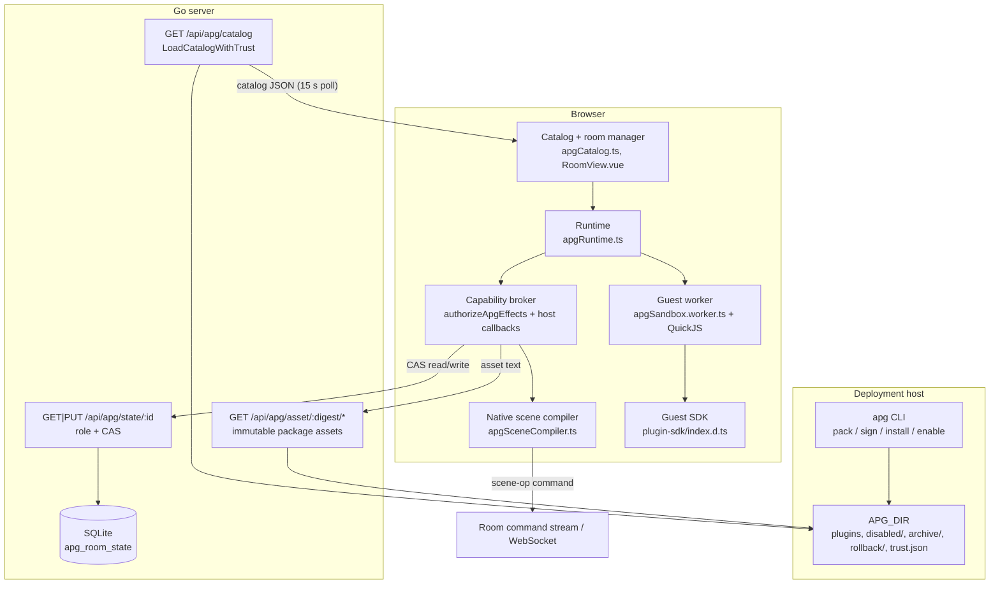

# Aevia-Plugin (APG)

APG is the plugin system for the Aevia collaborative whiteboard. It lets a deployment
extend the product with declarative UI contributions (color palettes, brush presets) and
with sandboxed JavaScript commands that can read a bounded scene snapshot, emit 1–8 native
elements (shapes, or a text caption and a sticky note) as one undo group, read/write one
room-scoped shared value, hand the user an inert text file to download, and show a short
preview.

This directory documents the system that exists in the working tree on branch
`feat/aevia-plugin`. It describes implemented behavior only. Anything aspirational is
marked **Not implemented** or **Unverified**.

## Problem statement

A whiteboard plugin system has to answer four questions without compromising the room:

1. **Who may change the running program set?** A room member must not be able to install
   code. Installation, trust, enablement and rollback belong to the deployment owner.
2. **What can guest code touch?** A plugin must not receive engine objects, DOM access,
   network access, or the ability to forge element identity. APG crosses the boundary
   with JSON only.
3. **How do drawings stay durable?** Plugin output becomes ordinary versioned scene
   operations, so replayed history does not require the plugin that produced it.
4. **How do shared values stay consistent?** Shared state uses a server-side revision
   compare-and-swap, not last-writer-wins.

## Governance model

| Actor | Can do | Cannot do |
| --- | --- | --- |
| Deployment owner (CLI + filesystem access on the server host) | Generate keys, pack/sign packages, edit the trust store, install/update/rollback/uninstall, enable/disable, choose trust policy | — |
| Room owner / editor (signed-in or guest session) | Run commands of enabled plugins, accept plugin scene output, write plugin shared state through CAS | Install code, change trust, enable a disabled package |
| Room viewer | Read the scene, receive rendered plugin output | Run commands that mutate, write shared state |
| Ordinary user (any role) | Toggle **user-scoped** contributions in their own browser | Toggle system-scoped plugins, install, affect other users |

The server never accepts a package over HTTP. The catalog is built from `APG_DIR` on each
request (`apps/backend/internal/gateway/apg_handler.go:9`), and packages only enter that
directory through the local CLI (`apps/backend/cmd/apg/main.go`).

User-scope toggles are stored in browser `localStorage` under the prefix
`aevia.apg.palette.enabled.`, keyed by the signed-in account
(`<prefix><owner>:<pluginId>`; guests use a `guest` slot) in
`apps/frontend/src/service/apgCatalog.ts`. They are not persisted to the server, so they do not
affect other participants, do not follow the account to another browser, and do not leak from
one account to the next on a shared profile.

### Scope classification rules

`scope` is mandatory in every manifest and is validated on both server and client
(`apps/backend/internal/apg/catalog.go:339`, mirrored in
`apps/frontend/src/service/apgCatalog.ts`).

| Capability | `system` | `user` |
| --- | --- | --- |
| Contribute palettes | yes | yes |
| Contribute brushes | yes | **rejected** (`user-scoped plugins cannot contribute brushes`) |
| `scene.read` | yes | yes |
| `scene.write` (shapes, text, sticky notes) | yes | **rejected** (`scene.write requires system scope`) |
| `storage.shared` | yes | **rejected** (`storage.shared requires system scope`) |
| `ui.preview` | yes | yes |
| `ui.download` | yes | yes (personal export; host writes the file, guest only supplies inert text) |
| `assets/**` command resources | yes | **rejected** (`shared assets require system scope`) |
| Per-user toggle | no (always active) | yes |

Rule of thumb: `system` means "the deployment decided this for every participant";
`user` means "read-only or cosmetic, and each participant may opt out".

### Effective permission is an intersection

A capability is usable only when **all** of these agree:

1. the manifest declares the permission and the scope allows it (validator);
2. the command actually requests it via the SDK effect (`authorizeApgEffects`);
3. the local room state allows editing (`apgCanEdit` in `apps/frontend/src/views/RoomView.vue`);
4. for shared state, the server independently re-checks plugin id + digest + `system`
   scope + `storage.shared` + room role (`apps/backend/internal/gateway/apg_state_handler.go:14`).

Nothing is granted because a client asked for it.

## Layered architecture



| Layer | Responsibility | Files |
| --- | --- | --- |
| Manager | Fetch and watch the catalog, reconcile enabled plugins, own panel state and room context | `apps/frontend/src/service/apgCatalog.ts`, `apps/frontend/src/views/RoomView.vue`, `apps/frontend/src/components/ApgPanel.vue` |
| Runtime | One worker per eligible plugin, activation, invocation, effect application, revocation | `apps/frontend/src/service/apgRuntime.ts`, `apps/frontend/src/service/apgSandbox.worker.ts` |
| Guest | QuickJS VM, frozen `apg` global, effect queue, resource budget | `apps/frontend/src/service/apgSandbox.ts` |
| Capability broker | Authorize effect JSON against permissions, scope and room role; convert scene requests | `apps/frontend/src/service/apgRuntime.ts` (`authorizeApgEffects`), `apps/frontend/src/service/apgSceneCompiler.ts` |
| Registries | Server catalog from disk; guest command/preview registry inside the VM | `apps/backend/internal/apg/catalog.go`, `apps/frontend/src/service/apgSandbox.ts` |
| SDK | Typed `apg` surface available to plugin authors | `packages/plugin-sdk/index.d.ts` |
| Server APG | Package validation, trust, immutable archive, endpoints, state table | `apps/backend/internal/apg/`, `apps/backend/internal/gateway/apg_*.go`, `apps/backend/internal/storage/apg_state.go` |

## Package and directory layout

A package is a signed ZIP with the `.apg` extension. It expands to a fixed shape
(see `docs/apg/package-spec.md`):

```text
example.apg
├── manifest.json          # required
├── main.js                # manifestVersion 2 executable only
├── signature.json         # manifestVersion 2 signature only
└── assets/<name>.json     # manifestVersion 2 system-scope command resources
```

The deployment directory layout is:

```text
$APG_DIR/
├── <id>.apg               # enabled packages
├── disabled/<id>.apg      # installed but disabled (new installs land here)
├── archive/<digest>.apg   # content-addressed copy for the asset endpoint
├── rollback/<id>.apg      # previous version saved by install/update
├── trust.json             # Ed25519 public keys
└── .apg-lock              # lock directory held by one mutating CLI command
```

## Request flow for a command

Files: `apps/frontend/src/views/RoomView.vue`, `apps/frontend/src/service/apgRuntime.ts`,
`apps/frontend/src/service/apgSceneCompiler.ts`.

1. **Trigger.** The user clicks a command button in the APG panel
   (`data-apg-command="<pluginId>:<commandId>"`) or presses the declared
   `Alt+Shift+<0-9>` shortcut. Shortcuts fire only when exactly one enabled plugin
   declares that shortcut and focus is not in an editable field.
2. **Eligibility.** `runApgCommand` rejects the call while another command runs, before
   initial scene sync, or while reconnecting. The runtime additionally requires an
   enabled, program-bearing entry whose scope is `system` or locally enabled.
3. **Activation.** The first command for a plugin creates a module worker, boots QuickJS,
   installs the frozen `apg` global, evaluates `main.js`, and runs `onActivate` hooks.
   Activation must return an empty effect list. Workers are capped at 8 active plugins.
4. **Input assembly.** The host reads only what the manifest permits: a scene snapshot
   (at most 512 elements) with `scene.read`, the room shared state with
   `storage.shared`, and the declared command resource for `system` plugins.
5. **Invocation.** The guest handler runs synchronously and pushes effects. The result is
   a JSON array of at most 16 effects, at most 64 KiB.
6. **Authorization.** `authorizeApgEffects` checks each effect against permissions, scope
   and `apgCanEdit()`. At most one mutation is allowed per invocation.
7. **Native mutation.** `compileApgSceneMutations` turns a request (one shape or 1-8
   shapes) into `SceneOperationEnvelopeV2` element creations with host-allocated ids and
   lamport, sharing one history group so a template undoes as a unit. Each operation is a
   normal `scene-op` command pushed through the ordinary room command pipeline; the
   bundle is not a server transaction.
8. **Shared state.** A `storage.shared` effect issues `PUT /api/apg/state/{id}?digest=`.
   The server checks identity, scope, role and revision atomically. The client requires
   the acknowledgement revision to be `expected + 1`; otherwise the command fails.
9. **Preview.** `ui.preview` sets a short text in the APG panel (`role="status"`).
10. **Download.** `ui.download` validates `{name, mime, text}` (safe filename, JSON/plain/
    CSV mime, at most 64 KiB) and hands inert text to the host, which builds a Blob and
    triggers a browser download. The plugin never sees a path or the filesystem.
11. **Propagation.** Scene commands travel over the normal WebSocket command stream and
    are rendered from the native descriptor by every peer and by future joiners. No peer
    needs the plugin to display the result.

Any failure disposes that plugin's worker (`catch` in `run`), surfaces
`APG 插件执行失败或权限已撤销` in the UI, and leaves the command unapplied. There is no
automatic retry for a conflicting shared-state write; the user re-runs the command.

## Failure and revocation behavior

| Situation | Behavior |
| --- | --- |
| Server cannot read trust store or catalog | Catalog request returns `503`; the client fails closed to an empty catalog |
| Package digest or signature invalid | CLI refuses install/update/enable; it never reaches the catalog |
| Plugin disabled/uninstalled while a page is open | Next 15 s poll removes it; commands disappear; its worker is disposed after `onDeactivate` |
| Room/page/role/reconnect change | Runtime clears workers and pending previews, then reconciles the current catalog |
| Guest exceeds time, memory, stack, size or effect limits | Invocation fails, worker disposed, nothing applied |
| Shared-state revision conflict | `409`, command fails, no partial scene or state effect is committed |
| Stale `.apg-lock` after a crash | Reclaimed automatically once the recorded owner PID is gone; a lock younger than 15 minutes without an owner file is respected |

## Status summary

Implemented and covered by tests: package validation, signing/trust, CLI lifecycle,
catalog endpoint and per-client endpoint budgets, sandboxed execution with limits, effect
authorization, native shape bundles and native text/sticky elements sharing one history group,
shared-state CAS with a `stateSchemaVersion` downgrade guard plus a CLI to inspect and purge
stored room state, disable/withdraw (including live re-enable in an open
room), undo/redo of a plugin template on a peer, user-scoped export downloads, late-joiner
replay (real multi-browser Lab case).

**Partly measured:** idle APG adds no first-pixel latency beyond run-to-run noise, and a
trust-verified official-plugin catalog load costs ≈2.1 ms. Plugin execution cost, memory and
larger catalogs are unmeasured. See `docs/apg/performance.md`.

**Per-item acceptance:** `docs/apg/acceptance.md`; the end-to-end handoff summary with
commands, environments and remaining gaps is `docs/apg/report.md`. The three capabilities that
are deliberately not implemented (scene images, semantic components, atomic multi-op commit)
are specified in `docs/apg/future-work.md`, with the exact files each one must touch.
**Not implemented:** a plugin marketplace, remote installation, third-party repository
subscriptions, server-persisted per-user plugin preferences, plugin hot-patching without
a catalog change, and any plugin access to network, DOM, clipboard or filesystem.

## Glossary

| Term | Meaning |
| --- | --- |
| APG | Aevia-Plugin: this package/manifest/execution system |
| Package (`.apg`) | ZIP container with manifest, optional program, signature, assets |
| Manifest | Declarative JSON describing id, scope, permissions and contributions |
| Program | `main.js`, the guest JavaScript evaluated in QuickJS |
| Contribution | Declarative output: palette, brush or command |
| Effect | JSON object a guest handler returns (`ui.preview`, `ui.download`, `scene.write`, `storage.shared`) |
| Capability | A permission plus the runtime checks that gate it |
| Digest | SHA-256 over a canonical serialization of package entries |
| Trust policy | `allow-unsigned` or `require-signed`, applied when packages are loaded |
| Trust store | JSON map of key id to base64 Ed25519 public key |
| Archive | Immutable content-addressed copy used to serve assets to peers |
| Native operation | Ordinary `SceneOperationEnvelopeV2` scene command, replayable without the plugin |
| Shared state | One JSON value per `(room, plugin)` with a monotonic revision |
| Revocation | Removal of a plugin's worker and commands because it was disabled, replaced or the context changed |
