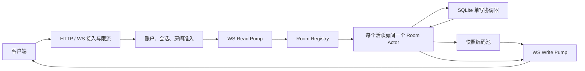

# Aevia Go 后端 v2 重构方案

## 1. 总体结论

现有“四层 goroutine”应改为“连接负责 I/O、房间负责状态、数据库负责持久化”的 actor 模型。Go 的 HTTP 服务本身已为连接创建 goroutine，无需额外设置一个串行“网关 goroutine”；固定 worker pool 只用于密码哈希、快照编码等有明确资源上限的重任务。[Go net/http](https://go.dev/pkg/net/http/?m=old)

核心所有权规则：

- 每条 WS 连接拥有一个读取 goroutine、一个写入 goroutine和有界邮箱；不存在“用户线程池”。
- 每个活跃房间只有一个 `RoomActor` 能修改房间状态、命令、成员在线态、页状态、`roomSeq` 和点级索引。
- 用户可以多端连接；状态按连接保存，在线成员按用户去重。
- 鉴权模块只管理账户、会话、准入和权限版本，不解析或修改白板业务状态。
- SQLite 使用 WAL、一个写连接和有限读连接；WAL 允许读写并行，但 SQLite 的常规写入仍应视为单写者模型。[SQLite WAL](https://sqlite.org/wal.html)

## 2. 并发、状态与持久化设计

### 房间与连接 actor

- `RoomRegistry` 仅负责通过 `roomId` 查找或创建 actor，短时互斥后立即释放，不持有业务锁。
- `RoomActor` 的邮箱分为可靠控制/持久事件与可丢弃实时事件；所有队列有消息数和字节数上限。
- 游标、框选等事件采用 latest-wins 合并；队列拥塞时优先丢弃旧实时事件。
- 白板命令不可静默丢弃；可靠队列溢出时返回 `SERVER_BUSY`，慢客户端可靠发送队列溢出时发送 `resync.required` 并以 1013 断开。
- 连接状态固定为 `SYNCING → ACTIVE → DRAINING → CLOSED`。同一设备重连时递增 `connectionEpoch`，actor 拒绝旧连接迟到的数据；不同设备拥有独立会话和 epoch。
- 房间无连接、无待提交写入、无快照任务满 10 分钟后卸载；页面无订阅满 5 分钟后可单独释放。

### 全局点级序列

- 点序继续按 `(lamport, commandId, pointIndex)` 排序，客户端 Lamport 语义保持不变。
- 新增服务端 `roomSeq`，仅表示房间状态事件的接收、恢复和确认顺序；游标等瞬时事件不消耗 `roomSeq`。
- 不再维护一个每次更新都全量过滤并排序的房间数组。由于客户端只渲染当前页，改为每页维护 `PagePointIndex`；按页过滤后的顺序与原全局序列一致。
- 索引采用约 2000 点的有序块：正常追加只修改尾块，乱序点通过二分定位后局部合并/分裂。命令移动或替换只重建受影响页面和命令的引用。
- `Command` 作为不可变版本对象保存；更新时替换对象，点索引保存 `commandId + pointIndex`，撤销/重做只更新命令元数据。
- 快照由 actor 捕获 `{roomSeq, pageRevision, immutable command pointers, point block pointers}`，编码池只读这些数据，不跨 goroutine 修改房间状态。
- 初始化和换页继续保留“当前页渲染点 + 相邻页命令”的窗口模型。连接在 `SYNCING` 期间缓存 `roomSeq > snapshotSeq` 的增量，快照完成后按序释放；缓存溢出则重新同步。
- 房间维护最多 30 秒且受 64 MiB 单房间、512 MiB 全局限制的增量环形缓冲。断线位置仍在缓冲内时增量恢复，否则下发新快照。

### 混合持久化

- `stroke.start`、`stroke.append`：actor 立即应用并广播，返回 `ack.accepted`；写协调器每 5 ms 或累计 128 项执行一次事务，并按 `commandId` 合并为最新完整状态。
- `stroke.finish`、撤销、重做、删除、移动、批量替换、清屏、加页、权限变更：作为写屏障，先提交该房间此前的全部写入，再广播并返回 `ack.committed`。
- SQLite 写事务同时更新命令状态、`durableSeq` 和需要持久幂等的操作回执；客户端在收到 `committed` 前保留待确认操作。
- `stroke.append` 必须携带 `fromPointIndex`。小于服务端长度时按重复包处理，大于服务端长度时拒绝并要求补包/重同步，避免重连重复追加。
- 移动、批量替换等非幂等操作携带 `opId` 和预期 `commandRevision`；屏障操作回执持久保存，避免“提交成功但确认丢失”导致重复执行。
- 数据库写失败后房间进入 `DEGRADED_READ_ONLY`，停止接受新的白板修改并通知客户端重同步；游标和读取仍可工作。就绪探针同时变为失败。
- 使用 `journal_mode=WAL`、`foreign_keys=ON`、`synchronous=NORMAL`，空闲期执行受控 checkpoint 并监控 WAL 大小。

## 3. v2 公共接口、鉴权与权限

### 账户与房间准入

新增接口：

- `POST /v2/auth/register`、`/login`、`/refresh`、`/logout`
- `POST /v2/rooms`：创建房间，创建者成为 owner。
- `POST /v2/rooms/{roomId}/admission`：每次进入房间验证房间密码，保留已有成员角色并签发短期 room grant。
- `POST /v2/rooms/{roomId}/ws-ticket`：使用 room grant 换取 30 秒、一次性的非 JWT WS ticket。
- `GET /v2/rooms/{roomId}/members`、`/pages`
- `PATCH /v2/rooms/{roomId}/members/{userId}`：owner 晋升/降级成员。
- `POST .../kick`、`.../ban`、`.../unban`
- `PATCH /v2/rooms/{roomId}/role-policies/{role}`：owner 修改 admin/participant 的 capability。

账户访问 JWT 默认 15 分钟；刷新令牌默认 30 天，以哈希形式保存到 `auth_sessions`。JWT 必须同时通过签名、账户状态、会话撤销状态和 `tokenVersion` 校验。账户及房间密码使用 Argon2id，并通过有界哈希池限制并发，防止登录请求耗尽 CPU/内存。[Go Argon2](https://pkg.go.dev/golang.org/x/crypto/argon2)

房间准入规则：

- `room_members` 长期保存角色和封禁状态，但每次新的房间访问都重新验证房间密码。
- 同一次 room grant 内的刷新、页面重载和短线重连无需重新输入密码；主动离开、grant 过期或被踢后需要重新验证。
- kick 会关闭连接并撤销 grant，但用户可重新凭密码加入；ban 在解除前禁止再次加入。
- 修改房间密码只影响后续准入，不主动踢出现有用户。

### 权限模型

固定角色为 `owner / admin / participant`，授权通过可扩展 capability 表实现：

- `owner`：隐式拥有全部能力。
- `admin` 默认拥有 `board.view`、`board.edit`、`members.moderate_participants`，只能踢出或封禁 participant。
- `participant` 默认拥有 `board.view`、`board.edit`。
- 第一版 owner 可分别开关 admin 和 participant 的 `board.edit`。
- 只有 owner 能修改管理员、角色策略、房间密码及安全设置。
- 每种 WS 持久事件声明所需 capability，actor 在执行时再次校验，不能只依赖握手时的权限。
- 后续增加 `board.erase`、`board.clear`、`page.add` 等能力时只新增 capability 和事件映射，不修改角色或连接架构。
- 编辑权限在绘制中途被撤销时，只允许已经开始的笔迹发送一次受大小限制的 `stroke.finish`，其余修改立即拒绝。

### WS v2 协议

- 子协议固定为 `aevia.v2`；一次性 ticket 用于升级认证，不再把 JWT 塞入 `Sec-WebSocket-Protocol`。
- 低频控制消息使用 JSON envelope：`v、type、opId、clientSeq、pageId、payload`。
- 游标、点增量和快照块使用带 magic/version/type/length 的二进制帧。
- `clientSeq` 在单连接内严格递增；`opId` 用于跨重连幂等；服务端响应携带 `roomSeq` 和必要时的 `durableSeq`。
- 事件命名统一为 `stroke.start/append/finish`、`command.undo/redo/delete/moveBatch/replaceBatch`、`cursor.update/leave`、`selection.update`、`page.add/subscribe`。
- 服务端响应统一为 `snapshot.*`、`ack.accepted/committed/rejected`、`presence.changed`、`policy.changed`、`resync.required`、`server.draining`。

## 4. 网关、背压与性能控制

- 使用 `net/http`、`github.com/coder/websocket`、`database/sql + modernc.org/sqlite`；后两者分别提供上下文、消息读取上限和无 CGO SQLite 驱动能力。[coder/websocket](https://pkg.go.dev/github.com/coder/websocket)、[modernc SQLite](https://pkg.go.dev/modernc.org/sqlite)
- 每连接设置 256 KiB 入站消息上限，并限制点数、批量命令数、字符串长度及所有数值必须有限；未知字段和版本直接拒绝。
- 限流按全局、IP、账户、连接、房间和事件类别分层；默认全局连接硬上限 6000、单账户同房间最多 8 条连接。
- 游标默认 60 次/秒并合并，绘制增量允许短时突发，房间持续速率以 10000 入站事件/秒为目标；过载时先降级瞬时事件，再拒绝持久事件。
- 每连接只有 write pump 写 socket；可靠队列按字节计量，瞬时队列按 `(eventType,userId)` 保留最新值，actor 永不等待网络发送。
- 热路径二进制帧不启用 WebSocket 压缩；依靠紧凑编码降低带宽，避免 5000 连接下的压缩 CPU 峰值。
- HTTP 设置 header/read/write/idle timeout、请求体上限、Origin allowlist；登录和房间密码验证使用单独限流与哈希并发池。
- 暴露连接数、活跃房间、actor 队列等待、丢包/拒绝原因、DB 批次与提交延迟、快照耗时/大小/缓存命中、恢复命中率、堆和 GC 指标；提供 `/health/live`、`/health/ready`，pprof 仅绑定管理地址。
- 优雅停机时停止升级、进入 draining、刷新所有写屏障、发送 1001、等待最多 10 秒后关闭。

## 5. 实施顺序与验收

1. 在 `apps/backend-go` 并行建立 Go module、配置、结构化日志、迁移器和 v2 协议 golden vectors；当前机器尚未安装 Go，实施前先补齐 Go 工具链。
2. 建立全新 SQLite schema：`users`、`auth_sessions`、`rooms`、`room_members`、`room_role_capabilities`、`commands`、`operation_receipts`；项目未上线，直接使用空 v2 数据库，不迁移旧数据。
3. 完成账户、房间准入、角色策略及一次性 WS ticket，再实现连接 read/write pump、限流和慢客户端处理。
4. 实现 `RoomActor`、页面惰性加载、命令版本、点级块索引、`roomSeq`、同步状态机和增量恢复。
5. 接入 SQLite 写协调器、5 ms 微批、持久化屏障、故障降级与快照编码池。
6. 同步修改前端 v2 transport、账户/房间进入流程、确认重试、权限 UI 和快照协议；不实现 v1/v2 兼容适配器。
7. 功能、竞态和容量验收通过后，切换根脚本到 Go 服务并删除 Node 后端。

验收必须覆盖：

- `go test -race ./...` 无数据竞态、死锁和 goroutine 泄漏。
- 同房间多用户并发 start/append/finish、撤销/删除/移动时顺序确定，点级快照与实时客户端最终一致。
- DB 屏障前进程崩溃最多丢失微批窗口内未完成笔迹；收到 `ack.committed` 的操作在重启后仍存在。
- 确认丢失、重复发送、点索引缺口、旧 connection epoch、权限中途撤销均不会重复修改状态。
- 慢客户端、队列溢出、超大帧、非法数值、JWT 撤销、用户禁用、kick/ban、数据库 busy/失败均有确定行为。
- 换页请求竞态只发送最新 generation，快照期间的增量无丢失、无重复；环形缓冲缺口自动退化为全量快照。
- 8 核/16 GB Linux 下通过 5000 总连接、单房间 1000 人、持续 10000 入站事件/秒压测；实时转发 p99 ≤ 50 ms，持久化屏障 p99 ≤ 150 ms，所有队列和内存保持有界。
