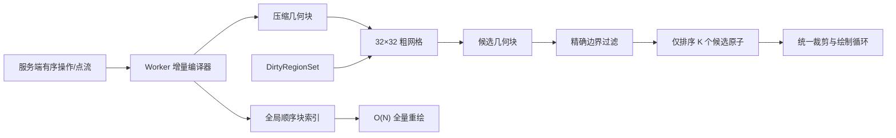

# Aevia 产品能力与统一场景引擎完善方案

## 1. 结论与性能边界

你的担忧成立：如果每次脏区重绘都执行“遍历全部命令 → 找相交片段 → 重新扁平化 → 全局排序 → 裁剪绘制”，这条路径不可接受。

当前实现已经暴露出三个问题：

- Worker 会遍历全部命令筛选候选，并可能再次遍历候选笔迹；重绘某条长笔迹末端时，还会从第一个点重建笔迹状态。[canvasWorker.ts](C:/Users/ASUS/Desktop/code/web/collaborative-whiteboard/apps/frontend/src/workers/canvasWorker.ts:597)
- 主线程回退路径会扫描全量 `lastSortedPoints`，或者按命令逐条绘制，前者是 `O(N)`，后者无法严格复现跨命令的点级交错顺序。[canvas.ts](C:/Users/ASUS/Desktop/code/web/collaborative-whiteboard/apps/frontend/src/service/canvas.ts:361)
- 现有 10 万点全量渲染的稳定时间预算约为 109–285ms，显然不能作为拖动、擦除等交互中的逐帧成本。[budgets.json](C:/Users/ASUS/Desktop/code/web/collaborative-whiteboard/apps/frontend/tests/e2e/external/budgets.json)

因此修改原计划：

| 路径 | 禁止的方案 | 新方案 |
|---|---|---|
| 场景加载 | 客户端重新收集并排序全部点 | 消费服务端已有的有序流，边接收边编译 |
| 脏区重绘 | 扫描全部命令或点 | 粗网格查询几何块 |
| 几何准备 | 每次重绘临时扁平化 | 每个采样点只在进入场景时编译一次 |
| 层级恢复 | 对全部点重新排序 | 只排序脏区内的 `K` 个候选原子 |
| 密集脏区 | 强行局部重绘 | 达到阈值后主动切换全量重绘 |

复杂度目标：

- 当前坏路径：`O(N)` 筛选，最坏加 `O(N log N)` 排序和长笔迹前缀重放。
- 新的局部路径：`O(G + S×B + K log K + draw(K))`。
  - `G`：脏区覆盖的网格数。
  - `S`：候选几何块数。
  - `B`：单块内原子上限。
  - `K`：真正与脏区相交的渲染原子数。
- 全量重绘：直接遍历已排序索引，`O(N + draw(N))`，不再重新扁平化或排序。
- 当区域本身很密、`K≈N` 时，没有算法能避免接近全量绘制；这时明确切换全量路径。

## 2. 统一场景、顺序与空间索引

### 统一操作模型

引入不可变的 `SceneOperationEnvelopeV2`：

- 公共字段：`schemaVersion: 2`、`opId`、`elementId`、`actorId`、`roomId`、`pageId`、`lamport`、`historyGroupId`、`kind`、`payload`。
- 操作类型包括：
  - `element.create`
  - `element.append`
  - `element.transform`
  - `element.erase`
  - `element.delete`
  - `text.patch`
  - `history.toggle`
  - `page.clear`
- 移动、缩放、旋转、擦除和删除都追加新操作，不再修改旧命令、旧点或数据库中的历史记录。
- `RenderOrderKey` 固定为 `(lamport, opId字节序, sourceIndex, subIndex)`；前后端及 Worker 共享等价比较规则。
- 多选变换在一个操作中携带多个目标及各自的 `deltaMatrix`，保证原子提交和原子撤回。

### 一次编译的渲染原子

`RenderAtom` 是逻辑概念，不实现成“每个点对应一个重型 JS 对象”：

- 笔迹采样增量编译成自包含的二次曲线段，保存端点、控制点、宽度、样式和顺序键。
- 每个曲线段无需从笔迹起点恢复状态，可以直接独立绘制。
- 收笔时产生尾部原子，使用最后一个采样点的顺序键和稳定的 `subIndex`。
- 文字按字素生成 glyph 原子；插件工具也必须编译成同一组公共图元。
- 原子存放在紧凑的 `GeometryChunk` 中，网格和顺序索引只保存数字引用。
- Worker 不再保留第二份完整扁平点数组；Canvas 丢失或尺寸变化时直接重放已编译原子。

### 顺序索引

复用后端 `PagePointIndex` 的分块思想，但不把服务端代码或区域查询搬到客户端：

- `RenderOrderIndex` 使用约 2000 个原子引用为一块的有序块。
- 服务端初始化流本身已有严格顺序，客户端以尾部追加方式构建索引，摊销 `O(1)`。
- 少量乱序到达通过“定位块 → 块内二分插入 → 超限分裂”处理。
- 全量重绘顺序扫描这些块，不创建临时数组、不排序。
- 局部重绘只对查询得到的 `K` 个原子引用使用统一比较器排序；暂不引入 LSM Tree 或复杂的多路归并，除非基准证明候选排序已成为主要瓶颈。

### 粗网格索引

采用你的网格建议，但索引“空间连续的几何块”，不索引整条命令，也不为每个点创建独立桶记录：

- 页面使用归一化坐标下的 `32×32` 固定网格，首版不引入四叉树。
- `GeometryChunk` 最多保存 64 个相邻原子，并限制其覆盖不超过 8 个普通网格；超过任一条件即切块。
- 单个超大图元覆盖超过 64 个网格时进入 `largePrimitiveList`，避免在大量桶中重复登记。
- 网格桶保存 `chunkId`；查询阶段通过 generation marker 去重，不临时创建大量 `Set`。
- 命中候选块后仍进行精确原子 AABB、OBB或逆矩阵几何检测，网格只负责粗筛。
- 变换预览期间不逐帧更新永久网格：直接使用已选元素的 chunk 列表绘制预览；提交后一次性更新网格。
- 擦除和历史隐藏可以保留保守空间记录，在查询后过滤有效状态，避免频繁删除、插入索引。

### 脏区调度

- `DirtyRegionSet` 保留最多 8 个互不相交的矩形，不再无条件合成一个巨大 AABB。
- 变换使用旧位置和新位置两个脏区，不使用包含整段移动距离的大矩形。
- 旋转元素使用 OBB/逆矩阵命中；AABB仅用于网格粗筛和 Canvas 裁剪。
- 满足任一条件时切换全量重绘：
  - 合并后的脏区覆盖画布达到 35%；
  - 候选原子达到当前可见原子的 40%；
  - 同帧无法保持在 8 个脏矩形以内。
- 服务端继续负责初始化顺序流，不增加按区域拉取接口；交互中的区域请求会引入网络延迟、序列化开销和第二套空间索引，收益不足。

## 3. 产品功能与协同语义

### 选择、移动与变换重做

- 删除未提交实验中 `previousPoints`、`pathBases`、直接替换历史点等设计，不复用其结构或处理链。
- 点击选择按渲染顺序逆序进行精确命中，返回最上层元素；框选使用精确几何相交结果。
- 支持单选、多选、移动、八方向缩放和旋转。
- 拖动期间只维护临时矩阵和预览层；松手后提交一个不可变 `element.transform`。
- 并发变换按统一顺序组合矩阵，所有客户端得到相同结果。
- 变换操作属于历史组，可撤回、重做；撤回只切换操作有效性，不恢复或覆盖旧点数组。

### 真正的擦除

- 橡皮轨迹不再成为可选择、可移动的白色笔迹。
- 擦除时通过网格找到候选目标，在操作发起端执行一次精确求交：
  - 对笔迹、虚线、双线等路径类图元记录稳定 `atomId` 和量化后的参数切除区间。
  - 对文字、贴纸、填充形状首版采用整元素擦除，避免引入昂贵且难维护的任意布尔裁剪。
- 参数区间使用整数定点表示，排序、合并和舍入规则固定；协同端直接应用显式结果，不重复执行浮点求交。
- 后续移动、缩放和旋转只作用于未被切除的局部几何，被擦除部分不会重新出现。
- 撤回擦除通过 `history.toggle` 恢复，重做再次隐藏相同区间。
- 并发或延迟到达的新笔迹段不会被旧擦除自动命中；擦除只影响其创建时显式记录的目标原子。

### 工具体系

所有工具共用 SceneEngine、顺序索引、空间索引、脏区、变换和历史系统。工具只负责输入解释与公共图元编译。

首轮工具集：

- 自由绘制：钢笔、铅笔、荧光笔。
- 轨迹样式：实线、虚线、点线、点划线、双线。
- 形状：直线、箭头、矩形、圆角矩形、椭圆。
- 内容：文字、便签、Emoji/内置贴纸。
- 编辑：选择、框选、移动、缩放、旋转、路径擦除、对象擦除。

暂不加入图片上传和任意第三方插件执行，因为它们还涉及资源存储、安全及版本分发；但接口为其保留。

工具注册接口拆为：

- `ToolDefinition`：工具栏信息、输入策略、属性面板定义。
- `PrimitiveCompiler`：把操作增量编译成公共图元。
- `PrimitiveRecipe`：有限的共享类型，如 stroke、shape、glyph、bitmap。
- `SceneEngine`：统一负责折叠、排序、查询、绘制、命中和脏区。

新增工具如果能映射到现有公共图元，不新增渲染管线；真正的新图元类型才需要增加一个独立 recipe executor。

### 文字与跨类型交错层级

- 文本内容使用按字素的 RGA/墓碑模型，不按 UTF-16 code unit 拆分。
- 每个字素保留自己的插入顺序键和 glyph 原子；当前排版只改变 glyph 的几何位置，不改变其历史层级。
- 较早笔迹的前半段可以位于文字下方，同一笔迹稍后产生的曲线段可以覆盖文字，严格复现当前扁平点序列的交错效果。
- 形状、贴纸等原子型内容作为一个整体参与顺序；未来流式插件可以产生多个带独立顺序键的原子。
- 使用项目内固定字体资源和量化排版坐标，避免不同系统字体造成明显布局漂移。
- 连续输入以 750ms 为本地撤回组；切换光标、样式、工具、IME提交或收到“同一个文本元素”的远端修改时关闭分组。无关远端操作不会打断本地文本组。

### 撤回重做和清空

- 每次笔迹、擦除手势、变换手势、形状创建、贴纸创建和页面清空分别形成历史组。
- Undo/redo追加 `history.toggle`，不修改或删除目标操作。
- 用户默认只撤回自己的历史组；其他用户的操作不进入本地撤回栈。
- 撤回元素创建时，引用它的后续变换和擦除保留但暂时无效；重做创建后重新按当前有效操作折叠。
- `page.clear` 只隐藏其顺序之前的页面元素；之后创建的元素保留，清空本身可撤回。
- 任意历史切换都由 SceneEngine 返回受影响元素的旧、新脏区；影响范围过大时主动全量重绘。

### 协议与后端职责

- Go 后端只验证、排序、持久化和广播操作，不实现画笔、文字排版、求交或裁剪算法。
- 网关严格检查 `schemaVersion`、操作类型、必要字段、数值范围及 `recipeId` 能力。
- 不支持的协议版本返回 `op-rejected: UPGRADE_REQUIRED`；不支持的 recipe 返回明确能力错误，不静默降级。
- 现有 V1 数据通过单一兼容适配器投影成 V2 场景操作；新写入只产生 V2，不保留两套渲染引擎。
- 旧客户端在 V2 切换后必须升级，避免旧客户端写入无法表达变换、擦除和历史语义的数据。

## 4. 实施顺序

1. 建立正确性与性能基线  
   固化当前全量渲染截图、交错顺序、10k/50k/100k性能和内存数据；识别并隔离未提交的失败变换实验，保留其他无关用户修改。

2. 建立只支持现有钢笔的 SceneEngine 骨架  
   完成增量编译、紧凑几何块、顺序块和粗网格；让全量与脏区共用同一绘制循环。此阶段必须证明小脏区成本随 `K` 而非 `N` 增长。

3. 替换旧渲染数据流  
   初始化时直接消费服务端有序块，删除 Worker 重新 `flattenCommands` 的职责；主线程回退路径复用相同的纯场景核心，不再维护另一套筛选逻辑。

4. 引入 V2 不可变操作和统一历史  
   完成协议校验、持久化适配、场景折叠、所有操作的撤回重做及 V1 数据读取兼容。

5. 重做选择、变换和擦除  
   先完成精确命中与矩阵变换，再加入显式量化切除；完全移除直接修改旧命令点数组的路径。

6. 扩展产品工具  
   依次加入铅笔/荧光笔、线型、基础形状、文字、便签和贴纸；每一种工具都必须通过现有公共图元和同一验收套件。

7. 默认启用并删除遗留路径  
   只有在一致性、脏区像素对比、现有性能预算和新局部重绘预算全部通过后，才移除旧扁平化重绘与特殊橡皮管线。

## 5. 测试、验收与默认约束

### 正确性

- 同一组操作以不同网络到达顺序重放，Scene hash、有效原子顺序和最终截图一致。
- 脏区重绘结果与“同一时刻全量重绘后裁剪该区域”的结果一致。
- 覆盖持续绘制笔迹、其间插入文字、笔迹后半段再次穿过文字的交错案例。
- 覆盖并发变换、变换撤回、擦除后变换、擦除撤回、删除后重做、页面清空撤回。
- 覆盖旋转元素的 OBB 命中、透明形状、虚线间隙、双线和高亮混合模式。
- 擦除输出进行确定性哈希测试；禁止随机数、依赖对象遍历顺序或未固定的浮点舍入。
- 未知 schema、recipe、非法矩阵、非法切除区间必须被后端拒绝。

### 性能

新增 `dirty-replay` 基准，场景包含：

- 10k、50k、100k 稀疏笔迹和固定小脏区。
- 单条跨越全页的超长笔迹。
- 大量笔迹集中于一个热点。
- 大型旋转形状及大量小贴纸。
- 连续拖动、擦除、文本输入、历史切换和页面清空撤回。

验收条件：

- 在候选 `K` 基本不变的稀疏场景中，100k 相比 10k 的查询加排序 p95 不得超过 2 倍。
- 小脏区重绘中位耗时至少比同场景全量重绘快 3 倍。
- 100k 场景的 Worker 稳态内存不得超过现有基线的 1.5 倍；超出则在上线前进一步压缩 chunk 和索引引用。
- 所有现有 `full-render`、远端首像素和本地首像素预算继续通过。
- 密集区域触发全量回退属于预期行为，但不得在拖动过程中反复来回切换。
- 主线程不得因索引查询、排序或几何裁剪产生超过 50ms 的长任务。

### 默认约束

- 服务端不增加区域渲染查询，也不承担产品几何算法。
- 初版采用粗网格，不引入四叉树、R-Tree、LSM Tree或瓦片位图缓存。
- 逻辑上保留点级/字素级 RenderAtom，物理上使用紧凑几何块，避免对象和索引记录爆炸。
- 非路径元素初版使用对象擦除；任意填充区域布尔裁剪不在本轮范围。
- 插件接口只预留注册和能力校验，不在本轮加载或执行第三方代码。
- 未提交的失败变换实现仅作为反例，不复用其数据结构、变换协议或旧点回写逻辑。
